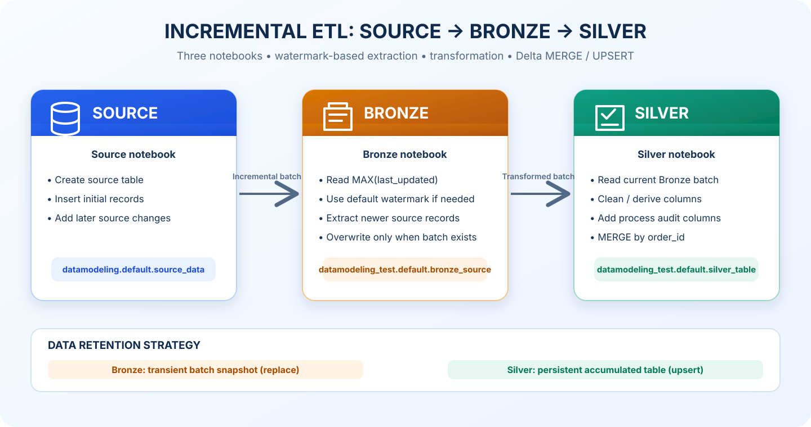
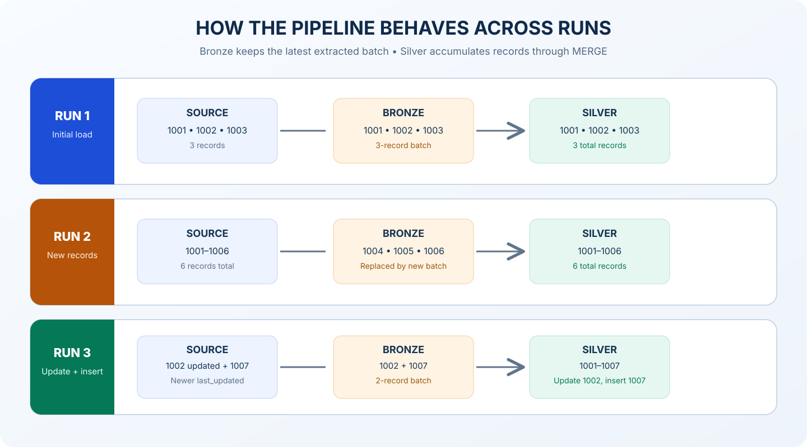

# End-to-End Incremental ETL Pipeline in Databricks

## Source → Bronze → Silver

> **Scope of this chapter:** Build and test an end-to-end incremental ETL pipeline using a source table, a transient Bronze batch table, and a persistent Silver table. The Gold layer and dimensional modelling are intentionally excluded; they belong to the next chapter.

---

## 1. Learning objectives

By completing this practical, you will be able to:

1. Create a source table and load an initial set of records.
2. Understand the responsibilities of the Source, Bronze, and Silver layers.
3. Build a watermark-based incremental extraction process.
4. Use a default watermark when the Bronze table does not exist or has no valid date.
5. Keep Bronze as a transient snapshot of the latest extracted batch.
6. Apply basic Silver transformations and audit columns.
7. Create a Silver Delta table on the first run and use `MERGE` / `UPSERT` on later runs.
8. Test the pipeline across multiple executions, including both inserts and updates.

## 2. Concepts and layer responsibilities

### 2.1 ETL

ETL stands for **Extract, Transform, Load**.

- **Extract:** Read data from the source system.
- **Transform:** Clean, standardise, enrich, or derive data.
- **Load:** Write the resulting data into the target layer.

### 2.2 The three layers in this practical

| Layer | Responsibility in this practical | Data behaviour |
|---|---|---|
| Source | Holds the original operational-style records. | Source of truth for this exercise. New and changed records are added here. |
| Bronze (staging) | Extracts records newer than the current watermark. No business transformation is performed here. | **Transient:** the table is overwritten with the latest non-empty incremental batch. |
| Silver (transformation) | Cleans and enriches the Bronze batch, then applies it to the target table. | **Persistent:** old records are retained; matching keys are updated and new keys are inserted. |

The handwritten notes describe the broader ETL layers as staging, transformation, and serving. They also associate the Medallion terms as Raw → Bronze, Enriched → Silver, and Curated → Gold. This practical stops after Silver; the serving/Gold and dimensional-modelling work is outside this chapter.

### 2.3 Transient staging vs persistent staging

- A **transient staging area** is replaced or refreshed as part of each load cycle. This practical uses that approach for Bronze.
- A **persistent staging area (PSA)** retains received data across load cycles rather than truncating or replacing it after every cycle.

Do not confuse the two patterns. Here, Bronze is deliberately configured as a latest-batch snapshot, while Silver is the accumulated table.



## 3. Databricks workspace and table organisation

Keep notebooks and tables conceptually separate:

- A **Workspace folder** organises project assets such as notebooks and files.
- A **Catalog** is the top-level namespace for governed data assets.
- A **Schema** groups tables and other objects inside a catalog.
- A **Table** stores the actual structured data.

This practical uses the following names. Create or select the catalogs and schemas in your own Databricks workspace before running the notebooks.

| Purpose | Fully qualified table name |
|---|---|
| Source | `datamodeling.default.source_data` |
| Bronze | `datamodeling_test.default.bronze_source` |
| Silver | `datamodeling_test.default.silver_table` |

Suggested workspace notebook folder:

```text
Source_Bronze_Silver_ETL/
│
├── 01_Source_Setup
├── 02_Bronze_Incremental_Load
└── 03_Silver_Transform_Merge
```

The notebook names are a suggested organisation; the fully qualified table names above are the names used by the code in this guide.

## 4. Pipeline overview

### Notebook responsibilities

| Notebook | Main responsibility | Output |
|---|---|---|
| `01_Source_Setup` | Create the source table and insert source records. | `source_data` |
| `02_Bronze_Incremental_Load` | Read the Bronze watermark, extract newer source rows, and overwrite Bronze with a non-empty batch. | `bronze_source` |
| `03_Silver_Transform_Merge` | Transform Bronze rows and create or merge the Silver target. | `silver_table` |

### Execution sequence

1. Run the Source notebook to create the table and insert the initial three records.
2. Run the Bronze notebook. On the first run, the Bronze table does not exist, so the default watermark is used and all initial source records are extracted.
3. Run the Silver notebook. It creates the Silver table from the transformed Bronze batch.
4. Insert additional records into the Source table.
5. Run Bronze again. It extracts only records newer than the Bronze watermark and replaces the Bronze batch.
6. Run Silver again. It merges the batch into Silver, preserving earlier records.
7. Optionally update an existing source record and insert another one to prove that the Silver `MERGE` both updates and inserts.

## 5. Notebook 1 — Source setup

### 5.1 Create the source table

Run this in a Databricks SQL cell. The column list follows the source schema used in the practical.

```sql
%sql
CREATE SCHEMA IF NOT EXISTS datamodeling.default;

CREATE TABLE IF NOT EXISTS datamodeling.default.source_data
(
    order_id INT,
    order_date DATE,
    customer_id INT,
    customer_name VARCHAR(100),
    customer_email VARCHAR(100),
    product_id INT,
    product_name VARCHAR(100),
    product_category VARCHAR(50),
    quantity INT,
    unit_price DECIMAL(10, 2),
    payment_type VARCHAR(50),
    country VARCHAR(50),
    last_updated DATE
)
USING DELTA;
```

**Key used by the pipeline:** `order_id` is the logical business key used to match records during the Silver `MERGE`. Do not assume that declaring a key in a table automatically prevents duplicate values. Make sure the source batch contains one row per `order_id` before merging.

### 5.2 Insert the initial three records

Run this once for the initial load. If you rerun the insert cell, the same sample records will be inserted again unless you clear the table first or use a duplicate-safe loading approach.

```sql
%sql
INSERT INTO datamodeling.default.source_data
VALUES
(
    1001, '2026-01-10', 101, 'Arun Kumar', 'arun@gmail.com',
    501, 'Laptop', 'Electronics', 1, 55000.00,
    'Credit Card', 'India', '2026-01-10'
),
(
    1002, '2026-01-11', 102, 'Priya Sharma', 'priya@gmail.com',
    502, 'Smartphone', 'Electronics', 2, 25000.00,
    'UPI', 'India', '2026-01-11'
),
(
    1003, '2026-01-12', 103, 'John David', 'john@gmail.com',
    503, 'Office Chair', 'Furniture', 1, 8500.00,
    'Debit Card', 'USA', '2026-01-12'
);
```

### 5.3 Verify the source data

```sql
%sql
SELECT *
FROM datamodeling.default.source_data
ORDER BY order_id;
```

Expected initial source count: **3 records**.

## 6. Notebook 2 — Bronze incremental load

### 6.1 Bronze layer logic

Bronze is the staging layer in this practical. It does not perform the customer-name or business transformations. Its job is to identify the latest extracted records from the Source table.

The watermark is the maximum `last_updated` value currently stored in Bronze:

- If the Bronze table does not exist, begin with the default date `1800-01-01`.
- If the Bronze table exists and has a valid `last_updated` value, use that maximum date.
- If the table exists but `MAX(last_updated)` is `NULL`, keep the default date.
- Extract Source rows where `last_updated` is greater than the watermark.
- Overwrite Bronze only when the incremental batch contains records. If there are no new records, leave the previous Bronze snapshot in place so that its watermark is not lost.

### 6.2 PySpark implementation

Run this in the Bronze notebook.

```python
from datetime import date
from pyspark.sql import functions as F

source_table = "datamodeling.default.source_data"
bronze_table = "datamodeling_test.default.bronze_source"

# Default watermark for the first execution
last_load = date(1800, 1, 1)

# Confirm that the source table is available
if not spark.catalog.tableExists(source_table):
    raise ValueError(f"Source table does not exist: {source_table}")

# Get the latest watermark from the existing Bronze table
if spark.catalog.tableExists(bronze_table):
    max_date_row = (
        spark.table(bronze_table)
        .agg(F.max("last_updated").alias("max_last_updated"))
        .first()
    )

    if max_date_row["max_last_updated"] is not None:
        last_load = max_date_row["max_last_updated"]

print(f"Last successful Bronze watermark: {last_load}")

# Read the source and extract only newer records
source_df = spark.table(source_table)

bronze_batch = source_df.filter(
    F.col("last_updated") > F.lit(last_load)
)

# Replace Bronze only when the new batch is not empty
batch_count = bronze_batch.count()

if batch_count > 0:
    (
        bronze_batch.write
        .format("delta")
        .mode("overwrite")
        .option("overwriteSchema", "true")
        .saveAsTable(bronze_table)
    )

    print(f"Bronze table overwritten with {batch_count} new records.")
else:
    print("No new records found. Existing Bronze snapshot was retained.")
```

### 6.3 Inspect the Bronze table

```python
if spark.catalog.tableExists(bronze_table):
    bronze_check = spark.table(bronze_table)
    display(bronze_check.orderBy("order_id"))
else:
    print("Bronze table has not been created yet.")
```

On the first run, the default watermark allows the three initial records to be extracted. Bronze is then created with those three records.

### 6.4 Why use `first()` here instead of `collect()[0][0]`?

Both can retrieve a scalar from a one-row aggregation result. The code above uses `.first()` and the column name (`max_last_updated`) so that the intention is easier to read. If using the earlier pattern:

```python
res = spark.sql("""
    SELECT MAX(last_updated)
    FROM datamodeling_test.default.bronze_source
""").collect()[0][0]
```

- `collect()` returns the query result rows as a Python list.
- `[0]` selects the first row.
- The next `[0]` selects the first column in that row.
- `res is None` checks whether the returned Python value is null. Use Python `is None`, not `.isNull()` on a Python date value.

## 7. Notebook 3 — Silver transformation and MERGE / UPSERT

### 7.1 Silver layer logic

Silver is the transformation layer in this practical. It reads the latest Bronze batch, applies the selected transformations, and merges those rows into a persistent Silver table.

The transformations used here are:

- `process_date`: date on which the Silver processing runs.
- `process_timestamp`: timestamp at which the Silver processing runs.
- `upper_name`: an uppercase version of `customer_name`.

The original `customer_name` column is retained. The uppercase value is added as a separate derived column.

### 7.2 Read Bronze and transform the data

```python
from pyspark.sql import functions as F

bronze_table = "datamodeling_test.default.bronze_source"
silver_table = "datamodeling_test.default.silver_table"

if not spark.catalog.tableExists(bronze_table):
    raise ValueError(f"Bronze table does not exist: {bronze_table}")

bronze_src = spark.table(bronze_table)

silver_src = (
    bronze_src
    .withColumn("process_date", F.to_date(F.current_timestamp()))
    .withColumn("process_timestamp", F.current_timestamp())
    .withColumn("upper_name", F.upper(F.col("customer_name")))
)

display(silver_src)
```

### 7.3 Create the Silver table on the first run; MERGE on later runs

This uses the Delta Lake Python API. `DeltaTable.forName()` accesses the existing target Delta table. The merge condition uses `order_id` as the matching key.

```python
from delta.tables import DeltaTable

# Avoid merging an old Bronze snapshot when no new Bronze batch was loaded.
# In this learning exercise, run this Silver notebook only after Bronze reports
# that it has loaded a new batch.

if silver_src.limit(1).count() == 0:
    print("Silver source is empty. No Silver changes to apply.")

elif spark.catalog.tableExists(silver_table):
    print("---------- Merge / Upsert Logic ----------")

    delta_target = DeltaTable.forName(spark, silver_table)

    (
        delta_target.alias("target")
        .merge(
            silver_src.alias("source"),
            "target.order_id = source.order_id"
        )
        .whenMatchedUpdateAll()
        .whenNotMatchedInsertAll()
        .execute()
    )

    print("Silver MERGE completed.")

else:
    print("---------- Creating Silver Table ----------")

    (
        silver_src.write
        .format("delta")
        .mode("overwrite")
        .saveAsTable(silver_table)
    )

    print("Silver table created.")
```

### 7.4 Verify the Silver table

```python
silver_check = spark.table(silver_table)

display(silver_check.orderBy("order_id"))

print(f"Silver record count: {silver_check.count()}")
```

### 7.5 How the MERGE behaves

| Condition | Action |
|---|---|
| `target.order_id = source.order_id` | `whenMatchedUpdateAll()` updates the matching target row with source values. |
| No matching `order_id` exists | `whenNotMatchedInsertAll()` inserts the new source row. |

Silver is therefore cumulative: records already in Silver remain there unless they are matched and updated. Bronze, by contrast, contains only the latest non-empty incremental batch.

## 8. End-to-end testing across multiple runs

The main learning objective is to run the same notebooks more than once and observe how the layers behave.

### Run 1 — Initial load

1. Run `01_Source_Setup` to create the source table and insert records 1001, 1002, and 1003.
2. Run `02_Bronze_Incremental_Load`.
   - Bronze does not exist.
   - Watermark defaults to `1800-01-01`.
   - All three records are extracted.
   - Bronze is created with three records.
3. Run `03_Silver_Transform_Merge`.
   - Silver does not exist.
   - The transformed batch creates the Silver table.

Expected result:

| Table | Expected records |
|---|---:|
| Source | 3 |
| Bronze | 3 |
| Silver | 3 |

### Run 2 — Insert three new source records

Insert the next three records into Source. Do not manually insert these records into Bronze. Bronze is populated by rerunning the Bronze notebook.

```sql
%sql
INSERT INTO datamodeling.default.source_data
VALUES
(
    1004, '2026-01-13', 104, 'Karthik Raj', 'karthik@gmail.com',
    504, 'Headphones', 'Electronics', 2, 2500.00,
    'UPI', 'India', '2026-01-13'
),
(
    1005, '2026-01-14', 105, 'Sneha Reddy', 'sneha@gmail.com',
    505, 'Office Table', 'Furniture', 1, 12000.00,
    'Credit Card', 'India', '2026-01-14'
),
(
    1006, '2026-01-15', 106, 'Michael Smith', 'michael@gmail.com',
    506, 'Smart Watch', 'Electronics', 1, 7500.00,
    'Debit Card', 'USA', '2026-01-15'
);
```

Now rerun in this order:

1. Bronze notebook: it reads the previous Bronze maximum date (`2026-01-12`), extracts records 1004–1006, and overwrites Bronze with this three-record batch.
2. Inspect Bronze: it should contain the new batch (1004–1006), not all six source records.
3. Silver notebook: it merges the new batch into Silver.

Expected result:

| Table | Expected records | Explanation |
|---|---:|---|
| Source | 6 | All source records remain. |
| Bronze | 3 | Latest incremental batch only: 1004–1006. |
| Silver | 6 | Previous three plus the newly inserted three. |

### Run 3 — Test an update and a new insert

This optional test proves both sides of the Silver UPSERT logic. Update an existing source record and insert a new source record, making sure both have a `last_updated` date later than the current Bronze watermark (`2026-01-15`).

```sql
%sql
UPDATE datamodeling.default.source_data
SET
    customer_name = 'Priya Sharma Updated',
    last_updated = '2026-01-16'
WHERE order_id = 1002;

INSERT INTO datamodeling.default.source_data
VALUES
(
    1007, '2026-01-17', 107, 'Nisha Kumar', 'nisha@gmail.com',
    507, 'Monitor', 'Electronics', 1, 18000.00,
    'UPI', 'India', '2026-01-17'
);
```

Rerun Bronze, inspect its two-row batch (1002 and 1007), then rerun Silver.

Expected result:

- `order_id = 1002` is updated in Silver.
- `order_id = 1007` is inserted into Silver.
- Silver contains seven distinct orders in total.

Expected counts after Run 3:

| Table | Expected records |
|---|---:|
| Source | 7 rows |
| Bronze | 2 rows (latest batch) |
| Silver | 7 distinct orders |



## 9. Important behaviour and practical cautions

### 9.1 Do not overwrite Bronze with an empty batch

If no new records are found, retain the existing Bronze table. Overwriting Bronze with an empty DataFrame would remove the maximum `last_updated` value used by this exercise as the next watermark. The next run could then fall back to the default date and re-extract the source from the beginning.

### 9.2 Run Silver only when a new Bronze batch has been loaded

Because the Bronze table retains its previous snapshot when no new rows are found, it may still contain the previous batch. For this manual exercise, run Silver after the Bronze notebook confirms that it loaded a new batch. Otherwise, re-merging the old snapshot can update Silver audit timestamps unnecessarily.

For a scheduled production pipeline, pass a batch status from Bronze to the orchestrator or maintain a separate control/checkpoint table so that Silver runs only for a new successful batch.

### 9.3 A date-only watermark has a limitation

This exercise uses `last_updated` with the `DATE` type and the filter `last_updated > last_load`. If multiple source records share the same date as the maximum watermark, a later-arriving record with that same date can be missed. A production design should use a sufficiently precise update timestamp, a composite watermark (for example, timestamp plus a unique key), or a source change-data-capture mechanism.

### 9.4 Protect against a Silver failure after Bronze succeeds

In this learning workflow, execute Bronze and then Silver as one sequence. In production, if Bronze overwrites its batch and Silver fails, do not allow the next Bronze batch to replace the unprocessed batch before Silver has recovered. Use a durable batch/control record, a persistent landing/PSA pattern, or another checkpoint strategy to coordinate successful processing.

### 9.5 Ensure one source row per merge key

The source DataFrame should contain at most one row for each `order_id` during a MERGE. Duplicate source keys can make Delta MERGE ambiguous or fail. Deduplicate using a defined business rule before merging when needed.

### 9.6 `current_timestamp()` is processing time

`process_date` and `process_timestamp` identify when the Silver transformation ran. They are not the original business event time or the source record's `last_updated` value.

## 10. Final validation checklist

- [ ] Source table exists in `datamodeling.default`.
- [ ] Initial three records are present in Source.
- [ ] First Bronze run uses the default watermark and loads all initial records.
- [ ] First Silver run creates the Silver target table.
- [ ] Three additional records are inserted into Source.
- [ ] Second Bronze run replaces Bronze with only the new incremental batch.
- [ ] Second Silver run inserts the new records while retaining earlier Silver records.
- [ ] Third test updates an existing key and inserts a new key.
- [ ] Third Bronze run contains the updated row and the new row.
- [ ] Third Silver run updates the matching key and inserts the new key.
- [ ] Silver contains the expected seven distinct `order_id` values after the third run.

## 11. Scope boundary — next chapter

This chapter ends with the persistent Silver table. The next chapter will begin with the Gold layer and dimensional modelling topics such as fact tables, dimension tables, star schema, snowflake schema, and galaxy schema.

---

## Quick reference

| Item | This practical's design |
|---|---|
| Source table | `datamodeling.default.source_data` |
| Bronze table | `datamodeling_test.default.bronze_source` |
| Silver table | `datamodeling_test.default.silver_table` |
| Watermark column | `last_updated` |
| Default watermark | `1800-01-01` |
| Bronze strategy | Incremental extract + overwrite latest non-empty batch |
| Silver strategy | Delta `MERGE` / UPSERT on `order_id` |
| Silver transformations | `upper_name`, `process_date`, `process_timestamp` |
| Gold / dimensional modelling | Not covered in this chapter |
