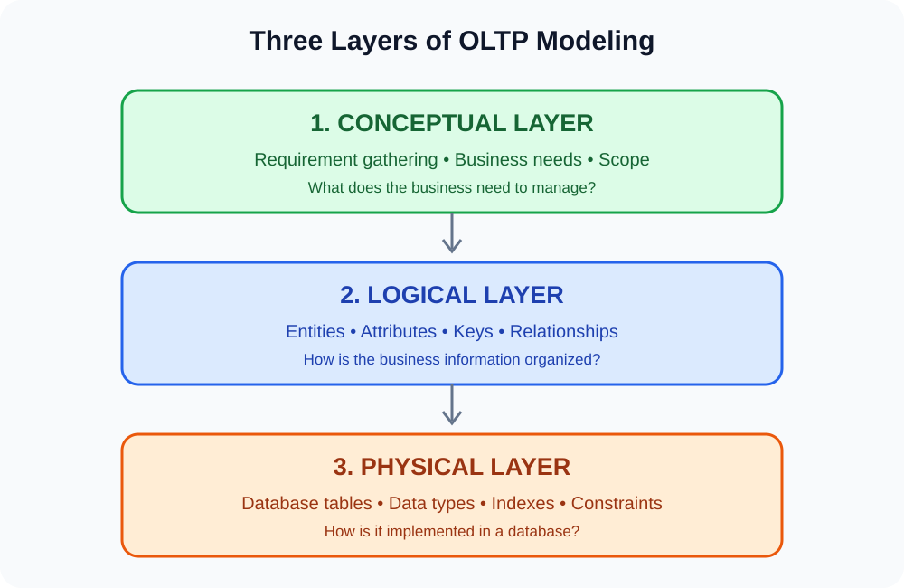
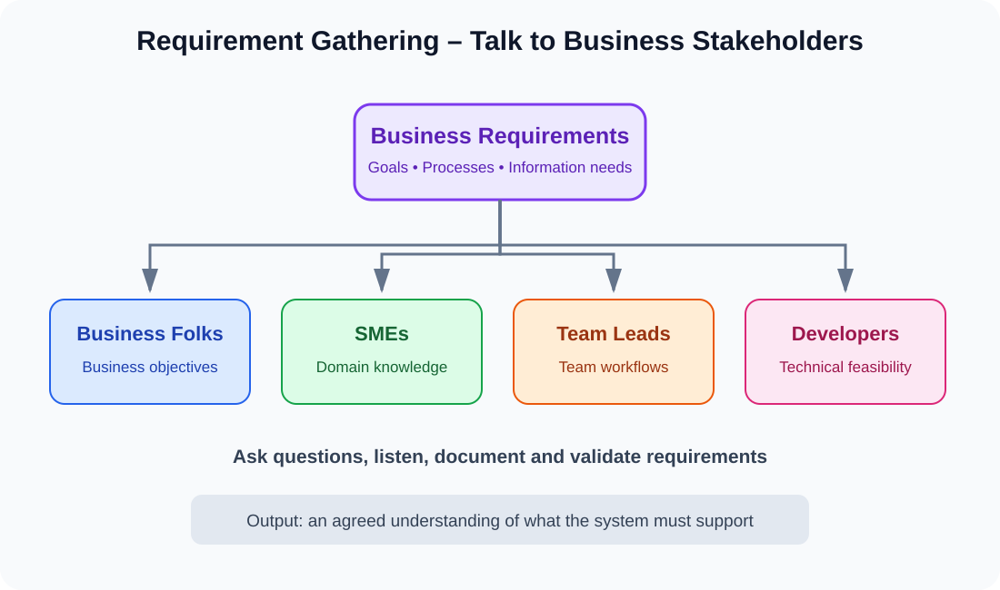
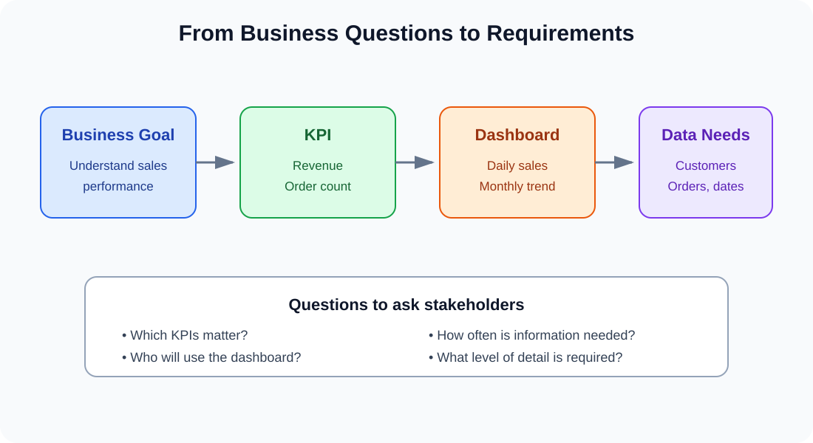
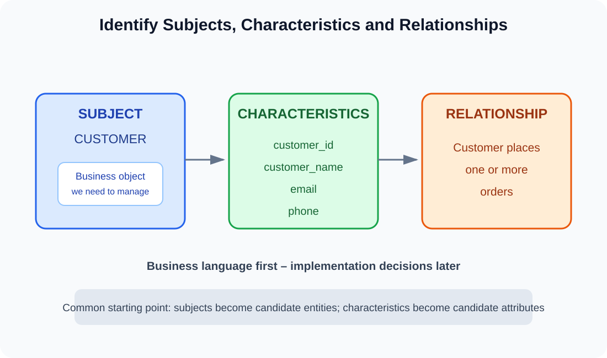
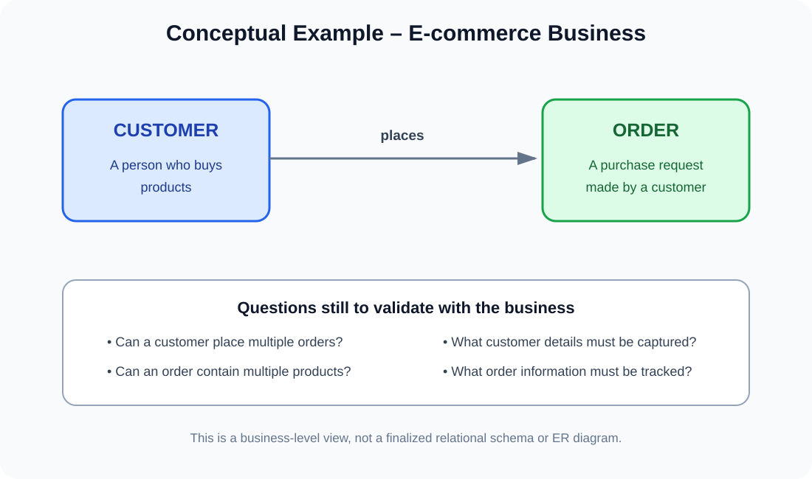

# Part 3 – OLTP Modeling: Part 1
## Conceptual Layer – Requirement Gathering

**Learning path:** Data Modeling for Data Engineering  
**Part:** 3 – OLTP Modeling, Part 1  
**Layer:** Conceptual / Business Requirement Gathering

---

## Learning objectives

By the end of this chapter, you should be able to:

1. Explain why OLTP modeling is studied before OLAP modeling.
2. Describe the three layers of OLTP modeling.
3. Explain the purpose of requirement gathering.
4. Identify the stakeholders who provide business requirements.
5. Ask questions about KPIs, dashboards and business processes.
6. Identify subjects, characteristics and relationships.
7. Explain how business subjects and characteristics become candidate entities and attributes in the next modeling stage.
8. Distinguish conceptual modeling from logical and physical modeling.
9. Understand the role of Waterfall and Agile approaches in gathering requirements.

---

# 1. Why learn OLTP Modeling before OLAP Modeling?

Before designing an analytical data warehouse, a Data Engineer should understand the operational systems that create the data.

An organization usually has applications that perform everyday activities:
- Customers register.
- Customers place orders.
- Employees update records.
- Payments are processed.
- Inventory is changed.

These activities generate operational data. OLAP systems and analytical pipelines often consume data originating from these operational systems.

Therefore, understanding the OLTP model helps us understand:
- What business objects exist.
- What information is captured about each object.
- How business activities relate to one another.
- Where operational records are created and updated.
- What the source data means.

**Key idea:** OLTP modeling describes how operational business information is organized. OLAP modeling later organizes data for analysis and decision-making.

---

# 2. Three Layers of OLTP Modeling

OLTP modeling can be approached through three layers.



## 2.1 Conceptual Layer – Requirement Gathering

This is the business-focused layer.

At this stage, we try to understand:
- What does the business do?
- What information does it need to manage?
- Who will use the system?
- What business processes must be supported?
- What questions or KPIs matter to the business?

The goal is to understand the business requirements before deciding the detailed database structure.

**Example:** An e-commerce company needs to manage customers, orders and products.

At this stage, we identify those business subjects and understand how the business uses them. We do not yet finalize SQL data types, indexes or physical table implementation.

## 2.2 Logical Layer

The logical layer organizes the business requirements into a structured data model.

It typically includes:
- Entities.
- Attributes.
- Primary and foreign keys.
- Relationships.
- Cardinality and participation rules.
- Business constraints.

An Entity-Relationship (ER) diagram is commonly used to communicate this structure.

For example, the business subjects `Customer` and `Order` may become entities. Their characteristics become attributes, and the rule that a customer can place orders becomes a relationship.

**This is the next layer, not the main focus of this chapter.**

## 2.3 Physical Layer

The physical layer describes how the logical model is implemented in a specific database technology.

It may define:
- Actual table names.
- Column names and data types.
- Primary key and foreign key constraints.
- Indexes.
- Storage and partitioning choices.
- Database-specific implementation details.

For example, implementing a customer table in MySQL or PostgreSQL belongs to the physical layer.

---

# 3. Requirement Gathering – Understanding the Business

Requirement gathering is the process of collecting, clarifying, documenting and validating what a business expects from a system.

A Data Modeler should not begin by guessing table names and columns. First, the business problem must be understood.



## 3.1 Who provides the requirements?

The notes identify four important stakeholder groups.

### 1. Business Folks

They explain the business goals and processes.

Questions:
- What does the business sell or provide?
- What activities happen every day?
- What information must be maintained?
- What problems should the system solve?

### 2. Subject Matter Experts (SMEs)

SMEs understand a specific business domain in detail.

For an e-commerce company, an order-management SME may explain:
- How orders are created.
- What order statuses exist.
- How cancellations work.
- What information is needed for returns.

### 3. Team Leads

Team leads explain how their teams work and what information they need.

Questions:
- What does the team manage?
- What steps are followed in a process?
- What information is required by the team?
- Which activities depend on other teams?

### 4. Developers

Developers help understand technical feasibility and implementation considerations.

They can identify:
- Existing application behavior.
- Available source systems.
- Integration requirements.
- Technical constraints.
- Questions that need clarification from the business.

**Important:** Developers help assess technical feasibility, but business stakeholders must validate business rules and requirements.

---

# 4. Understand KPIs and Dashboard Requirements

The notes emphasize asking stakeholders which KPIs they need and what dashboards they expect.

A KPI (Key Performance Indicator) is a measurable value used to evaluate progress toward a business objective.

A dashboard presents selected information in a form that users can understand and monitor.



## 4.1 Example – E-commerce company

Suppose the business wants to monitor sales performance.

Possible questions include:

| Stakeholder question | Requirement to clarify |
|---|---|
| What is our total revenue? | Definition of revenue and reporting period |
| How many orders are placed daily? | Definition of a valid order and date |
| Which products sell the most? | Product identification and sales measure |
| Which city generates the most sales? | Customer or delivery location rule |
| How many orders are cancelled? | Order status and cancellation definition |

Do not assume that every organization defines a KPI in the same way.

For example, revenue may mean:
- Gross order value.
- Paid order value.
- Net revenue after discounts and refunds.

The business must clarify the definition.

## 4.2 Dashboard requirement questions

Ask:

1. Who will use the dashboard?
2. Which KPIs should be displayed?
3. How frequently should the data be updated?
4. What date range should users be able to select?
5. Is the dashboard required at company, region, branch or individual level?
6. What level of detail is required?
7. Which filters are necessary?

**Modeling connection:** These questions help identify the business information that must be captured and maintained. The analytical dashboard itself will be designed later in the OLAP modeling process.

---

# 5. Identify Subjects, Characteristics and Relationships

This is one of the most important concepts in the requirement-gathering layer.

The notes identify three things to collect:

1. Subjects.
2. Characteristics.
3. Relationships.



## 5.1 Subject

A subject is a business object or concept about which the organization needs to store information.

Examples:
- Customer.
- Order.
- Product.
- Employee.
- Department.
- Payment.

Think of a subject as something the business needs to manage or track.

For an e-commerce application:
- A customer is a subject.
- An order is a subject.
- A product is a subject.

At the next modeling stage, these subjects are candidates for entities.

## 5.2 Characteristics

Characteristics describe the properties or details of a subject.

For example, a customer may have:
- Customer ID.
- Customer name.
- Email.
- Phone number.
- Address.

An order may have:
- Order ID.
- Order date.
- Order status.
- Order amount.

At the next modeling stage, characteristics are candidates for entity attributes.

### Example

| Subject | Characteristics |
|---|---|
| Customer | Customer ID, name, email, phone |
| Order | Order ID, date, status, amount |
| Product | Product ID, name, price, category |

## 5.3 Relationship

A relationship describes how two or more business subjects are associated.

Examples:
- A customer places an order.
- An order contains products.
- A payment is associated with an order.
- An employee belongs to a department.

At the conceptual stage, capture the relationship in business language.

For example:

**A customer can place one or more orders.**

The exact cardinality, optionality and key implementation should be validated and formalized in the logical model.

---

# 6. From Business Subjects to Database Concepts

The notes introduce a useful starting principle:

- Subjects commonly become tables or entities.
- Characteristics commonly become columns or attributes.
- Relationships describe how subjects are connected.



Consider this business statement:

"A customer can place orders. Each order contains products."

### Step 1 – Identify subjects

- Customer.
- Order.
- Product.

### Step 2 – Identify characteristics

Customer:
- Customer ID.
- Name.
- Email.

Order:
- Order ID.
- Order date.
- Status.

Product:
- Product ID.
- Product name.
- Price.

### Step 3 – Identify relationships

- Customer places Order.
- Order contains Product.

### Step 4 – Validate business rules

Ask:
- Can one customer place multiple orders?
- Can an order contain multiple products?
- Can a customer exist without placing an order?
- Can an order exist without a customer?
- Can the same product appear in multiple orders?

These questions must be answered before finalizing the logical model.

**Important distinction:** This is only a conceptual inventory of business subjects and their information. It is not yet a finalized relational schema. For example, an order containing multiple products may require an associative entity in the logical model.

---

# 7. Why should we not directly convert every characteristic into a column?

Consider this statement:

"A customer can place multiple orders."

A beginner might try to store all order information inside one customer column.

That would make the design difficult to maintain because:
- One customer can have multiple orders.
- Each order has its own date and status.
- Each order may contain multiple products.
- Order information has its own lifecycle.

Instead, first identify the separate business subjects and their characteristics. Then formalize their relationships in the logical layer.

The purpose of requirement gathering is to discover the correct business information, not to make premature implementation decisions.

---

# 8. Requirement Gathering Approaches – Waterfall and Agile

The notes mention two approaches:

- Waterfall.
- Agile.

These are project delivery approaches that influence how requirements are gathered, documented and refined.

## 8.1 Waterfall

Waterfall generally follows a sequential approach.

A simplified flow:

```text
Requirements
     |
     v
Analysis
     |
     v
Design
     |
     v
Development
     |
     v
Testing
     |
     v
Deployment
```

In this approach, requirements are generally gathered and documented early, before moving through later project phases.

**Example:** A project with a stable scope and formal approval process may use a Waterfall-style approach.

## 8.2 Agile

Agile follows an iterative and incremental approach.

A simplified flow:

```text
Initial Requirements
        |
        v
   Sprint Planning
        |
        v
     Development
        |
        v
      Review
        |
        v
     Feedback
        |
        v
Refine Requirements
        |
        +----> Next Sprint
```

Requirements are refined as the team receives feedback and learns more about the business needs.

**Example:** An e-commerce application may initially support customer registration and orders, then add returns, loyalty points and additional workflows in later iterations.

## 8.3 Waterfall vs Agile

| Aspect | Waterfall | Agile |
|---|---|---|
| Approach | Sequential | Iterative |
| Requirements | Usually defined early | Evolve through iterations |
| Feedback | Often at defined milestones | Frequent |
| Changes | Can be more difficult later | Expected and managed |
| Delivery | Commonly in larger phases | Incremental |
| Best suited to | Relatively stable requirements | Evolving requirements |

Neither approach removes the need for requirement validation and documentation.

---

# 9. Practical Case Study – XYZ E-commerce Company

You are assigned as a Data Modeler for XYZ Company.

The company wants to develop an application to manage its e-commerce operations.

Your first responsibility is to gather business requirements.

## 9.1 Stakeholder discovery

| Stakeholder | Information to collect |
|---|---|
| Business team | Business goals and processes |
| Order management SME | Order creation, status and cancellation rules |
| Product team | Product information and categories |
| Customer support team | Customer information and support workflows |
| Development team | Existing systems and technical constraints |

## 9.2 Identify business subjects

Initial subject list:

1. Customer.
2. Product.
3. Order.
4. Payment.
5. Employee.
6. Delivery.

## 9.3 Identify characteristics

| Subject | Possible characteristics |
|---|---|
| Customer | ID, name, email, phone |
| Product | ID, name, price, category |
| Order | ID, date, status, amount |
| Payment | ID, method, amount, status |
| Employee | ID, name, department |
| Delivery | ID, tracking number, status |

These are initial candidates. Confirm which fields are actually required with the business.

## 9.4 Identify relationships

Initial business statements:

- A customer places orders.
- An order contains products.
- An order is associated with payment.
- An order may have delivery information.
- An employee may manage orders.

Do not assume the exact relationship cardinality until the relevant business rules have been confirmed.

## 9.5 Requirement gathering output

At the end of this layer, produce a documented requirement summary containing:

- Business objectives.
- Stakeholders and their responsibilities.
- Business processes.
- Required KPIs and dashboards.
- Business subjects.
- Subject characteristics.
- Business relationships.
- Assumptions and open questions.
- Scope and priorities.

This becomes the input for the logical modeling layer.

---

# 10. Interview Questions and Answers

### Q1. What is OLTP modeling?

OLTP modeling is the process of organizing operational business information into a structured model that supports day-to-day business transactions.

### Q2. What are the three layers of OLTP modeling?

1. Conceptual layer.
2. Logical layer.
3. Physical layer.

### Q3. What is the conceptual layer?

It is the business-focused layer where requirements, business subjects, characteristics and high-level relationships are identified.

### Q4. What is requirement gathering?

It is the process of collecting, clarifying, documenting and validating business needs.

### Q5. Who are the stakeholders involved in requirement gathering?

Common stakeholders include business users, subject matter experts, team leads and developers.

### Q6. What is a KPI?

A Key Performance Indicator is a measurable value used to evaluate progress toward a business objective.

### Q7. What is a subject in data modeling?

A subject is a business object or concept that the organization needs to manage, such as Customer, Order or Product.

### Q8. What are characteristics?

Characteristics are the properties or details that describe a subject. For example, customer name, email and phone number.

### Q9. What is a relationship?

A relationship describes how two or more business subjects are associated.

### Q10. Do subjects directly become database tables?

They are common candidates for entities and tables, but the logical and physical design stages determine the final structure.

### Q11. What is the difference between conceptual and logical modeling?

Conceptual modeling focuses on business requirements and high-level subjects. Logical modeling defines entities, attributes, keys and relationships in a structured data model.

### Q12. What is the difference between Waterfall and Agile?

Waterfall generally follows sequential project phases, whereas Agile develops the solution iteratively and refines requirements through feedback.

---

# 11. Practical Assignments

## Assignment 1 – Identify business subjects

A hospital management system needs to maintain patient registrations, appointments, doctors, prescriptions and payments.

Identify:
1. Business subjects.
2. Characteristics of each subject.
3. Possible relationships.
4. Questions you need to ask the hospital stakeholders.

## Assignment 2 – Requirement gathering

Imagine you are designing an online food delivery application.

Identify the stakeholders:
- Business team.
- Restaurant operations team.
- Delivery team.
- Customer support team.
- Developers.

Prepare at least five requirement-gathering questions for each stakeholder group.

## Assignment 3 – KPI discovery

A retail business wants a management dashboard.

Identify:
1. Five possible KPIs.
2. The business definition of each KPI.
3. The information needed to calculate each KPI.
4. The stakeholder who should validate each definition.

## Assignment 4 – Conceptual modeling

For an e-commerce application, identify:

- Subjects.
- Characteristics.
- Relationships.
- Unresolved business questions.

Do not create SQL tables or finalize primary and foreign keys yet. Focus only on the conceptual layer.

## Assignment 5 – Waterfall vs Agile

For the same e-commerce project:
1. Explain how requirements would be gathered using Waterfall.
2. Explain how requirements would be gathered using Agile.
3. Identify advantages and limitations of each approach.

---

# 12. Part 3 – Completion Checklist

- [ ] Understand why OLTP modeling comes before OLAP modeling.
- [ ] Understand the three layers of OLTP modeling.
- [ ] Understand the conceptual layer.
- [ ] Understand requirement gathering.
- [ ] Identify business stakeholders.
- [ ] Understand KPIs and dashboard requirements.
- [ ] Identify subjects.
- [ ] Identify characteristics.
- [ ] Identify relationships.
- [ ] Understand how business concepts lead to entities and attributes.
- [ ] Understand Waterfall and Agile approaches.
- [ ] Complete the practical assignments.
- [ ] Practice interview questions.

---

# 13. Summary

| Concept | What it means |
|---|---|
| Conceptual layer | Understand business requirements |
| Requirement gathering | Collect and validate business needs |
| Stakeholders | People who provide or validate requirements |
| KPI | Measure of business performance |
| Subject | Business object to be managed |
| Characteristics | Properties describing a subject |
| Relationship | Association between business subjects |
| Waterfall | Sequential project approach |
| Agile | Iterative project approach |

**Remember this sequence:**

```text
UNDERSTAND THE BUSINESS
         |
         v
GATHER REQUIREMENTS
         |
         v
IDENTIFY STAKEHOLDERS
         |
         v
IDENTIFY KPIs AND BUSINESS NEEDS
         |
         v
IDENTIFY SUBJECTS
         |
         v
IDENTIFY CHARACTERISTICS
         |
         v
IDENTIFY RELATIONSHIPS
         |
         v
MOVE TO LOGICAL MODELING
```

**Key takeaway:** Do not start database design by immediately creating tables. First understand the business, identify what information it needs to manage, and validate the rules with the people who understand the business.

**Next chapter:** Part 3 – OLTP Modeling, Part 2: Logical Layer – Entities, Attributes, Relationships and ER Diagrams.


---

# 14. Mini Project – E-commerce OLTP Requirements
## Requirement Specification for Building an ER Diagram

This section brings the conceptual-layer concepts together in one practical e-commerce requirement. Read the business requirements, identify the subjects and characteristics, and use the stated business rules to prepare the logical ER diagram in the next chapter.

**Project objective:** Design an operational database for an e-commerce company that manages customers, products, orders, store branches, payments and shipments.

## 14.1 Business overview

The company sells products through its e-commerce platform and operates multiple store branches. Customers can place orders for products. Each order is handled by a store branch, payments are recorded against orders, and shipment information is maintained for order deliveries.

The system must maintain accurate information about these business activities and their related records.

## 14.2 Requirement 1 – Customer Management

The system should store information about customers who purchase products from the company.

**Subject:** Customer

**Characteristics:**
- Customer ID
- First Name
- Last Name
- Email
- Phone Number
- Date Joined

**Business rules:**
- Each customer must have a unique customer identifier.
- A customer can place multiple orders.
- Each order belongs to exactly one customer.
- A customer may be registered before placing their first order.

## 14.3 Requirement 2 – Product Catalog Management

The system should maintain a catalog of products available for sale.

**Subject:** Product

**Characteristics:**
- Product ID
- Product Name
- Category ID
- Price
- Stock Quantity

**Business rules:**
- Each product must have a unique product identifier.
- Each product is assigned to one product category.
- A category can contain multiple products.

**Modeling note:** Because the product requirement includes `Category ID`, a Category subject is included below so that the category information can be managed consistently rather than storing an unexplained category reference.

## 14.4 Requirement 3 – Order Processing

The system should record orders placed by customers. Each order should store its order details.

**Subject:** Order

**Characteristics:**
- Order ID
- Order Date
- Total Amount
- Order Status

**Business rules:**
- A customer can place multiple orders.
- Each order belongs to exactly one customer.
- Each order is processed by one store branch.
- An order can contain one or more products.
- A product can be included in multiple orders.

**Additional subject required – Order Item (Order Details)**

An order may contain multiple products, and the same product may appear in different orders. Therefore, the system must record each product included in each order as a separate order line.

**Subject:** Order Item

**Characteristics:**
- Order Item ID
- Order ID
- Product ID
- Quantity
- Unit Price

**Business rules:**
- Each order item belongs to exactly one order.
- Each order item refers to exactly one product.
- An order contains one or more order items.
- A product can appear in zero or many order items.

**Why is Order Item needed?** Order and Product have a many-to-many business relationship. Order Item captures the individual product and quantity details for each order and provides the associative entity needed when converting the requirements into a relational ER model.

## 14.5 Requirement 4 – Store Branch Management

The company operates multiple store branches that process customer orders.

**Subject:** Store Branch

**Characteristics:**
- Store Branch ID
- Store Branch Name
- Store Branch Location

**Business rules:**
- A store branch can process multiple orders.
- Each order is processed by one store branch.
- A store branch may exist before it processes its first order.

## 14.6 Requirement 5 – Payment Management

The system should record payment details for customer orders.

**Subject:** Payment

**Characteristics:**
- Payment ID
- Payment Method
- Payment Amount
- Payment Status
- Transaction Timestamp

**Business rules:**
- An order can have one or more payment records.
- Each payment record belongs to exactly one order.
- An order may have multiple payment records, for example when a payment is retried or split.
- Each payment must be recorded independently with its own status and timestamp.

**Clarification to confirm with the business:** Whether failed payment attempts are stored as Payment records, whether partial payments are supported, and whether refunds are represented as separate transactions or as payment status changes.

## 14.7 Requirement 6 – Shipment Management

The system should track shipment information for customer orders.

**Subject:** Shipment

**Characteristics:**
- Shipment ID
- Shipping Carrier
- Tracking Number
- Shipment Status
- Estimated Delivery Date

**Business rules:**
- An order can have one or more shipment records.
- Each shipment belongs to exactly one order.
- An order may be split into multiple shipments.
- Each shipment has its own tracking number and shipment status.

**Clarification to confirm with the business:** Whether an order can be created before shipment information exists, and whether cancelled or returned shipments must be retained.

## 14.8 Requirement 7 – Product Category Management

The product catalog stores a Category ID for each product. The system should maintain category information.

**Subject:** Category

**Characteristics:**
- Category ID
- Category Name

**Business rules:**
- A category can contain multiple products.
- Each product belongs to one category.

This requirement makes the Product–Category relationship explicit for the ER diagram.

---

## 14.9 Consolidated subject and characteristic inventory

| Subject | Characteristics |
|---|---|
| Customer | Customer ID, First Name, Last Name, Email, Phone Number, Date Joined |
| Product | Product ID, Product Name, Category ID, Price, Stock Quantity |
| Category | Category ID, Category Name |
| Order | Order ID, Order Date, Total Amount, Order Status |
| Order Item | Order Item ID, Order ID, Product ID, Quantity, Unit Price |
| Store Branch | Store Branch ID, Store Branch Name, Store Branch Location |
| Payment | Payment ID, Payment Method, Payment Amount, Payment Status, Transaction Timestamp |
| Shipment | Shipment ID, Shipping Carrier, Tracking Number, Shipment Status, Estimated Delivery Date |

## 14.10 Consolidated relationship requirements

Use these business statements to identify relationships and cardinalities in the logical model.

| Parent subject | Relationship | Child subject | Business cardinality |
|---|---|---|---|
| Customer | places | Order | One customer to zero or many orders; each order has exactly one customer |
| Store Branch | processes | Order | One branch to zero or many orders; each order has exactly one branch |
| Category | classifies | Product | One category to zero or many products; each product has exactly one category |
| Order | contains | Order Item | One order to one or many order items; each order item belongs to exactly one order |
| Product | appears in | Order Item | One product to zero or many order items; each order item refers to exactly one product |
| Order | has | Payment | One order to one or many payment records; each payment belongs to exactly one order |
| Order | has | Shipment | One order to one or many shipments; each shipment belongs to exactly one order |

## 14.11 ER diagram preparation task

Using the requirements above, prepare an ER diagram with the following steps:

1. Draw one entity for each subject.
2. List the characteristics as attributes inside the relevant entity.
3. Identify a suitable primary key for each entity.
4. Draw relationships between the entities.
5. Mark the cardinality at both ends of every relationship.
6. Identify the foreign keys needed to implement those relationships.
7. Resolve the many-to-many Order–Product relationship using Order Item.
8. Review the assumptions and clarification points before finalizing the model.

**Candidate entities:**

`Customer`, `Product`, `Category`, `Order`, `OrderItem`, `StoreBranch`, `Payment`, `Shipment`.

**Do not treat the candidate identifiers and foreign-key columns as fully finalized physical database definitions yet.** The next logical-modeling exercise will formalize keys, attributes, optionality, cardinality and relationship notation.

## 14.12 Business questions to clarify before finalizing the ER diagram

The requirements provide a starting point, but a real project needs stakeholder confirmation.

1. Can a customer place an order as a guest without registering?
2. Can an order be saved as a draft before checkout?
3. Can a product belong to more than one category?
4. Can an order contain the same product more than once, or should its quantity be combined into one order item?
5. Can a payment be split across multiple payment methods?
6. Are failed payment attempts stored?
7. Can an order be shipped in multiple packages?
8. Can a shipment contain items from more than one order?
9. Is stock quantity maintained centrally or separately for each store branch?
10. Can orders be processed by an online fulfillment center rather than a physical store branch?

Document the answers as business rules. If an answer changes the model, update the conceptual requirements before finalizing the ER diagram.

## 14.13 Scope of this mini project

**Included:**
- Customer management.
- Product and category catalog.
- Order processing.
- Order items and quantities.
- Store branch management.
- Payment records.
- Shipment tracking.

**Not included in this first version:**
- Shopping cart and wishlist.
- Product reviews and ratings.
- Coupons and promotions.
- Returns and refunds.
- Supplier and procurement management.
- Employee and user authentication.
- Inventory movement history.

These can be introduced in later modeling exercises.

## 14.14 Final exercise – Build the ER diagram

Your task is to convert the eight candidate subjects into a logical ER diagram.

Expected output:
- Eight entities.
- Attributes for each entity.
- Primary keys.
- Foreign keys.
- Relationships.
- Cardinality and optionality.
- An associative entity for Order–Product.

**Checkpoint:** You should be able to explain why each entity exists, why each relationship is required, and which business statement supports it.

This completes the requirement-gathering exercise and provides the input for **Part 3 – OLTP Modeling, Part 2: Logical Layer – ER Diagram Design**.
