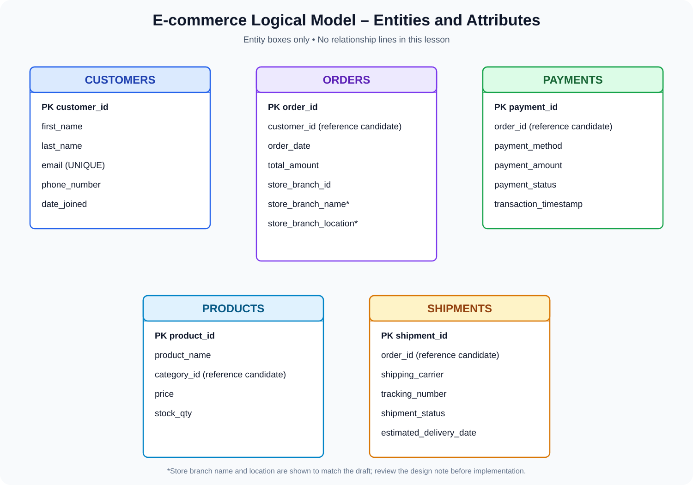

# Part 3.2 – OLTP Modeling: Logical Layer
## Entity Identification, Attributes, Data Types and Keys

**Learning path:** Data Modeling for Data Engineering  
**Chapter:** Part 3.2 – Logical Layer, first stage  
**Scope:** Identify entities and attributes, assign data types, understand keys, and draw an ER diagram without relationship lines.

> **Scope boundary:** This chapter deliberately does not teach or draw relationships. Relationship lines, cardinality and optionality will be covered in the next lesson. A column named `customer_id` inside `orders` is shown as an intended reference candidate, but this chapter does not connect the entity boxes.

---

## Learning objectives

By the end of this chapter, you should be able to:

1. Explain the purpose of the logical modeling layer.
2. Distinguish an entity from an attribute.
3. Identify entities and attributes in an e-commerce requirement.
4. Choose appropriate SQL data types.
5. Understand numeric, string, date/time and other common SQL data type families.
6. Explain Primary, Candidate, Alternate, Super, Foreign, Unique, Composite, Natural and Surrogate keys.
7. Distinguish a key from an ordinary attribute.
8. Identify a primary key for each entity.
9. Prepare an ER diagram containing entity boxes and attributes only.

---

# 1. What is the Logical Layer?

The logical layer converts business requirements into a structured data model. It describes the information that the system needs to store and how that information is organized.

At this stage, we identify:
- Entities.
- Attributes.
- Candidate identifiers.
- Data types.
- Key requirements.

A logical model is not tied to one physical database implementation in every detail. However, data types and constraints are often discussed at this stage so the design is precise enough to implement.

## 1.1 Entity

An **entity** is a distinguishable business object or concept about which the system stores information.

Examples:
- Customer.
- Order.
- Product.
- Payment.
- Shipment.

In a relational database implementation, an entity is commonly represented by a table.

## 1.2 Attribute

An **attribute** is a property that describes an entity.

For example, a Customer entity may have:
- customer_id
- first_name
- last_name
- email
- phone_number
- date_joined

In a relational table, an attribute is represented by a column.

## 1.3 Entity vs Attribute

| Entity | Example attributes |
|---|---|
| Customer | customer_id, first_name, email |
| Product | product_id, product_name, price |
| Order | order_id, order_date, total_amount |
| Payment | payment_id, payment_method, payment_amount |
| Shipment | shipment_id, tracking_number, shipment_status |

**Simple rule:** The entity is the thing we manage; attributes are the details we store about that thing.

---

# 2. Identify the E-commerce Entities

The initial ER draft contains five entities. We will use those five as the scope for this chapter.



## 2.1 Customer

**Purpose:** Store information about customers who purchase products.

| Attribute | Suggested SQL type | Key / constraint |
|---|---|---|
| customer_id | BIGINT | Primary Key |
| first_name | VARCHAR(60) | NOT NULL |
| last_name | VARCHAR(60) | NOT NULL |
| email | VARCHAR(254) | UNIQUE, NOT NULL |
| phone_number | VARCHAR(20) | Optional; UNIQUE only if business requires it |
| date_joined | DATE | NOT NULL |

Why these types?
- `customer_id` is an integer identifier with room for growth.
- Names and email addresses are variable-length text.
- Phone numbers are text, not arithmetic values. They may contain `+`, leading zeroes or formatting characters.
- `date_joined` represents a calendar date, not a time of day.

## 2.2 Orders

**Purpose:** Store information about customer orders.

| Attribute | Suggested SQL type | Key / constraint |
|---|---|---|
| order_id | BIGINT | Primary Key |
| customer_id | BIGINT | Reference candidate; relationship defined later |
| order_date | DATETIME | NOT NULL |
| total_amount | DECIMAL(12,2) | NOT NULL |
| store_branch_id | BIGINT | Reference candidate; relationship defined later |
| store_branch_name | VARCHAR(100) | Review design note |
| store_branch_location | VARCHAR(255) | Review design note |

**Design note:** The draft includes branch name and location inside Orders. If branch information is shared by many orders, a separate `store_branches` entity is normally a better design. The `store_branch_name` and `store_branch_location` columns are retained here to match the initial draft, but should be reviewed before implementation.

`customer_id` and `store_branch_id` are not primary keys of Orders. They are candidate references to identifiers owned by other entities. Their foreign-key constraints and relationship lines are intentionally deferred to the next lesson.

## 2.3 Products

**Purpose:** Maintain the catalog of products available for sale.

| Attribute | Suggested SQL type | Key / constraint |
|---|---|---|
| product_id | BIGINT | Primary Key |
| product_name | VARCHAR(150) | NOT NULL |
| category_id | BIGINT | Reference candidate; category entity to be confirmed |
| price | DECIMAL(10,2) | NOT NULL |
| stock_qty | INT | NOT NULL |

Why `DECIMAL` for price? Monetary values need exact decimal precision. Approximate floating-point values can introduce rounding differences.

**Design note:** The presence of `category_id` suggests a separate Category entity if category details need to be maintained. That entity is not shown in the five-entity starter diagram.

## 2.4 Payments

**Purpose:** Record payment details for customer orders.

| Attribute | Suggested SQL type | Key / constraint |
|---|---|---|
| payment_id | BIGINT | Primary Key |
| order_id | BIGINT | Reference candidate; relationship defined later |
| payment_method | VARCHAR(30) | NOT NULL |
| payment_amount | DECIMAL(12,2) | NOT NULL |
| payment_status | VARCHAR(30) | NOT NULL |
| transaction_timestamp | TIMESTAMP | NOT NULL |

A payment amount is monetary, so use an exact numeric type such as `DECIMAL`. A transaction timestamp records a date and time. Confirm the database's time-zone behavior and whether timestamps should be stored in UTC.

## 2.5 Shipments

**Purpose:** Track shipment information for customer orders.

| Attribute | Suggested SQL type | Key / constraint |
|---|---|---|
| shipment_id | BIGINT | Primary Key |
| order_id | BIGINT | Reference candidate; relationship defined later |
| shipping_carrier | VARCHAR(100) | NOT NULL |
| tracking_number | VARCHAR(100) | UNIQUE when supplied and required by the business |
| shipment_status | VARCHAR(30) | NOT NULL |
| estimated_delivery_date | DATE | May be NULL until estimated |

A tracking number is an identifier supplied by a carrier. It should be stored as text because it may contain letters, digits and leading zeroes.

---

# 3. What is a Data Type?

A **data type** defines what kind of value a column can store and influences:
- Valid values.
- Storage representation.
- Precision and range.
- Comparisons and calculations.
- Storage requirements.

For example:
- `INT` stores whole numbers.
- `DECIMAL(10,2)` stores exact decimal numbers.
- `VARCHAR(100)` stores variable-length text.
- `DATE` stores a calendar date.
- `TIMESTAMP` stores a date-time value with database-specific time-zone semantics.

The attached notes group common data types into Numeric, String and Date categories. We will begin with those and then cover additional common SQL types.

**Important:** Exact type names, ranges, storage and behavior differ between MySQL, PostgreSQL, SQL Server, Oracle and analytical platforms. Examples below use broadly familiar SQL syntax and identify important vendor differences.

---

# 4. Numeric Data Types

Numeric types store numbers. They are commonly divided into exact numeric and approximate numeric types.

## 4.1 INT / INTEGER

Stores whole numbers without a fractional component.

Examples:
- Quantity = 15
- Stock quantity = 250
- Number of items = 3

```sql
stock_qty INT
```

Use `INT` when the expected range fits the database's integer range.

Common MySQL signed `INT` range:
- Minimum: -2,147,483,648
- Maximum: 2,147,483,647

The exact range and storage details should be checked for the chosen database.

**Use cases:** quantities, counters, small-to-medium numeric identifiers.

## 4.2 BIGINT

Stores larger whole numbers than `INT`.

```sql
customer_id BIGINT
order_id BIGINT
```

Common MySQL signed `BIGINT` range:
- Minimum: -9,223,372,036,854,775,808
- Maximum: 9,223,372,036,854,775,807

Use it when the expected number of records or identifier range may exceed `INT`.

**Use cases:** large identifiers, high-volume transaction IDs and large counters.

A BIGINT identifier is still a number technically, but applications generally treat identifiers as labels rather than values for arithmetic.

## 4.3 SMALLINT and TINYINT

These store smaller whole-number ranges.

- `SMALLINT`: useful for relatively small integer values.
- `TINYINT`: supported by MySQL and some other databases; range and semantics vary by database.

Example:

```sql
rating SMALLINT
```

Do not choose a tiny type simply to save space if the business value may grow beyond its range.

## 4.4 DECIMAL(p,s) / NUMERIC(p,s)

Stores exact decimal values.

Syntax:

```sql
DECIMAL(precision, scale)
```

- `precision (p)`: maximum total number of digits.
- `scale (s)`: number of digits after the decimal point.

Example:

```sql
price DECIMAL(10,2)
```

This allows up to 10 total digits, of which 2 are after the decimal point. That leaves up to 8 digits before the decimal point.

Examples:
- `1250.50`
- `99.99`
- `100000.00`

For an e-commerce system:

```sql
price DECIMAL(10,2),
payment_amount DECIMAL(12,2),
total_amount DECIMAL(12,2)
```

**Why use DECIMAL for money?**

Decimal types represent decimal fractions exactly within their declared precision. Binary floating-point types approximate many decimal fractions, which can lead to surprising rounding behavior.

`NUMERIC` and `DECIMAL` are equivalent or very similar in many SQL databases, although standards and vendor implementations can differ.

## 4.5 FLOAT

Stores approximate floating-point values, usually with lower precision than DOUBLE.

```sql
temperature FLOAT
```

It is useful for scientific measurements where approximation is acceptable.

Avoid FLOAT for financial amounts, because many decimal values cannot be represented exactly in binary floating-point.

## 4.6 DOUBLE

Stores approximate floating-point values with more precision than a typical FLOAT.

```sql
measurement DOUBLE
```

Use for scientific, statistical or measurement values where approximate representation is acceptable.

Do not use it as the default type for currency.

## 4.7 Exact vs approximate numeric

| Type | Number kind | Typical use |
|---|---|---|
| TINYINT | Exact integer | Small flags or counts |
| SMALLINT | Exact integer | Small counts |
| INT | Exact integer | Quantities |
| BIGINT | Exact integer | Large identifiers |
| DECIMAL(p,s) | Exact decimal | Money and precise amounts |
| NUMERIC(p,s) | Exact decimal | Money and precise amounts |
| FLOAT | Approximate | Measurements |
| DOUBLE | Approximate | Scientific calculations |

---

# 5. String Data Types

String types store text.

The notes list `CHAR(n)`, `VARCHAR(n)`, `TEXT` and `NVARCHAR(n)`.

## 5.1 CHAR(n)

Fixed-length character type.

```sql
country_code CHAR(2)
```

If the column is defined as `CHAR(2)`, it is designed for a fixed-length value such as `IN` or `US`. Padding and comparison behavior can vary by database.

**Use cases:**
- Fixed-length country codes.
- Fixed-format status codes.
- Fixed-size codes where the database's CHAR semantics are appropriate.

Avoid CHAR for names and email addresses of varying length.

## 5.2 VARCHAR(n)

Variable-length character type with a declared maximum length.

```sql
first_name VARCHAR(60)
email VARCHAR(254)
product_name VARCHAR(150)
```

It stores values up to the declared maximum, subject to the database's character and byte limits.

**Use cases:**
- Names.
- Email addresses.
- Phone numbers.
- Product names.
- Status labels.

`VARCHAR` is a good default for many ordinary text attributes.

## 5.3 TEXT

Stores longer text.

```sql
product_description TEXT
```

**Use cases:**
- Product descriptions.
- Comments.
- Long notes.
- Article content.

Maximum length and indexing behavior vary significantly by database.

## 5.4 NVARCHAR(n)

In databases such as SQL Server, `NVARCHAR` stores Unicode text.

```sql
customer_name NVARCHAR(100)
```

Unicode supports text from many writing systems, including Tamil, Hindi, Japanese and Arabic.

**Vendor note:** SQL Server distinguishes `VARCHAR` and `NVARCHAR` in this way. MySQL normally uses character sets such as `utf8mb4` with `CHAR` and `VARCHAR`; PostgreSQL uses database encodings and does not use `NVARCHAR` as a standard built-in type.

## 5.5 CHAR vs VARCHAR vs TEXT vs NVARCHAR

| Type | Main behavior | Example |
|---|---|---|
| CHAR(n) | Fixed-length | `CHAR(2)` |
| VARCHAR(n) | Variable-length with limit | `VARCHAR(100)` |
| TEXT | Longer text | `TEXT` |
| NVARCHAR(n) | Unicode variable-length in supporting databases | `NVARCHAR(100)` |

### Important: Phone numbers are strings

Do not store a phone number as INT or BIGINT.

A phone number:
- Is not used for arithmetic.
- Can begin with zero.
- May contain a country code such as `+91`.
- May contain formatting characters.

Prefer:

```sql
phone_number VARCHAR(20)
```

---

# 6. Date and Time Data Types

Date/time types store calendar dates, times and date-time values.

## 6.1 DATE

Stores a calendar date without a time-of-day component.

```sql
date_joined DATE
estimated_delivery_date DATE
```

Example:

```text
2026-11-09
```

Use DATE when only the day matters.

## 6.2 TIME

Stores a time-of-day value without a calendar date.

```sql
store_opening_time TIME
```

Example:

```text
09:30:00
```

Use it for opening hours or a daily schedule.

## 6.3 DATETIME

Stores a date and time together.

```sql
order_date DATETIME
```

Example:

```text
2026-11-09 15:30:45
```

Useful for recording when an order was placed.

In MySQL, DATETIME stores the date and time value without automatic session-time-zone conversion.

## 6.4 TIMESTAMP

Stores a date-time value with database-specific timestamp semantics.

```sql
transaction_timestamp TIMESTAMP
```

In MySQL, TIMESTAMP values are converted between the session time zone and UTC for storage/retrieval. PostgreSQL distinguishes `timestamp without time zone` and `timestamp with time zone` (`timestamptz`).

**Important:** Never assume every database implements TIMESTAMP identically. Choose the type based on whether the value represents a local wall-clock time or a real moment in time.

## 6.5 DATE vs TIME vs DATETIME vs TIMESTAMP

| Type | Stores | Example |
|---|---|---|
| DATE | Date only | `2026-11-09` |
| TIME | Time only | `15:30:00` |
| DATETIME | Date and time | `2026-11-09 15:30:00` |
| TIMESTAMP | Date-time with vendor-specific semantics | Transaction event time |

---

# 7. Other Useful SQL Data Types

The first three categories are the focus of the handwritten notes. These additional types are also useful in real database design.

## 7.1 BOOLEAN / BOOL

Represents a true/false value.

```sql
is_active BOOLEAN
```

Examples:
- TRUE
- FALSE

Vendor differences:
- PostgreSQL has a native BOOLEAN type.
- MySQL treats BOOLEAN as a synonym for TINYINT(1).
- SQL Server commonly uses BIT.

Use it for simple flags, such as whether a product is active.

## 7.2 BINARY and VARBINARY

Store binary bytes rather than human-readable text.

- `BINARY(n)`: fixed-length binary data.
- `VARBINARY(n)`: variable-length binary data.

Use cases include hashes, compact binary identifiers and byte sequences.

## 7.3 BLOB

Binary Large Object. Stores large binary data.

Examples:
- Images.
- Documents.
- Binary files.

In many modern systems, images and documents are stored in object storage, while the database stores a URL or object key and metadata.

## 7.4 JSON

Stores JSON documents in databases that support a JSON type.

Example:

```json
{
  "color": "black",
  "size": "large"
}
```

Possible column:

```sql
product_attributes JSON
```

JSON is useful for flexible semi-structured attributes, but it should not replace well-defined relational columns when those attributes need strong constraints, joins or frequent structured queries.

## 7.5 UUID

A Universally Unique Identifier is a 128-bit identifier.

Example:

```text
550e8400-e29b-41d4-a716-446655440000
```

Databases differ in how they represent UUIDs:
- PostgreSQL has a UUID type.
- SQL Server has UNIQUEIDENTIFIER.
- MySQL commonly stores UUID values using CHAR(36) or BINARY(16).

UUIDs are useful when identifiers need to be generated across distributed systems without relying on one central sequence.

## 7.6 XML

Some database platforms provide XML-specific types for structured XML documents.

Use only when XML data needs to be stored or queried as XML. Support and functionality are database-specific.

## 7.7 Spatial types

Geospatial databases may support types such as:
- POINT
- LINESTRING
- POLYGON

These represent geographic coordinates and shapes. They are useful for maps, delivery zones and location-based applications.

---

# 8. How to Choose the Correct Data Type

Use the meaning of the attribute, not just the example value.

| Attribute | Recommended type | Reason |
|---|---|---|
| customer_id | BIGINT | Whole-number identifier |
| first_name | VARCHAR(60) | Variable-length text |
| email | VARCHAR(254) | Variable-length text |
| phone_number | VARCHAR(20) | Identifier-like text |
| date_joined | DATE | Calendar date |
| order_date | DATETIME | Date and time |
| total_amount | DECIMAL(12,2) | Exact monetary value |
| stock_qty | INT | Whole-number quantity |
| product_name | VARCHAR(150) | Variable-length text |
| payment_status | VARCHAR(30) | Text label |
| transaction_timestamp | TIMESTAMP | Event time |
| is_active | BOOLEAN | True/false flag |
| product_description | TEXT | Longer text |

### Common mistakes

1. Using FLOAT for money.
2. Using INT for phone numbers.
3. Using VARCHAR for every column without considering meaning.
4. Using DATE when the exact event time is required.
5. Using an undersized VARCHAR limit without considering real business values.
6. Choosing BIGINT for every column without considering actual range and requirements.
7. Assuming the same data type behaves identically in all database engines.

---

# 9. What is a Key?

A **key** is an attribute or combination of attributes used to identify records, enforce uniqueness or refer to records in a database.

Keys help us:
- Identify one record.
- Prevent duplicate identifiers.
- Enforce data integrity.
- Reference records from other tables.
- Support relationships between entities.

The handwritten notes introduce several key types. Let's understand them one by one.

---

# 10. Super Key

A **Super Key** is any set of one or more attributes that uniquely identifies each row in a table.

Consider this Customer table:

| customer_id | email | phone_number | first_name |
|---:|---|---|---|
| 101 | arun@example.com | 9876500001 | Arun |
| 102 | priya@example.com | 9876500002 | Priya |
| 103 | kumar@example.com | 9876500003 | Kumar |

Assume `customer_id`, `email` and `phone_number` are each unique.

Possible super keys:
- `{customer_id}`
- `{email}`
- `{phone_number}`
- `{customer_id, first_name}`
- `{email, phone_number}`
- `{customer_id, email, phone_number}`

Why are the combinations also super keys?

Because if one attribute already uniquely identifies a row, adding more attributes does not remove that uniqueness.

**Important:** A super key may contain unnecessary attributes.

For example:

`{customer_id, first_name}`

is a super key if `customer_id` is unique, but `first_name` is not needed to identify the customer.

---

# 11. Candidate Key

A **Candidate Key** is a minimal super key.

It uniquely identifies each row, and no attribute can be removed from it without losing that uniqueness.

Using the same Customer table, possible candidate keys are:

- `customer_id`
- `email`
- `phone_number` (only if the business guarantees that every stored phone number is unique and present)

Candidate keys do not contain unnecessary attributes.

### Super Key vs Candidate Key

| Super Key | Candidate Key |
|---|---|
| Uniquely identifies a row | Uniquely identifies a row |
| May contain extra attributes | Minimal; no unnecessary attributes |
| Multiple may exist | Multiple may exist |
| Example: customer_id + first_name | Example: customer_id |

**Remember:** Every candidate key is a super key, but every super key is not necessarily a candidate key.

---

# 12. Primary Key

A **Primary Key (PK)** is the candidate key selected as the main identifier for records in a table.

Example:

```sql
CREATE TABLE customers (
    customer_id BIGINT PRIMARY KEY,
    first_name VARCHAR(60) NOT NULL,
    last_name VARCHAR(60) NOT NULL,
    email VARCHAR(254) UNIQUE NOT NULL
);
```

Here:
- `customer_id` is the Primary Key.
- `email` is another candidate-key candidate if it is guaranteed unique and mandatory.
- The primary key uniquely identifies each customer.

### Primary key rules

1. Primary key values must be unique.
2. Primary key values cannot be NULL.
3. A table has one PRIMARY KEY constraint.
4. That primary key can consist of one or multiple columns.
5. The primary key should be stable and suitable for record identification.

### Can a table have multiple candidate keys?

Yes.

A table can have several candidate keys, but one is selected as the primary key.

### Why only one Primary Key?

The table needs one designated primary-key constraint. It may be a composite key containing multiple columns, but it is still one primary-key constraint.

---

# 13. Alternate Key

An **Alternate Key** is a candidate key that was not selected as the primary key.

Suppose Customer has these candidate keys:

- `customer_id`
- `email`

If `customer_id` is selected as the primary key, then `email` is an alternate key.

```sql
CREATE TABLE customers (
    customer_id BIGINT PRIMARY KEY,
    email VARCHAR(254) UNIQUE NOT NULL
);
```

Here:
- `customer_id` = Primary Key.
- `email` = Alternate Key, assuming it is a candidate key under the business rules.

**Remember:** An alternate key is not an arbitrary extra column. It must be another candidate key.

---

# 14. Unique Key

A **UNIQUE constraint** ensures that duplicate values are not allowed in a column or combination of columns, subject to the database's NULL semantics.

Example:

```sql
CREATE TABLE customers (
    customer_id BIGINT PRIMARY KEY,
    email VARCHAR(254) UNIQUE
);
```

This prevents duplicate non-NULL email values.

### Primary Key vs Unique Key

| Primary Key | Unique Key |
|---|---|
| Main identifier | Enforces uniqueness |
| Cannot be NULL | NULL handling depends on database |
| One primary-key constraint per table | Multiple UNIQUE constraints allowed |
| Can contain multiple columns | Can contain multiple columns |

**Important:** UNIQUE is a database constraint. Candidate and alternate key are conceptual modeling classifications. A UNIQUE constraint often implements a candidate or alternate key, but the concepts are not identical in every design.

---

# 15. Composite Key

A **Composite Key** is a key made up of two or more attributes.

Example: suppose an order can contain many products. In an Order Item table, the pair `order_id` and `product_id` might identify one product line per order.

| order_id | product_id | quantity |
|---:|---:|---:|
| 5001 | 101 | 2 |
| 5001 | 102 | 1 |
| 5002 | 101 | 3 |

The combination `(order_id, product_id)` is unique in this example.

SQL:

```sql
CREATE TABLE order_items (
    order_id BIGINT NOT NULL,
    product_id BIGINT NOT NULL,
    quantity INT NOT NULL,
    PRIMARY KEY (order_id, product_id)
);
```

Here:
- `order_id` alone is not unique.
- `product_id` alone is not unique.
- Together, they identify a row.

**Important:** If the same product can appear as multiple separate lines in one order, this combination is insufficient. Add an `order_item_id` or a line number to distinguish those lines.

---

# 16. Natural Key

A **Natural Key** is an identifier that already has business meaning outside the database.

Examples:
- Email address (when the business treats it as a unique identifier).
- Government-issued identifier (where lawful and appropriate).
- A product SKU.
- A standardized country code.

Example:

```sql
product_sku VARCHAR(40) UNIQUE NOT NULL
```

A natural key comes from the business domain.

### Advantages

- May already exist in source systems.
- Can be meaningful to business users.
- Can support matching across systems.

### Disadvantages

- Business values may change.
- Some identifiers may not always be available.
- Privacy or security considerations may apply.
- Natural identifiers can have complex formats.

A natural key should not be chosen merely because a value looks unique in a small sample. Its uniqueness and stability must be supported by business rules.

---

# 17. Surrogate Key

A **Surrogate Key** is an artificial identifier created specifically for the database, without inherent business meaning.

Example:

| customer_key | customer_name | email |
|---:|---|---|
| 1 | Arun | arun@example.com |
| 2 | Priya | priya@example.com |
| 3 | Kumar | kumar@example.com |

Here, `customer_key` is a surrogate key.

Example SQL:

```sql
CREATE TABLE customers (
    customer_id BIGINT AUTO_INCREMENT PRIMARY KEY,
    customer_name VARCHAR(100) NOT NULL,
    email VARCHAR(254) UNIQUE NOT NULL
);
```

`AUTO_INCREMENT` is MySQL syntax. Other databases use identity columns, sequences or generated UUIDs.

### Advantages

- Independent of changing business identifiers.
- Compact integer keys can be efficient for joins and indexes.
- Useful when combining records from different source systems.
- Allows the business identifier to change without changing the surrogate identifier.

### Disadvantages

- Has no direct business meaning.
- Requires a separate business identifier when users need to search by one.
- Must be generated and managed consistently.

---

# 18. Natural Key vs Surrogate Key

| Natural Key | Surrogate Key |
|---|---|
| Comes from business data | Generated for database use |
| Has business meaning | No inherent business meaning |
| May change | Designed to remain stable |
| Example: product SKU | Example: product_id |
| May be long or complex | Often a compact integer or UUID |

### E-commerce example

A product may have:

```text
product_id = 1001
product_sku = LAPTOP-DELL-001
product_name = Dell Laptop
```

- `product_id` = Surrogate Key.
- `product_sku` = Natural Key, if unique and stable under business rules.

Both can be useful in the same table.

---

# 19. Foreign Key

A **Foreign Key (FK)** is an attribute or set of attributes in one table that references a candidate key, usually the primary key, in another table.

Example:

Customers:

| customer_id | customer_name |
|---:|---|
| 101 | Arun |
| 102 | Priya |

Orders:

| order_id | customer_id |
|---:|---:|
| 5001 | 101 |
| 5002 | 102 |

`orders.customer_id` refers to `customers.customer_id`.

SQL example:

```sql
CREATE TABLE customers (
    customer_id BIGINT PRIMARY KEY,
    customer_name VARCHAR(100) NOT NULL
);

CREATE TABLE orders (
    order_id BIGINT PRIMARY KEY,
    customer_id BIGINT NOT NULL,
    order_date DATETIME NOT NULL,

    CONSTRAINT fk_orders_customer
        FOREIGN KEY (customer_id)
        REFERENCES customers(customer_id)
);
```

### Why do we need a Foreign Key?

It enforces referential integrity.

For example, if customer 101 does not exist, the database should not allow an order to reference customer 101 when the foreign-key constraint is enforced.

### Foreign Key characteristics

- A table can have multiple foreign keys.
- A foreign key can contain one or multiple columns.
- Foreign-key values do not have to be unique.
- A foreign key may be nullable if the business permits an unassigned reference and the column allows NULL.
- The referenced columns must be eligible as a referenced key under the database's rules.

**Important:** A foreign key is not automatically unique. Many rows in Orders can refer to the same customer.

---

# 20. Other Key Classifications You May Encounter

## 20.1 Secondary Key

A secondary key is a column or set of columns used to search or retrieve records, but it does not necessarily uniquely identify a row.

Example:

```sql
SELECT *
FROM orders
WHERE order_status = 'PLACED';
```

`order_status` can be useful as a search attribute, but many orders may have the same status.

A secondary key is a practical access/search concept; terminology varies across textbooks and database design contexts.

## 20.2 Partial Key

A partial key is used in conceptual ER modeling for a weak entity. It uniquely distinguishes one weak entity among those belonging to the same owner entity, but does not uniquely identify it across the entire database.

For example, a dependent number might distinguish dependents within one employee's records. The employee identifier plus dependent number can form the full identifier.

We will explore weak entities and partial keys when studying ER diagram notation.

## 20.3 Composite vs Compound terminology

Many materials use *composite key* for a key consisting of multiple attributes. Some authors distinguish composite and compound keys differently, so follow the terminology specified by your modeling standard or course.

---

# 21. Key Comparison – Complete Revision Table

| Key | Main purpose | Example |
|---|---|---|
| Super Key | Any unique identifier set | customer_id + first_name |
| Candidate Key | Minimal unique identifier | customer_id |
| Primary Key | Selected main candidate key | customer_id |
| Alternate Key | Candidate key not selected as PK | email |
| Unique Key | Database uniqueness constraint | UNIQUE(email) |
| Composite Key | Key using multiple attributes | order_id + product_id |
| Natural Key | Business-derived identifier | product_sku |
| Surrogate Key | Artificial database identifier | product_id |
| Foreign Key | References a key in another table | orders.customer_id |
| Secondary Key | Supports searching and retrieval | order_status |
| Partial Key | Identifies a weak entity within its owner | dependent_number |

## 21.1 Key hierarchy

```text
SUPER KEY
   |
   | Remove unnecessary attributes
   v
CANDIDATE KEY
   |
   | Select one
   v
PRIMARY KEY

Remaining candidate keys
   |
   v
ALTERNATE KEYS
```

This diagram shows the conceptual relationship between super keys, candidate keys, primary keys and alternate keys.

---

# 22. Applying Keys to Our E-commerce Entities

This is our initial key-selection proposal. Business uniqueness rules must be confirmed before final implementation.

| Entity | Proposed Primary Key | Possible Alternate / Unique Attribute |
|---|---|---|
| Customers | customer_id | email |
| Orders | order_id | No alternate key assumed |
| Products | product_id | product SKU, if introduced |
| Payments | payment_id | External transaction ID, if guaranteed unique |
| Shipments | shipment_id | tracking_number, if guaranteed unique |

### What about the reference columns?

These columns are intended to reference other entities:

| Entity | Attribute | Intended reference |
|---|---|---|
| Orders | customer_id | Customer identifier |
| Orders | store_branch_id | Store Branch identifier |
| Payments | order_id | Order identifier |
| Shipments | order_id | Order identifier |
| Products | category_id | Category identifier |

We are identifying these as reference candidates only. We will define and draw the relationships in the next lesson.

---

# 23. Basic SQL Implementation – Entities and Data Types

The following MySQL-style example creates the five entity tables with their primary keys and selected uniqueness constraints. Foreign-key constraints are intentionally omitted in this chapter.

```sql
CREATE TABLE customers (
    customer_id BIGINT AUTO_INCREMENT PRIMARY KEY,
    first_name VARCHAR(60) NOT NULL,
    last_name VARCHAR(60) NOT NULL,
    email VARCHAR(254) NOT NULL UNIQUE,
    phone_number VARCHAR(20),
    date_joined DATE NOT NULL
);

CREATE TABLE orders (
    order_id BIGINT AUTO_INCREMENT PRIMARY KEY,
    customer_id BIGINT NOT NULL,
    order_date DATETIME NOT NULL,
    total_amount DECIMAL(12,2) NOT NULL,
    store_branch_id BIGINT,
    store_branch_name VARCHAR(100),
    store_branch_location VARCHAR(255)
);

CREATE TABLE products (
    product_id BIGINT AUTO_INCREMENT PRIMARY KEY,
    product_name VARCHAR(150) NOT NULL,
    category_id BIGINT,
    price DECIMAL(10,2) NOT NULL,
    stock_qty INT NOT NULL
);

CREATE TABLE payments (
    payment_id BIGINT AUTO_INCREMENT PRIMARY KEY,
    order_id BIGINT NOT NULL,
    payment_method VARCHAR(30) NOT NULL,
    payment_amount DECIMAL(12,2) NOT NULL,
    payment_status VARCHAR(30) NOT NULL,
    transaction_timestamp TIMESTAMP NOT NULL
);

CREATE TABLE shipments (
    shipment_id BIGINT AUTO_INCREMENT PRIMARY KEY,
    order_id BIGINT NOT NULL,
    shipping_carrier VARCHAR(100) NOT NULL,
    tracking_number VARCHAR(100) UNIQUE,
    shipment_status VARCHAR(30) NOT NULL,
    estimated_delivery_date DATE
);
```

**Note:** This is a teaching implementation, not a final production schema. For example, `store_branch_name` and `store_branch_location` are retained from the draft, but should be reviewed for normalization. The database engine, version, identifier-generation strategy, NULL rules and business constraints should be confirmed before deployment.

---

# 24. Common Interview Questions

### Q1. What is an entity?

An entity is a distinguishable business object about which information is stored, such as Customer or Product.

### Q2. What is an attribute?

An attribute is a property that describes an entity, such as customer_name or email.

### Q3. What is a data type?

A data type defines the kind of value a database column can store and its valid representation, precision and range.

### Q4. What is the difference between INT and BIGINT?

Both store whole numbers, but BIGINT supports a much larger range than INT.

### Q5. Why use DECIMAL instead of FLOAT for money?

DECIMAL stores exact decimal values within its defined precision, whereas FLOAT is approximate and can introduce rounding differences.

### Q6. What is the difference between CHAR and VARCHAR?

CHAR is fixed-length, while VARCHAR is variable-length with a declared maximum.

### Q7. What is the difference between DATE and DATETIME?

DATE stores a calendar date; DATETIME stores both a date and time.

### Q8. What is a Super Key?

Any set of one or more attributes that uniquely identifies a row.

### Q9. What is a Candidate Key?

A minimal super key with no unnecessary attributes.

### Q10. Can a table have multiple candidate keys?

Yes. One is selected as the primary key, and the others are alternate keys.

### Q11. What is a Primary Key?

The selected candidate key used as the main identifier for records in a table.

### Q12. Can a Primary Key contain multiple columns?

Yes. This is a composite primary key.

### Q13. What is an Alternate Key?

A candidate key that was not selected as the primary key.

### Q14. What is a Foreign Key?

An attribute or set of attributes that references a candidate key in another table and can enforce referential integrity.

### Q15. What is a Surrogate Key?

An artificial identifier created for database record identification, such as an auto-generated customer_id.

### Q16. What is a Natural Key?

A business-derived identifier such as a product SKU, when its uniqueness and stability are guaranteed.

### Q17. What is the difference between Candidate Key and Super Key?

Every candidate key is a super key, but a super key may contain unnecessary attributes.

### Q18. Is a Foreign Key always unique?

No. Many rows can reference the same parent record.

### Q19. Can a table have multiple UNIQUE constraints?

Yes. A table can have multiple UNIQUE constraints, each enforcing uniqueness on its defined column or column combination.

### Q20. Why should we select stable identifiers?

Stable identifiers reduce the risk of changing references when business information changes.

---

# 25. Practical Assignments

## Assignment 1 – Identify entities and attributes

For a library management system, identify:
- Entities.
- Attributes.
- Suitable data types.
- One proposed primary key for each entity.

## Assignment 2 – Choose data types

Choose an appropriate type for each:

1. Customer name.
2. Customer phone number.
3. Product price.
4. Stock quantity.
5. Order timestamp.
6. Date of joining.
7. Email address.
8. Product description.
9. Is product active?
10. Payment amount.

Explain why you selected each type.

## Assignment 3 – Identify key types

Given a Customer table containing:

```text
customer_id
email
phone_number
first_name
last_name
```

Assume the business guarantees that customer_id and email are both unique and non-NULL.

Identify:
1. Candidate keys.
2. Primary key if customer_id is selected.
3. Alternate key.
4. Two examples of super keys.
5. One example of a non-key attribute.

## Assignment 4 – Composite key

Create a sample table with:
- order_id
- product_id
- quantity

Explain why order_id alone and product_id alone may not uniquely identify a row, and why the combination can be a composite key.

## Assignment 5 – E-commerce entity diagram

Using the five entities in this chapter:

1. Draw all five entity boxes.
2. Add all attributes.
3. Mark the primary key.
4. Mark possible unique attributes.
5. Do not draw relationship lines.
6. Label each attribute with its data type.

---

# 26. Completion Checklist

- [ ] Understand the logical modeling layer.
- [ ] Understand entities and attributes.
- [ ] Identify the five e-commerce entities.
- [ ] Understand Numeric data types.
- [ ] Understand String data types.
- [ ] Understand Date and Time data types.
- [ ] Understand other common SQL types.
- [ ] Understand data type selection.
- [ ] Understand Super Key.
- [ ] Understand Candidate Key.
- [ ] Understand Primary Key.
- [ ] Understand Alternate Key.
- [ ] Understand Unique Key.
- [ ] Understand Composite Key.
- [ ] Understand Natural Key.
- [ ] Understand Surrogate Key.
- [ ] Understand Foreign Key.
- [ ] Understand Secondary and Partial Keys.
- [ ] Complete the SQL implementation.
- [ ] Draw the ER diagram without relationships.

---

# 27. Summary

In this chapter, we moved from business requirements to the initial logical representation of the e-commerce system.

We identified five entities:
- Customers.
- Orders.
- Products.
- Payments.
- Shipments.

We then identified their attributes, assigned appropriate data types and studied database keys.

**Remember the sequence:**

```text
BUSINESS REQUIREMENTS
        |
        v
IDENTIFY ENTITIES
        |
        v
IDENTIFY ATTRIBUTES
        |
        v
ASSIGN DATA TYPES
        |
        v
IDENTIFY KEY CANDIDATES
        |
        v
SELECT PRIMARY KEYS
        |
        v
PREPARE ENTITY DIAGRAM
        |
        v
NEXT: DEFINE RELATIONSHIPS
```

**Next lesson – Part 3.2 (continued): Relationships in ER Modeling**

We will connect the entities and learn:
- One-to-One (1:1).
- One-to-Many (1:M).
- Many-to-Many (M:N).
- Cardinality and optionality.
- Foreign-key placement.
- Associative entities.
- Complete e-commerce ER diagram.
