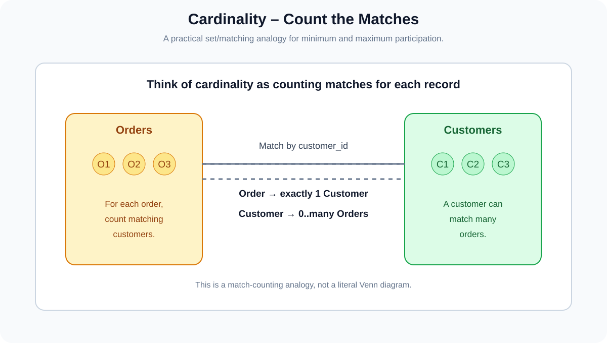
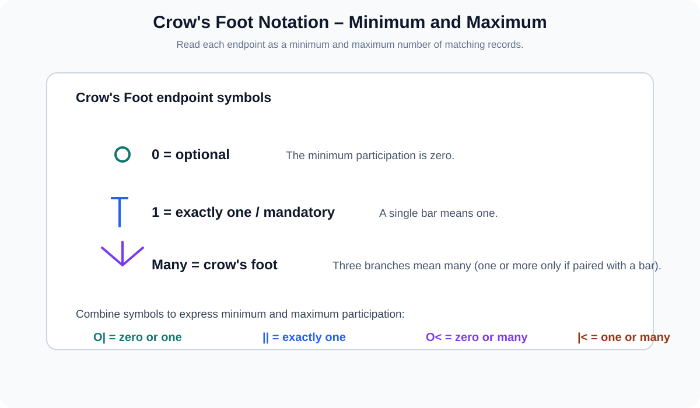
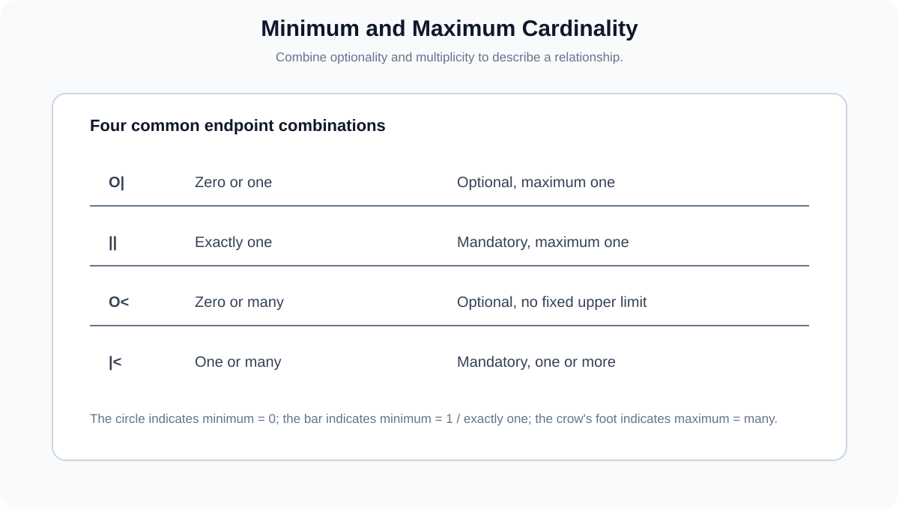
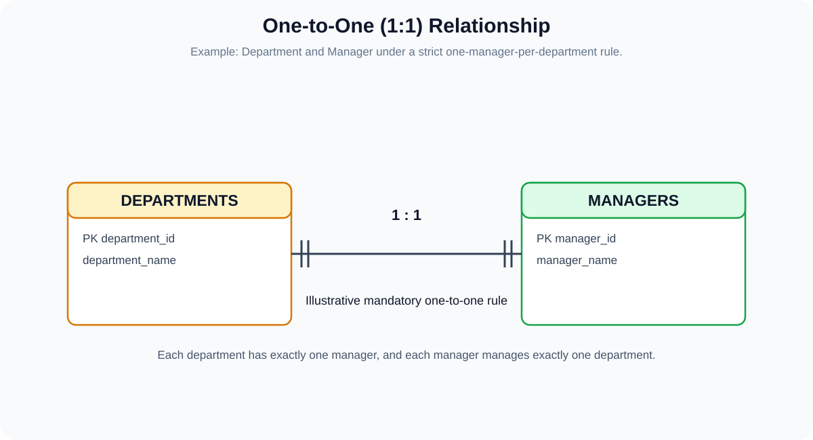
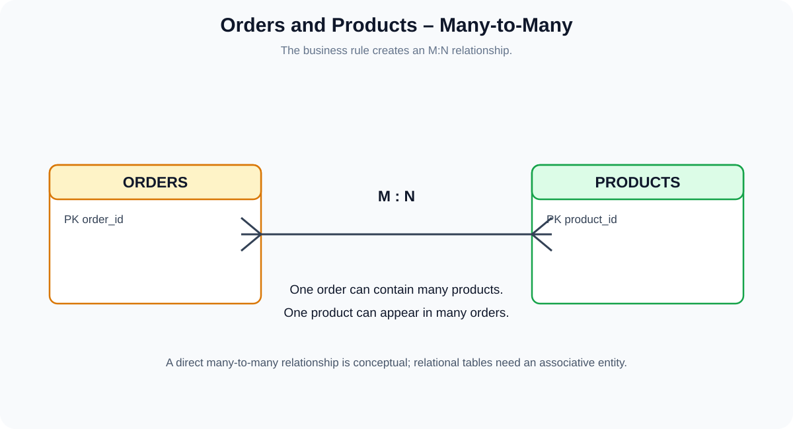
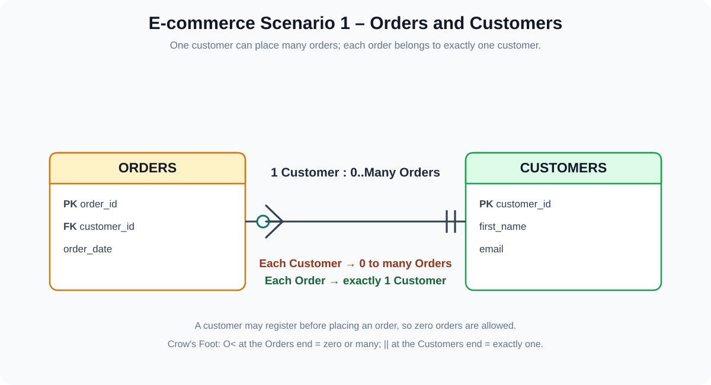
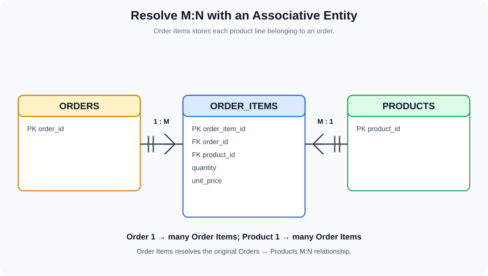
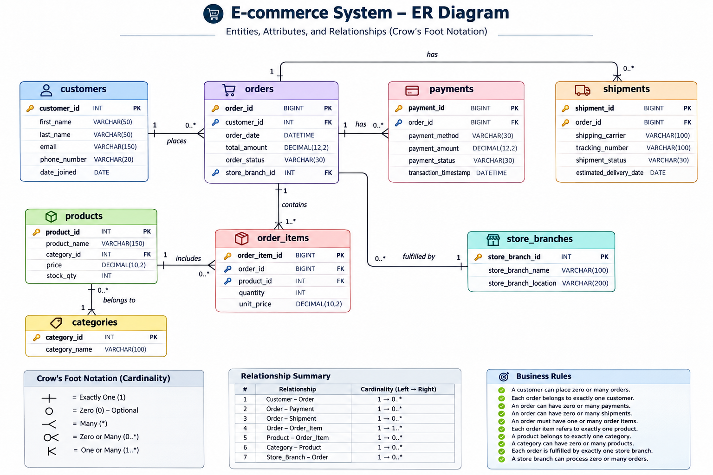

# Part 3.3 – OLTP Modeling: Relationships and Cardinality
## Crow's Foot Notation, Minimum/Maximum Participation and the E-commerce ER Diagram

**Learning path:** Data Modeling for Data Engineering  
**Chapter:** Part 3.3 – Logical Layer, Relationships  
**Project:** E-commerce OLTP database

---

## Learning objectives

By the end of this chapter, you should be able to:

1. Explain what a relationship is in an ER model.
2. Understand cardinality and participation.
3. Distinguish zero, one and many.
4. Read minimum and maximum cardinality.
5. Understand Crow's Foot notation.
6. Identify one-to-one, one-to-many and many-to-many relationships.
7. Interpret the Orders–Customers relationship correctly.
8. Resolve the Orders–Products many-to-many relationship using `order_items`.
9. Extend the e-commerce ER diagram with relationship lines and foreign keys.

---

# 1. What is a Relationship?

A **relationship** describes how records in one entity are associated with records in another entity.

Examples from our e-commerce application:

- A customer places orders.
- An order receives payments.
- An order is fulfilled through shipments.
- An order contains products.

An entity tells us **what information we store**. A relationship tells us **how records in different entities are connected**.

## 1.1 Why do we need relationships?

Suppose our database contains these two tables:

**customers**

| customer_id | customer_name |
|---:|---|
| 101 | Arun |
| 102 | Priya |

**orders**

| order_id | customer_id |
|---:|---:|
| 5001 | 101 |
| 5002 | 101 |
| 5003 | 102 |

The `customer_id` in Orders allows us to identify which customer placed each order.

The relationship is not just a line in a diagram. It represents a business rule and is normally implemented through a foreign key in a relational database.

---

# 2. What is Cardinality?

**Cardinality** describes how many records of one entity can be associated with a record of another entity.

For example:
- Can one order be associated with one customer?
- Can one customer place many orders?
- Can one order contain many products?
- Can one product appear in many orders?

Cardinality helps us define the allowed number of matching records.

There are two important ideas:

1. **Minimum cardinality:** the minimum number of related records allowed.
2. **Maximum cardinality:** the maximum number of related records allowed.

---

# 3. Minimum and Maximum Participation

When reading a relationship, ask two questions for each side:

- What is the minimum number of matching records?
- What is the maximum number of matching records?

For example, a customer may exist before placing an order.

Therefore, the minimum number of orders for a customer can be zero.

A customer can also place multiple orders, so the maximum is many.

That gives:

```text
Customer → Orders = 0..many
```

Each order, however, must belong to exactly one customer under our current business rule:

```text
Order → Customer = 1..1
```



## 3.1 What does zero mean?

Zero means participation is optional.

Example:
- A newly registered customer may not have placed an order.
- A product may not have appeared in any order yet.
- An order may not have a shipment yet if it is awaiting fulfillment.

Zero does not mean that the record itself does not exist. It means that a related record is not required yet.

## 3.2 What does one mean?

One means exactly one when used as both the minimum and maximum.

Example:
- Each order belongs to exactly one customer.
- Each payment record belongs to exactly one order, under the current model.

## 3.3 What does many mean?

Many means multiple matching records are allowed.

Example:
- A customer can place many orders.
- An order can have multiple shipment records if it is split into packages.
- An order can contain multiple order items.

---

# 4. Crow's Foot Notation

Crow's Foot notation is a common visual notation used in Entity-Relationship Diagrams (ERDs).

It uses three basic endpoint symbols:

- Circle = zero / optional.
- Bar = one.
- Crow's foot = many.



## 4.1 Circle – Zero

A circle means the minimum participation is zero.

```text
O
```

Interpretation: a record may have no matching record on the other side.

## 4.2 Bar – One

A bar means one.

```text
|
```

When the endpoint has a bar and no circle or crow's foot, it means exactly one.

## 4.3 Crow's Foot – Many

The three-pronged endpoint means many.

```text
<
```

It represents the maximum cardinality of many. It is combined with a circle or bar to show the minimum.

## 4.4 The four common combinations



| Crow's Foot endpoint | Meaning | Minimum | Maximum |
|---|---|---:|---:|
| `O|` | Zero or one | 0 | 1 |
| `||` | Exactly one | 1 | 1 |
| `O<` | Zero or many | 0 | Many |
| `|<` | One or many | 1 | Many |

**Notation correction:** A circle by itself does not mean the complete relationship is zero-to-one. A bar by itself does not describe the full relationship either. Read the combined endpoint marks to determine the minimum and maximum.

---

# 5. How to Read a Relationship Line

A relationship line has an endpoint at each entity. Each endpoint describes how many records of that entity can be associated with one record on the opposite side.

For example:

```text
CUSTOMER  ||────────O<  ORDER
```

Read from the Customer record:
- One customer can have zero or many orders.

Read from the Order record:
- Each order belongs to exactly one customer.

The endpoint nearest an entity tells you the number of records of that entity that can match one record on the opposite side.

**Always read the business statement from both directions.** This prevents confusing one-to-many with many-to-one.

---

# 6. Relationship Types

There are three common relationship types based on maximum cardinality.

## 6.1 One-to-One (1:1)

One record in Entity A is associated with one record in Entity B, and vice versa.

Example:

**Department and Manager**

Assume the business rule says:
- Every department must have exactly one manager.
- Every manager manages exactly one department.



```text
DEPARTMENT  1 : 1  MANAGER
```

Example data:

**departments**

| department_id | department_name |
|---:|---|
| 10 | HR |
| 20 | Finance |

**managers**

| manager_id | manager_name | department_id |
|---:|---|---:|
| 501 | Ravi | 10 |
| 502 | Meena | 20 |

The business rule is mandatory one-to-one in this simplified example.

**Important:** Real organizations may have vacant departments, acting managers or managers overseeing multiple departments. Always model the actual business rule, not an assumed universal rule.

## 6.2 One-to-Many (1:M)

One record in Entity A can be associated with multiple records in Entity B.

Example:

**Customer and Orders**

- One customer can place many orders.
- Each order belongs to exactly one customer.

```text
CUSTOMER  1 : M  ORDERS
```

Example:

| customer_id | customer_name |
|---:|---|
| 101 | Arun |
| 102 | Priya |

| order_id | customer_id |
|---:|---:|
| 5001 | 101 |
| 5002 | 101 |
| 5003 | 101 |
| 5004 | 102 |

Customer 101 has three orders. Customer 102 has one order.

## 6.3 Many-to-Many (M:N)

Multiple records in Entity A can be associated with multiple records in Entity B.

Example:

- One order can contain many products.
- One product can appear in many orders.

```text
ORDERS  M : N  PRODUCTS
```



Example data:

**orders**

| order_id |
|---:|
| 1 |
| 2 |
| 3 |
| 4 |

**products**

| product_id |
|---:|
| 101 |
| 102 |
| 103 |
| 104 |
| 105 |

A direct many-to-many association is useful at the conceptual level, but a relational database normally resolves it using an associative entity or junction table.

---

# 7. E-commerce Scenario 1 – Orders and Customers

This scenario follows the first relationship in the running notes.

## Business requirements

1. A customer can place multiple orders.
2. Each order belongs to exactly one customer.
3. A customer can register without immediately placing an order.

## 7.1 Read from Orders to Customers

Question: Can one order have multiple customers?

**No.** Under our business rule, one order belongs to exactly one customer.

Therefore:

```text
Order → Customer = exactly one
```

## 7.2 Read from Customers to Orders

Question: Can one customer place multiple orders?

**Yes.**

A customer may also have no orders yet.

Therefore:

```text
Customer → Orders = zero or many
```



## 7.3 Correct relationship classification

| Direction | Cardinality |
|---|---|
| Customer to Orders | 1:M |
| Orders to Customer | M:1 |

This is one relationship described from two directions. It is not a one-to-one relationship.

## 7.4 How is this implemented?

The `customer_id` foreign key is placed in the many-side table, which is Orders.

```sql
CREATE TABLE customers (
    customer_id BIGINT PRIMARY KEY,
    first_name VARCHAR(60),
    email VARCHAR(254)
);

CREATE TABLE orders (
    order_id BIGINT PRIMARY KEY,
    customer_id BIGINT NOT NULL,
    order_date DATETIME,

    CONSTRAINT fk_orders_customers
        FOREIGN KEY (customer_id)
        REFERENCES customers(customer_id)
);
```

The `NOT NULL` constraint expresses that every order must have a customer. The foreign key ensures that the referenced customer exists.

A customer with zero orders is still allowed because the customer table does not require an order record to exist.

---

# 8. E-commerce Scenario 2 – Orders and Products

## Business requirements

1. An order can contain multiple products.
2. A product can appear in multiple orders.
3. Each order-product line should record the quantity.
4. The system should preserve the unit price charged at the time of the order.

This is a many-to-many relationship.

```text
ORDERS M : N PRODUCTS
```

Why can't we simply place `product_id` in Orders?

Because one order can contain multiple product IDs. A single scalar column cannot represent an arbitrary list of product references in a normalized relational design.

Why can't we simply place `order_id` in Products?

Because a product can appear in many orders, so one `order_id` column in Products cannot store all its order memberships.

We need an associative entity.

---

# 9. Introducing Order Items – Resolving M:N

The solution is to introduce a new entity called `order_items`.

It sits between Orders and Products.



## 9.1 What is an associative entity?

An **associative entity** is an entity used to represent an association between other entities, commonly to resolve a many-to-many relationship.

It is also called:
- Junction table.
- Bridge table.
- Linking table.

## 9.2 Order Items attributes

| Attribute | Suggested data type | Purpose |
|---|---|---|
| order_item_id | BIGINT | Unique order-line identifier |
| order_id | BIGINT | Identifies the order |
| product_id | BIGINT | Identifies the product |
| quantity | INT | Number of units ordered |
| unit_price | DECIMAL(10,2) | Price per unit at purchase time |

We use `unit_price` to preserve the price charged when the order was placed. The current product catalog price may change later.

## 9.3 Relationships after introducing Order Items

Two one-to-many relationships replace the original many-to-many relationship:

1. One Order can contain one or many Order Items.
2. One Product can appear in zero or many Order Items.

From the Order Item perspective:
- Each order item belongs to exactly one order.
- Each order item refers to exactly one product.

## 9.4 Sample data

**order_items**

| order_item_id | order_id | product_id | quantity | unit_price |
|---:|---:|---:|---:|---:|
| 1 | 5001 | 101 | 2 | 450.00 |
| 2 | 5001 | 102 | 1 | 120.00 |
| 3 | 5002 | 101 | 1 | 450.00 |
| 4 | 5003 | 103 | 3 | 75.00 |

This shows:
- Order 5001 contains Products 101 and 102.
- Product 101 appears in Orders 5001 and 5002.
- The same product can appear in multiple orders.

## 9.5 Why does Order Item need its own identifier?

For this first design, we use `order_item_id` as a surrogate primary key.

An alternative is a composite primary key:

```sql
PRIMARY KEY (order_id, product_id)
```

However, that composite key only works if the same product can appear at most once per order.

If the business allows multiple separate lines for the same product within one order, use `order_item_id` or a composite key such as `(order_id, line_number)`.

---

# 10. Complete E-commerce ER Diagram

We now extend the five-entity diagram from Part 3.2 by adding relationship lines and the new `order_items` entity.



## 10.1 Relationship summary

| Entity A | Entity B | Relationship | Meaning |
|---|---|---|---|
| Customers | Orders | 1:M | One customer can place zero or many orders |
| Orders | Payments | 1:M | One order can have multiple payment records |
| Orders | Shipments | 1:M | One order can have multiple shipment records |
| Orders | Order Items | 1:M | One order contains one or many order items |
| Products | Order Items | 1:M | One product can appear in zero or many order items |

**Note:** The current diagram is a learning model. It follows the supplied entity draft and adds Order Items. Store Branch and Category are not yet modeled as separate entities, so those should be added during a later refinement. Payment and Shipment participation rules should also be confirmed with the business.

---

# 11. SQL Implementation of the Relationships

The following MySQL-style example demonstrates the foreign keys for the customer-order and order-item relationships.

```sql
CREATE TABLE customers (
    customer_id BIGINT PRIMARY KEY,
    first_name VARCHAR(60) NOT NULL,
    email VARCHAR(254) UNIQUE NOT NULL
);

CREATE TABLE products (
    product_id BIGINT PRIMARY KEY,
    product_name VARCHAR(150) NOT NULL,
    price DECIMAL(10,2) NOT NULL
);

CREATE TABLE orders (
    order_id BIGINT PRIMARY KEY,
    customer_id BIGINT NOT NULL,
    order_date DATETIME NOT NULL,

    CONSTRAINT fk_orders_customer
        FOREIGN KEY (customer_id)
        REFERENCES customers(customer_id)
);

CREATE TABLE order_items (
    order_item_id BIGINT PRIMARY KEY,
    order_id BIGINT NOT NULL,
    product_id BIGINT NOT NULL,
    quantity INT NOT NULL,
    unit_price DECIMAL(10,2) NOT NULL,

    CONSTRAINT fk_order_items_order
        FOREIGN KEY (order_id)
        REFERENCES orders(order_id),

    CONSTRAINT fk_order_items_product
        FOREIGN KEY (product_id)
        REFERENCES products(product_id),

    CONSTRAINT chk_order_item_quantity
        CHECK (quantity > 0)
);
```

The foreign keys ensure that an order item cannot refer to a non-existent order or product.

The foreign keys do not, by themselves, enforce every minimum-cardinality rule. For example, requiring every order to have at least one order item needs additional transaction/application logic or an appropriate database-level strategy.

---

# 12. Common Mistakes in Cardinality

1. Calling Orders–Customers a 1:1 relationship. It is 1:M from Customer to Orders.
2. Reading only one end of a relationship line.
3. Treating zero as a missing entity instead of optional participation.
4. Assuming a foreign key must be unique.
5. Trying to store multiple product IDs in one ordinary scalar column.
6. Forgetting the Order Item entity in an Order–Product M:N relationship.
7. Assuming every relationship must be mandatory on both sides.
8. Assuming a crow's-foot symbol alone tells you the minimum; inspect the circle or bar too.

---

# 13. Interview Questions

### Q1. What is cardinality?

Cardinality defines how many records of one entity can be associated with a record of another entity.

### Q2. What is minimum cardinality?

The minimum number of related records allowed for an entity instance.

### Q3. What is maximum cardinality?

The maximum number of related records allowed for an entity instance.

### Q4. What does a circle represent in Crow's Foot notation?

Zero or optional participation.

### Q5. What does a single bar represent?

One. A bar endpoint without a circle or crow's foot indicates exactly one.

### Q6. What does the crow's foot represent?

Many.

### Q7. What does O| mean?

Zero or one.

### Q8. What does || mean?

Exactly one.

### Q9. What does O< mean?

Zero or many.

### Q10. What does |< mean?

One or many.

### Q11. What is a one-to-many relationship?

One record in the parent entity can be associated with multiple records in the child entity.

### Q12. What is a many-to-many relationship?

Multiple records in each entity can be associated with multiple records in the other entity.

### Q13. How do you implement a many-to-many relationship in a relational database?

Introduce an associative or junction table containing references to both participating entities.

### Q14. Why do we need Order Items?

It records each product line in an order, including quantity and the price at the time of purchase, while resolving the Orders–Products many-to-many relationship.

### Q15. Where is the foreign key normally placed in a one-to-many relationship?

On the many side, referencing the key of the one side.

### Q16. Is Orders–Customers one-to-one?

No. One customer can place many orders, while each order belongs to one customer.

---

# 14. Practical Assignments

## Assignment 1 – Identify cardinality

For each pair, decide whether it is 1:1, 1:M or M:N and state the minimum and maximum participation on both sides.

1. Customer and Orders.
2. Orders and Payments.
3. Orders and Shipments.
4. Orders and Products.
5. Orders and Order Items.
6. Products and Order Items.

## Assignment 2 – Crow's Foot notation

Draw each relationship using the four endpoint combinations:

- Zero or one.
- Exactly one.
- Zero or many.
- One or many.

Write a real-world example for each.

## Assignment 3 – Build the Order Items entity

Create the Order Items table with:
- order_item_id
- order_id
- product_id
- quantity
- unit_price

Choose a primary key and identify the foreign keys.

## Assignment 4 – Analyze business rules

A customer can register without placing an order. An order must have one customer.

Answer:
1. What is the minimum number of orders for a customer?
2. What is the maximum number of orders for a customer?
3. How many customers can one order have?
4. Which table should contain the foreign key?
5. Why?

## Assignment 5 – Complete the ER diagram

Draw the following entities and relationships:

- Customers → Orders.
- Orders → Payments.
- Orders → Shipments.
- Orders → Order Items.
- Products → Order Items.

Mark primary keys, foreign keys, minimum cardinality and maximum cardinality.

---

# 15. Completion Checklist

- [ ] Understand relationships.
- [ ] Understand cardinality.
- [ ] Understand minimum participation.
- [ ] Understand maximum participation.
- [ ] Understand zero, one and many.
- [ ] Read Crow's Foot notation.
- [ ] Understand 1:1 relationships.
- [ ] Understand 1:M relationships.
- [ ] Understand M:N relationships.
- [ ] Correctly model Orders–Customers.
- [ ] Understand associative entities.
- [ ] Create Order Items.
- [ ] Understand foreign-key placement.
- [ ] Complete the e-commerce ER diagram.
- [ ] Complete practical assignments.

---

# 16. Final Summary

| Concept | Meaning |
|---|---|
| Relationship | Association between entities |
| Cardinality | Number of matching records |
| Minimum cardinality | Minimum allowed matches |
| Maximum cardinality | Maximum allowed matches |
| Circle | Zero / optional |
| Bar | One |
| Crow's foot | Many |
| 1:1 | One-to-one |
| 1:M | One-to-many |
| M:N | Many-to-many |
| Associative entity | Resolves an M:N relationship in a relational model |
| Foreign Key | References another entity's key |

## Final learning sequence

```text
IDENTIFY ENTITIES
       |
       v
IDENTIFY ATTRIBUTES
       |
       v
ASSIGN DATA TYPES
       |
       v
IDENTIFY KEYS
       |
       v
UNDERSTAND CARDINALITY
       |
       v
DEFINE RELATIONSHIPS
       |
       v
RESOLVE MANY-TO-MANY
       |
       v
COMPLETE ER DIAGRAM
```

**Key takeaway:** Entity identification tells us what information to store. Relationships and cardinality tell us how the records are connected and how many matching records are allowed.

**Next chapter:** Part 3.4 – OLTP Logical Modeling: Normalization (1NF, 2NF and 3NF), Functional Dependencies and Redundancy.
