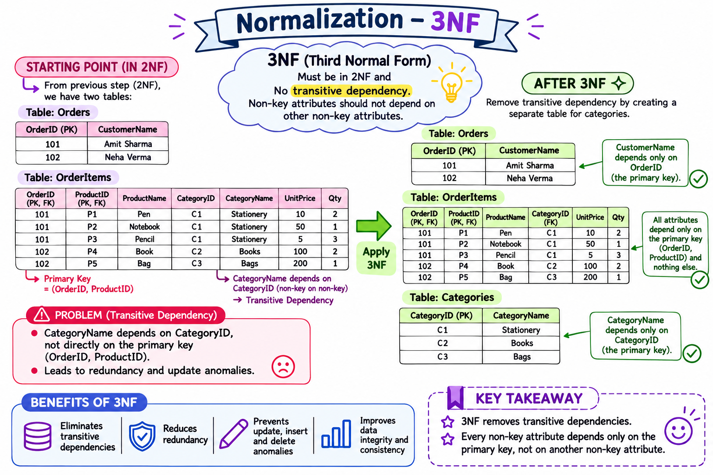
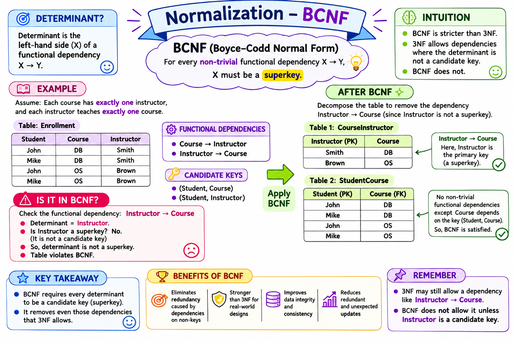
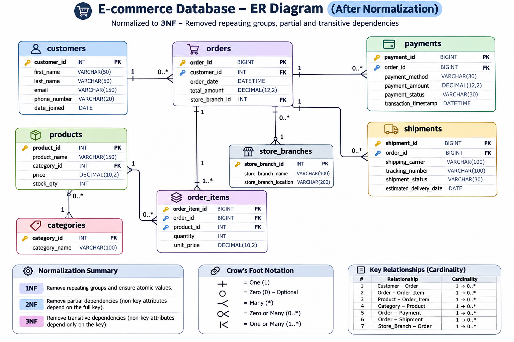

# Part 3.4 – OLTP Modeling: Database Normalization

**Chapter status:** Final chapter of OLTP logical data modeling  
**Project:** E-commerce database  
**Topics:** Functional Dependencies, Data Anomalies, 1NF, 2NF, 3NF, BCNF, Normalized E-commerce Schema

---

## Learning objectives

By the end of this chapter, you should be able to:

1. Explain why normalization is important in OLTP systems.
2. Identify insertion, update and deletion anomalies.
3. Understand functional dependencies, determinants and dependent attributes.
4. Identify partial and transitive dependencies.
5. Explain and apply 1NF, 2NF, 3NF and BCNF.
6. Analyze the e-commerce entities and their dependencies.
7. Explain why each entity is stored separately.
8. Review the final normalized e-commerce logical schema.
9. Distinguish normalization from denormalization.

---

# 1. Why do we need normalization?

Imagine that our e-commerce application stores customer, order and product information in one large table. Whenever a customer places multiple orders, the customer's name, email and phone number may be repeated. Product names and catalog prices may also appear in many rows.

This creates unnecessary data redundancy.

**Database normalization** is the process of organizing data into well-structured relations to reduce avoidable redundancy and prevent insertion, update and deletion anomalies.

Normalization is not about removing every repeated value. It is about ensuring that attributes are stored with the entity and key that properly determine them.

## 1.1 Example: Unnormalized order data

| order_id | customer_name | customer_email | product_name | product_price | quantity |
|---:|---|---|---|---:|---:|
| 5001 | Arun | arun@gmail.com | Laptop | 55000 | 1 |
| 5001 | Arun | arun@gmail.com | Mouse | 800 | 2 |
| 5002 | Arun | arun@gmail.com | Keyboard | 1500 | 1 |
| 5003 | Priya | priya@gmail.com | Laptop | 55000 | 1 |

Problems:
- Customer details are repeated across orders.
- Product catalog information is repeated across order lines.
- Updating one copy but not another can create inconsistent data.
- Product catalog information is tied to order activity.

---

# 2. Database anomalies

Normalization helps prevent three common anomalies.

## 2.1 Insertion anomaly

An insertion anomaly occurs when a fact cannot be recorded without also inserting an unrelated fact.

**E-commerce example:** If product details can only be stored in the order table, the business may be unable to add a new product to its catalog until someone places an order for it.

**Design improvement:** Store product catalog details in `products`, independently of `orders`.

## 2.2 Update anomaly

An update anomaly occurs when the same fact is stored in multiple rows and all copies must be updated consistently.

**E-commerce example:** Arun changes his email address. If his email appears in 50 order rows, all 50 copies must be updated. Missing one row leaves inconsistent customer information.

**Design improvement:** Store customer details once in `customers`; reference the customer from `orders` using `customer_id`.

## 2.3 Deletion anomaly

A deletion anomaly occurs when deleting one fact unintentionally removes another fact that should have been retained.

**E-commerce example:** If the only record of a product is stored in an order-line table, deleting the last order line for that product may also remove the only stored product details.

**Design improvement:** Maintain the product catalog independently in `products`.

---

# 3. Functional Dependency

A **functional dependency** describes how one attribute or a group of attributes determines another attribute.

Notation:

```text
X → Y
```

Read this as: X determines Y.

For example:

```text
customer_id → customer_name
customer_id → email
customer_id → phone_number
```

If `customer_id` uniquely identifies a customer, it determines that customer's stored name, email and phone number.

## 3.1 Determinant and dependent attribute

In:

```text
customer_id → email
```

- `customer_id` is the determinant.
- `email` is the dependent attribute.

## 3.2 E-commerce functional dependency examples

| Functional dependency | Meaning |
|---|---|
| `customer_id → first_name, last_name, email` | Customer ID identifies customer details |
| `product_id → product_name, category_id, price` | Product ID identifies current catalog attributes |
| `category_id → category_name` | Category ID identifies category name |
| `order_id → customer_id, order_date` | Order ID identifies its customer and date |
| `payment_id → order_id, payment_amount, payment_status` | Payment ID identifies a payment record |
| `shipment_id → order_id, tracking_number, shipment_status` | Shipment ID identifies a shipment record |

These examples assume the identifiers are unique and the attributes have one stored value for each identified record.

## 3.3 Composite functional dependency

Some attributes depend on a combination of attributes.

For example, if a product can appear only once per order:

```text
(order_id, product_id) → quantity
(order_id, product_id) → unit_price
```

Neither `order_id` nor `product_id` alone identifies the quantity of that product in that order. The combination does.

This is important when learning 2NF.

---

# 4. First Normal Form (1NF)

**Definition:** A relation is in First Normal Form when each attribute contains a single value for each row and there are no repeating groups or multi-valued lists stored in one cell.

Main requirements:
- One value per cell.
- No comma-separated lists of products in a single column.
- No repeating groups of product columns.
- Rows must be distinguishable.

## 4.1 Before 1NF

| order_id | customer_name | products | quantities |
|---:|---|---|---|
| 5001 | Arun | Laptop, Mouse | 1, 2 |
| 5002 | Priya | Keyboard, Mouse | 1, 1 |

The `products` and `quantities` cells contain lists. The individual product and quantity values are not represented as separate rows.

## 4.2 Convert to 1NF

| order_id | customer_name | product_name | quantity |
|---:|---|---|---:|
| 5001 | Arun | Laptop | 1 |
| 5001 | Arun | Mouse | 2 |
| 5002 | Priya | Keyboard | 1 |
| 5002 | Priya | Mouse | 1 |

Now each cell contains one value and each product line is represented as a separate row.

**1NF does not guarantee that all redundancy has been removed.** Customer and product information can still be repeated.

## 4.3 1NF reference image

The following image is referenced by filename. Keep `1NF.png` in the same directory as this Markdown file for the link to resolve.


---

# 5. Second Normal Form (2NF)

**Definition:** A relation is in Second Normal Form if:

1. It is already in 1NF.
2. Every non-prime attribute is fully functionally dependent on every candidate key; no non-prime attribute depends on only a proper subset of a candidate key.

In introductory examples, this is often described as removing partial dependencies on a composite candidate key.

## 5.1 Understand partial dependency

Consider this order-line relation:

| order_id | product_id | customer_name | product_name | quantity |
|---:|---:|---|---|---:|
| 5001 | 101 | Arun | Laptop | 1 |
| 5001 | 102 | Arun | Mouse | 2 |
| 5002 | 101 | Priya | Laptop | 1 |

Assume `(order_id, product_id)` is the candidate key because a product appears at most once per order.

Dependencies:

```text
(order_id, product_id) → quantity
order_id → customer_name
product_id → product_name
```

`customer_name` depends only on `order_id`, while `product_name` depends only on `product_id`. These are partial dependencies on parts of the composite key.

## 5.2 Decompose into 2NF

**Orders**

| order_id (PK) | customer_name |
|---:|---|
| 5001 | Arun |
| 5002 | Priya |

**Products**

| product_id (PK) | product_name |
|---:|---|
| 101 | Laptop |
| 102 | Mouse |

**Order Items**

| order_id (PK, FK) | product_id (PK, FK) | quantity |
|---:|---:|---:|
| 5001 | 101 | 1 |
| 5001 | 102 | 2 |
| 5002 | 101 | 1 |

Each attribute is now stored with the key on which it fully depends.

## 5.3 Important note about surrogate keys

Our final design uses `order_item_id` as the primary key of `order_items`. A surrogate primary key does not automatically remove every dependency or make a relation 2NF.

When checking 2NF, examine **all candidate keys**, not only the selected primary key. For teaching the composite-key example above, `(order_id, product_id)` is assumed to be a candidate key under the stated one-line-per-product-per-order rule.

If the same product can appear on multiple separate lines in one order, use a line identifier or another appropriate candidate key, such as `(order_id, line_number)`.

## 5.4 2NF reference image

Keep `2NF.png` in the same directory as this Markdown file.


---

# 6. Third Normal Form (3NF)

**Definition:** A relation is in Third Normal Form if, for every non-trivial functional dependency `X → A`, at least one of these conditions holds:

1. X is a superkey; or
2. A is a prime attribute (an attribute that belongs to at least one candidate key).

A common introductory explanation is that 3NF removes transitive dependencies of non-prime attributes on candidate keys.

## 6.1 Transitive dependency example: Customer address

Consider:

| customer_id | customer_name | pincode | city | state |
|---:|---|---|---|---|
| 101 | Arun | 600001 | Chennai | Tamil Nadu |
| 102 | Priya | 600001 | Chennai | Tamil Nadu |
| 103 | Kumar | 560001 | Bengaluru | Karnataka |

Assume the simplified business rule that each pincode determines one city and state.

Dependencies:

```text
customer_id → customer_name, pincode
pincode → city, state
```

Therefore, customer ID determines city and state through pincode:

```text
customer_id → pincode → city, state
```

This is a transitive dependency.

## 6.2 Decompose into 3NF

**Customers**

| customer_id (PK) | customer_name | pincode (FK) |
|---:|---|---|
| 101 | Arun | 600001 |
| 102 | Priya | 600001 |
| 103 | Kumar | 560001 |

**Postal Areas**

| pincode (PK) | city | state |
|---|---|---|
| 600001 | Chennai | Tamil Nadu |
| 560001 | Bengaluru | Karnataka |

The postal-area attributes are now stored with the postal-area identifier.

**Modeling caveat:** Real postal-code data can map to multiple localities. The determinant and key must reflect the actual address reference data rather than assuming every postal code uniquely identifies one city.

## 6.3 E-commerce example: Products and Categories

Before decomposition:

| product_id | product_name | category_id | category_name |
|---:|---|---:|---|
| 101 | Laptop | 10 | Electronics |
| 102 | Mouse | 10 | Electronics |
| 103 | Shirt | 20 | Clothing |
| 104 | Keyboard | 10 | Electronics |

Dependencies:

```text
product_id → product_name, category_id
category_id → category_name
```

Decompose into:

**Products**

| product_id | product_name | category_id |
|---:|---|---:|
| 101 | Laptop | 10 |
| 102 | Mouse | 10 |
| 103 | Shirt | 20 |
| 104 | Keyboard | 10 |

**Categories**

| category_id | category_name |
|---:|---|
| 10 | Electronics |
| 20 | Clothing |

Now category details are maintained independently.

## 6.4 3NF reference image

Keep `3NF.png` in the same directory as this Markdown file.



---

# 7. Boyce-Codd Normal Form (BCNF)

BCNF is a stronger form of 3NF.

**Definition:** A relation is in BCNF if, for every non-trivial functional dependency `X → Y`, X is a superkey.

In simpler terms:

**Every determinant must be a superkey.**

## 7.1 Why do we need BCNF?

A relation can satisfy 3NF while still having a determinant that is not a superkey, in a special case where the dependent attribute is prime.

BCNF removes this remaining class of dependency.

## 7.2 E-commerce fulfillment example

Assume these business rules:

1. An order can be assigned to multiple warehouse managers.
2. Each manager is assigned to exactly one warehouse.
3. An order-manager assignment identifies the warehouse associated with that manager.

Relation:

`order_fulfillment(order_id, warehouse_id, manager_id)`

Example:

| order_id | warehouse_id | manager_id |
|---:|---|---|
| 5001 | WH01 | M01 |
| 5001 | WH02 | M02 |
| 5002 | WH01 | M01 |
| 5003 | WH03 | M03 |

Functional dependencies:

```text
(order_id, warehouse_id) → manager_id
manager_id → warehouse_id
```

Candidate keys under these assumptions:

```text
(order_id, warehouse_id)
(order_id, manager_id)
```

The dependency `manager_id → warehouse_id` has a determinant that is not a superkey of the original relation.

However, `warehouse_id` is a prime attribute because it belongs to a candidate key. This dependency can satisfy 3NF while violating BCNF.

## 7.3 Decompose into BCNF

**Manager Warehouse**

| manager_id (PK) | warehouse_id |
|---|---|
| M01 | WH01 |
| M02 | WH02 |
| M03 | WH03 |

**Order Manager**

| order_id (PK, part) | manager_id (PK, part) |
|---:|---|
| 5001 | M01 |
| 5001 | M02 |
| 5002 | M01 |
| 5003 | M03 |

In the first relation, manager ID is the key and determines the warehouse. In the second relation, the combination of order ID and manager ID identifies an assignment.

This decomposition is lossless under the stated dependency. The example illustrates the BCNF rule; real fulfillment systems may require additional attributes and business rules.

## 7.4 BCNF reference image

Keep `BCNF.png` in the same directory as this Markdown file.



---

# 8. Compare the Normal Forms

| Normal form | Main requirement | Main issue addressed |
|---|---|---|
| 1NF | Atomic values and no repeating groups | Multi-valued cells |
| 2NF | No partial dependency of non-prime attributes on a candidate key | Partial dependency |
| 3NF | For every non-trivial FD, determinant is a superkey or dependent is prime | Transitive and other non-3NF dependencies |
| BCNF | Every non-trivial FD has a superkey determinant | Remaining determinant-related redundancy |

Relationship:

```text
BCNF ⊂ 3NF ⊂ 2NF ⊂ 1NF
```

Every BCNF relation is in 3NF, every 3NF relation is in 2NF, and every 2NF relation is in 1NF. The reverse implications do not necessarily hold.

---

# 9. Final Normalized E-commerce Schema

The following is the final logical schema represented in our e-commerce ER diagram after separating customer, product, branch and transaction-line information into their own entities.



## 9.1 Entity inventory

| Entity | Primary key | Attributes shown in the design |
|---|---|---|
| customers | `customer_id` | first_name, last_name, email, phone_number, date_joined |
| orders | `order_id` | customer_id, order_date, total_amount, store_branch_id |
| products | `product_id` | product_name, category_id, price, stock_qty |
| store_branch | `store_branch_id` | store_branch_name, store_branch_location |
| order_items | `order_item_id` | order_id, product_id |
| payments | `payment_id` | order_id, payment_method, payment_amount, payment_status, transaction_status |
| shipments | `shipment_id` | order_id, shipping_carrier, tracking_number, shipment_status, estimated_delivery_date |

## 9.2 Relationships represented in the ER diagram

| Parent entity | Child entity | Foreign key | Relationship |
|---|---|---|---|
| customers | orders | `orders.customer_id` | One customer can have many orders |
| store_branch | orders | `orders.store_branch_id` | One branch can process many orders |
| orders | payments | `payments.order_id` | One order can have multiple payment records |
| orders | shipments | `shipments.order_id` | One order can have multiple shipment records |
| orders | order_items | `order_items.order_id` | One order can have multiple order items |
| products | order_items | `order_items.product_id` | One product can appear in multiple order items |

The `order_items` entity resolves the many-to-many relationship between Orders and Products.

## 9.3 Two modeling points to carry forward

**Category:** The `products` entity contains `category_id`, but the supplied final diagram does not show a separate `categories` entity or its relationship. Add that entity and foreign-key relationship when completing the category model.

**Order Items:** The supplied diagram shows `order_item_id`, `order_id` and `product_id`. In a production order-line model, also consider `quantity` and historical `unit_price`. These attributes are needed to represent the purchased quantity and price for each line.

## 9.4 Normalization is not just splitting tables

The final schema should be validated against its actual functional dependencies, candidate keys and business rules. A diagram with separate tables is not automatically proven to be in BCNF.

Normalization decisions must be justified by the dependencies in the data.

---

# 10. Why retain some repeated or derived values?

Normalization does not mean that every repeated or calculated value must be removed.

## 10.1 Historical unit price

Suppose a laptop costs ₹55,000 when an order is placed. Two months later, the catalog price becomes ₹60,000.

The historical order must retain the original purchase price.

That is why `unit_price` belongs in `order_items` as a transaction snapshot, while `products.price` represents the current catalog price.

## 10.2 Order total

An order total may be calculated from order items, discounts, taxes, shipping and other charges. Some systems retain a finalized total as a transaction snapshot for financial and audit purposes.

If it is stored, the system must keep it consistent with the transaction details.

## 10.3 Inventory quantity

`stock_qty` is a current inventory value. A more advanced inventory system may use a stock ledger or inventory movement table as the source of truth and maintain a current balance for performance.

The correct choice depends on operational requirements.

---

# 11. Normalization vs Denormalization

| Normalization | Denormalization |
|---|---|
| Reduces unnecessary redundancy | Intentionally introduces or retains redundancy |
| Separates related entities | Combines data for selected workloads |
| Common in OLTP design | Common in analytical designs |
| Supports transactional consistency | Can simplify analytical queries |
| Often requires joins to reconstruct details | Can reduce joins for common reports |

Example normalized OLTP flow:

```text
CUSTOMERS
    |
    | customer_id
    v
 ORDERS
    |
    | order_id
    v
ORDER_ITEMS
    |
    | product_id
    v
 PRODUCTS
```

An analytical dataset may intentionally combine customer, product and transaction attributes to make reporting easier.

This is why OLTP modeling and OLAP dimensional modeling have different design goals.

---

# 12. Interview Questions

1. What is database normalization?
2. Why do we normalize relational databases?
3. What are insertion, update and deletion anomalies?
4. What is a functional dependency?
5. What is a determinant?
6. What is a composite functional dependency?
7. What is partial dependency?
8. What is transitive dependency?
9. What are the requirements of 1NF?
10. What are the requirements of 2NF?
11. Why do candidate keys matter when checking 2NF?
12. Can a table with a single-column primary key still violate 2NF?
13. What is the difference between 2NF and 3NF?
14. What is BCNF?
15. What is the difference between 3NF and BCNF?
16. Can a relation be in 3NF but not BCNF?
17. Does normalization remove every repeated value?
18. Why is historical unit price stored in Order Items?
19. Why is category information separated from Products?
20. Why do OLTP and OLAP systems use different modeling approaches?

---

# 13. Practical Assignments

Use the e-commerce application throughout these assignments.

## Assignment 1 – Identify anomalies

Given:

```text
order_id
customer_id
customer_name
customer_email
product_id
product_name
product_price
quantity
```

Identify insertion, update and deletion anomalies.

## Assignment 2 – Convert into 1NF

Given:

| order_id | products | quantities |
|---:|---|---|
| 5001 | Laptop, Mouse | 1, 2 |
| 5002 | Keyboard, Mouse | 1, 1 |

Convert it into 1NF.

## Assignment 3 – Convert into 2NF

Given:

```text
order_id
product_id
customer_name
product_name
quantity
```

Assume `(order_id, product_id)` is a candidate key.

Identify the partial dependencies and decompose the relation.

## Assignment 4 – Convert into 3NF

Given:

```text
customer_id
customer_name
pincode
city
state
```

Assume:

```text
customer_id → customer_name, pincode
pincode → city, state
```

Identify the transitive dependency and decompose the relation.

## Assignment 5 – Convert into BCNF

Use the Order Fulfillment example.

Identify:
- Candidate keys.
- Functional dependencies.
- The BCNF violation.
- A lossless decomposition.

## Assignment 6 – Review the final e-commerce schema

Using the final ER diagram:

1. Identify all primary keys.
2. Identify all foreign keys.
3. Identify all one-to-many relationships.
4. Explain why Order Items is required.
5. Explain why Store Branch is separate from Orders.
6. Identify the missing Category relationship.
7. Suggest additional attributes for Order Items.
8. Explain which transaction snapshots should be retained.

---

# 14. Final Revision Checklist

- [ ] Understand database normalization.
- [ ] Understand insertion anomaly.
- [ ] Understand update anomaly.
- [ ] Understand deletion anomaly.
- [ ] Understand functional dependencies.
- [ ] Identify determinants and dependent attributes.
- [ ] Understand composite dependencies.
- [ ] Apply 1NF.
- [ ] Identify partial dependencies.
- [ ] Apply 2NF.
- [ ] Identify transitive dependencies.
- [ ] Apply 3NF.
- [ ] Understand superkeys and candidate keys.
- [ ] Apply BCNF.
- [ ] Review the final e-commerce schema.
- [ ] Distinguish normalization from denormalization.

---

# 15. OLTP Data Modeling – Completed

We have completed the four learning parts of OLTP modeling.

| Part | Chapter | Status |
|---|---|---|
| 3.1 | Conceptual Layer – Requirements Gathering | Completed |
| 3.2 | Logical Layer – Entities, Attributes, Data Types and Keys | Completed |
| 3.3 | Relationships, Cardinality and Crow's Foot | Completed |
| 3.4 | Normalization – 1NF, 2NF, 3NF and BCNF | Completed |

## What have we learned?

```text
REQUIREMENT GATHERING
        |
        v
ENTITY IDENTIFICATION
        |
        v
ATTRIBUTES & DATA TYPES
        |
        v
PRIMARY & FOREIGN KEYS
        |
        v
RELATIONSHIPS & CARDINALITY
        |
        v
NORMALIZATION
        |
        v
LOGICAL DATA MODEL
```

## Final note – Physical Layer

The next step is the Physical Data Model:

- Select the target database engine.
- Define actual SQL data types.
- Implement primary and foreign keys.
- Define unique, check and not-null constraints.
- Create indexes.
- Choose storage and partitioning strategies where appropriate.
- Generate and validate the DDL.

We can use AI to help generate the physical model from our completed logical ER diagram, then review and test the generated SQL.

<badge color="success">OLTP Data Modeling – Learning sequence completed</badge>

**Next major learning area:** OLAP Modeling and Dimensional Modeling.
