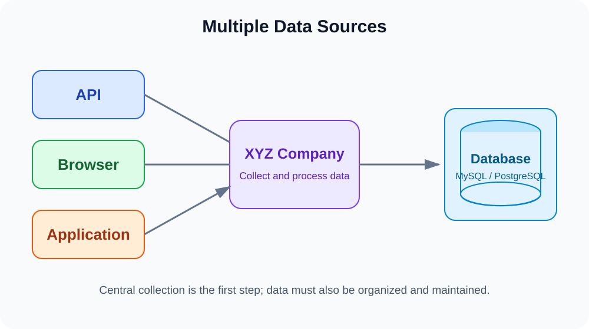
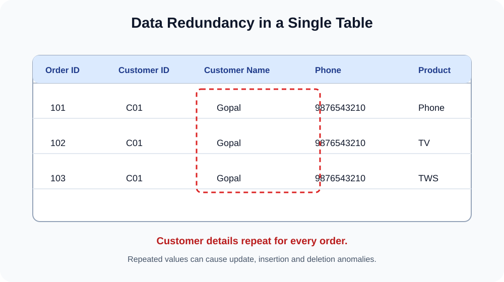
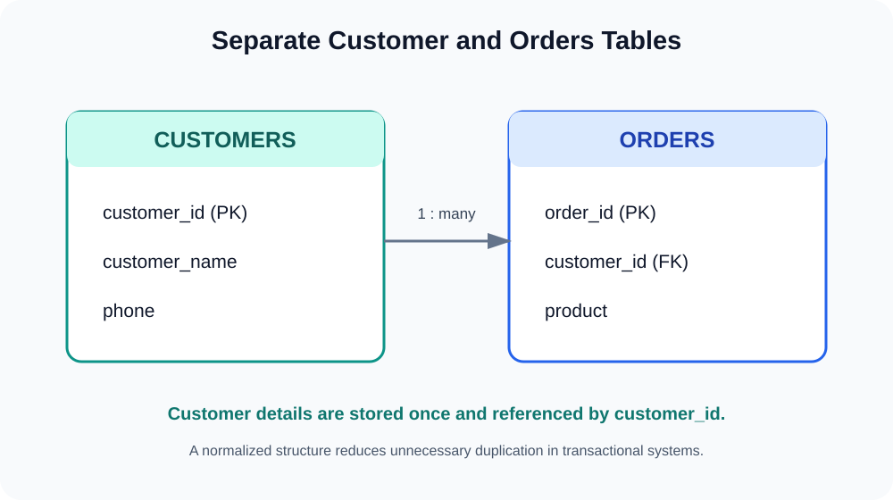
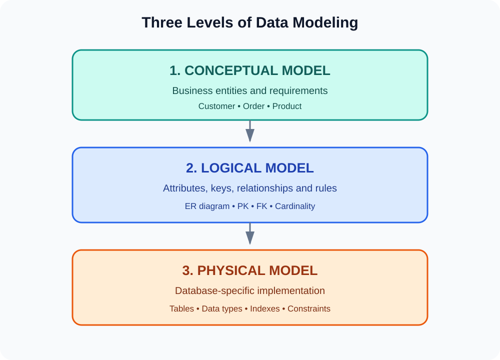
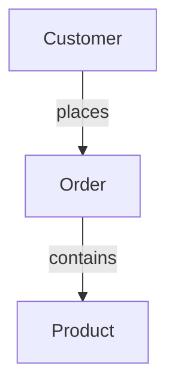
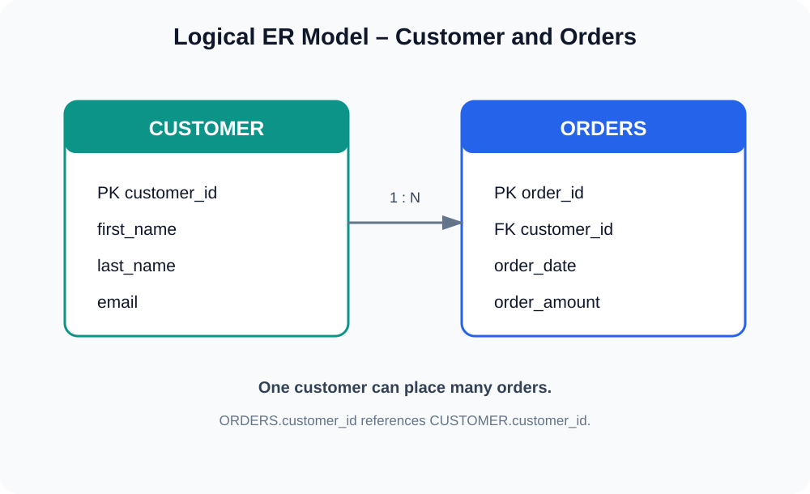
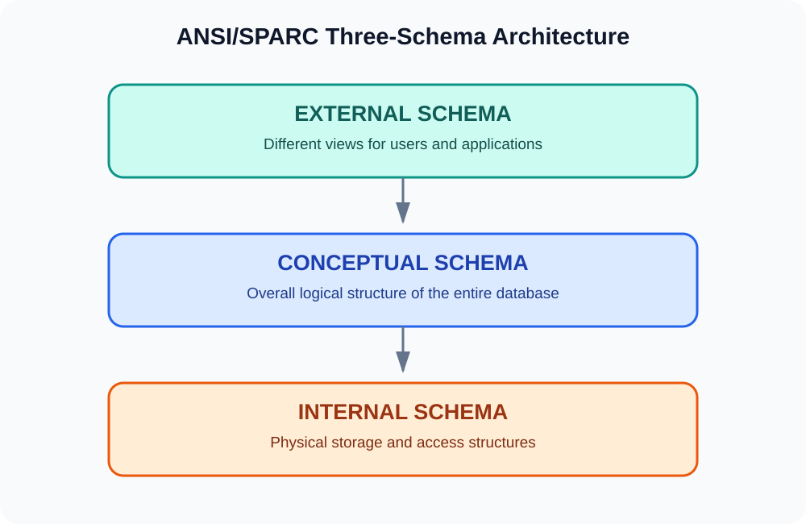
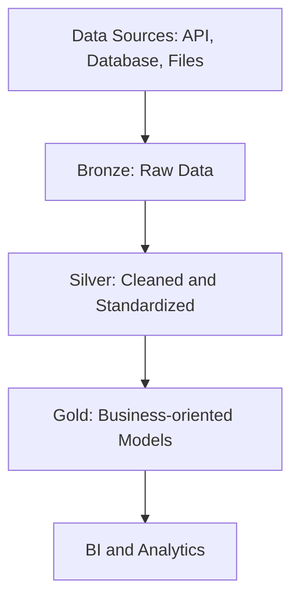

# Part 1 – Why Data Modeling?

> **Learning path:** Data Modeling for Data Engineering  
> **Part:** 1 – Why Data Modeling?  
> **Scope:** Why data modeling is needed; data redundancy, storage, performance and maintenance; conceptual, logical and physical modeling levels; ANSI/SPARC three-schema architecture.

---

## Learning objectives

By the end of this part, you should be able to:

1. Explain why collecting data into a central database is not enough.
2. Explain data redundancy and the anomalies it can create.
3. Describe how data modeling supports maintainability, consistency and analytical querying.
4. Distinguish conceptual, logical and physical data models.
5. Explain the difference between the three modeling levels and the ANSI/SPARC external, conceptual and internal schemas.
6. Read a simple entity relationship diagram (ERD) and identify primary and foreign keys.

---

# 1. Why do we need Data Modeling?

## 1.1 Definition

**Data modeling** is the process of identifying, organizing and defining data entities, their attributes, relationships and rules so that data can be stored, maintained and used effectively.

In practical terms, data modeling answers questions such as:

- What data does the business need?
- What are the important entities?
- What information should be stored about each entity?
- How are entities related?
- Which attributes uniquely identify a record?
- How should the data be structured for its intended workload?

A company may collect data successfully but still have a poorly organized database. Data collection and data organization are two different concerns.

## 1.2 Example: multiple sources sending data to one company

Imagine an e-commerce company called **XYZ Company**. It receives information from several sources:

- **API:** customer profiles, product catalogues and external service data.
- **Browser:** page visits, searches and browsing activity.
- **Application:** orders, payments and delivery events.

These sources send data to a central platform, where it may be stored in MySQL, PostgreSQL, a data lake or another storage system.



**Key idea:** Centralizing data is only the first step. The company must also decide how the data should be structured, connected, validated and maintained. This is where data modeling becomes important.

> **Data Engineering note:** In modern platforms, data may first land in a raw data lake or Bronze layer without being fully modeled. Modeling and standardization can happen later in Silver and Gold layers. The exact approach depends on the architecture and use case.

---

# 2. Problems that Data Modeling helps address

The original notes identify four motivations: data redundancy, storage cost, performance and maintenance. The following sections explain each in more detail.

## 2.1 Data redundancy

**Data redundancy** means storing the same piece of information repeatedly when it does not need to be duplicated.

Consider a customer named Gopal who places three orders.

| Order ID | Customer ID | Customer Name | Phone | Product |
|---:|---|---|---|---|
| 101 | C01 | Gopal | 9876543210 | Phone |
| 102 | C01 | Gopal | 9876543210 | TV |
| 103 | C01 | Gopal | 9876543210 | TWS |

The customer's name and phone number are repeated in every order row.



### Why can this become a problem?

1. The same customer information is stored in multiple rows.
2. If the phone number changes, several rows may need to be updated.
3. If only some rows are updated, the database can contain inconsistent values.
4. The repeated information increases the amount of data stored and maintained.

### A normalized design

We can separate customer details from order details.

**CUSTOMERS**

| customer_id (PK) | customer_name | phone |
|---|---|---|
| C01 | Gopal | 9876543210 |

**ORDERS**

| order_id (PK) | customer_id (FK) | product |
|---:|---|---|
| 101 | C01 | Phone |
| 102 | C01 | TV |
| 103 | C01 | TWS |



Now customer details are stored once in the Customers table. The Orders table references the customer using `customer_id`.

This is an example of **normalization**: organizing relational data to reduce unnecessary duplication and avoid modification anomalies.

### SQL example

```sql
CREATE TABLE customers (
    customer_id INT PRIMARY KEY,
    customer_name VARCHAR(100),
    phone VARCHAR(15)
);

CREATE TABLE orders (
    order_id INT PRIMARY KEY,
    customer_id INT,
    product VARCHAR(100),
    FOREIGN KEY (customer_id)
        REFERENCES customers(customer_id)
);
```

Insert sample records:

```sql
INSERT INTO customers
    (customer_id, customer_name, phone)
VALUES
    (1, 'Gopal', '9876543210');

INSERT INTO orders
    (order_id, customer_id, product)
VALUES
    (101, 1, 'Phone'),
    (102, 1, 'TV'),
    (103, 1, 'TWS');
```

Retrieve customer and order information:

```sql
SELECT
    c.customer_id,
    c.customer_name,
    c.phone,
    o.order_id,
    o.product
FROM customers AS c
JOIN orders AS o
    ON c.customer_id = o.customer_id
ORDER BY o.order_id;
```

Expected result:

| customer_id | customer_name | phone | order_id | product |
|---:|---|---|---:|---|
| 1 | Gopal | 9876543210 | 101 | Phone |
| 1 | Gopal | 9876543210 | 102 | TV |
| 1 | Gopal | 9876543210 | 103 | TWS |

### Important: redundancy is not always wrong

Normalization is common in transactional database design. Analytical data warehouses often intentionally use denormalization, such as Star Schema dimensions, to make reporting simpler and reduce the number of joins.

Therefore, the goal is not to eliminate every duplicate value. The goal is to choose a structure that suits the workload and business requirements.

## 2.2 Storage cost

Repeated data can increase storage consumption, backup size and data movement.

For example, imagine customer details repeated across millions of order rows. Even if each repeated value is small, the total duplication can become substantial at scale.

Data modeling can reduce unnecessary duplication in systems where normalized structures are appropriate.

However, storage is only one consideration. Modern storage systems may be inexpensive compared with the operational cost of complicated queries, data movement or maintenance. Do not normalize or denormalize based on storage cost alone.

## 2.3 Performance

A poorly designed table can make queries harder to understand and maintain. A query that requests every column and every row can also read far more data than necessary.

For example:

```sql
SELECT *
FROM orders;
```

This requests every column for every order.

If the business only needs total sales for Chennai, a more focused query is:

```sql
SELECT
    SUM(order_amount) AS total_sales
FROM orders
WHERE city = 'Chennai';
```

Data modeling helps organize data around its intended access patterns. Performance also depends on indexing, partitioning, statistics, file formats, query plans, data volume and the database engine.

**Important correction:** It is not true that every query against a single table must fetch every record. A database optimizer can use indexes, partition pruning and other techniques. The point is that a suitable data structure makes efficient access and clear queries easier to achieve.

## 2.4 Maintenance

Suppose Gopal changes his phone number.

If his phone number is repeated across thousands of order rows, the system may need to update many records. If some rows are missed, different versions of the phone number may remain.

In the normalized design, the customer phone number is maintained in one customer record.

This reduces the risk of inconsistent updates.

### Database anomalies

Poorly structured relational tables can lead to three common anomalies:

| Anomaly | Explanation | Example |
|---|---|---|
| Insertion anomaly | A fact cannot be inserted without another unrelated fact | A product cannot be added until an order exists |
| Update anomaly | The same fact must be changed in multiple rows | Updating Gopal's phone number in many order rows |
| Deletion anomaly | Deleting one row unintentionally removes another fact | Deleting the last order also removes the only stored customer details |

Normalization helps address these problems by separating entities and defining relationships.

---

# 3. Layers / Levels of Data Modeling

The notes introduce three modeling levels:

1. Conceptual model – business view.
2. Logical model – data structure and relationships.
3. Physical model – database-specific implementation.



These levels describe increasing detail, moving from business understanding toward implementation.

## 3.1 Conceptual Data Model – Business Layer

### Definition

A **Conceptual Data Model** is a high-level representation of the important business entities and how they relate to one another. It focuses on business requirements rather than database implementation details.

Imagine XYZ Company wants an e-commerce platform. The business stakeholders identify these concepts:

- Customer
- Order
- Product

They also describe the business relationships:

- A customer places orders.
- An order contains products.

At this stage, we do not need to decide SQL data types, indexes or database-specific syntax.

### Conceptual diagram



### What does this level define?

- Major business entities.
- High-level business relationships.
- Business scope and terminology.
- Important business rules.

### Typical participants

Business analysts, data architects, product owners and business stakeholders often collaborate on this level.

### Example questions

- What are the major business objects?
- What does the business mean by a customer?
- Can one customer place multiple orders?
- Can an order contain multiple products?

**Deliverable:** A high-level business model.

## 3.2 Logical Data Model – Data Structure Layer

### Definition

A **Logical Data Model** describes entities, attributes, identifiers, relationships, cardinality and business rules in greater detail. It is generally independent of a specific database technology.

Now we know that the business has Customers and Orders. We identify the information required for each entity.

**CUSTOMER entity**

| Attribute | Description |
|---|---|
| customer_id | Unique customer identifier |
| first_name | Customer's first name |
| last_name | Customer's last name |
| email | Customer's email address |

**ORDERS entity**

| Attribute | Description |
|---|---|
| order_id | Unique order identifier |
| customer_id | Customer who placed the order |
| order_date | Date of the order |
| order_amount | Total order amount |

### Logical ER diagram



The diagram identifies:

- `customer_id` as the Primary Key in CUSTOMER.
- `order_id` as the Primary Key in ORDERS.
- `customer_id` in ORDERS as a Foreign Key.
- One customer can have many orders (1:N).

### What does this level define?

- Entities and attributes.
- Primary and foreign keys.
- Relationships and cardinality.
- Logical constraints and business rules.
- ER diagrams.

### Important relationship example

A customer can place multiple orders, but each order belongs to one customer.

This is a one-to-many relationship:

```text
CUSTOMER (1) ─────────── (N) ORDERS
```

**Deliverable:** A detailed logical ER diagram and data structure.

## 3.3 Physical Data Model – Implementation Layer

### Definition

A **Physical Data Model** describes how the logical model is implemented in a specific database technology.

Now we choose a database, such as MySQL, and define:

- Database and table names.
- Column names.
- Data types and lengths.
- Primary and foreign key constraints.
- Indexes.
- Nullability and default values.
- Database-specific storage and partitioning options where appropriate.

### SQL implementation

Create the Customers table:

```sql
CREATE TABLE customers (
    customer_id INT PRIMARY KEY,
    first_name VARCHAR(50),
    last_name VARCHAR(50),
    email VARCHAR(100)
);
```

Create the Orders table:

```sql
CREATE TABLE orders (
    order_id INT PRIMARY KEY,
    customer_id INT,
    order_date DATE,
    order_amount DECIMAL(10,2),

    CONSTRAINT fk_orders_customer
        FOREIGN KEY (customer_id)
        REFERENCES customers(customer_id)
);
```

Insert sample data:

```sql
INSERT INTO customers
VALUES
(1, 'Gopal', 'Kumar', 'gopal@gmail.com'),
(2, 'Arun', 'Raj', 'arun@gmail.com');
```

```sql
INSERT INTO orders
VALUES
(101, 1, '2026-11-01', 50000.00),
(102, 1, '2026-11-02', 1500.00),
(103, 2, '2026-11-03', 25000.00);
```

Query the data:

```sql
SELECT
    c.customer_id,
    c.first_name,
    o.order_id,
    o.order_amount
FROM customers AS c
INNER JOIN orders AS o
    ON c.customer_id = o.customer_id;
```

Expected output:

| customer_id | first_name | order_id | order_amount |
|---:|---|---:|---:|
| 1 | Gopal | 101 | 50000.00 |
| 1 | Gopal | 102 | 1500.00 |
| 2 | Arun | 103 | 25000.00 |

**Deliverable:** Actual database tables and implementation scripts.

---

# 4. Compare the Three Modeling Levels

| Aspect | Conceptual | Logical | Physical |
|---|---|---|---|
| Main focus | Business requirements | Data structure | Implementation |
| Entities | High-level | Detailed | Database tables |
| Attributes | Usually not detailed | Defined | Defined with data types |
| Keys | Usually not specified | Identified | Implemented as constraints |
| Relationships | High-level | Detailed | Implemented through constraints and structures |
| Technology | Independent | Generally independent | Database-specific |
| Deliverable | Business model | Logical ERD | Physical schema / DDL |

### Easy way to remember

- **Conceptual:** What does the business need?
- **Logical:** How should the data be organized?
- **Physical:** How will we implement it?

---

# 5. ANSI/SPARC Three-Schema Architecture

The notes and syllabus also mention Internal, Conceptual and External Schemas.

These terms belong to the traditional **ANSI/SPARC three-schema architecture**. It is important not to confuse these with the three data modeling levels discussed above.



## 5.1 External Schema

The External Schema describes the view of the database presented to a particular user or application.

Different users may need different views of the same database.

Example:

- Sales team: customer and order details.
- Finance team: payment and revenue details.
- Delivery team: order and shipping details.

Each team sees the data relevant to its work.

## 5.2 Conceptual Schema

The Conceptual Schema describes the overall logical structure of the complete database.

It represents the database as a whole, including:

- Entities.
- Attributes.
- Relationships.
- Constraints.

It does not describe the low-level physical storage mechanism.

## 5.3 Internal Schema

The Internal Schema describes how the database stores and accesses data internally.

It may include:

- Storage organization.
- File organization.
- Index structures.
- Access paths.
- Physical record placement.

## 5.4 ANSI/SPARC comparison

| Schema | Main question | Focus |
|---|---|---|
| External | What does each user see? | User-specific views |
| Conceptual | What is the overall logical database structure? | Entire database |
| Internal | How is the data physically stored? | Storage and access |

### Important distinction

Do not treat these two sets of terms as identical:

| Data modeling levels | ANSI/SPARC schemas |
|---|---|
| Conceptual model | Conceptual schema |
| Logical model | No exact one-to-one equivalent |
| Physical model | Internal schema |

They are related ways of discussing abstraction and database design, but they are not interchangeable taxonomies. In particular, the ANSI/SPARC architecture includes an External Schema, while the common conceptual/logical/physical modeling progression uses a Logical Model.

---

# 6. End-to-End Example: From Business Requirement to Database

Let's connect everything using XYZ Company.

### Step 1 – Business requirement

The company wants to maintain customers and their orders.

### Step 2 – Conceptual model

Identify the entities:

- Customer
- Order

Define the relationship:

- A customer can place many orders.

### Step 3 – Logical model

Define the attributes and keys:

```text
CUSTOMER
--------
customer_id
first_name
last_name
email

ORDERS
------
order_id
customer_id
order_date
order_amount
```

Define the relationship:

```text
CUSTOMER.customer_id
        |
        | 1 : N
        |
ORDERS.customer_id
```

### Step 4 – Physical model

Implement the design using MySQL DDL:

```sql
CREATE DATABASE xyz_company;
USE xyz_company;

CREATE TABLE customers (
    customer_id INT PRIMARY KEY,
    first_name VARCHAR(50) NOT NULL,
    last_name VARCHAR(50),
    email VARCHAR(100) UNIQUE
);

CREATE TABLE orders (
    order_id INT PRIMARY KEY,
    customer_id INT NOT NULL,
    order_date DATE NOT NULL,
    order_amount DECIMAL(12,2) NOT NULL,

    FOREIGN KEY (customer_id)
        REFERENCES customers(customer_id)
);
```

### Step 5 – Validate the relationship

```sql
SELECT
    c.customer_id,
    CONCAT(c.first_name, ' ', c.last_name) AS customer_name,
    COUNT(o.order_id) AS total_orders,
    SUM(o.order_amount) AS total_spent
FROM customers c
LEFT JOIN orders o
    ON c.customer_id = o.customer_id
GROUP BY
    c.customer_id,
    c.first_name,
    c.last_name;
```

This shows how a business requirement becomes a conceptual model, then a logical design, and finally a physical database implementation.

---

# 7. Data Modeling in the Data Engineering Lifecycle

Data modeling is not limited to traditional relational databases. It also plays a role in data warehouses and lakehouses.

A simplified example:



- **Bronze:** Raw source data is ingested.
- **Silver:** Data is cleaned, validated and standardized.
- **Gold:** Data is organized for business use, often using fact tables, dimension tables and dimensional models.
- **BI and Analytics:** Business users query the curated data.

The exact modeling approach depends on the platform. Not every Bronze or Silver layer is required to follow a dimensional model.

---

# 8. Interview Questions and Answers

### Q1. What is Data Modeling?

Data Modeling is the process of defining how data is structured, related and organized to support business requirements, data management and analytics.

### Q2. Why do we need Data Modeling?

It helps organize data, manage relationships, reduce unnecessary duplication, improve consistency, support maintainability and create structures suited to analytical or transactional workloads.

### Q3. What is data redundancy?

Data redundancy is unnecessary repetition of the same information across multiple records or locations.

### Q4. What are database anomalies?

Database anomalies are problems caused by poorly structured data. The three common types are insertion, update and deletion anomalies.

### Q5. What is a Conceptual Data Model?

It is a high-level business representation that identifies major entities and relationships without focusing on implementation details.

### Q6. What is a Logical Data Model?

It defines entities, attributes, keys, relationships and business rules independently of a specific database implementation.

### Q7. What is a Physical Data Model?

It describes how a logical model is implemented in a particular database, including data types, indexes, constraints and tables.

### Q8. What is an ER diagram?

An Entity Relationship Diagram visually represents entities, their attributes and the relationships between them.

### Q9. What is the difference between a Primary Key and a Foreign Key?

A Primary Key uniquely identifies a row in a table. A Foreign Key references a candidate or primary key in another or the same table to represent a relationship.

### Q10. What is the difference between Conceptual, Logical and Physical models?

Conceptual focuses on business requirements, Logical focuses on the data structure and relationships, and Physical focuses on database-specific implementation.

### Q11. What is the ANSI/SPARC architecture?

It is a traditional database architecture that separates database descriptions into External, Conceptual and Internal schemas.

### Q12. Is denormalization always bad?

No. Denormalization intentionally introduces some redundancy to simplify queries or improve analytical performance. It is commonly used in dimensional data warehouses.

---

# 9. Practice Assignments

## Assignment 1 – Identify entities

An online shopping company has customers, products, orders and payments.

1. Identify the main entities.
2. List at least four attributes for each entity.
3. Identify possible relationships.
4. Draw a conceptual model.

## Assignment 2 – Identify redundancy

Consider this table:

| Order ID | Customer Name | Customer City | Product | Amount |
|---:|---|---|---|---:|
| 1 | Arun | Chennai | Laptop | 50000 |
| 2 | Arun | Chennai | Mouse | 800 |
| 3 | Priya | Mumbai | Keyboard | 1500 |
| 4 | Arun | Chennai | Monitor | 12000 |

1. Identify repeated values.
2. Explain the possible update anomaly.
3. Separate the data into appropriate entities.
4. Identify Primary Keys and Foreign Keys.

## Assignment 3 – Design three modeling levels

Design a library management system.

- Conceptual: identify the business entities.
- Logical: define attributes, relationships and keys.
- Physical: create the database tables using SQL.

## Assignment 4 – Implementation

Using MySQL:

1. Create a database named `library_db`.
2. Create `members` and `books` tables.
3. Create a suitable `loans` table.
4. Define Primary and Foreign Keys.
5. Insert sample records.
6. Write a query to retrieve member borrowing details.

---

# 10. Part 1 – Completion Checklist

- [ ] Understand why Data Modeling is required.
- [ ] Understand data redundancy.
- [ ] Understand storage and maintenance challenges.
- [ ] Understand performance considerations.
- [ ] Understand insertion, update and deletion anomalies.
- [ ] Understand Conceptual Data Modeling.
- [ ] Understand Logical Data Modeling.
- [ ] Understand Physical Data Modeling.
- [ ] Understand ANSI/SPARC architecture.
- [ ] Complete the SQL implementation.
- [ ] Complete the practice assignments.

---

## Summary

Data Modeling is the foundation for designing reliable data systems.

A data engineer should understand not only how to process data using tools such as PySpark, but also how the data should be structured, related and maintained for its intended purpose.

The three modeling levels provide a progression:

**Business Requirements → Logical Data Structure → Physical Database Implementation**

The next part of this learning series will cover:

**Part 2 – Schema Fundamentals**

- Internal, Conceptual and External Schema.
- Schema-on-Read vs Schema-on-Write.
- Schema Evolution.
- Schema Inference vs Explicit Schema.
- Keys: Primary, Foreign, Candidate, Composite, Surrogate and Natural.

---

*The diagrams are stored separately in the `assets/` directory and linked using relative paths.*
