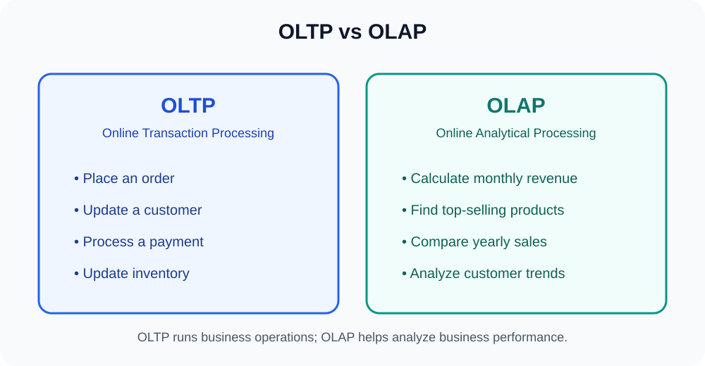
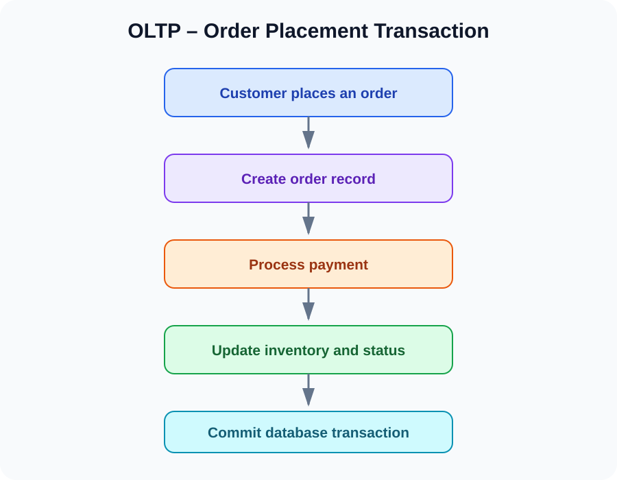
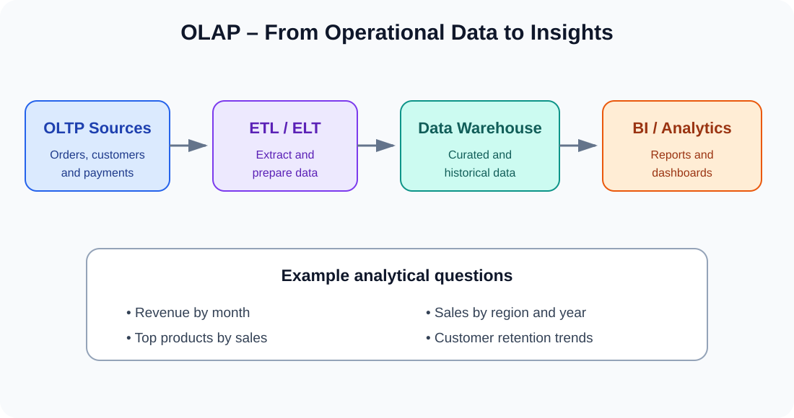
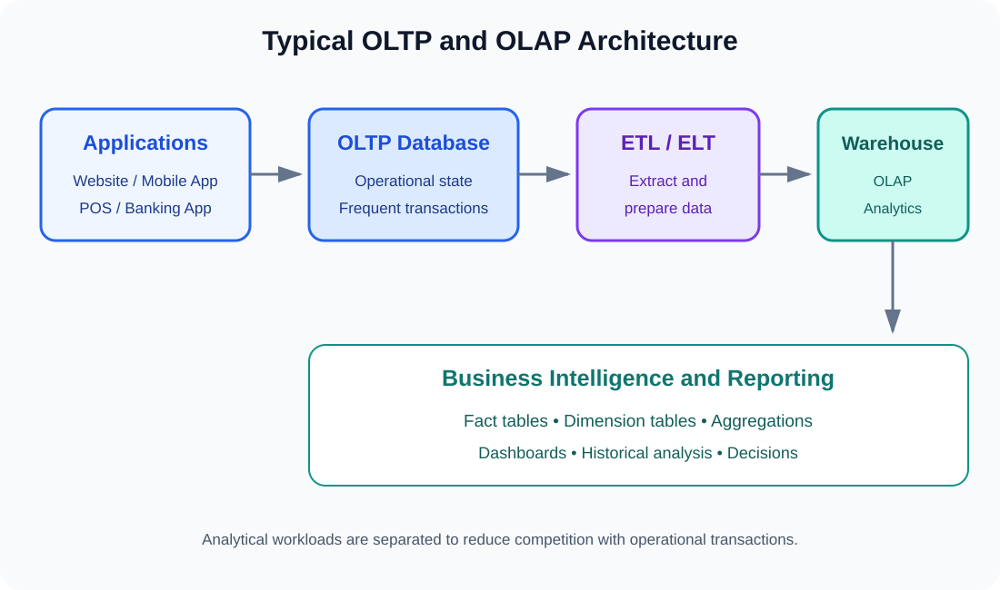
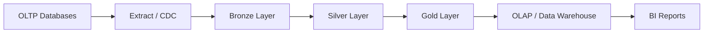

# Part 2 – OLTP vs OLAP

> **Learning path:** Data Modeling for Data Engineering  
> **Part:** 2 – OLTP vs OLAP  
> **Focus:** Transaction processing, analytical processing, workload differences, architecture, SQL examples and practical data engineering flow.

---

## Learning objectives

By the end of this part, you should be able to:

1. Explain OLTP and OLAP in simple terms.
2. Identify where each system is used in a business.
3. Understand why OLTP workloads need fast, reliable transactions.
4. Understand why OLAP workloads need to scan and aggregate large datasets.
5. Compare their data structures, users, query patterns and performance goals.
6. Explain how operational data is moved into an analytical platform.
7. Write basic OLTP-style and OLAP-style SQL queries.
8. Explain why a data engineer needs to understand both.

---

# 1. Introduction to OLTP and OLAP

Imagine an e-commerce company called **XYZ Company**.

Every day, customers:
- Register accounts.
- Browse products.
- Place orders.
- Make payments.
- Update their profiles.
- Cancel orders.
- Track deliveries.

At the same time, management wants to understand:
- What is the total revenue this month?
- Which products generate the highest sales?
- Which city has the most customers?
- What is the year-over-year growth?
- Which customers purchase most frequently?

These are two different categories of workloads.



- **OLTP** supports the daily operations of the business.
- **OLAP** supports analysis of business performance and trends.

## 1.1 OLTP – Online Transaction Processing

### Definition

**OLTP (Online Transaction Processing)** is a database workload designed to process a large number of short, concurrent business transactions accurately and reliably.

In simple terms, OLTP is where the actual business activities happen.

Examples:
- Customer registration.
- Order placement.
- Payment processing.
- Inventory updates.
- Bank transfers.
- Ticket bookings.
- Account balance updates.

### Example: placing an order

When a customer places an order, the application may need to:

1. Validate the customer and cart.
2. Create an order record.
3. Create order-item records.
4. Record payment information or payment status.
5. Update inventory.
6. Return an order confirmation.



A database transaction should protect the database changes it controls. For example, if an order and its order items are written together, the transaction should not leave only half of those database changes committed.

A real checkout process can also involve external payment gateways, inventory services and messaging systems. Those cross-service workflows may require idempotency, retries, compensating actions and event-driven coordination; one SQL transaction cannot automatically make an entire distributed workflow atomic.

### Typical OLTP characteristics

| Characteristic | Explanation |
|---|---|
| Workload | Day-to-day business transactions |
| Operations | INSERT, UPDATE, DELETE and targeted SELECT |
| Query type | Short and predictable |
| Data access | Usually a small number of rows per operation |
| Concurrency | Many users and transactions at the same time |
| Response time | Usually low latency |
| Data | Current operational state |
| Integrity | Strong correctness and consistency requirements |
| Design | Often normalized relational tables |
| Users | Customers, applications, operational staff |

### OLTP and ACID properties

OLTP databases commonly rely on ACID transaction properties.

**A – Atomicity**

A transaction is treated as one unit: either all its database changes commit or none of them do.

Example: an order header and its order items should not be partially inserted if they are part of the same transaction.

**C – Consistency**

A transaction should preserve defined database rules and constraints.

Example: a foreign key should not refer to a customer that does not exist.

**I – Isolation**

Concurrent transactions should not interfere in ways that violate the database's isolation guarantees.

Example: two customers attempting to purchase the last unit of a product must be handled safely.

**D – Durability**

Once a transaction is committed, its changes should survive failures according to the database's durability guarantees.

### Example OLTP SQL

Create a small operational schema:

```sql
CREATE TABLE customers (
    customer_id INT PRIMARY KEY,
    customer_name VARCHAR(100) NOT NULL,
    email VARCHAR(150) UNIQUE
);

CREATE TABLE orders (
    order_id INT PRIMARY KEY,
    customer_id INT NOT NULL,
    order_date TIMESTAMP NOT NULL,
    order_status VARCHAR(30) NOT NULL,
    total_amount DECIMAL(12, 2) NOT NULL,
    FOREIGN KEY (customer_id)
        REFERENCES customers(customer_id)
);
```

Insert a customer:

```sql
INSERT INTO customers
    (customer_id, customer_name, email)
VALUES
    (101, 'Arun Kumar', 'arun@example.com');
```

Place an order:

```sql
INSERT INTO orders
    (order_id, customer_id, order_date, order_status, total_amount)
VALUES
    (5001, 101, CURRENT_TIMESTAMP, 'PLACED', 2599.00);
```

Update the order status:

```sql
UPDATE orders
SET order_status = 'SHIPPED'
WHERE order_id = 5001;
```

Retrieve one order:

```sql
SELECT
    order_id,
    customer_id,
    order_status,
    total_amount
FROM orders
WHERE order_id = 5001;
```

These are examples of short, targeted operational operations.

---

## 1.2 OLAP – Online Analytical Processing

### Definition

**OLAP (Online Analytical Processing)** is a workload designed to analyze large volumes of data through complex queries, aggregations, comparisons and historical analysis.

In simple terms, OLAP helps us understand what has happened in the business and why.

Examples:
- Monthly and yearly revenue analysis.
- Top-selling product analysis.
- Regional sales comparisons.
- Customer purchase behavior.
- Profitability analysis.
- Trend and growth analysis.

### Example: monthly sales analysis

Management wants to know the total sales for each month.

The system may need to:

1. Read millions of sales records.
2. Group records by month.
3. Calculate total revenue.
4. Compare results across months.
5. Return a summarized report.



### Typical OLAP characteristics

| Characteristic | Explanation |
|---|---|
| Workload | Business analysis and reporting |
| Operations | Mostly SELECT and aggregations |
| Query type | Complex and analytical |
| Data access | Many rows and multiple tables |
| Concurrency | Varies by platform and reporting workload |
| Response time | Often seconds or minutes, depending on scale and SLA |
| Data | Current plus historical data |
| Design | Often dimensional or denormalized models |
| Users | Data analysts, data scientists, managers and executives |
| Output | Reports, dashboards and analytical insights |

OLAP platforms are often optimized for scanning and aggregating large datasets. Columnar storage, compression, partition pruning, distributed execution and pre-aggregations are common techniques.

### Example OLAP SQL

Assume a warehouse contains a sales fact table:

```text
fact_sales
----------
sales_id
customer_key
product_key
date_key
quantity
sales_amount
```

Calculate total revenue:

```sql
SELECT
    SUM(sales_amount) AS total_revenue
FROM fact_sales;
```

Calculate monthly revenue (PostgreSQL-style date syntax):

```sql
SELECT
    DATE_TRUNC('month', order_date) AS sales_month,
    SUM(sales_amount) AS monthly_revenue
FROM fact_sales
GROUP BY DATE_TRUNC('month', order_date)
ORDER BY sales_month;
```

Find the top 5 products by revenue:

```sql
SELECT
    product_key,
    SUM(sales_amount) AS total_revenue
FROM fact_sales
GROUP BY product_key
ORDER BY total_revenue DESC
LIMIT 5;
```

Analyze sales by region:

```sql
SELECT
    d.region,
    SUM(f.sales_amount) AS regional_revenue
FROM fact_sales f
JOIN dim_customer d
    ON f.customer_key = d.customer_key
GROUP BY d.region
ORDER BY regional_revenue DESC;
```

These queries scan and summarize many business records rather than changing an individual order.

---

# 2. OLTP vs OLAP – Detailed Comparison

| Aspect | OLTP | OLAP |
|---|---|---|
| Full form | Online Transaction Processing | Online Analytical Processing |
| Main purpose | Run business operations | Analyze business performance |
| Workload | Transactions | Analytical queries |
| Typical operations | INSERT, UPDATE, DELETE, SELECT | Mostly SELECT |
| Query complexity | Usually simple and short | Often complex |
| Data volume per query | Usually limited | Often large |
| Data history | Operational/current state | Historical and current data |
| Design | Often normalized | Often dimensional / denormalized |
| Response goal | Low-latency transaction response | Efficient analytical query execution |
| Users | Applications and operational users | Analysts and decision-makers |
| Examples | Banking, checkout, booking | Reporting, forecasting, dashboards |
| Typical storage | Row-oriented relational databases are common | Columnar warehouses and analytical engines are common |

## 2.1 Difference in data structure

### OLTP – Normalized structure

OLTP databases commonly use normalized structures to reduce unnecessary duplication and protect data consistency.

```text
CUSTOMERS
---------
customer_id (PK)
customer_name
email

ORDERS
------
order_id (PK)
customer_id (FK)
order_date

ORDER_ITEMS
-----------
order_item_id (PK)
order_id (FK)
product_id (FK)
quantity
unit_price
```

Customer information is maintained separately from order information.

### OLAP – Dimensional structure

An analytical warehouse may use a Star Schema.

```text
             DIM_CUSTOMER
                   |
DIM_PRODUCT -- FACT_SALES -- DIM_DATE
                   |
             DIM_LOCATION
```

The fact table stores measurable business events, while dimension tables provide descriptive context for analysis. We will study fact tables, dimensions and Star Schema in later parts.

---

# 3. Typical OLTP and OLAP Architecture

A common architecture keeps operational workloads separate from analytical workloads.



### Step 1 – OLTP source

The application writes operational transactions into its database.

Examples:
- Customer orders.
- Payment records.
- Inventory changes.

### Step 2 – Extract data

A data engineering pipeline extracts data from the operational system.

Extraction can happen through:
- Batch queries.
- Incremental extraction.
- Change Data Capture (CDC).
- Database logs or event streams.

### Step 3 – Transform and load

The pipeline validates, cleans, standardizes and prepares the data.

Technologies may include:
- Python.
- SQL.
- Apache Spark / PySpark.
- Apache Kafka.
- Apache Airflow.

### Step 4 – OLAP destination

Prepared data is stored in an analytical platform such as:
- Amazon Redshift.
- Google BigQuery.
- Snowflake.
- Databricks SQL Warehouse.
- PostgreSQL configured for smaller analytical workloads.

### Step 5 – Business intelligence

Analysts and business users use the curated data for dashboards, revenue reports, customer analysis and business performance tracking.

**Important:** OLAP is a workload and processing approach, not the name of one specific database product. A data warehouse is a common platform used to serve OLAP workloads.

---

# 4. Why separate OLTP and OLAP workloads?

Imagine a shopping platform has 10 million customers and receives thousands of orders per minute.

At the same time, an analyst runs a query that scans several years of sales records and calculates revenue by product, city and month.

If this large analytical query runs directly against the same database that handles checkout transactions, it may compete for:

- CPU.
- Memory.
- Disk I/O.
- Cache.
- Database connections.
- Network bandwidth.

This can affect application response times.

Separating analytical workloads helps isolate resource-intensive reporting from operational transactions.

This is one reason organizations build data warehouses and lakehouses.

However, not every OLAP query necessarily harms an OLTP database. The impact depends on database capacity, workload isolation, replicas, query design and platform architecture.

---

# 5. Practical Example – E-commerce Business

Suppose XYZ Company has the following requirements.

| Requirement | Processing type | Reason |
|---|---|---|
| Register a customer | OLTP | Creates an operational record |
| Place an order | OLTP | Executes a business transaction |
| Update payment status | OLTP | Changes operational state |
| Check order status | OLTP | Retrieves a specific record |
| Calculate daily revenue | OLAP | Aggregates many transactions |
| Find top 10 products | OLAP | Compares aggregated sales |
| Compare yearly revenue | OLAP | Analyzes historical data |
| Find customer purchase trends | OLAP | Analyzes behavior over time |

## 5.1 Same business data, different questions

Consider this operational data:

**ORDERS**

| order_id | customer_id | city | amount |
|---:|---:|---|---:|
| 101 | 1 | Chennai | 5000 |
| 102 | 2 | Mumbai | 3000 |
| 103 | 1 | Chennai | 2000 |
| 104 | 3 | Bengaluru | 4500 |
| 105 | 2 | Mumbai | 1500 |

An OLTP query retrieves one order:

```sql
SELECT *
FROM orders
WHERE order_id = 101;
```

An OLAP query calculates revenue by city:

```sql
SELECT
    city,
    SUM(amount) AS total_revenue,
    COUNT(*) AS total_orders
FROM orders
GROUP BY city
ORDER BY total_revenue DESC;
```

Expected output:

| city | total_revenue | total_orders |
|---|---:|---:|
| Chennai | 7000 | 2 |
| Mumbai | 4500 | 2 |
| Bengaluru | 4500 | 1 |

The underlying business data can be similar, but the query purpose is different.

---

# 6. Role of OLTP and OLAP in Data Engineering

A data engineer often works between operational sources and analytical destinations.



### OLTP side

The operational system generates business data.

### Data engineering side

The data engineer builds reliable pipelines to ingest, clean, transform and organize that data.

### OLAP side

The analytical system allows users to query historical and aggregated information.

### Example technology mapping

| Stage | Example technologies |
|---|---|
| Operational source | MySQL, PostgreSQL |
| Change capture | Debezium, database CDC |
| Ingestion | Kafka, Python |
| Processing | PySpark |
| Storage | S3, ADLS, GCS |
| Lakehouse | Delta Lake |
| Warehouse | Snowflake, Redshift, BigQuery |
| Orchestration | Airflow |
| Reporting | Power BI, Tableau |

These are examples, not mandatory components of every architecture.

---

# 7. Interview Questions and Answers

### Q1. What is OLTP?

OLTP is a transaction processing workload designed to handle frequent, short and concurrent business transactions reliably.

### Q2. What is OLAP?

OLAP is an analytical processing workload designed to query, aggregate and analyze large volumes of current and historical data.

### Q3. What is the major difference between OLTP and OLAP?

OLTP focuses on executing daily business transactions, while OLAP focuses on analyzing business data to support decision-making.

### Q4. Why is OLTP usually normalized?

Normalization reduces unnecessary data duplication and helps maintain consistency during frequent inserts and updates.

### Q5. Why is OLAP often denormalized?

Denormalized and dimensional structures can simplify analytical queries and reduce the number of joins required for reporting.

### Q6. Which system handles more frequent INSERT and UPDATE operations?

Typically OLTP systems.

### Q7. Which system is more suitable for historical sales analysis?

OLAP systems.

### Q8. Why should analytical queries be separated from transactional workloads?

Large analytical queries can consume significant resources and interfere with the response times of operational transactions. Workload separation helps protect operational performance.

### Q9. What is the role of a Data Engineer between OLTP and OLAP?

A Data Engineer develops ingestion and transformation pipelines to move data from operational sources into analytical platforms while maintaining data quality, reliability and consistency.

### Q10. Is OLAP a database?

OLAP is an analytical processing approach or workload. Data warehouses and analytical databases are commonly used to support OLAP workloads.

### Q11. Can one database support both OLTP and OLAP?

Yes. Some database systems support both types of workloads, but resource isolation, workload design and performance requirements determine whether sharing one system is appropriate.

### Q12. What is the relationship between OLTP, OLAP and a Data Warehouse?

OLTP systems generate and maintain operational data. A data warehouse integrates and organizes data for analytical workloads, commonly serving OLAP queries.

---

# 8. Practice Assignments

## Assignment 1 – Identify OLTP or OLAP

Classify each operation:

1. Customer registration.
2. Monthly revenue calculation.
3. Updating an order status.
4. Finding the top 10 products by sales.
5. Processing a bank transfer.
6. Comparing sales between two years.
7. Updating customer contact information.
8. Calculating average order value.
9. Booking a flight ticket.
10. Finding the highest-revenue city.

## Assignment 2 – Design an OLTP database

Create these tables using SQL:

- Customers.
- Products.
- Orders.
- Order_Items.
- Payments.

Requirements:

1. Define primary keys.
2. Define foreign keys.
3. Insert at least 10 customers.
4. Insert at least 20 orders.
5. Update order statuses.
6. Retrieve an individual customer's orders.

## Assignment 3 – Write OLAP queries

Using the same business data, write queries to:

1. Calculate total revenue.
2. Calculate monthly revenue.
3. Find the top 5 products.
4. Calculate revenue by city.
5. Find the average order value.
6. Find the number of orders per customer.
7. Compare monthly sales.
8. Calculate the percentage contribution of each product category.

## Assignment 4 – Architecture design

Draw an architecture that includes:

1. MySQL OLTP source.
2. Data extraction using CDC or batch ingestion.
3. Bronze layer.
4. Silver layer.
5. Gold layer.
6. Data warehouse.
7. BI dashboard.

Explain the responsibility of every component.

---

# 9. Part 2 – Completion Checklist

- [ ] Understand OLTP.
- [ ] Understand OLAP.
- [ ] Understand transaction processing.
- [ ] Understand analytical processing.
- [ ] Understand ACID properties.
- [ ] Understand normalized OLTP structures.
- [ ] Understand dimensional OLAP structures.
- [ ] Understand OLTP vs OLAP architecture.
- [ ] Understand the data engineering pipeline between them.
- [ ] Complete the SQL exercises.
- [ ] Complete the architecture assignment.
- [ ] Practice interview questions.

---

# 10. Summary

| OLTP | OLAP |
|---|---|
| Runs daily business operations | Supports business analysis |
| Handles frequent transactions | Handles analytical queries |
| Focuses on fast and reliable writes | Focuses on large-scale reads and aggregations |
| Often uses normalized schemas | Often uses dimensional models |
| Maintains operational state | Analyzes historical and current data |

**Remember this simple distinction:**

- OLTP answers: *What is happening in the business right now?*
- OLAP answers: *What has happened in the business, and what can we learn from it?*

The next part of Data Modeling will cover **Schema Fundamentals**, including Schema-on-Read, Schema-on-Write, Schema Evolution, Schema Inference, Explicit Schema and different types of keys.
