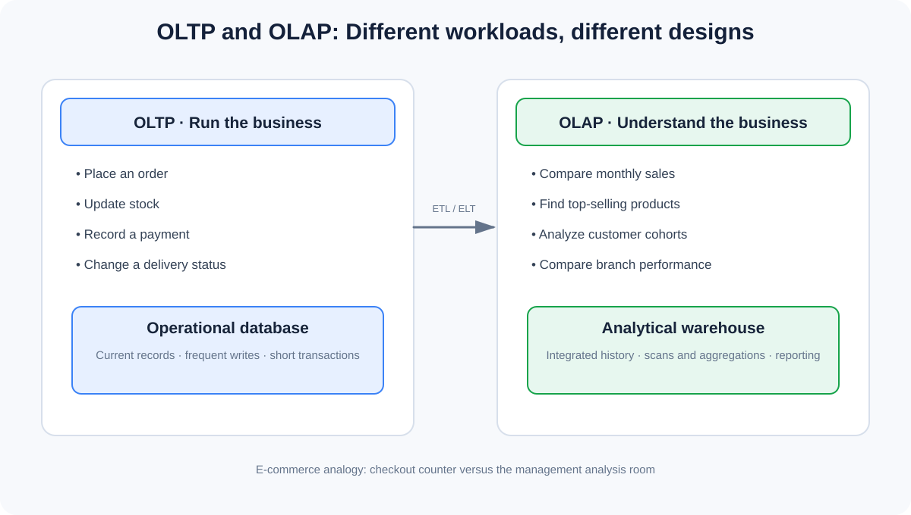
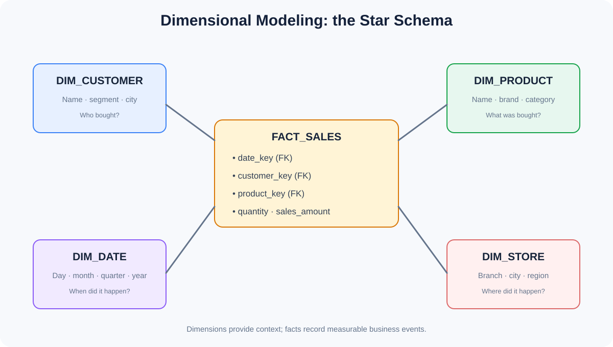
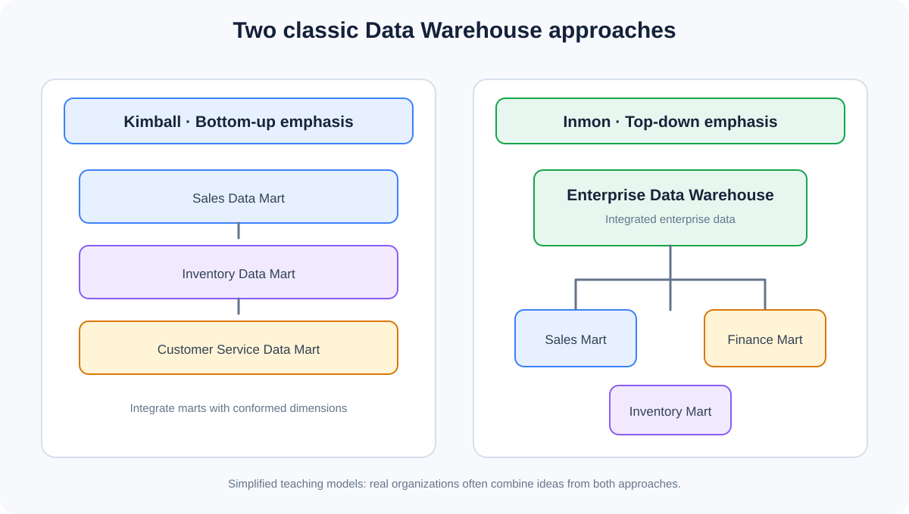
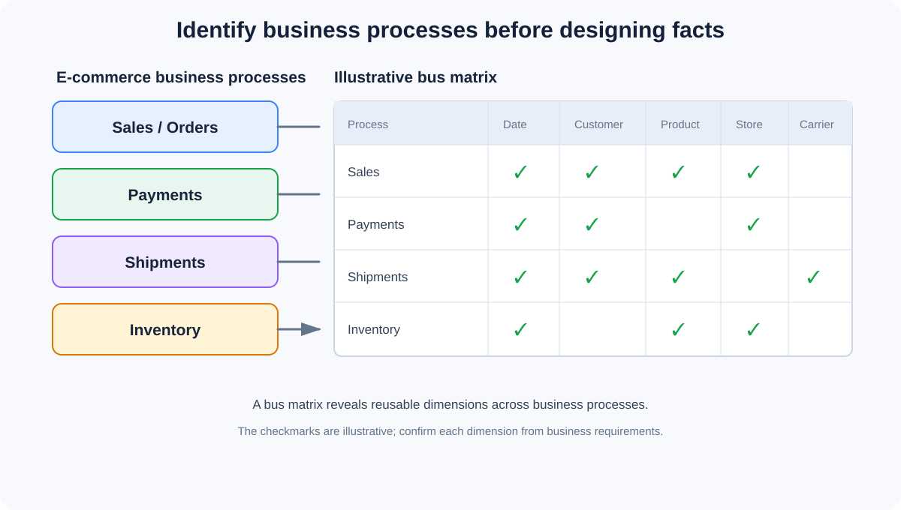
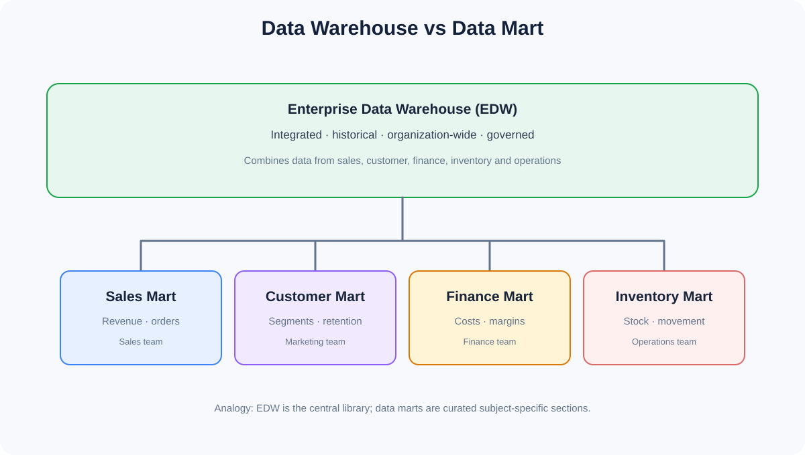
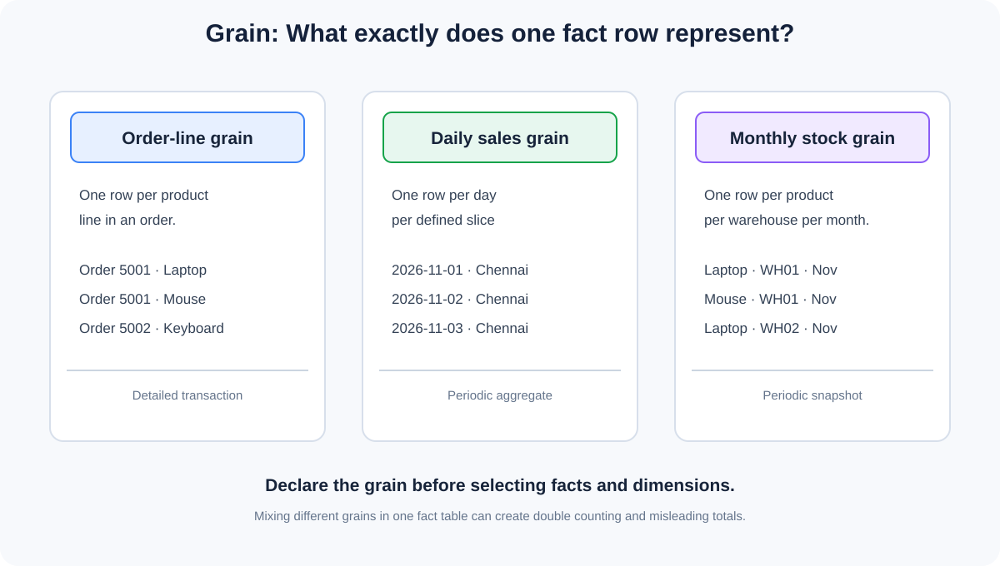
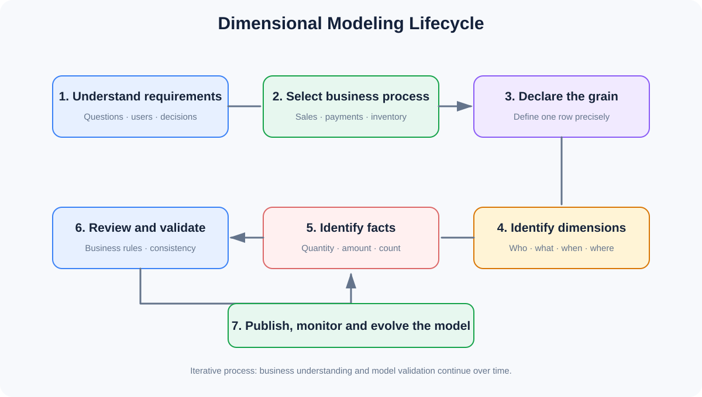

# Part 4.1 – Introduction to Dimensional Modeling
## OLAP Modeling | Core Concepts | Theory Notes

**Learning mode:** Theory only  
**Business scenario:** E-commerce  
**Recommended duration:** 1.5 hours (the notes are intentionally more detailed than a single lecture)  
**Prerequisites:** OLTP vs OLAP, OLTP conceptual/logical modeling, relationships, keys and normalization.

---

## Learning outcomes

By the end of this chapter, you should be able to:

1. Explain OLAP modeling and why analytical systems need a different design from OLTP systems.
2. Compare OLTP and OLAP architectures and workloads.
3. Explain dimensional modeling and its core building blocks.
4. Describe the Kimball and Inmon approaches at a high level.
5. Apply fundamental dimensional modeling principles.
6. Identify business processes that should become analytical models.
7. Distinguish an enterprise data warehouse from a data mart.
8. Explain fact tables, dimension tables, measures, metrics and dimensions.
9. Declare the grain of a fact table precisely.
10. Describe the dimensional modeling lifecycle and the role of an enterprise data warehouse.

---

# 1. What is OLAP Modeling?

**OLAP (Online Analytical Processing)** is an approach to organizing and analyzing data so people can understand business performance, discover patterns and make decisions.

OLAP systems are designed for questions that examine many records, compare periods, group information and calculate summaries.

### E-commerce example

An operational application answers questions such as:

- Did order 5001 get placed?
- Was payment transaction P900 successful?
- Is product 101 in stock?

An analytical system answers questions such as:

- What was total sales revenue by month this year?
- Which product category generated the highest revenue?
- Which city has the highest average order value?
- How has the number of returning customers changed over the last six months?
- Which branches have the highest cancellation rate?

The difference is the purpose: OLTP records business activity; OLAP analyzes business activity.

### Real-life analogy: Checkout counter vs management review room

Think about a supermarket.

- At the checkout counter, the cashier scans one customer's products, accepts payment and prints a receipt. The system must complete each transaction correctly and quickly.
- At the management review room, managers examine thousands or millions of receipts to understand daily revenue, popular products, seasonal demand and branch performance.

The checkout counter is like OLTP. The management review room is like OLAP.



### Typical OLAP characteristics

| Characteristic | Explanation |
|---|---|
| Read-intensive | Many queries read and analyze stored data |
| Historical analysis | Compares current and previous periods |
| Aggregation | Calculates totals, averages, counts and other summaries |
| Multi-dimensional analysis | Examines measures by customer, product, date, region and more |
| Complex queries | Often scans and combines large amounts of data |
| Decision support | Helps business users understand performance and take action |

**Important:** OLAP does not simply mean making a database read-only. Analytical platforms may also receive data loads, corrections and refreshes. The defining purpose is analysis rather than processing individual operational transactions.

---

# 2. OLTP vs OLAP – Architectural Differences

You have already studied OLTP vs OLAP. Here we connect that comparison to dimensional modeling.

| Area | OLTP | OLAP |
|---|---|---|
| Main purpose | Run daily operations | Analyze business performance |
| Typical user | Customer, cashier, support agent, application | Analyst, manager, executive, data scientist |
| Typical question | What is the status of this order? | How did sales change by month and region? |
| Data focus | Current operational state and transactions | Integrated historical and analytical data |
| Workload | Frequent inserts, updates and point lookups | Large reads, joins, aggregations and scans |
| Design emphasis | Transaction integrity and operational efficiency | Understandable analysis and query efficiency |
| Modeling style | Commonly normalized relational models | Commonly dimensional models |
| Query pattern | Usually narrow and selective | Often broad and aggregative |
| Example | Create an order | Compare quarterly sales |

## 2.1 E-commerce architecture example

A simplified flow:

```text
CUSTOMER PLACES AN ORDER
          |
          v
E-COMMERCE APPLICATION
          |
          v
OLTP DATABASE
  - customers
  - orders
  - order_items
  - products
  - payments
  - shipments
          |
          v
DATA INGESTION / ETL / ELT
          |
          v
ANALYTICAL DATA PLATFORM
          |
          v
OLAP / DIMENSIONAL MODEL
          |
          v
REPORTS, DASHBOARDS AND ANALYSIS
```

The analytical model is not normally the database that handles the live checkout transaction. It is built from operational and other source data for analysis.

### Example question transformation

| Operational question | Analytical question |
|---|---|
| Is order 5001 paid? | What percentage of orders are paid each month? |
| What is the stock of product 101 now? | Which products frequently experience stock-outs? |
| Where is shipment S100? | What is the average delivery time by carrier? |
| What is this customer's email? | Which customer segments generate the most revenue? |

**Key takeaway:** OLTP helps the company operate. OLAP helps the company understand how it operates.


---

# 3. What is Dimensional Modeling?

**Dimensional modeling** is a data warehouse design technique that organizes business data into fact tables and dimension tables so that analytical queries are understandable and efficient.

It focuses on representing:

- Business events that we want to measure.
- The descriptive context in which those events occur.

The two primary building blocks are:

1. **Fact tables** – record measurable business events or states.
2. **Dimension tables** – describe the people, products, places, dates and other contexts related to those facts.

### E-commerce example

Suppose a customer buys two laptops from a particular branch on a specific date.

The business event is a sale.

The fact record may contain:

- Quantity sold = 2
- Sales amount = ₹1,10,000

The dimensions provide context:

- Who? Customer
- What? Product
- When? Date
- Where? Store branch



### Real-life analogy: A cricket scorecard

Think about a cricket match scorecard.

The scorecard records measurable events:

- Runs
- Wickets
- Overs
- Extras

But to understand those numbers, you need descriptive context:

- Which player?
- Which team?
- Which match?
- Which venue?
- Which innings?

The measurable events are similar to facts. The descriptive context is similar to dimensions.

A score of 75 alone is not very informative. Knowing that a player scored 75 runs in a particular match, against a particular opponent, at a particular venue gives it meaning.

### Why dimensional modeling?

- Makes business questions easier to express.
- Gives consistent definitions to measures and dimensions.
- Helps users navigate analytical data.
- Supports slicing, filtering, grouping and aggregation.
- Provides reusable dimensions across business processes.

---

# 4. Kimball vs Inmon Approaches – Introduction

Kimball and Inmon are two influential approaches to data warehouse architecture.

They are not competing database technologies. They are different architectural philosophies for organizing enterprise analytical data.

## 4.1 Kimball approach – Bottom-up emphasis

The Kimball approach commonly builds dimensional data marts around business processes and integrates them using **conformed dimensions**.

A simplified progression:

```text
Identify business process
        |
        v
Build dimensional model
        |
        v
Create Sales Data Mart
        |
        v
Create Inventory Data Mart
        |
        v
Create Customer Service Data Mart
        |
        v
Integrate using conformed dimensions
```

Example:

- Sales mart analyzes orders and revenue.
- Inventory mart analyzes stock levels and movement.
- Customer service mart analyzes support activity.

If these marts share properly governed Customer, Product and Date dimensions, their results can be analyzed consistently.

## 4.2 Inmon approach – Top-down emphasis

The Inmon approach commonly emphasizes building an integrated enterprise data warehouse first, often using a normalized enterprise model, and then deriving subject-oriented data marts.

A simplified progression:

```text
Collect enterprise source data
          |
          v
Build integrated EDW
          |
          v
Create Sales Data Mart
          |
          v
Create Finance Data Mart
          |
          v
Create Inventory Data Mart
```

The EDW provides a central integrated foundation for downstream analytical structures.

## 4.3 Comparison

| Area | Kimball | Inmon |
|---|---|---|
| General direction | Bottom-up emphasis | Top-down emphasis |
| Starting point | Business processes and dimensional marts | Enterprise-wide integrated warehouse |
| Common modeling style | Dimensional | Traditionally normalized enterprise model in the EDW |
| Integration | Conformed dimensions and bus architecture | Central enterprise integration |
| Delivery | Can deliver focused marts incrementally | Establishes enterprise integration foundation |
| Main strength | Business-oriented analytics and incremental delivery | Enterprise-wide integration and centralized view |



### Real-life analogy: Building a city

**Kimball analogy:** Build useful neighborhoods and connect them through common roads, standards and services. Each neighborhood provides value, and shared standards help the whole city work together.

**Inmon analogy:** First plan and establish the city's central infrastructure and master plan. Then build specialized districts that connect to that foundation.

These are simplified analogies. Real organizations may combine the approaches.

### What should a Data Engineer understand?

- Where does enterprise integration happen?
- How are business areas connected?
- How can two departments use the same definition of Customer or Product?
- How can analytical data marts remain consistent?

---

# 5. Dimensional Modeling Principles

Dimensional modeling should begin with business understanding, not with choosing columns or writing SQL.

## Principle 1 – Start with the business process

Identify the activity the business wants to analyze.

Examples:

- Sales
- Payments
- Shipments
- Returns
- Inventory movements

Do not begin by creating a generic fact table without knowing what business event it represents.

## Principle 2 – Declare the grain first

The grain defines exactly what one row in a fact table represents.

Example:

> One row represents one product line within one customer order.

Only after declaring this should you select dimensions and measures.

## Principle 3 – Choose dimensions that describe the grain

For a sales fact table, dimensions may include:

- Date
- Customer
- Product
- Store
- Promotion

Every dimension must make sense at the declared fact grain.

## Principle 4 – Choose facts that are true to the grain

For an order-line sales fact, possible measures include:

- Quantity
- Unit selling price
- Discount amount
- Extended sales amount

Do not place an unrelated measure in the fact table simply because it is available in a source table.

## Principle 5 – Use consistent, conformed dimensions

A shared Customer dimension should have consistent meaning when used by Sales, Returns and Customer Service.

This allows business users to compare different processes using the same descriptive definitions.

## Principle 6 – Preserve history intentionally

Business attributes change. A customer's city, a product category or a sales territory may change.

The model must define whether analysis should use current descriptions or historical descriptions. Slowly Changing Dimensions address this topic; you have already covered the SCD types in your earlier chapter.

## Principle 7 – Keep the model understandable

Use clear business names, meaningful descriptions and consistent definitions.

A business analyst should be able to understand what a fact and dimension represent without reverse-engineering the source database.

---

# 6. Business Process Identification

A **business process** is an activity performed by an organization that creates events, transactions or measurable outcomes.

In dimensional modeling, identifying business processes is one of the earliest and most important steps.

### E-commerce business processes

| Business process | What happens? | Possible analytical questions |
|---|---|---|
| Sales / Orders | Customers purchase products | What is revenue by month? |
| Payments | Customers pay for orders | What is the payment success rate? |
| Shipments | Orders are dispatched and delivered | Which carrier delivers fastest? |
| Returns | Customers return products | Which products have the highest return rate? |
| Inventory | Stock is received, adjusted or sold | Which products have frequent stock-outs? |
| Customer Service | Customers contact support | What is the average resolution time? |

## 6.1 Business process vs database entity

These concepts are related, but they are not the same.

| OLTP entity | Business process / analytical focus |
|---|---|
| orders | Sales / order processing |
| payments | Payment processing |
| shipments | Fulfillment / delivery |
| products | Product description used by multiple processes |
| customers | Customer context used by multiple processes |

A `products` table is an entity that describes products. A product sale or inventory movement is a business event.

The distinction matters because dimensional models organize analysis around business processes and their measurable events, not simply around copying every OLTP table.

## 6.2 Bus matrix – Introduction

A bus matrix maps business processes against reusable dimensions.

Illustrative e-commerce matrix:

| Business process | Date | Customer | Product | Store | Carrier |
|---|:---:|:---:|:---:|:---:|:---:|
| Sales | ✓ | ✓ | ✓ | ✓ | |
| Payments | ✓ | ✓ | | ✓ | |
| Shipments | ✓ | ✓ | ✓ | | ✓ |
| Inventory | ✓ | | ✓ | ✓ | |

The checkmarks are illustrative. Actual dimension applicability must be confirmed from the business requirements and the grain of each process.



### Why is the bus matrix useful?

- Identifies shared dimensions.
- Reveals which business processes need analytical models.
- Helps plan an enterprise data warehouse incrementally.
- Supports consistent reporting across departments.
- Helps identify gaps in analytical coverage.

### Real-life analogy: A railway network

Think of business processes as railway routes and conformed dimensions as shared stations.

Different routes may share the same station. Similarly, Sales and Returns may share Customer, Product and Date dimensions.

The bus matrix helps us identify these shared points before constructing the full network.

---

# 7. Data Warehouse vs Data Mart

## 7.1 What is a Data Warehouse?

A **Data Warehouse** is a centralized analytical data environment that integrates data from multiple sources and supports reporting, analysis and decision-making.

It may contain data from:

- E-commerce application
- Payment gateway
- Inventory system
- CRM
- Shipping provider
- Finance system

A warehouse provides a governed analytical foundation across the organization.

## 7.2 What is a Data Mart?

A **Data Mart** is a focused analytical data store designed for a particular business subject, department or analytical need.

Examples:

- Sales Data Mart
- Finance Data Mart
- Customer Data Mart
- Inventory Data Mart

## 7.3 Comparison

| Area | Data Warehouse | Data Mart |
|---|---|---|
| Scope | Enterprise-wide | Subject or department focused |
| Data coverage | Multiple business areas | Selected business area |
| Users | Organization-wide analytical users | Specific teams or users |
| Purpose | Integrated enterprise analysis | Focused reporting and analysis |
| Complexity | Usually broader | Usually narrower |
| Example | E-commerce enterprise warehouse | Sales reporting mart |



### Real-life analogy: Central library vs specialist section

- A data warehouse is like a central library containing organized information across many subjects.
- A data mart is like a specialist section containing curated material for one subject, such as finance or science.

The data mart is not necessarily a physically separate database. It may be implemented as a logical or physical subset of a larger warehouse platform.

### E-commerce example

The enterprise warehouse may integrate:

- Customer information
- Sales transactions
- Payment events
- Shipment events
- Inventory history

From this foundation, the organization may provide:

- Sales Mart for sales managers.
- Finance Mart for finance analysts.
- Inventory Mart for operations.
- Customer Mart for marketing.

---

# 8. Fact Tables and Dimension Tables – Introduction

These are the two fundamental structures of dimensional modeling.

## 8.1 Fact table

A **Fact Table** stores measurable business events or states at a declared grain. It commonly contains foreign keys to dimensions and numeric measures.

Example: `FACT_SALES`

| date_key | customer_key | product_key | quantity | sales_amount |
|---:|---:|---:|---:|---:|
| 20261101 | 101 | 501 | 2 | 110000 |
| 20261101 | 102 | 502 | 1 | 1500 |
| 20261102 | 101 | 503 | 1 | 800 |

The fact table answers questions such as:

- How much was sold?
- How many units were sold?
- How many sales events occurred?

## 8.2 Dimension table

A **Dimension Table** stores descriptive attributes that provide context for analyzing facts.

Example: `DIM_PRODUCT`

| product_key | product_name | brand | category |
|---:|---|---|---|
| 501 | Laptop | Brand A | Electronics |
| 502 | Mouse | Brand B | Accessories |
| 503 | Keyboard | Brand C | Accessories |

The dimension answers:

- Which product?
- Which brand?
- Which category?

## 8.3 Fact vs Dimension

| Fact Table | Dimension Table |
|---|---|
| Records measurable events or states | Describes analytical context |
| Commonly contains foreign keys | Commonly has a surrogate primary key |
| Contains measures where appropriate | Contains descriptive attributes |
| Often grows rapidly | Often grows more slowly |
| Used for aggregation | Used for filtering, grouping and labeling |

### Important distinction

A fact table does not always need numeric measures. A factless fact table can record that an event or relationship occurred, or that something was covered or eligible.

A dimension table does not have to be tiny. Large customer or product dimensions can contain many rows and attributes.

---

# 9. Measures, Metrics and Dimensions

These three terms are closely related but should not be treated as interchangeable.

## 9.1 Measures

A **measure** is a value that can be analyzed or aggregated, often stored in a fact table.

E-commerce measures:

- Quantity sold
- Sales amount
- Discount amount
- Shipping amount
- Cost amount

Example:

| order_id | product | quantity | sales_amount |
|---|---|---:|---:|
| 5001 | Laptop | 2 | 110000 |
| 5002 | Mouse | 1 | 800 |

Quantity and sales amount are measures.

## 9.2 Metrics

A **metric** is a defined business indicator used to evaluate performance. It may be calculated from one or more measures and business rules.

Examples:

**Total Revenue**

\[
Revenue = \sum(sales\_amount)
\]

**Average Order Value (AOV)**

\[
AOV = \frac{Total\ Revenue}{Number\ of\ Orders}
\]

**Return Rate**

\[
Return\ Rate =
\frac{Returned\ Orders}{Eligible\ Orders}\times100
\]

A measure is a stored or derived analytical value. A metric is a business-defined indicator with a calculation and interpretation.

For example, `sales_amount` is a measure. Monthly revenue is a metric calculated by aggregating that measure.

## 9.3 Dimensions

A **Dimension** provides descriptive context for measures and metrics.

Examples:

| Dimension | Example attributes |
|---|---|
| Customer | Name, segment, city, region |
| Product | Product name, brand, category |
| Date | Day, month, quarter, year |
| Store | Branch name, city, region |
| Payment Method | Method type, provider |

### E-commerce analysis

Question:

> What was the total revenue for Electronics products in Chennai during November?

Break it down:

- Metric: Total revenue.
- Measure: Sales amount.
- Product dimension: Category = Electronics.
- Store dimension: City = Chennai.
- Date dimension: Month = November.

This is the basic power of dimensional modeling: business users can analyze measures through descriptive dimensions.

---

# 10. Grain / Granularity – Introduction

**Grain** defines exactly what one row in a fact table represents.

This is one of the most important decisions in dimensional modeling.

Do not define grain vaguely as "sales data." State the exact event or state represented by one row.

## 10.1 E-commerce grain examples

### Example A – Order-line grain

> One row represents one product line within one customer order.

An order with three products creates three fact rows.

### Example B – Daily sales grain

> One row represents total sales for one store, one product and one calendar day.

Many individual transactions may contribute to one row.

### Example C – Monthly inventory snapshot grain

> One row represents the stock balance for one product, one warehouse and one month-end date.

These are different grains and answer different questions.



## 10.2 Why does grain matter?

Suppose order 5001 contains:

| Product | Quantity | Line amount |
|---|---:|---:|
| Laptop | 1 | 55000 |
| Mouse | 2 | 1600 |
| Keyboard | 1 | 1500 |

At order-line grain, there are three rows.

If we accidentally mix an order-level total of ₹58,100 into each of the three rows and then sum it, the result becomes ₹174,300. That is incorrect double counting.

The model must store facts at a clearly declared grain and ensure measures are valid at that grain.

## 10.3 Grain declaration checklist

Before designing a fact table, answer:

1. What business event or state does one row represent?
2. What is the level of detail?
3. Which dimensions describe that row?
4. Can the source data provide that level of detail?
5. Which measures are valid at that level?
6. What uniquely identifies a row at this grain?

### Real-life analogy: A photograph

Imagine taking a photograph of a busy marketplace.

- One photo of each individual customer transaction gives transaction-level detail.
- One photo showing the total activity for the day gives a daily summary.
- One monthly report gives a much higher-level summary.

The more detailed the grain, the more individual events can be examined. Aggregated grains are useful for summaries but cannot recover every underlying detail.

**Golden rule: Declare the grain before choosing facts and dimensions.**

---

# 11. Dimensional Modeling Lifecycle

Dimensional modeling is a structured and iterative process. It should begin with business requirements and proceed through model design and validation.

## Main steps

### Step 1 – Understand business requirements

Identify:

- Business questions.
- Stakeholders.
- Reports and dashboards required.
- Important business definitions.
- Required historical analysis.

Example: Sales managers want revenue by product, customer segment, store and month.

### Step 2 – Select the business process

Choose the process being analyzed.

Example: Sales / Orders.

### Step 3 – Declare the grain

Example:

> One row per product line in an order.

### Step 4 – Identify dimensions

For sales:

- Date
- Customer
- Product
- Store
- Promotion, if applicable

### Step 5 – Identify facts and measures

For sales:

- Quantity
- Unit selling price
- Discount amount
- Line sales amount

### Step 6 – Review and validate

Check:

- Does every fact match the grain?
- Are dimensions appropriate?
- Are business definitions clear?
- Are shared dimensions consistent?
- Can the model answer the required questions?

### Step 7 – Publish, monitor and evolve

The model is reviewed as business requirements change, new processes are added and data quality issues are discovered.



### Real-life analogy: Planning a restaurant

Before constructing a restaurant:

1. Understand the customer and business needs.
2. Decide which services the restaurant will provide.
3. Define the capacity and purpose of each area.
4. Plan the kitchen, seating and storage areas.
5. Decide what equipment each area needs.
6. Review the layout for safety and workflow.
7. Open, monitor and improve.

Similarly, dimensional modeling should not begin by creating tables randomly. It starts with business requirements and progresses through deliberate design decisions.

---

# 12. Enterprise Data Warehouse (EDW) – Overview

An **Enterprise Data Warehouse (EDW)** is an organization-wide analytical data environment designed to integrate information from multiple business systems and provide a consistent foundation for enterprise reporting and analysis.

### E-commerce example

Imagine our e-commerce company uses:

| Source system | Data provided |
|---|---|
| E-commerce application | Customers, orders, products |
| Payment gateway | Payment attempts and outcomes |
| Shipping provider | Shipment and delivery events |
| Inventory platform | Stock and warehouse movement |
| CRM | Customer interactions and segments |
| Finance system | Costs, invoices and financial records |

An EDW brings relevant information together so that the organization can analyze the business across systems.

## 12.1 EDW characteristics

- Enterprise-wide scope.
- Integration across multiple sources.
- Consistent business definitions.
- Historical analysis.
- Data governance and quality controls.
- Support for multiple analytical use cases.

## 12.2 EDW vs Data Mart

An EDW provides the broader integrated foundation. A data mart serves a focused subject or team.

For example:

```text
             ENTERPRISE DATA WAREHOUSE
                       |
          +------------+------------+
          |            |            |
          v            v            v
       SALES         FINANCE     INVENTORY
       MART           MART         MART
```

The data marts may be physical databases, warehouse schemas, curated datasets or logical views depending on the platform architecture.

## 12.3 EDW and dimensional modeling

An EDW is an architectural concept; dimensional modeling is a way to structure analytical data.

An enterprise warehouse can contain dimensional models, normalized integration structures, data vault structures or a combination of approaches.

Do not assume that every EDW must consist only of star schemas.

---

# 13. End-to-End E-commerce Example – Connecting All Concepts

Let's bring the chapter together.

## Business requirement

Management wants to understand:

- Monthly revenue.
- Top-selling product categories.
- Revenue by customer city.
- Branch performance.
- Payment success trends.

## Step 1 – Identify business processes

- Sales
- Payments
- Shipments
- Inventory

## Step 2 – Select the first analytical process

Start with Sales.

## Step 3 – Declare the grain

One row per product line in an order.

## Step 4 – Identify dimensions

- Date
- Customer
- Product
- Store

## Step 5 – Identify measures

- Quantity
- Unit selling price
- Discount amount
- Sales amount

## Step 6 – Define metrics

- Total revenue
- Units sold
- Average order value
- Sales growth

## Step 7 – Identify future shared dimensions

Customer, Product, Date and Store may be reused by additional business processes when their definitions and grain are compatible.

## Conceptual result

```text
                 DIM_CUSTOMER
                       |
DIM_DATE ---- FACT_SALES ---- DIM_PRODUCT
                       |
                   DIM_STORE
```

This is the starting point for the detailed star schema chapter in Part 4.3.

---

# 14. Common Misunderstandings

| Misunderstanding | Correct understanding |
|---|---|
| OLAP is only reporting | It supports broader analytical exploration and decision support |
| A data warehouse is just a large database | It is an integrated analytical data environment with architecture, governance and historical data considerations |
| Every source table becomes a fact table | Facts are designed around business processes and declared grain |
| Every numeric column is a measure | A numeric value may be an identifier, code or descriptive attribute |
| A metric and a measure are identical | Metrics have business definitions and may be calculated from measures |
| Grain means the number of rows | Grain means what one row represents |
| A data mart is always a separate database | It can also be a logical or curated subject-area structure |
| Kimball and Inmon are software products | They are data warehouse architectural approaches |
| Every EDW must use star schemas only | EDWs can contain different modeling layers and structures |

---

# 15. Interview Questions

1. What is OLAP modeling?
2. What is the difference between OLTP and OLAP?
3. What is dimensional modeling?
4. What are the two main components of a dimensional model?
5. Explain Kimball and Inmon approaches.
6. What is a bottom-up data warehouse approach?
7. What is a top-down data warehouse approach?
8. What are conformed dimensions?
9. What is a business process in dimensional modeling?
10. Why should we identify business processes before creating fact tables?
11. What is a bus matrix?
12. What is the difference between a data warehouse and a data mart?
13. What is an Enterprise Data Warehouse?
14. What is a fact table?
15. What is a dimension table?
16. What is the difference between measures and metrics?
17. What is a dimension attribute?
18. What is grain in dimensional modeling?
19. Why should grain be declared before facts and dimensions?
20. What happens when different grains are mixed in a fact table?
21. Explain the dimensional modeling lifecycle.
22. Can an enterprise data warehouse contain both normalized and dimensional structures?

---

# 16. Knowledge Check

Try answering these without looking at the notes.

### Question 1
A customer places an order for a laptop. Which system handles the live order transaction?

### Question 2
Management wants to compare laptop sales across the last 12 months. Which type of system supports this analysis?

### Question 3
In a sales star schema, is `product_name` usually a fact or a dimension attribute?

### Question 4
In a sales fact table, what does quantity represent?

### Question 5
What does one row represent if the grain is declared as one row per order line?

### Question 6
What is the purpose of a bus matrix?

### Question 7
What is the primary architectural emphasis of Kimball?

### Question 8
What is the primary architectural emphasis of Inmon?

### Question 9
Can a Data Mart be a logical view or curated dataset rather than a separate database?

### Question 10
Why is it dangerous to mix order-level and order-line-level measures without considering grain?

---

# 17. Final Revision Sheet

| Concept | Remember |
|---|---|
| OLAP | Analyze business data for decisions |
| OLTP | Process daily business transactions |
| Dimensional Modeling | Organize analytical data into facts and dimensions |
| Kimball | Bottom-up emphasis; dimensional marts integrated through conformed dimensions |
| Inmon | Top-down emphasis; integrated EDW foundation |
| Business Process | Business activity to analyze |
| Bus Matrix | Maps business processes to reusable dimensions |
| Data Warehouse | Integrated enterprise analytical environment |
| Data Mart | Focused analytical subject area |
| Fact Table | Records measurable business events or states |
| Dimension Table | Provides descriptive context |
| Measure | Stored or derived analytical value |
| Metric | Defined business performance indicator |
| Grain | Exact meaning of one fact row |
| EDW | Enterprise-wide integrated analytical foundation |

---

# 18. Part 4.1 Completion Checklist

- [ ] Understand OLAP modeling.
- [ ] Explain OLTP vs OLAP architecture.
- [ ] Understand dimensional modeling.
- [ ] Explain Kimball vs Inmon.
- [ ] Understand dimensional modeling principles.
- [ ] Identify e-commerce business processes.
- [ ] Understand the bus matrix.
- [ ] Differentiate Data Warehouse and Data Mart.
- [ ] Understand Fact Tables and Dimension Tables.
- [ ] Differentiate Measures, Metrics and Dimensions.
- [ ] Declare fact table grain.
- [ ] Explain the dimensional modeling lifecycle.
- [ ] Understand Enterprise Data Warehouse.

## What comes next?

**Part 4.2 – Fact Tables and Dimension Tables**

We will go deeper into:
- Fact table structure and grain.
- Transaction, periodic snapshot and accumulating snapshot facts.
- Factless fact tables.
- Additive, semi-additive and non-additive measures.
- Dimension attributes and hierarchies.
- Conformed, role-playing, degenerate, junk and outrigger dimensions.

The goal is to understand each building block thoroughly before designing our complete e-commerce star schema.
