# Part 4.2 – Fact Tables and Dimension Tables
## Detailed OLAP Modeling Notes | E-commerce Case Study

**Scope:** Theory, concepts, diagrams and real-world examples  
**Scenario:** E-commerce sales, payments, shipments, returns and inventory  
**Prerequisite:** Part 4.1 – Introduction to Dimensional Modeling

## Learning outcomes

You will learn to explain fact and dimension tables, their structures, grain, measures, aggregation behavior, fact types, dimension patterns, hierarchies, SCD purpose, date dimensions and design principles.

---

# Section A – Fact Tables

## 1. What is a Fact Table?

A **fact table** stores measurable business events or business states at a clearly defined level of detail called the *grain*. It commonly contains foreign keys to dimensions and measures that quantify the event.

**Real-life analogy – shopping receipt:** Each receipt line records a product, quantity and amount. Product, customer, date and store describe the context. A fact table stores these business events in a structured analytical form.

**E-commerce example:** A customer purchases one laptop for ₹55,000 and receives a ₹2,000 discount. A sales fact row can record quantity = 1, gross line amount = ₹55,000, discount = ₹2,000 and net line amount = ₹53,000, with keys to Customer, Product, Date and Store.

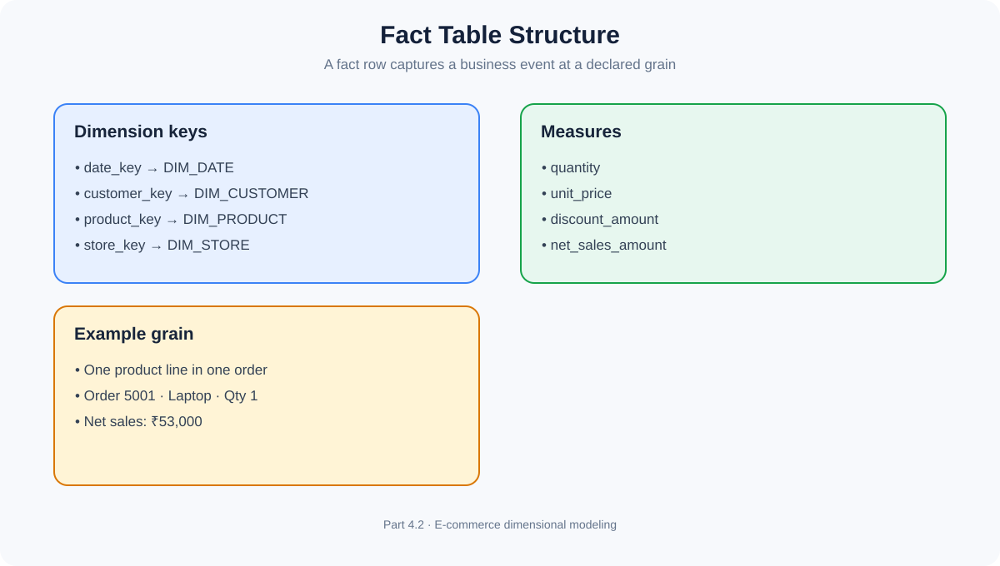

Typical characteristics:
- Every row has a precise business meaning.
- Dimension foreign keys provide context.
- Measures quantify events or states where applicable.
- Fact tables often grow quickly as events accumulate.
- They support analysis and aggregation.

A fact table does **not** always require numeric measures. A factless fact table is a valid pattern.

## 2. Fact Table Structure

Consider `FACT_SALES` at the grain **one row per product line within an order**.

| Column | Meaning | Role |
|---|---|---|
| sales_date_key | Related date | Foreign key |
| customer_key | Related customer | Foreign key |
| product_key | Related product | Foreign key |
| store_key | Related branch | Foreign key |
| order_number | Source order identifier | Degenerate dimension candidate |
| quantity | Units sold | Measure |
| unit_price | Selling price per unit | Measure |
| discount_amount | Discount on the line | Measure |
| net_sales_amount | Net line amount | Measure |

Illustrative row:

| date_key | customer_key | product_key | store_key | order_number | quantity | net_sales_amount |
|---:|---:|---:|---:|---|---:|---:|
| 20261111 | 1001 | 501 | 10 | ORD-5001 | 1 | 53000 |

Interpretation: On 11 November 2026, customer 1001 purchased product 501 at store 10. One unit was sold and the net line amount was ₹53,000.

**Key idea:** A fact table is not just a collection of numeric columns. Every field must be valid at the declared grain.

## 3. Foreign Keys in Fact Tables

A **foreign key (FK)** in a fact table points to a dimension record. The dimension table typically has a primary key (PK), often a warehouse-generated surrogate key.

```text
FACT_SALES
  date_key      ─────► DIM_DATE.date_key
  customer_key  ─────► DIM_CUSTOMER.customer_key
  product_key   ─────► DIM_PRODUCT.product_key
  store_key     ─────► DIM_STORE.store_key
```

Why use keys instead of repeating descriptions? If a customer makes 100 purchases, their name, city and segment do not need to be repeated in every sales row. The fact row references the customer dimension record.

### Surrogate key vs source key

| Key | Example | Purpose |
|---|---|---|
| Surrogate key | `customer_key = 1001` | Warehouse-generated identity |
| Natural/source key | `customer_id = C101` | Identifier from source application |

Surrogate keys are useful when data comes from multiple systems or when historical versions of a dimension must be represented. For Type 2 SCD, different historical versions of the same business entity can have different surrogate keys.

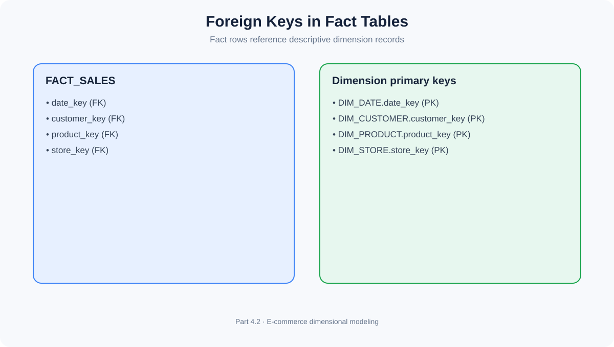

## 4. Measures and Metrics

A **measure** is a quantified value associated with a business event or state. It may be stored in a fact table or derived during analysis. Examples: quantity sold, net sales amount, discount amount, shipping cost and returned quantity.

A **metric** is a business-defined indicator used to evaluate performance. It may be calculated from one or more measures and explicit business rules.

**Total revenue**

\[
Revenue = \sum(NetSalesAmount)
\]

**Average Order Value**

\[
AOV = \frac{TotalRevenue}{NumberOfOrders}
\]

**Return rate**

\[
ReturnRate = \frac{ReturnedUnits}{SoldUnits}\times100
\]

| Measure | Metric |
|---|---|
| Net sales amount | Monthly net revenue |
| Quantity sold | Units sold per month |
| Discount amount | Average discount percentage |
| Delivery duration | Average delivery time |
| Returned quantity | Product return rate |

A measure is a value; a metric is a defined indicator with a calculation and business interpretation. Always define what “revenue” means: gross sales, net sales after discounts, or another accounting definition.

## 5. Additive Measures

An **additive measure** can be summed across all relevant dimensions, assuming the grain and business definitions are consistent.

| Day | Sales |
|---|---:|
| Monday | ₹100 |
| Tuesday | ₹150 |
| Wednesday | ₹200 |
| **Total** | **₹450** |

Sales amount and units sold are common additive measures. They can usually be summed by date, product, customer or store.

**Analogy:** Money earned each day can be added to calculate total earnings over the period.

Caution: even additive measures can be double-counted if a query joins a fact table to a one-to-many table and duplicates fact rows.

## 6. Semi-Additive Measures

A **semi-additive measure** can be summed across some dimensions but not across all dimensions. Balances and inventory levels are common examples.

| Date | Product | Closing stock |
|---|---|---:|
| 1 Nov | Laptop | 20 |
| 2 Nov | Laptop | 18 |
| 3 Nov | Laptop | 15 |

Adding daily closing stock gives 53, but 53 is not the stock available on any of those dates. For a particular snapshot date, stock may be summed across products or warehouses if definitions and units are compatible. It should not normally be summed across dates.

Examples: bank balance, inventory on hand, outstanding loan balance and headcount at a point in time.

For month-end stock, select the appropriate month-end snapshot or last valid balance. Do not add all daily closing balances.

## 7. Non-Additive Measures

A **non-additive measure** cannot be meaningfully summed directly across one or more dimensions. Percentages, ratios, rates and unit prices are common examples.

| Day | Visitors | Purchases | Conversion rate |
|---|---:|---:|---:|
| Monday | 100 | 5 | 5% |
| Tuesday | 1000 | 100 | 10% |

Do not add 5% + 10% and report 15%. Recalculate using the aggregated numerator and denominator:

\[
CombinedRate = \frac{5+100}{100+1000}\times100 = 9.55\%
\]

| Type | Example | Aggregation |
|---|---|---|
| Additive | Sales amount | Sum across relevant dimensions |
| Semi-additive | Closing inventory | Sum across some dimensions, not time |
| Non-additive | Conversion rate | Recalculate from components |

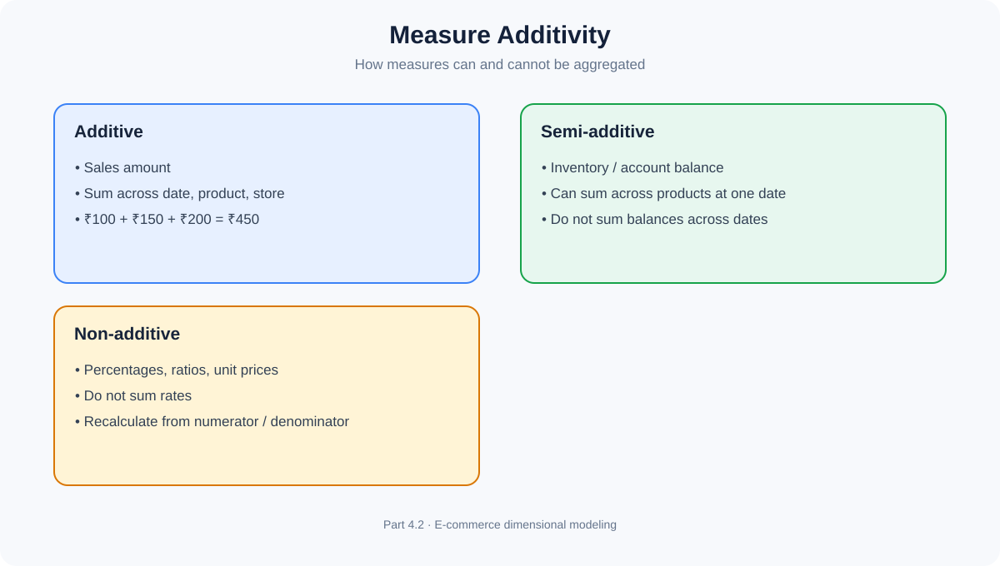

**Analogy:** Add daily earnings; do not add daily bank balances; do not add percentages.

## 8. Fact Table Grain

**Grain** is the exact definition of what one row in a fact table represents. It is not the number of rows.

Suppose order 5001 contains:

| Order | Product | Quantity | Line amount |
|---|---|---:|---:|
| 5001 | Laptop | 1 | ₹53,000 |
| 5001 | Mouse | 2 | ₹1,600 |
| 5001 | Keyboard | 1 | ₹1,500 |

At **order-line grain**, the order produces three rows. At **order grain**, it produces one row with order-level values. These are different models.

Examples of precise grain statements:
- One row per product line in an order.
- One row per payment attempt.
- One row per shipment event.
- One row per product, warehouse and day-end inventory snapshot.
- One row per customer support interaction.

If the order total ₹56,100 is copied into all three line rows, summing the fact table produces ₹168,300. That is incorrect double counting.

Before designing a fact table, answer:
1. What exact event or state does one row represent?
2. What is the level of detail?
3. Which dimensions describe it?
4. Which measures are valid at this level?
5. What source provides this detail?
6. How can duplicate events be detected?

**Golden rule: Declare the grain before selecting dimensions and measures.**

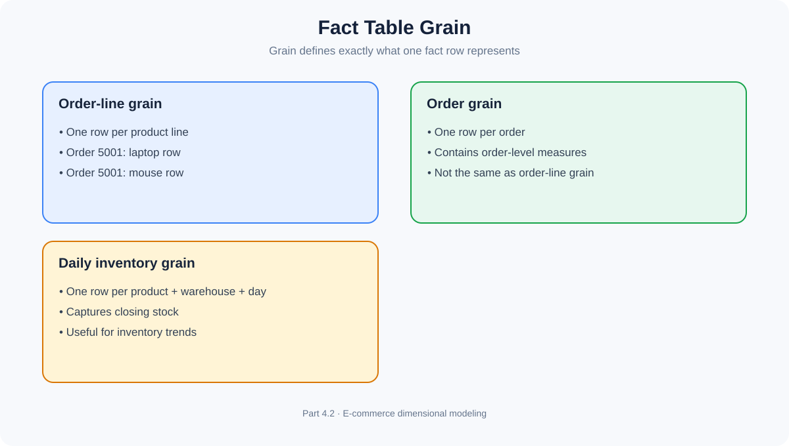

## 9. Transaction Fact Table

A **transaction fact table** stores one row for each individual business event at its declared grain.

E-commerce example: one row per product line in an order.

| Order | Product | Quantity | Net sales |
|---|---|---:|---:|
| ORD-5001 | Laptop | 1 | ₹53,000 |
| ORD-5001 | Mouse | 2 | ₹1,600 |
| ORD-5002 | Keyboard | 1 | ₹1,500 |

Characteristics:
- Captures individual events.
- Usually grows as transactions occur.
- Supports detailed drill-down and later aggregation.
- Often includes event date/time and dimension keys.

Other examples: payment attempt, return line, inventory movement or shipment scan.

**Use it when:** detailed event-level history is required.

## 10. Periodic Snapshot Fact Table

A **periodic snapshot fact table** stores the state or activity of a process at regular, predefined intervals such as daily, weekly or monthly.

E-commerce inventory example. Grain: one row per product, warehouse and calendar day.

| Snapshot date | Product | Warehouse | Closing stock |
|---|---|---|---:|
| 1 Nov | Laptop | WH01 | 20 |
| 2 Nov | Laptop | WH01 | 18 |
| 3 Nov | Laptop | WH01 | 15 |

Characteristics:
- Captures a state at regular intervals.
- Useful for trend analysis.
- Often contains semi-additive measures.
- A snapshot may be produced even if no transaction occurred in that interval, depending on process design.

Other examples: daily bank balances, monthly customer account status and monthly employee headcount.

**Use it when:** the business needs to see how a state changes over time.

## 11. Accumulating Snapshot Fact Table

An **accumulating snapshot fact table** stores one row for a process instance and updates that row as the process passes through known milestones.

E-commerce fulfillment example:

```text
ORDER PLACED
     ↓
PAYMENT CONFIRMED
     ↓
ORDER PACKED
     ↓
ORDER SHIPPED
     ↓
ORDER DELIVERED
```

One row represents one order/fulfillment process instance.

| Order | Placed date | Paid date | Shipped date | Delivered date |
|---|---|---|---|---|
| 5001 | 1 Nov | 1 Nov | 2 Nov | 4 Nov |
| 5002 | 2 Nov | 2 Nov | 3 Nov | NULL |

As milestones occur, the row is updated with dates and other milestone information.

Useful measures include time from order to payment, payment to shipment, shipment to delivery and total fulfillment duration.

**Use it when:** a process has recognizable milestones and the business needs to measure progress and elapsed time.

## 12. Factless Fact Table

A **factless fact table** records that an event occurred or that a condition/relationship existed, without requiring numeric measures.

Example: promotion eligibility. Grain: one row per customer, promotion and eligibility date.

| Customer key | Promotion key | Date key |
|---:|---:|---:|
| 101 | 10 | 20261101 |
| 102 | 10 | 20261101 |
| 103 | 11 | 20261102 |

The presence of a row records eligibility. Another example is customer attendance at a promotional event.

Two common uses:
- **Event tracking:** What happened?
- **Coverage tracking:** What was available, eligible or expected?

Rows can still be counted, such as eligible customers or event attendances.

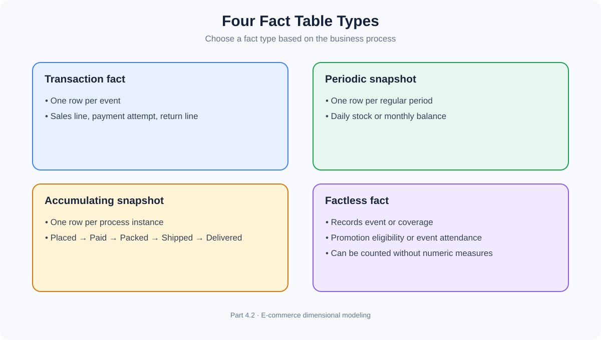

## 13. Fact Table Design Principles

1. **Declare grain first.** Write a precise sentence defining one row.
2. **Keep measures true to grain.** Do not casually mix order-level, order-line-level and daily-summary values.
3. **Use dimension keys.** Link facts to the appropriate descriptive context.
4. **Understand additivity.** Define how each measure can be aggregated.
5. **Avoid duplicated facts.** Ensure joins and transformations do not multiply event rows.
6. **Handle missing dimension references.** Define unknown or not-applicable dimension members where needed.
7. **Preserve event meaning.** A payment attempt, successful payment and settlement may be different events.
8. **Choose the right fact type.** Event, periodic state, milestone process or event/coverage without measures.

---

# Section B – Dimension Tables

## 14. What is a Dimension Table?

A **dimension table** stores descriptive information that provides context for analyzing facts. It answers who, what, when, where, how and sometimes why.

Example `DIM_CUSTOMER`:

| customer_key | customer_id | customer_name | city | segment |
|---:|---|---|---|---|
| 1001 | C101 | Arun Kumar | Chennai | Premium |
| 1002 | C102 | Priya | Bengaluru | Regular |
| 1003 | C103 | Karthik | Chennai | Regular |

**Analogy – product catalogue:** A catalogue describes products by name, brand, category and size, but does not record every sale. The dimension describes; the fact records the business event.

## 15. Dimension Table Structure

A dimension commonly contains:
- A primary key, often a warehouse surrogate key.
- A source-system or natural identifier.
- Descriptive attributes.
- Hierarchy attributes.
- Optional history-management columns.

Example `DIM_PRODUCT`:

| Column | Purpose |
|---|---|
| product_key | Surrogate primary key |
| product_id | Source identifier |
| product_name | Business-friendly name |
| brand | Product brand |
| category | Product category |
| subcategory | Product subcategory |
| effective_start_date | Version start, when history is tracked |
| effective_end_date | Version end, when history is tracked |
| is_current | Current-version indicator, when used |

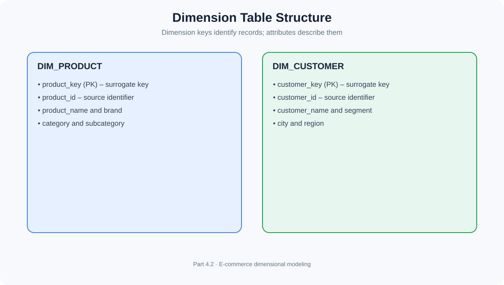

## 16. Dimension Attributes

A **dimension attribute** is a descriptive column in a dimension table.

Examples in `DIM_PRODUCT`: product name, brand, category, subcategory, color, size and product status.

| Attribute type | Example | Use |
|---|---|---|
| Descriptive | Product name | Display and filtering |
| Categorization | Category | Grouping |
| Geographic | City, region | Location analysis |
| Status | Active / discontinued | Filtering |
| Hierarchy | Category → Subcategory → Product | Drill-down |

An attribute is not automatically a measure because it is numeric. Product ID, postal code and category code are identifiers/codes, not quantities to sum.

## 17. Dimension Hierarchies

A **dimension hierarchy** organizes attributes into levels so users can move between detailed and summarized views.

```text
DATE:       Year → Quarter → Month → Day
GEOGRAPHY:  Country → State → City → Store
PRODUCT:    Category → Subcategory → Product
```

**Roll-up** moves from detail to summary, such as Day → Month → Quarter → Year.

**Drill-down** moves from summary to detail, such as Year → Quarter → Month → Day.

Example: A manager sees yearly revenue and drills down to quarter, month, city and individual store.

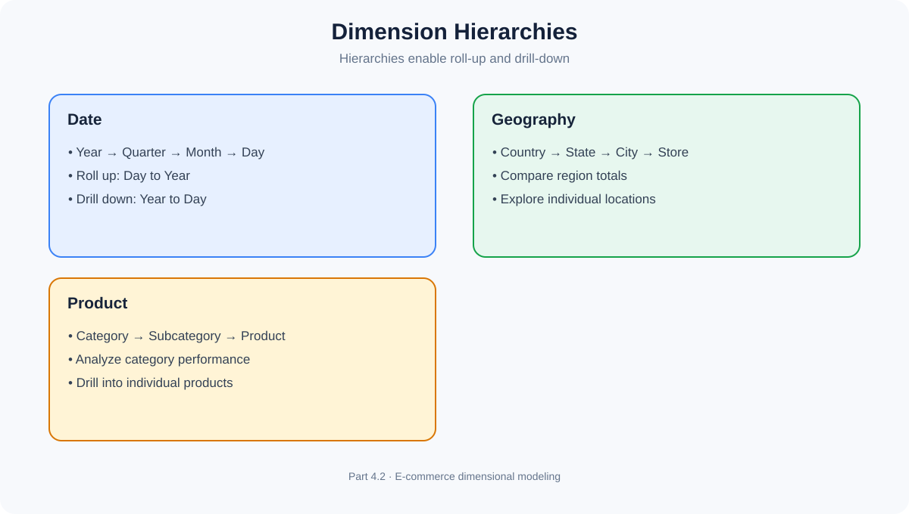

Not all business hierarchies are perfectly balanced; real hierarchies can be irregular or change over time.

## 18. Conformed Dimensions

A **conformed dimension** is a shared dimension with consistent meaning and definitions across multiple fact tables or data marts.

Example: Sales, Returns and Customer Support can all reference a common Customer dimension. This enables questions such as:
- Which customer segments generate the most sales?
- Which segments return the most products?
- Which segments raise the most support cases?

Benefits: reusable definitions, consistent reporting, cross-process analysis and enterprise integration.

**Analogy – common dictionary:** If Sales and Finance use different definitions of “active customer,” their reports may disagree. A governed Customer dimension provides a common definition.

Two tables are not conformed merely because they both contain `customer_id`. Their meaning, domain and business rules must be consistent.

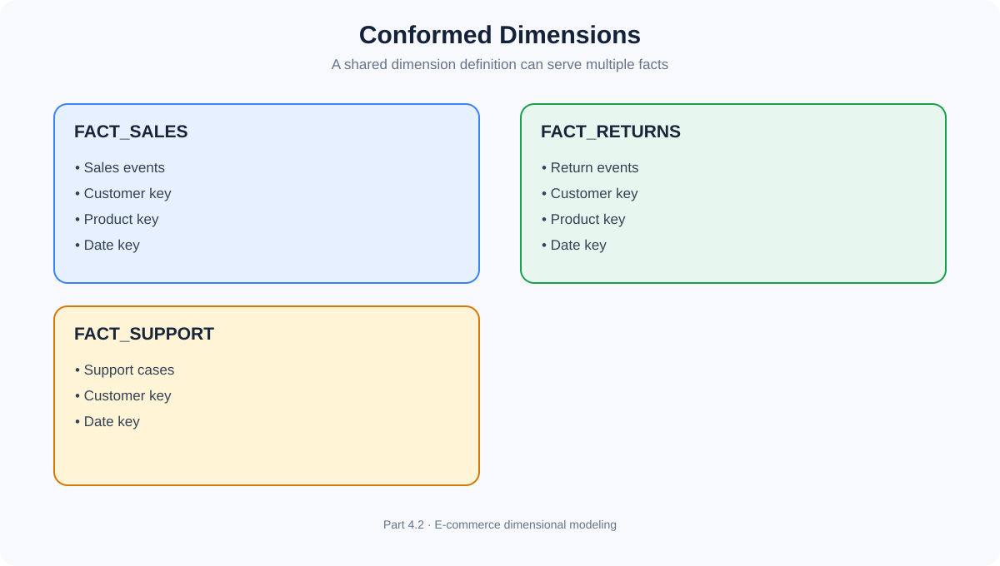

## 19. Role-Playing Dimensions

A **role-playing dimension** is one dimension referenced multiple times in a fact table, with each reference representing a different business role.

An order can have order date, payment date, shipment date and delivery date. All can reference the same Date dimension:

```text
FACT_ORDER
  order_date_key     → DIM_DATE
  payment_date_key   → DIM_DATE
  shipment_date_key  → DIM_DATE
  delivery_date_key  → DIM_DATE
```

Each role has its own FK value, but the shared dimension definition is reused.

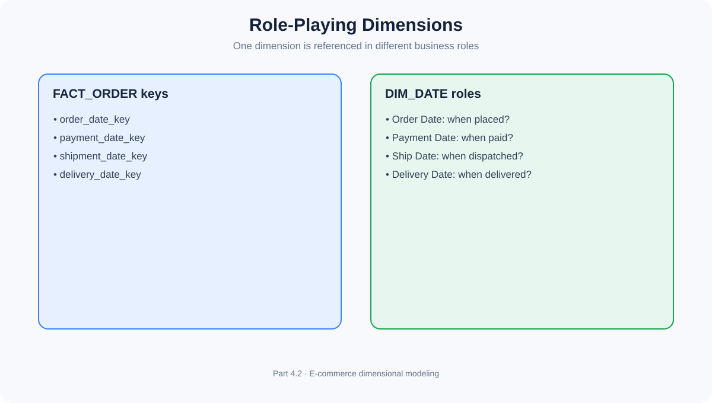

## 20. Degenerate Dimensions

A **degenerate dimension** is a business identifier stored directly in a fact table rather than in a separate dimension table.

Example: `order_number` in `FACT_SALES`.

| order_number | product_key | quantity | sales_amount |
|---|---:|---:|---:|
| ORD-5001 | 501 | 1 | 53000 |
| ORD-5001 | 502 | 2 | 1600 |
| ORD-5002 | 503 | 1 | 1500 |

If the order number has no meaningful descriptive attributes that justify a separate dimension, it can remain in the fact table. Other examples: invoice number, ticket number and transaction reference.

It is not a foreign key to a descriptive dimension table; it is an identifier retained in the fact for transaction identification and analysis.

## 21. Junk Dimensions

A **junk dimension** combines suitable low-cardinality flags and indicators into one dimension table.

E-commerce order flags:
- Gift wrap required? Yes/No.
- Priority order? Yes/No.
- Promotional order? Yes/No.
- Special handling? Yes/No.

These can be combined into `DIM_ORDER_FLAGS`.

| flags_key | gift_wrap | priority | promotional | special_handling |
|---:|---|---|---|---|
| 1 | No | No | No | No |
| 2 | Yes | No | Yes | No |
| 3 | No | Yes | No | Yes |

The fact stores `flags_key`. This groups flags and reduces fact-table clutter. Do not combine unrelated high-cardinality attributes simply to reduce columns.

## 22. Outrigger Dimensions

An **outrigger dimension** is a dimension table referenced by another dimension table.

```text
FACT_SALES
    |
    v
DIM_CUSTOMER
    |
    v
DIM_GEOGRAPHY
```

`DIM_CUSTOMER` may contain `geography_key`, which references a geography dimension containing city, state, region and country.

This can support reuse, but adds another join and may increase query complexity. A denormalized customer dimension containing geography attributes may be simpler for users. An outrigger is a design choice, not automatically a better design.

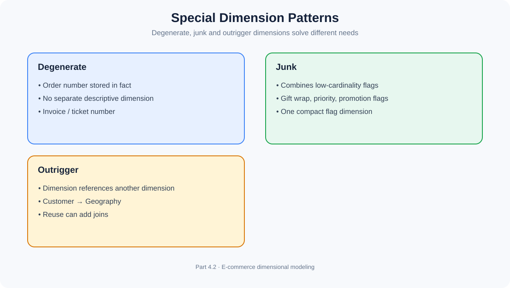

## 23. Slowly Changing Dimensions – Types and Purpose (Revision)

You already studied SCD Types 0, 1, 2, 3, 4 and 6. This is a dimensional-modeling recap, not a repeat of the full implementation chapter.

A **Slowly Changing Dimension (SCD)** manages changes to dimension attributes over time.

Example: A customer moves from Chennai to Bengaluru. Should historical sales show the city at the time of purchase, or the current city? The business requirement determines the strategy.

| Type | Behavior | Example |
|---|---|---|
| 0 | Retain original value | Original registration date |
| 1 | Overwrite old value | Correct misspelled name |
| 2 | Add a new version row | Preserve city history |
| 3 | Store limited previous value | Current and previous city columns |
| 4 | Keep history in a separate table | Current dimension plus history table |
| 6 | Hybrid approach | Combines Type 1, Type 2 and Type 3 ideas |

Type 2 commonly uses a new surrogate key for each version and may include effective dates and a current-row flag.

SCD behavior determines whether historical analysis uses current descriptions, preserves the value valid at event time, or maintains limited/separate history.

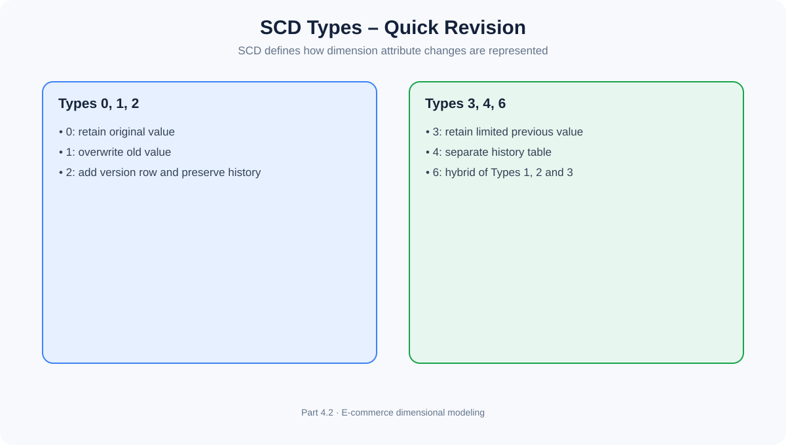

## 24. Date and Time Dimensions

A **Date Dimension** is a dedicated dimension containing calendar and business-calendar attributes used to analyze facts consistently over time.

Example `DIM_DATE`:

| date_key | full_date | day | month | quarter | year | weekday |
|---:|---|---:|---|---|---:|---|
| 20261110 | 10-Nov-2026 | 10 | November | Q4 | 2026 | Tuesday |
| 20261111 | 11-Nov-2026 | 11 | November | Q4 | 2026 | Wednesday |
| 20261112 | 12-Nov-2026 | 12 | November | Q4 | 2026 | Thursday |

Useful attributes include date key, full date, day, weekday, week number, month, quarter, calendar year, fiscal period, weekend flag, holiday flag and business-day flag.

Why not use only a raw timestamp? A timestamp gives precise event time, while a date dimension provides consistent calendar and business-calendar definitions. For example, a company fiscal year may not begin in January.

A separate time-of-day dimension may be useful for hour, minute, shift, time band or business-hours analysis. Whether it is needed depends on reporting requirements.

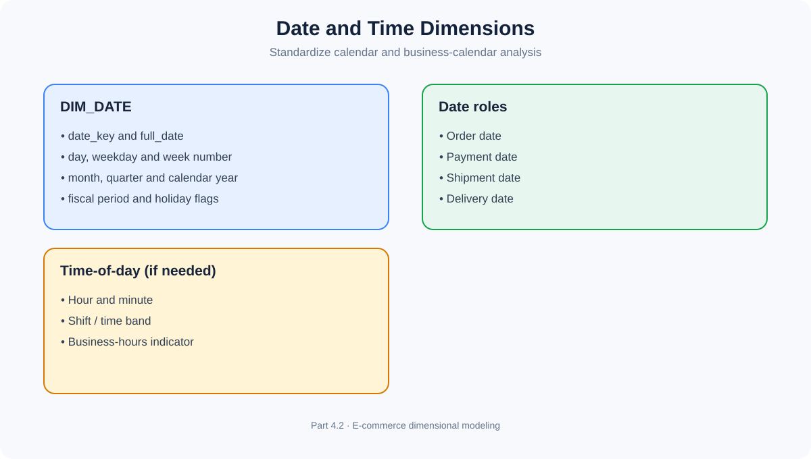

## 25. Dimension Design Principles

1. **Stable surrogate key:** separate warehouse identity from source identifiers.
2. **Retain source identifiers:** support traceability and integration.
3. **Understandable attributes:** use business-friendly names and descriptions.
4. **Intentional history behavior:** choose the appropriate SCD strategy.
5. **Unknown and not-applicable values:** missing lookups should not silently discard facts.
6. **Consistent conformed dimensions:** shared definitions across processes.
7. **Useful hierarchies:** support drill-down and roll-up.
8. **Avoid unnecessary normalization:** keep analytical models understandable.
9. **Document the dimension:** business definition, grain, attributes, source, key strategy, history behavior and quality rules.

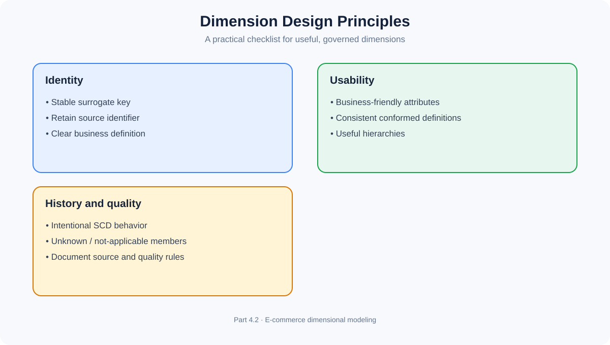

---

# Section C – E-commerce Model and Revision

## 26. E-commerce Fact Table Candidates

| Business process | Fact table candidate | Grain | Possible dimensions |
|---|---|---|---|
| Sales | FACT_SALES | One row per order product line | Date, Customer, Product, Store |
| Payment attempts | FACT_PAYMENT | One row per payment attempt | Date, Customer, Payment Method, Store |
| Shipment events | FACT_SHIPMENT_EVENT | One row per shipment event | Date, Customer, Carrier, Store |
| Inventory | FACT_INVENTORY_SNAPSHOT | One row per product, warehouse and snapshot date | Date, Product, Warehouse |
| Returns | FACT_RETURN | One row per returned product line | Date, Customer, Product, Store |

These are candidates, not a final schema. Validate grain and dimension applicability against business requirements and source data.

## 27. Analytical Questions

| Business question | Fact / measure | Dimensions |
|---|---|---|
| Monthly revenue by category? | FACT_SALES / net sales | Date, Product |
| Which city has most orders? | FACT_SALES / order count | Customer, Geography |
| Payment success rate? | FACT_PAYMENT / successful and total attempts | Date, Payment Method |
| Month-end stock by warehouse? | FACT_INVENTORY_SNAPSHOT / closing stock | Date, Product, Warehouse |
| Which carrier takes longest? | Fulfillment / delivery duration | Carrier, Date |

## 28. Common Mistakes

| Mistake | Better approach |
|---|---|
| Designing before defining grain | Write a precise grain statement first |
| Treating every numeric column as a measure | Distinguish measures from IDs and codes |
| Summing inventory across dates | Use the correct snapshot value |
| Adding percentages | Recalculate from numerator and denominator |
| Repeating descriptions in facts | Reference dimensions |
| Different definitions for shared dimensions | Govern conformed dimensions |
| Treating degenerate dimension as normal FK | Retain identifier directly in fact where appropriate |
| Junk dimension for unrelated high-cardinality fields | Use for suitable low-cardinality flags |
| Unnecessary outrigger joins | Balance reuse against query simplicity |
| Ignoring missing dimension records | Define unknown/inferred member handling |

## 29. Interview Questions

### Fact tables
1. What is a fact table?
2. What is the role of foreign keys in a fact table?
3. Difference between a measure and a metric?
4. Explain additive, semi-additive and non-additive measures.
5. Why is inventory balance semi-additive?
6. Why should percentages not be summed?
7. What is fact table grain?
8. What happens when different grains are mixed?
9. What is a transaction fact table?
10. What is a periodic snapshot fact table?
11. What is an accumulating snapshot fact table?
12. What is a factless fact table?
13. Can a fact table have no numeric measures?
14. Difference between periodic and accumulating snapshots?
15. What are fact table design principles?

### Dimension tables
16. What is a dimension table?
17. Difference between fact and dimension?
18. What are dimension attributes?
19. What is a dimension hierarchy?
20. Explain roll-up and drill-down.
21. What is a conformed dimension?
22. What is a role-playing dimension?
23. What is a degenerate dimension?
24. What is a junk dimension?
25. What is an outrigger dimension?
26. What is the purpose of a Date dimension?
27. Why are surrogate keys commonly used?
28. How do SCDs preserve historical dimension information?
29. What is an unknown dimension member?
30. What are dimension design principles?

## 30. Knowledge Check

1. A fact table stores one row per product line in an order. What is its grain?
2. Which fact type tracks an order from placement to delivery?
3. Which fact type stores month-end inventory balances?
4. Can a factless fact table be useful without numeric measures?
5. Why is sales amount additive?
6. Why is account balance not normally additive across dates?
7. Why must conversion rates be recalculated from numerator and denominator?
8. What does a foreign key identify?
9. Difference between conformed and role-playing dimensions?
10. Why can an order number be a degenerate dimension?
11. When is a junk dimension useful?
12. What makes a dimension an outrigger?
13. What is the purpose of a Date dimension?
14. Why is a surrogate key useful for Type 2 SCD?
15. What is the risk of designing a fact table without clear grain?

## 31. Final Revision Sheet

| Concept | Remember |
|---|---|
| Fact table | Records measurable events or states |
| Fact FK | References a dimension row |
| Measure | Quantified value |
| Metric | Business-defined performance indicator |
| Additive | Sum across relevant dimensions |
| Semi-additive | Sum across some dimensions, not all |
| Non-additive | Not directly summed |
| Grain | Exact meaning of one fact row |
| Transaction fact | One row per event |
| Periodic snapshot | One row per regular interval |
| Accumulating snapshot | One row per process instance, updated at milestones |
| Factless fact | Records event or coverage without numeric measures |
| Dimension | Descriptive context |
| Attribute | Descriptive dimension column |
| Hierarchy | Levels for roll-up and drill-down |
| Conformed | Shared, consistent dimension |
| Role-playing | One dimension used in multiple roles |
| Degenerate | Identifier stored directly in fact |
| Junk | Combined low-cardinality flags |
| Outrigger | Dimension referencing another dimension |
| SCD | Manages dimension attribute changes |
| Date dimension | Standardized calendar attributes |

## 32. Completion Checklist

### Fact tables
- [ ] What is a Fact Table?
- [ ] Fact Table Structure
- [ ] Foreign Keys in Fact Tables
- [ ] Measures and Metrics
- [ ] Additive Measures
- [ ] Semi-Additive Measures
- [ ] Non-Additive Measures
- [ ] Fact Table Grain
- [ ] Transaction Fact Table
- [ ] Periodic Snapshot Fact Table
- [ ] Accumulating Snapshot Fact Table
- [ ] Factless Fact Table
- [ ] Fact Table Design Principles

### Dimension tables
- [ ] What is a Dimension Table?
- [ ] Dimension Table Structure
- [ ] Dimension Attributes
- [ ] Dimension Hierarchies
- [ ] Conformed Dimensions
- [ ] Role-Playing Dimensions
- [ ] Degenerate Dimensions
- [ ] Junk Dimensions
- [ ] Outrigger Dimensions
- [ ] SCD Types and Purpose – Revision
- [ ] Date and Time Dimensions
- [ ] Dimension Design Principles

## What comes next?

**Part 4.3 – Star Schema Architecture**

We will combine the fact and dimension concepts into a complete E-commerce Star Schema, including architecture, relationships, grain validation, OLTP-to-Star conversion, advantages, disadvantages and practical design considerations.
