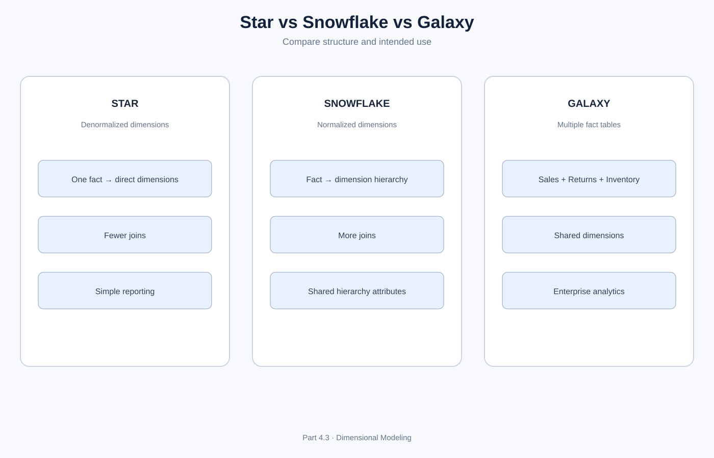
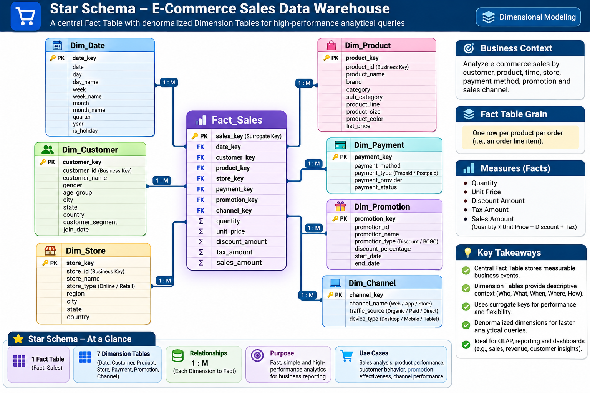
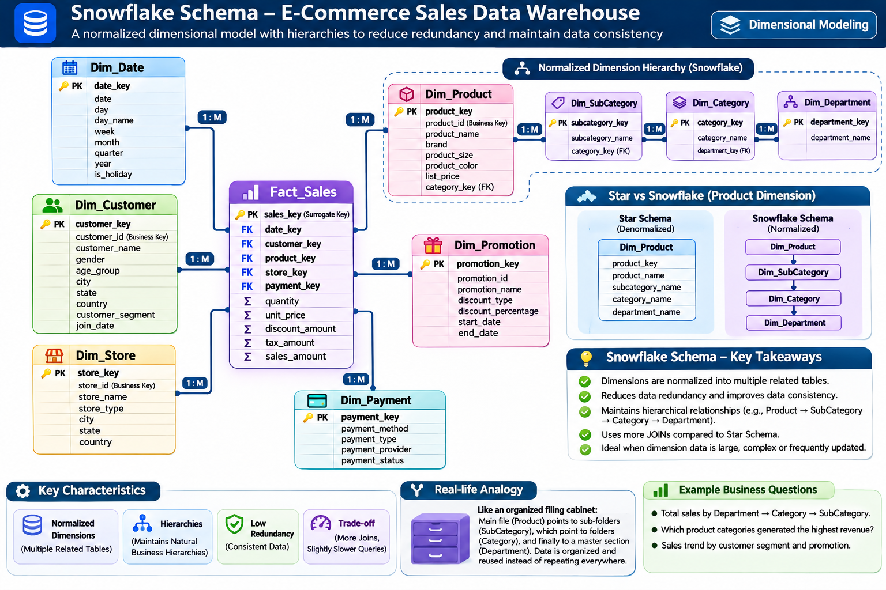
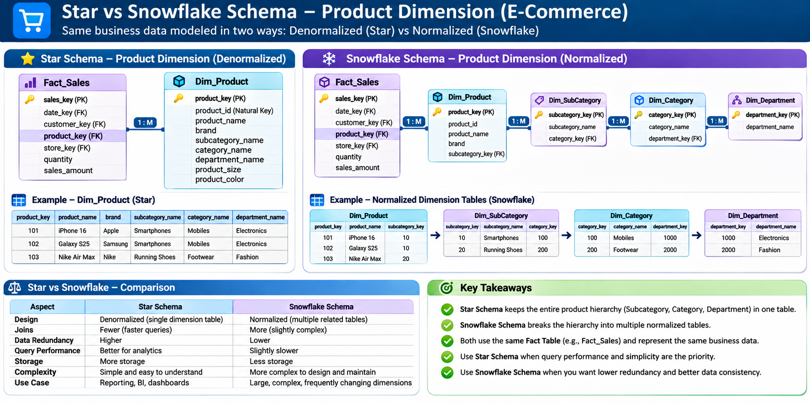
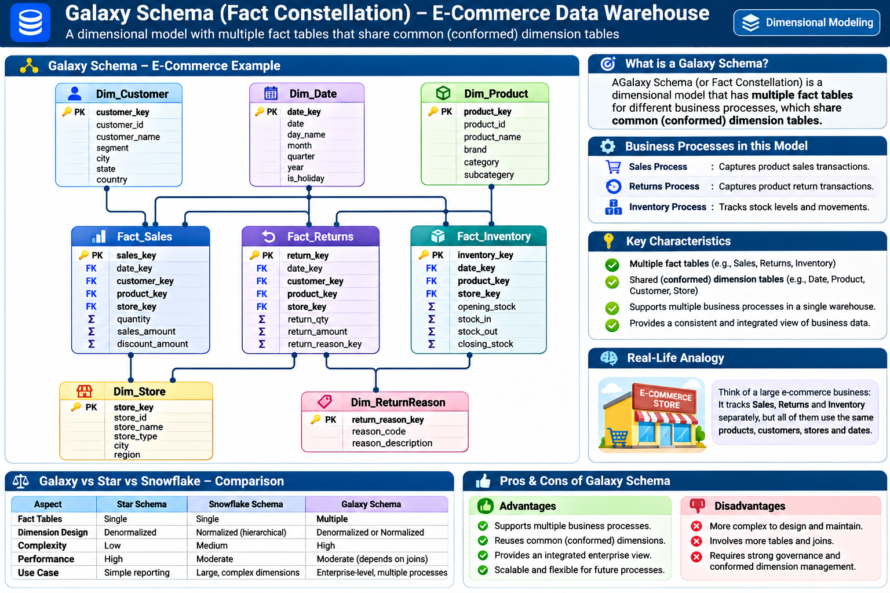
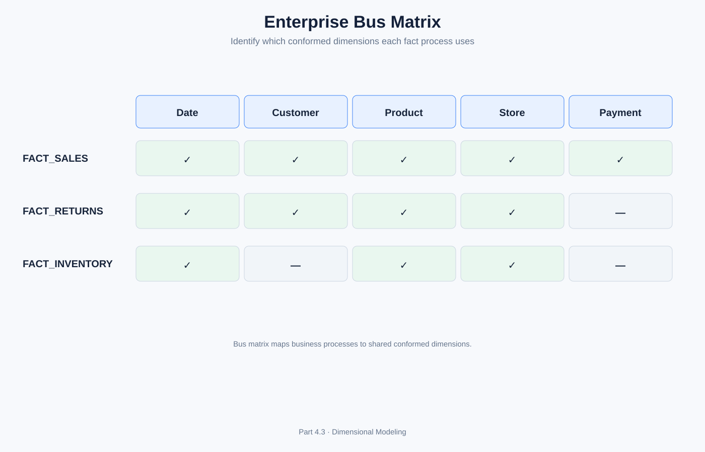
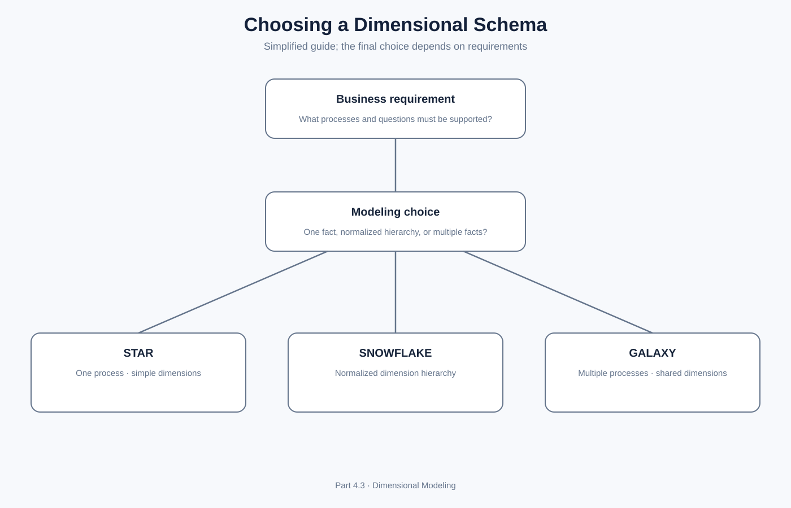
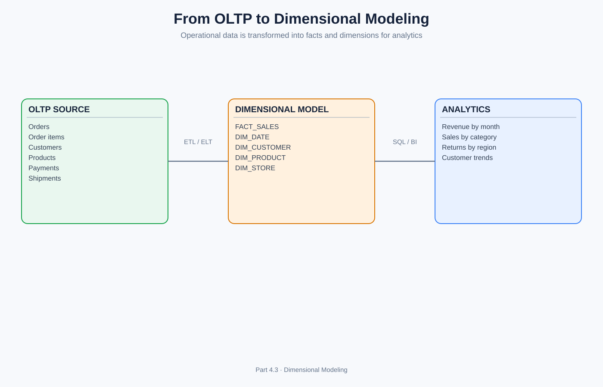
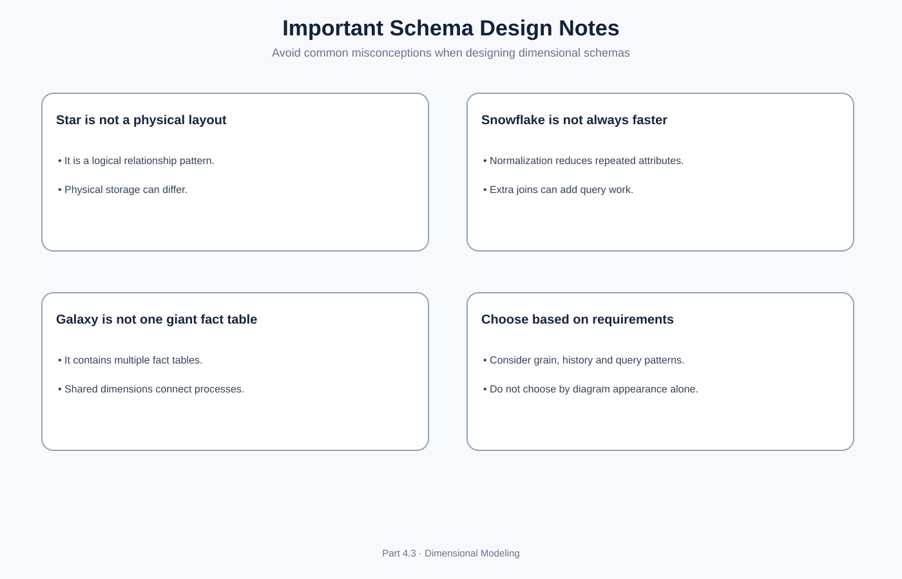

# Part 4.3 – Star Schema, Snowflake Schema and Galaxy Schema
## Final Chapter of Dimensional Modeling | OLAP & Data Warehousing

**Learning path:** Part 4.1 – Dimensional Modeling → Part 4.2 – Fact Tables and Dimension Tables → **Part 4.3 – Dimensional Schemas** → Next: Medallion Architecture with Databricks.

**Case study:** An e-commerce company that sells products, accepts payments, ships orders, manages inventory and processes returns.

## Learning outcomes

By the end of this chapter, you should be able to explain dimensional schemas, design Star and Snowflake Schemas, model a Galaxy Schema, understand conformed dimensions and bus matrices, compare the three patterns, and select a suitable design for a business requirement.

# 1. What is a Dimensional Schema?

A **dimensional schema** is a logical way of organizing data in a data warehouse for analytical queries and reporting. It organizes business measurements into **fact tables** and descriptive context into **dimension tables**.

It helps answer questions such as:
- What was the total revenue this month?
- Which product category generated the highest sales?
- Which city has the most customers?
- How many products were returned?
- How much inventory was available at month-end?

### OLTP vs OLAP

| OLTP – operational systems | OLAP – analytical systems |
|---|---|
| Runs day-to-day transactions | Supports analysis and decisions |
| Frequent inserts and updates | Read-heavy analytical queries |
| Application-oriented | Business-process and analysis-oriented |
| Often normalized relational design | Often dimensional design |
| Example: place an order | Example: analyze 3 years of sales |

An order application records an individual purchase. A warehouse organizes sales facts with Date, Customer, Product and Store dimensions so analysts can summarize thousands or millions of purchases.

## 1.1 Three dimensional schema patterns

1. **Star Schema:** One central fact table connects directly to dimension tables. Dimensions are generally denormalized.
2. **Snowflake Schema:** A fact table connects to dimensions, and dimension hierarchies are split into related normalized tables.
3. **Galaxy Schema / Fact Constellation:** Multiple fact tables share common, conformed dimensions.



These are logical modeling patterns. They do not dictate the physical storage format or file layout.

---

# 2. Star Schema

## 2.1 What is a Star Schema?

A **Star Schema** is a dimensional modeling design in which one central fact table connects directly to several dimension tables. The dimensions are generally denormalized, meaning related descriptive attributes are stored together in the same dimension table.

It is called a Star Schema because the diagram often looks like a star: the fact table is in the center and dimensions surround it.



### E-commerce example

Suppose an online shopping company wants to analyze sales by date, customer, product and store.

The central table is `FACT_SALES`. It connects to `DIM_DATE`, `DIM_CUSTOMER`, `DIM_PRODUCT` and `DIM_STORE`.

## 2.2 Star Schema table design

**FACT_SALES**

**Grain:** One row per product line within an order.

| Column | Role | Description |
|---|---|---|
| sales_fact_key | PK, optional | Fact-row identifier |
| date_key | FK | References DIM_DATE |
| customer_key | FK | References DIM_CUSTOMER |
| product_key | FK | References DIM_PRODUCT |
| store_key | FK | References DIM_STORE |
| order_number | Identifier | Order reference |
| quantity | Measure | Units sold |
| unit_price | Measure | Price per unit |
| discount_amount | Measure | Discount on the line |
| net_sales_amount | Measure | Net amount for the line |

**DIM_DATE**

| Column | Description |
|---|---|
| date_key (PK) | Date key |
| full_date | Actual date |
| day | Day number |
| month_name | Month |
| quarter | Quarter |
| year | Calendar year |
| fiscal_period | Business fiscal period |

**DIM_CUSTOMER**

| Column | Description |
|---|---|
| customer_key (PK) | Warehouse key |
| customer_id | Source customer ID |
| customer_name | Customer name |
| city | Customer city |
| state | Customer state |
| customer_segment | Business segment |

**DIM_PRODUCT**

| Column | Description |
|---|---|
| product_key (PK) | Warehouse key |
| product_id | Source product ID |
| product_name | Product name |
| brand | Brand |
| subcategory | Product subcategory |
| category | Product category |

**DIM_STORE**

| Column | Description |
|---|---|
| store_key (PK) | Warehouse key |
| store_id | Source store ID |
| store_name | Store name |
| city | Store city |
| state | Store state |
| region | Store region |

**Notice:** Product category and subcategory are stored as attributes in `DIM_PRODUCT`. They do not need separate dimension tables in this example.

## 2.3 How does a Star Schema work?

Business question: **What is the total sales amount by product category in 2026?**

1. Read `FACT_SALES`.
2. Join to `DIM_PRODUCT` using `product_key`.
3. Join to `DIM_DATE` using `date_key`.
4. Filter the year to 2026.
5. Group by product category.
6. Sum `net_sales_amount`.

```sql
SELECT
    p.category,
    SUM(f.net_sales_amount) AS total_sales
FROM fact_sales f
JOIN dim_product p
    ON f.product_key = p.product_key
JOIN dim_date d
    ON f.date_key = d.date_key
WHERE d.year = 2026
GROUP BY p.category
ORDER BY total_sales DESC;
```

Illustrative output:

| Category | Total sales |
|---|---:|
| Electronics | ₹25,00,000 |
| Fashion | ₹12,00,000 |
| Home Appliances | ₹9,00,000 |

These are sample values for learning, not real company data.

## 2.4 Advantages of Star Schema

1. **Simple structure:** Easy for learners, analysts and BI users to understand.
2. **Fewer joins:** Dimensions connect directly to the fact table.
3. **Readable queries:** SQL is generally straightforward.
4. **Business-friendly:** Descriptive attributes are available together.
5. **BI-friendly:** Commonly convenient for dashboards and reporting.
6. **Analytical usability:** Supports slicing, filtering, grouping and drill-down.

## 2.5 Disadvantages of Star Schema

1. **Repeated attributes:** Category and region descriptions may be repeated across many dimension rows.
2. **More dimension storage:** Denormalized descriptive data can consume more space.
3. **Update consistency:** Repeated values must be maintained consistently.
4. **Wide dimensions:** A dimension with many descriptive attributes can become wide.

Repeated values are not automatically a major problem in a warehouse. The trade-off is often accepted to make analytical queries simpler.

## 2.6 When should you use a Star Schema?

Use it when:
- The primary requirement is straightforward analytical reporting.
- Business users need simple and understandable models.
- Query simplicity and BI usability are important.
- Dimension hierarchies are manageable within one dimension table.

**Example:** A retail dashboard that reports sales by product, customer, store and date.

---

# 3. Snowflake Schema

## 3.1 What is a Snowflake Schema?

A **Snowflake Schema** is a dimensional model in which dimension tables are normalized into additional related tables. Instead of storing every hierarchy attribute in one dimension table, related levels are separated into their own tables.

It is called a Snowflake Schema because its diagram can branch into multiple related tables.



### Simple explanation

In a Star Schema, a product dimension might contain:

```text
DIM_PRODUCT
------------
product_key
product_name
subcategory
category
department
```

In a Snowflake Schema, the hierarchy may be separated:

```text
DIM_PRODUCT
     |
     v
DIM_SUBCATEGORY
     |
     v
DIM_CATEGORY
     |
     v
DIM_DEPARTMENT
```

This is normalization applied to dimension structures.

## 3.2 Snowflake Schema example

Consider the same e-commerce business.

**FACT_SALES**

| Column | Role |
|---|---|
| date_key | FK |
| customer_key | FK |
| product_key | FK |
| store_key | FK |
| quantity | Measure |
| net_sales_amount | Measure |

**DIM_PRODUCT**

| product_key | product_id | product_name | subcategory_key |
|---:|---|---|---:|
| 501 | P501 | Laptop | 20 |
| 502 | P502 | Mouse | 21 |

**DIM_SUBCATEGORY**

| subcategory_key | subcategory_name | category_key |
|---:|---|---:|
| 20 | Laptops | 1 |
| 21 | Accessories | 1 |

**DIM_CATEGORY**

| category_key | category_name |
|---:|---|
| 1 | Electronics |
| 2 | Fashion |

The product hierarchy is separated into related tables.

## 3.3 How does a Snowflake Schema work?

Question: **Find total sales by product category.**

The query needs more joins because category is no longer directly stored in the product dimension.

```sql
SELECT
    c.category_name,
    SUM(f.net_sales_amount) AS total_sales
FROM fact_sales f
JOIN dim_product p
    ON f.product_key = p.product_key
JOIN dim_subcategory s
    ON p.subcategory_key = s.subcategory_key
JOIN dim_category c
    ON s.category_key = c.category_key
GROUP BY c.category_name;
```



## 3.4 Advantages of Snowflake Schema

1. **Reduced attribute duplication:** Shared hierarchy descriptions can be stored once.
2. **Normalization:** Related dimension data is separated into logical entities.
3. **Hierarchy reuse:** A category or geography table can be referenced by multiple related dimension records.
4. **Centralized maintenance:** Shared hierarchy attributes can be maintained in one place.
5. **Clear hierarchy relationships:** Useful where business hierarchies are complex.

## 3.5 Disadvantages of Snowflake Schema

1. **More joins:** Queries may need several dimension-to-dimension joins.
2. **More complex SQL:** Analysts must understand hierarchy relationships.
3. **BI model complexity:** More relationships may require additional semantic-model configuration.
4. **Potential query overhead:** Additional joins can increase query work, depending on platform and optimization.
5. **More objects to govern:** More tables and relationships must be documented and maintained.

## 3.6 When should you use a Snowflake Schema?

Consider it when:
- Dimension hierarchies are complex.
- Shared descriptive hierarchy data needs centralized management.
- Reducing repeated attributes is important.
- The organization can manage additional joins and modeling complexity.

**Example:** A global retailer with product, subcategory, category, department and merchandise hierarchy tables, or a large geography hierarchy.

> Snowflake is not automatically faster or better than Star. Choose based on query patterns, data governance, platform behavior and user needs.

---

# 4. Galaxy Schema (Fact Constellation Schema)

## 4.1 What is a Galaxy Schema?

A **Galaxy Schema**, also called a **Fact Constellation Schema**, contains multiple fact tables that share common dimensions.

A Star Schema commonly focuses on one central fact table. A Galaxy Schema brings together multiple business processes, each with its own fact table, using conformed dimensions.



### Simple real-life example

An e-commerce company has several business processes:
1. Sales
2. Returns
3. Inventory
4. Payments
5. Shipments

Each process has different measures and a different grain. However, several processes can share dimensions such as Date, Product, Customer and Store.

## 4.2 Galaxy Schema example

**FACT_SALES**

Grain: One row per product line in an order.

| Column | Role |
|---|---|
| date_key | FK |
| customer_key | FK |
| product_key | FK |
| store_key | FK |
| quantity | Measure |
| sales_amount | Measure |

**FACT_RETURNS**

Grain: One row per returned product line.

| Column | Role |
|---|---|
| return_date_key | FK to Date |
| customer_key | FK |
| product_key | FK |
| store_key | FK |
| return_quantity | Measure |
| refund_amount | Measure |

**FACT_INVENTORY**

Grain: One row per product, warehouse and snapshot date.

| Column | Role |
|---|---|
| snapshot_date_key | FK to Date |
| product_key | FK |
| warehouse_key | FK |
| opening_stock | Measure |
| closing_stock | Measure |

The facts have different grains and different measures. They should not be combined into one fact table merely because they describe the same company.

## 4.3 What are Conformed Dimensions in a Galaxy Schema?

A **conformed dimension** is a shared dimension whose meaning, attributes and definitions are consistent across fact tables.

Example: the same Date and Product dimensions can support consistent reporting across sales and returns.

Benefits:
- Consistent business definitions.
- Cross-process reporting.
- Reusable dimensions.
- Enterprise-wide analysis.
- Reduced duplication of dimension definitions.

## 4.4 Enterprise Bus Matrix

A **Bus Matrix** is a planning tool that maps business processes (fact tables) against conformed dimensions.



| Business process | Date | Customer | Product | Store | Payment |
|---|---|---|---|---|---|
| Sales | Yes | Yes | Yes | Yes | Yes |
| Returns | Yes | Yes | Yes | Yes | No |
| Inventory | Yes | No | Yes | Yes | No |

This matrix helps identify which dimensions should be shared across the data warehouse.

## 4.5 Advantages of Galaxy Schema

1. **Enterprise-level modeling:** Represents several business processes.
2. **Shared dimensions:** Reuses conformed dimensions.
3. **Cross-process reporting:** Compare sales, returns and inventory.
4. **Scalability:** New fact tables can be added as new business processes are modeled.
5. **Consistent analysis:** Shared definitions support enterprise reporting.

## 4.6 Disadvantages of Galaxy Schema

1. **Higher design complexity:** Multiple facts and relationships must be governed.
2. **Grain management:** Every fact table needs its own clear grain.
3. **More ETL/ELT coordination:** Shared dimensions must be loaded and maintained consistently.
4. **Complex reporting:** Cross-process queries require careful aggregation.
5. **Risk of double counting:** Joining multiple fact tables directly can multiply rows.

### Important warning: Do not directly join fact tables without considering grain

Suppose one order has three sales lines and two return records. Joining the two fact tables only by order number can produce six rows, multiplying measures.

A safer approach is to aggregate each fact to the common reporting grain first, then join the aggregated results using shared dimension keys.

**Use it when:** The warehouse needs to support multiple business processes such as sales, returns, payments and inventory.

---

# 5. Detailed Comparison: Star vs Snowflake vs Galaxy


| Feature | Star Schema | Snowflake Schema | Galaxy Schema |
|---|---|---|---|
| Basic structure | One central fact with dimensions | Fact with normalized dimension tables | Multiple fact tables sharing dimensions |
| Fact tables | Commonly one per star | Commonly one per model/process | Multiple |
| Dimensions | Usually denormalized | Normalized into related tables | Shared/conformed dimensions are common |
| Joins | Usually fewer | Usually more | Depends on facts and dimensions |
| Query simplicity | Generally high | Generally lower | Depends on reporting requirement |
| Dimension duplication | Can be higher | Can be lower | Shared dimensions reduce duplicate definitions |
| Design complexity | Relatively simple | Moderate | Higher |
| Best suited for | Focused reporting | Complex dimension hierarchies | Enterprise multi-process analytics |

### Do not confuse these concepts

- **Star vs Snowflake:** Mainly about how dimension structures are organized.
- **Star vs Galaxy:** Mainly about one business-process fact model versus multiple related fact models.
- A Galaxy can contain individual Star Schemas. It can also use normalized dimensions where appropriate.

# 6. Choosing the Right Schema



| Requirement | Suitable starting point |
|---|---|
| Simple sales reporting | Star |
| Easy BI consumption | Star |
| Complex product hierarchy | Snowflake may fit |
| Shared normalized hierarchy | Snowflake may fit |
| Sales + returns + inventory analytics | Galaxy |
| Enterprise-wide data warehouse | Galaxy / fact constellation |

The correct design depends on business requirements, fact grain, data volume, platform optimization, governance and how users consume the data.

# 7. From OLTP to Dimensional Modeling

Operational databases are often designed around individual application transactions. A data warehouse reorganizes relevant data around business processes, facts and dimensions.



Example transformation:

| OLTP source | Dimensional target |
|---|---|
| orders | FACT_SALES / order-level process facts |
| order_items | FACT_SALES |
| customers | DIM_CUSTOMER |
| products | DIM_PRODUCT |
| stores | DIM_STORE |
| calendar/business date logic | DIM_DATE |

This is a conceptual mapping. Actual design must account for source grain, history, keys, late-arriving data, duplicates and business definitions.

## 7.1 Typical dimensional ETL / ELT steps

1. Extract source data from operational systems.
2. Clean and standardize source records.
3. Identify business events and declare fact grain.
4. Create or update dimension records.
5. Generate and resolve surrogate keys.
6. Apply required SCD logic.
7. Load fact rows with dimension foreign keys.
8. Validate row counts, key lookups, measures and duplicates.
9. Make curated warehouse data available to SQL and BI tools.

# 8. Schema Design Principles

1. Identify the business process before designing tables.
2. Declare the grain of every fact table.
3. Identify the dimensions that describe that process.
4. Select measures that are valid at the declared grain.
5. Document additive behavior.
6. Use conformed dimensions for shared business concepts.
7. Apply SCD logic based on historical reporting needs.
8. Avoid unnecessary joins and over-normalization.
9. Prevent fact-to-fact join multiplication.
10. Validate the model using real analytical questions.



# 9. Common Interview Questions

## Star Schema
1. What is a Star Schema?
2. Why is it called a Star Schema?
3. What is the role of the central fact table?
4. Why are dimensions generally denormalized?
5. What are the advantages of a Star Schema?
6. What are its disadvantages?
7. Explain a Star Schema using an e-commerce example.
8. How would you query sales by product category?

## Snowflake Schema
9. What is a Snowflake Schema?
10. How is it different from a Star Schema?
11. Why do we normalize dimension tables?
12. What is a dimension hierarchy?
13. What are the advantages and disadvantages of Snowflake?
14. Does Snowflake always improve performance?
15. Give an example of a normalized product hierarchy.

## Galaxy Schema
16. What is a Galaxy Schema?
17. What is another name for Galaxy Schema?
18. What is a fact constellation?
19. What are conformed dimensions?
20. How do Sales and Returns share dimensions?
21. What is an enterprise bus matrix?
22. Why must fact tables have separate grains?
23. What happens when fact tables are joined without aggregation?
24. How does Galaxy support enterprise reporting?

## Scenario-based questions
25. A retail company wants a simple sales dashboard. Which schema would you start with and why?
26. A product hierarchy has multiple reusable levels. Which schema could be appropriate?
27. A company wants Sales, Returns and Inventory in one enterprise warehouse. Which schema pattern is appropriate?
28. Two fact tables share Date and Product dimensions. What is the benefit?
29. Why should you aggregate facts before joining them at a common reporting grain?
30. Can a Galaxy Schema contain multiple Star Schemas?

# 10. Knowledge Check

1. Explain the Star Schema using four dimensions.
2. What does denormalized dimension mean?
3. Explain the Product hierarchy in a Snowflake Schema.
4. Why can Snowflake require more joins?
5. What is a fact constellation?
6. What is a conformed dimension?
7. What is the difference between a role-playing dimension and a conformed dimension?
8. Can a Galaxy Schema contain multiple fact tables with different grains?
9. Why can joining two fact tables directly create double counting?
10. What is the purpose of an enterprise bus matrix?
11. Which schema would you choose for sales and returns reporting?
12. Can a Snowflake Schema be used inside a larger Galaxy model?

# 11. Final Revision Sheet

| Term | Short explanation |
|---|---|
| Dimensional schema | Logical organization of facts and dimensions for analysis |
| Star Schema | Central fact table connected directly to dimensions |
| Denormalized dimension | Descriptive attributes stored together |
| Snowflake Schema | Dimension hierarchies split into normalized tables |
| Normalization | Organizing data to reduce repeated attributes and manage relationships |
| Galaxy Schema | Multiple fact tables sharing dimensions |
| Fact constellation | Another name for Galaxy Schema |
| Conformed dimension | Shared dimension with consistent definitions |
| Bus matrix | Maps business processes to conformed dimensions |
| OLTP | Operational transaction processing |
| OLAP | Analytical processing |

# 12. Chapter Completion Checklist

- [ ] What is a Dimensional Schema?
- [ ] OLTP vs OLAP
- [ ] Star Schema – definition and structure
- [ ] Star Schema – table design and relationships
- [ ] Star Schema – SQL example
- [ ] Star Schema – advantages and disadvantages
- [ ] Snowflake Schema – definition and structure
- [ ] Snowflake Schema – normalization example
- [ ] Snowflake Schema – SQL example
- [ ] Snowflake Schema – advantages and disadvantages
- [ ] Galaxy Schema / Fact Constellation
- [ ] Multiple fact tables and separate grain
- [ ] Conformed dimensions
- [ ] Enterprise Bus Matrix
- [ ] Star vs Snowflake vs Galaxy comparison
- [ ] Choosing the right schema
- [ ] OLTP to dimensional model
- [ ] Dimensional ETL / ELT flow
- [ ] Design principles
- [ ] Interview questions and knowledge check

---

# End of Part 4 – Dimensional Modeling

**Dimensional Modeling Complete**

You have now covered:
- Part 4.1 – Introduction to Dimensional Modeling
- Part 4.2 – Fact Tables and Dimension Tables
- Part 4.3 – Star Schema, Snowflake Schema and Galaxy Schema

# Next Module – Part 5: Medallion Architecture with Databricks

The next module moves from dimensional data warehouse modeling to modern data lakehouse architecture.

## Proposed learning sequence

1. Introduction to Medallion Architecture
2. Data Lake vs Data Warehouse vs Data Lakehouse
3. Bronze Layer – raw data ingestion
4. Silver Layer – cleaning, validation and standardization
5. Gold Layer – business-ready data and aggregates
6. End-to-end Bronze → Silver → Gold pipeline
7. Databricks workspace and architecture
8. Delta Lake fundamentals
9. Delta tables and transaction log
10. Batch and incremental processing
11. Data quality and pipeline orchestration
12. Building a practical project in Databricks

**Important transition:** Dimensional modeling explains how analytical data is organized. Medallion Architecture explains how data is progressively ingested, refined and prepared across lakehouse layers. They complement each other; Gold-layer data can include dimensional models such as Star Schemas.
