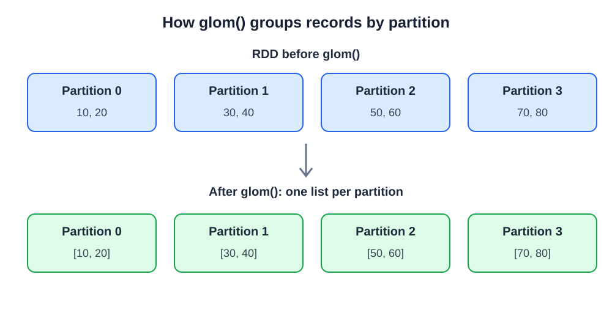
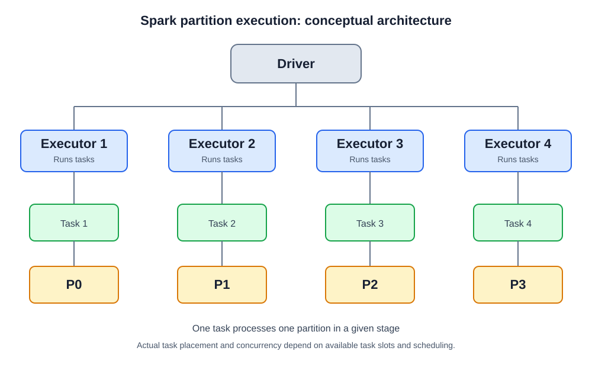
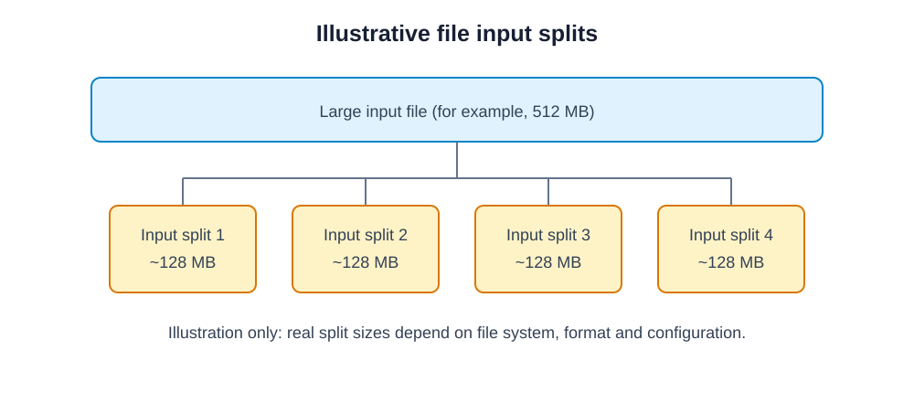

# 1. Partitions Fundamentals in Apache Spark

**Advanced PySpark – Chapter 1 | RDD Fundamentals**

Before learning repartition, coalesce, shuffling, narrow transformations and wide transformations, you must understand partitions thoroughly. Partitions influence parallelism, resource utilization, data distribution and job performance.

This chapter covers:
- What partitions are
- Why Spark divides data into partitions
- Default partition creation
- `getNumPartitions()`
- `glom()`
- Practical examples, diagrams, assignments and interview questions

---

## 1.1 What are partitions?

A **partition** is a logical division of a dataset into smaller chunks of data. Spark processes these chunks independently across available CPU cores and executors.

Instead of processing an entire dataset as one large unit, Spark divides it into multiple partitions and processes them in parallel.

For example, a dataset containing 1 million records might be divided into four partitions:

| Partition | Illustrative record count |
|---|---:|
| Partition 0 | 250,000 |
| Partition 1 | 250,000 |
| Partition 2 | 250,000 |
| Partition 3 | 250,000 |

Each partition becomes an independent unit of task execution for a stage.

### Visual understanding



**Important:** Partitions are logical data divisions. They are not necessarily separate physical files, machines or executors.

### How partitions work internally

Spark uses a distributed execution model:

1. The Driver creates and manages the Spark application.
2. Spark determines the number of partitions in the dataset.
3. The Driver schedules tasks to executors.
4. Each task processes one partition for a particular stage.
5. Multiple tasks can execute simultaneously on available task slots.
6. Results are returned or written to the required destination.



**Key relationship: `1 partition = 1 task per stage`**

For example, if a stage has eight partitions, Spark normally creates eight tasks for that stage. This does not mean all eight tasks execute simultaneously. Actual concurrency depends on available task slots and resources.

---

## 1.2 Why does Spark divide data into partitions?

### 1. Parallel processing

Parallel processing allows Spark to process multiple partitions simultaneously.

Imagine a dataset with 1 million records and four available CPU cores:

| CPU core | Assigned partition |
|---|---|
| Core 1 | Partition 0 |
| Core 2 | Partition 1 |
| Core 3 | Partition 2 |
| Core 4 | Partition 3 |

All four cores can process different partitions simultaneously. Without sufficient partitions, available CPU resources might remain underutilized.

### 2. Scalability

Spark can distribute partitions across multiple executors and machines.

For example:
- Executor 1 processes partitions 0 and 1.
- Executor 2 processes partitions 2 and 3.
- Executor 3 processes partitions 4 and 5.

This allows Spark to scale processing across a cluster. The actual placement is decided by Spark's scheduler.

### 3. Memory management

Instead of requiring the entire dataset to fit into one processing unit, Spark processes data in partition-sized units.

This makes distributed processing practical for large datasets. However, partitioning alone does not guarantee that data fits in memory. A single oversized partition can still cause memory pressure or out-of-memory errors.

### 4. Fault tolerance

RDDs maintain lineage information describing how they were created.

If a partition is lost because of an executor failure, Spark can often recompute that partition using its lineage rather than recomputing the entire dataset.

### 5. Improved resource utilization

Proper partition sizing helps Spark utilize CPU cores efficiently and avoid unnecessarily large tasks.

**Real-world example: E-commerce order processing**

Imagine an e-commerce company processing 50 million orders daily. It needs to calculate:
- Total daily revenue
- Product-wise sales
- Customer-wise order counts
- Regional sales performance

Spark distributes order data into partitions and processes these operations in parallel.

---

## 1.3 Default partition creation in Spark

When we create an RDD without specifying the number of partitions, how does Spark decide how many partitions to create?

The answer depends on how the RDD is created and the underlying execution environment.

### A. Creating an RDD using `parallelize()`

The `parallelize()` method creates an RDD from an existing Python collection.

```python
sparkContext.parallelize(collection, numSlices)
```

- `collection`: Python list or another supported collection.
- `numSlices`: Number of partitions to create; optional.

#### Example 1 – Without specifying partitions

```python
data = [10, 20, 30, 40, 50, 60, 70, 80]

rdd = sc.parallelize(data)

print(rdd.getNumPartitions())
```

If the SparkContext's default parallelism is 4, the result will typically be:

```text
4
```

The data may be distributed approximately like this:

```text
Partition 0 → [10, 20]
Partition 1 → [30, 40]
Partition 2 → [50, 60]
Partition 3 → [70, 80]
```

#### Example 2 – Specifying partitions manually

```python
data = list(range(1, 21))

rdd = sc.parallelize(data, 4)

print(rdd.getNumPartitions())
```

Output:

```text
4
```

Here, we explicitly request four partitions.

#### Example 3 – Creating eight partitions

```python
data = list(range(1, 101))

rdd = sc.parallelize(data, 8)

print(rdd.getNumPartitions())
```

Output:

```text
8
```

Each partition will contain approximately 12 or 13 elements.

### B. What determines the default parallelism?

Spark provides a property called:

```python
sc.defaultParallelism
```

It returns the default level of parallelism configured for the SparkContext.

```python
print("Default Parallelism:", sc.defaultParallelism)
```

Suppose the output is:

```text
Default Parallelism: 4
```

When you execute:

```python
rdd = sc.parallelize(data)
```

Spark uses the applicable default parallelism to determine the number of slices.

The actual default depends on the cluster manager, available resources and Spark configuration.

For a local environment:

```python
spark = (
    SparkSession.builder
    .appName("PartitionDemo")
    .master("local[*]")
    .getOrCreate()
)

sc = spark.sparkContext
```

`local[*]` tells Spark to use all available logical CPU cores on the local machine.

| Environment | Typical default parallelism |
|---|---:|
| `local[2]` | 2 |
| `local[4]` | 4 |
| `local[*]` | Available logical cores |
| Cluster mode | Depends on cluster resources and configuration |

These are typical examples, not universal guarantees for every deployment.

### C. Creating an RDD using `textFile()`

Another common way to create an RDD is by reading a file.

```python
rdd = sc.textFile("sales.csv")

print(rdd.getNumPartitions())
```

Spark uses the underlying Hadoop input format and file splits to determine input partitions.

You can also specify a minimum number of partitions:

```python
rdd = sc.textFile("sales.csv", minPartitions=8)
```

**Important:** `minPartitions` is a hint, not an exact guarantee that Spark will create exactly eight partitions. Actual partitioning depends on the file format, input splits and implementation.



For example, assuming 128 MB input splits:

| File size | Possible input splits |
|---|---:|
| 128 MB | 1 |
| 256 MB | 2 |
| 512 MB | 4 |
| 1 GB | 8 |

This is an illustrative example. Actual splits depend on the filesystem, file format, compression and configuration.

### D. DataFrame partition creation

DataFrames also have partitions.

```python
df = spark.read.csv(
    "sales.csv",
    header=True,
    inferSchema=True
)

print(df.rdd.getNumPartitions())
```

You can inspect the number of partitions in a DataFrame using:

```python
df.rdd.getNumPartitions()
```

DataFrame partitioning can be affected by file input splits, subsequent transformations, joins, aggregations, adaptive query execution and other optimizations.

---

## 1.4 Understanding `getNumPartitions()`

### Definition

`getNumPartitions()` is an RDD method used to determine how many partitions exist in an RDD.

```python
rdd.getNumPartitions()
```

It returns an integer representing the number of partitions.

### Example 1 – Basic usage

```python
data = list(range(1, 21))

rdd = sc.parallelize(data, 4)

print(rdd.getNumPartitions())
```

Output:

```text
4
```

### Example 2 – Compare different partition counts

```python
data = list(range(1, 101))

rdd1 = sc.parallelize(data, 2)
rdd2 = sc.parallelize(data, 4)
rdd3 = sc.parallelize(data, 8)

print("RDD 1:", rdd1.getNumPartitions())
print("RDD 2:", rdd2.getNumPartitions())
print("RDD 3:", rdd3.getNumPartitions())
```

Output:

```text
RDD 1: 2
RDD 2: 4
RDD 3: 8
```

### Example 3 – Check partitions after transformations

```python
data = list(range(1, 101))

rdd = sc.parallelize(data, 4)

filtered_rdd = rdd.filter(lambda x: x > 50)

mapped_rdd = filtered_rdd.map(lambda x: x * 2)

print("Original:", rdd.getNumPartitions())
print("Filtered:", filtered_rdd.getNumPartitions())
print("Mapped:", mapped_rdd.getNumPartitions())
```

Output:

```text
Original: 4
Filtered: 4
Mapped: 4
```

Why?

Because `filter()` and `map()` are narrow transformations. They generally preserve the parent RDD's partition count.

---

## 1.5 Understanding `glom()`

### Definition

`glom()` is an RDD transformation that converts each partition into a single collection (a list in PySpark).

In simple words:

- `collect()` retrieves all records from all partitions into one Python list.
- `glom()` groups records separately within each partition and returns an RDD containing one list per partition.

### Visual understanding


Suppose we have this RDD:

```python
data = [10, 20, 30, 40, 50, 60, 70, 80]

rdd = sc.parallelize(data, 4)
```

The data distribution might be:

```text
Partition 0 → [10, 20]
Partition 1 → [30, 40]
Partition 2 → [50, 60]
Partition 3 → [70, 80]
```

After applying `glom()`, each partition's values are represented as one list.

### Example 1 – Basic `glom()` usage

```python
data = [10, 20, 30, 40, 50, 60, 70, 80]

rdd = sc.parallelize(data, 4)

result = rdd.glom().collect()

print(result)
```

Possible output:

```python
[
    [10, 20],
    [30, 40],
    [50, 60],
    [70, 80]
]
```

Notice that the output contains four separate lists. Each list represents one partition.

### Example 2 – Inspect each partition separately

```python
data = list(range(1, 21))

rdd = sc.parallelize(data, 4)

partition_data = rdd.glom().collect()

for index, partition in enumerate(partition_data):
    print(f"Partition {index}: {partition}")
```

Possible output:

```text
Partition 0: [1, 2, 3, 4, 5]
Partition 1: [6, 7, 8, 9, 10]
Partition 2: [11, 12, 13, 14, 15]
Partition 3: [16, 17, 18, 19, 20]
```

### Example 3 – Count records in each partition

This is useful for checking data distribution.

```python
data = list(range(1, 101))

rdd = sc.parallelize(data, 4)

partition_counts = (
    rdd.glom()
       .map(lambda partition: len(partition))
       .collect()
)

print(partition_counts)
```

Output:

```text
[25, 25, 25, 25]
```

This indicates that all four partitions contain 25 records each.

### Example 4 – Find minimum and maximum values in each partition

```python
data = list(range(1, 101))

rdd = sc.parallelize(data, 4)

result = rdd.glom().map(
    lambda partition: (
        min(partition),
        max(partition)
    )
).collect()

print(result)
```

Output:

```text
[(1, 25), (26, 50), (51, 75), (76, 100)]
```

### Example 5 – Calculate partition-wise sum

```python
data = list(range(1, 101))

rdd = sc.parallelize(data, 4)

partition_sums = rdd.glom().map(
    lambda partition: sum(partition)
).collect()

print(partition_sums)
```

Output:

```text
[325, 950, 1575, 2200]
```

### Important technical distinction

`glom()` is a transformation, not an action.

| Operation | Type | Purpose |
|---|---|---|
| `glom()` | Transformation | Groups each partition into a list |
| `collect()` | Action | Retrieves all resulting records to the Driver |
| `getNumPartitions()` | Metadata method | Returns partition count |

**Performance warning:** `glom().collect()` is useful for learning and debugging small datasets. Avoid collecting large partitions to the Driver because this can cause memory issues.

---

## 1.6 Partition distribution across executors

The following conceptual diagram shows a Driver scheduling work across executors. Each task processes its assigned partition.


Actual executor and task placement is controlled by Spark's scheduler. The number of tasks that run simultaneously depends on available task slots.

---

## 1.7 Important differences to remember

| Method | What it does |
|---|---|
| `parallelize()` | Creates an RDD from a Python collection |
| `textFile()` | Creates an RDD from a text file |
| `getNumPartitions()` | Returns the number of RDD partitions |
| `glom()` | Groups elements within each partition |
| `collect()` | Retrieves all RDD elements to the Driver |
| `defaultParallelism` | Returns SparkContext's default parallelism |

### Common misconceptions

1. More partitions do not always mean faster execution.
2. One partition does not necessarily mean one executor.
3. Partitions are not the same as CPU cores.
4. Partitions do not necessarily correspond to physical files.
5. Increasing partition count does not automatically improve performance.
6. `glom()` does not combine all partitions into one partition; it creates a list of elements for each existing partition.

---

## 1.8 Practical assignment

Try these exercises in your Jupyter Notebook.

1. Create an RDD containing numbers from 1 to 100 with 4 partitions.
2. Print the number of partitions using `getNumPartitions()`.
3. Display the contents of every partition using `glom()` and `collect()`.
4. Create an RDD with 10 partitions and calculate the number of records in each partition.
5. Calculate the sum of values in every partition independently.
6. Compare the partition distribution of RDDs created with 2, 4 and 8 partitions.
7. Create an RDD using `textFile()` and inspect its partition count.
8. Apply `filter()` and `map()` and check whether the partition count changes.

---

## 1.9 Interview questions

### Basic level

1. What is a partition in Apache Spark?
2. Why does Spark divide datasets into partitions?
3. What is the difference between an RDD and a partition?
4. What does `getNumPartitions()` return?
5. What is the purpose of `glom()`?

### Intermediate level

6. How does Spark determine the default number of partitions?
7. What is `sc.defaultParallelism`?
8. What is the difference between `collect()` and `glom()`?
9. Can two different partitions execute simultaneously?
10. Does increasing the number of partitions always improve performance?

### Advanced level

11. What happens when an executor fails while processing a partition?
12. What is the relationship between partitions, tasks and executors?
13. How does Spark distribute data when using `parallelize()`?
14. How are partitions created when reading large files?
15. Why can a partition containing significantly more records than others become a performance bottleneck?

---

## 1.10 Chapter 1 – Learning checklist

- [ ] What partitions are
- [ ] Why Spark uses partitions
- [ ] Parallel processing and task execution
- [ ] Default partition creation
- [ ] `sc.defaultParallelism`
- [ ] `getNumPartitions()`
- [ ] `glom()`
- [ ] Partition-wise data inspection
- [ ] Relationship between partitions, tasks and executors

---

## Next topic in your advanced Spark roadmap

**2. Partition Distribution and Data Skew**

Before learning repartitioning and coalescing, understand how Spark distributes data and why partitions sometimes contain unequal amounts of data.

Recommended learning sequence:

1. Partitions Fundamentals — Current chapter
2. Partition Distribution and Data Skew
3. Spark Shuffling Fundamentals
4. Narrow vs Wide Transformations
5. Repartitioning
6. Coalesce
7. Partition Optimization and Performance Tuning

This sequence builds the foundation to understand not just how to use these methods, but also why and when to use them in real-world Data Engineering pipelines.

---

## References and further reading

- [Apache Spark RDD Programming Guide](https://spark.apache.org/docs/latest/rdd-programming-guide.html)
- [PySpark RDD API – `getNumPartitions`](https://spark.apache.org/docs/latest/api/python/reference/api/pyspark.RDD.getNumPartitions.html)
- [PySpark RDD API – `glom`](https://spark.apache.org/docs/latest/api/python/reference/api/pyspark.RDD.glom.html)
- [PySpark SparkContext API](https://spark.apache.org/docs/latest/api/python/reference/api/pyspark.SparkContext.html)

## Included SVG assets

The diagrams are stored in the `assets/` directory. Keep the directory beside this Markdown file so the relative image links continue to work.
