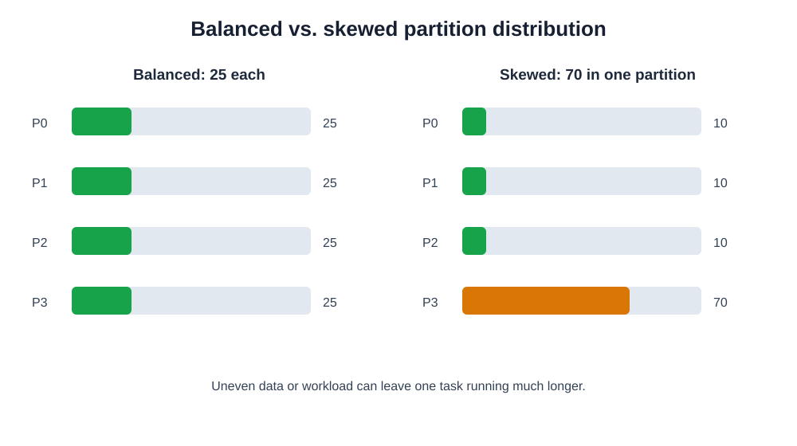
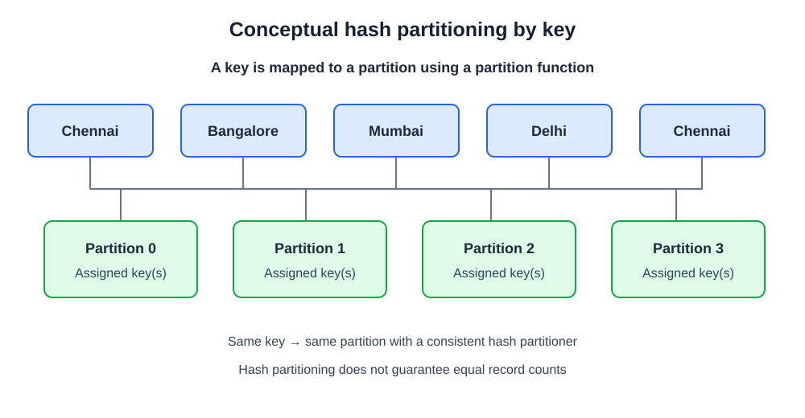
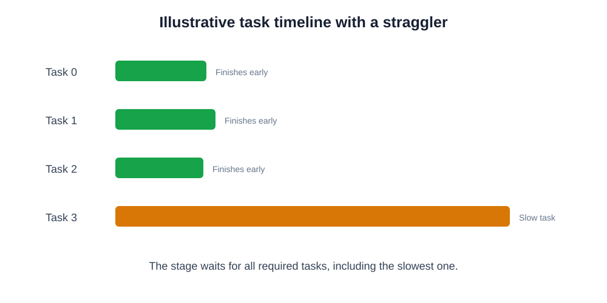
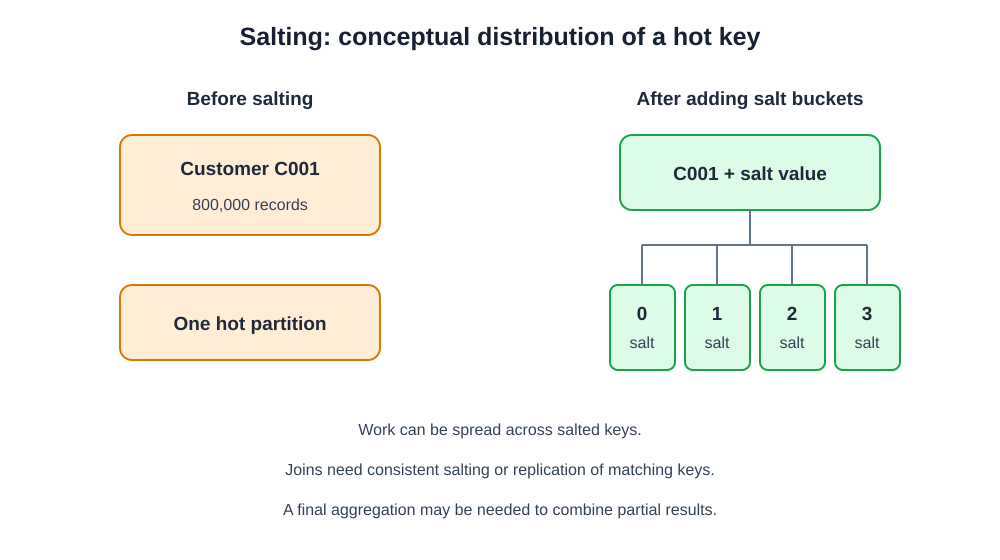

# 2. Partition Distribution and Data Skew in Apache Spark

**Advanced PySpark – Chapter 2 | Partition Fundamentals**

Now that you understand what partitions are, how Spark creates them, and how to inspect them using `getNumPartitions()` and `glom()`, the next important concept is **Partition Distribution and Data Skew**.

This chapter is important before learning:
- Shuffling
- Repartitioning
- Coalesce
- Narrow and Wide Transformations
- Partition Optimization
- Spark Performance Tuning

We will understand how Spark distributes data, why some partitions contain more records than others, and how this affects execution performance.

---

## 2.1 What is partition distribution?

### Definition

Partition distribution refers to how records are spread across different partitions in a Spark dataset.

Ideally, data should be distributed in a way that allows Spark to utilize available resources efficiently.

Consider an RDD containing 100 records with four partitions.

**Scenario 1: Balanced distribution**

| Partition | Records |
|---|---:|
| P0 | 25 |
| P1 | 25 |
| P2 | 25 |
| P3 | 25 |
| **Total** | **100** |

**Scenario 2: Unbalanced distribution**

| Partition | Records |
|---|---:|
| P0 | 10 |
| P1 | 10 |
| P2 | 10 |
| P3 | 70 |
| **Total** | **100** |

Both datasets have 100 records and four partitions, but their execution performance can be very different.

### Visual understanding



**Important:** Equal record counts do not necessarily mean equal processing time. Records can have different sizes and processing costs.

---

## 2.2 How does Spark distribute data into partitions?

There is no single distribution mechanism for every Spark operation. Spark distributes data differently depending on how the dataset is created and which transformations are applied.

### A. Slicing with `parallelize()`

When you create an RDD from a Python collection using `parallelize()`, Spark divides the collection into slices.

```python
data = list(range(1, 21))

rdd = sc.parallelize(data, 4)

print(rdd.getNumPartitions())
```

Output:

```text
4
```

Inspect the data:

```python
rdd.glom().collect()
```

Possible output:

```python
[
    [1, 2, 3, 4, 5],
    [6, 7, 8, 9, 10],
    [11, 12, 13, 14, 15],
    [16, 17, 18, 19, 20]
]
```

Here, Spark divides the collection into approximately equal-sized slices.

**Note:** This is not the same as round-robin repartitioning. `parallelize()` creates slices from the input collection.

### B. Hash partitioning

Hash partitioning distributes records according to the hash of a key. This is particularly important when working with key-value RDDs.

Consider this dataset:

```python
data = [
    ("Chennai", 100),
    ("Bangalore", 200),
    ("Mumbai", 300),
    ("Chennai", 150),
    ("Delhi", 400),
    ("Bangalore", 250)
]

rdd = sc.parallelize(data, 4)
```

Now apply:

```python
partitioned_rdd = rdd.partitionBy(4)
```

Inspect:

```python
partitioned_rdd.glom().collect()
```



Conceptually, a hash partitioner maps a key to a partition:

```text
partition_id = partitioner(key)
```

A simplified illustration is:

\[
partition = hash(key) \bmod N
\]

Where:
- `hash(key)` = hash value of the key.
- `N` = number of partitions.

**Important:** This is a simplified explanation, not a complete description of PySpark's implementation. PySpark uses a partition function (by default, `portable_hash`) and handles the resulting value to determine the partition. Do not assume this simplified formula predicts every actual partition assignment.

The important point is that records with the same key are assigned to the same partition by a consistent hash partitioner.

This is useful for operations such as:
- `reduceByKey()`
- `groupByKey()`
- `partitionBy()`
- Joins on keys

### C. Range partitioning

Range partitioning distributes records based on ranges of values.

For example, imagine employee salaries:

| Salary range | Conceptual partition |
|---|---|
| 0–20,000 | P0 |
| 20,001–40,000 | P1 |
| 40,001–60,000 | P2 |
| 60,001–100,000 | P3 |

In PySpark DataFrames, you can use:

```python
df = df.repartitionByRange(4, "salary")
```

This creates range-based partitions according to the specified column.

The range boundaries are determined using sampling and are not guaranteed to match manually defined ranges exactly.

**Real-world example:** Distributing transaction records according to transaction dates or employee records according to salary ranges.

---

## 2.3 What is Data Skew?

### Definition

Data skew occurs when data or processing work is distributed unevenly across partitions, causing some partitions to contain significantly more data or require significantly more processing than others.

In simple terms: one partition has much more work than the remaining partitions.

### Example

Imagine an e-commerce company processing 10 million orders.

Balanced distribution:

| Partition | Records |
|---|---:|
| P0 | 2,500,000 |
| P1 | 2,500,000 |
| P2 | 2,500,000 |
| P3 | 2,500,000 |

Skewed distribution:

| Partition | Records |
|---|---:|
| P0 | 500,000 |
| P1 | 500,000 |
| P2 | 500,000 |
| P3 | 8,500,000 |

The last partition contains 85% of the records.

What happens?
- P0 finishes relatively quickly.
- P1 finishes relatively quickly.
- P2 finishes relatively quickly.
- P3 takes significantly longer.

Spark cannot complete the stage until all required tasks finish.

This situation is associated with **straggler tasks**.

### Visual explanation



A skewed partition can cause:
- Longer stage execution time
- Underutilized executors while other tasks wait
- Increased memory pressure
- Larger shuffle reads
- Memory or disk spilling
- Potential executor failures

The stage completion time is often constrained by the slowest required task.

---

## 2.4 Types and causes of Data Skew

Understanding the cause of skew is more important than simply increasing the partition count.

### A. Key skew

Key skew occurs when some keys appear much more frequently than others.

Consider this order dataset:

| Order ID | Customer ID |
|---|---|
| 101 | C001 |
| 102 | C001 |
| 103 | C001 |
| 104 | C001 |
| 105 | C002 |
| 106 | C003 |
| 107 | C004 |
| 108 | C001 |
| 109 | C001 |

Here, customer `C001` appears much more frequently.

Suppose you perform:

```python
customer_orders = rdd.reduceByKey(
    lambda a, b: a + b
)
```

If the data is shuffled using the customer ID as the key, all occurrences of `C001` are assigned to the same hash partition. That partition may become much heavier than the others.

### B. Join skew

Join skew occurs when one or more join keys have significantly more records than other keys.

**Orders dataset**

| Customer ID | Orders |
|---|---:|
| C001 | 500,000 |
| C002 | 100 |
| C003 | 150 |

**Customer dataset**

| Customer ID | Customer Name |
|---|---|
| C001 | Arun |
| C002 | Bala |
| C003 | Kumar |

Now perform:

```python
result = orders_df.join(
    customers_df,
    on="customer_id",
    how="inner"
)
```

If `C001` has an enormous number of matching records, the partition processing that key may become a bottleneck.

The problem can become particularly severe when a skewed key exists on both sides of a join, creating a very large many-to-many join.

### C. Uneven input file sizes

Imagine reading multiple files:

```text
sales_01.csv → 10 MB
sales_02.csv → 15 MB
sales_03.csv → 20 MB
sales_04.csv → 2 GB
```

Depending on the file format, compression and input splitting, some tasks may receive substantially more data than others.

This can create uneven task durations even before performing transformations.

### D. Uneven processing complexity

Sometimes partitions have approximately equal record counts but require different processing times.

For example:
- Some records contain simple values.
- Some records require expensive JSON parsing.
- Some records require complex regular expressions.
- Some records require expensive transformations.

Therefore, record count alone cannot identify every form of skew.

---

## 2.5 Practical PySpark demonstration – Create balanced and skewed datasets

Let's create datasets and inspect partition distribution.

### Example 1 – Balanced dataset

```python
data = list(range(1, 101))

rdd = sc.parallelize(data, 4)

print("Partitions:", rdd.getNumPartitions())

print(rdd.glom().map(len).collect())
```

Output:

```text
Partitions: 4
[25, 25, 25, 25]
```

All four partitions have approximately equal records.

### Example 2 – Create a skewed dataset using key-value pairs

```python
data = (
    [("A", 1)] * 800 +
    [("B", 1)] * 100 +
    [("C", 1)] * 50 +
    [("D", 1)] * 50
)

rdd = sc.parallelize(data, 4)
```

Here:
- A = 800 records
- B = 100 records
- C = 50 records
- D = 50 records

Total = 1,000 records.

Inspect the initial partition distribution:

```python
print(
    rdd.glom()
       .map(len)
       .collect()
)
```

Because the initial Python collection is divided into slices, this initial distribution will generally be balanced by record count.

Possible output:

```text
[250, 250, 250, 250]
```

Notice something important: the initial partitions have equal record counts, but they may contain very different key distributions.

Now repartition by key:

```python
partitioned_rdd = rdd.partitionBy(4)
```

Inspect partition counts:

```python
print(
    partitioned_rdd.glom()
                   .map(len)
                   .collect()
)
```

Depending on the hash assignment, the partition containing key A will contain at least 800 records.

Inspect the actual partition sizes:

```python
for index, partition in enumerate(
    partitioned_rdd.glom().collect()
):
    print(f"Partition {index}: {len(partition)} records")
```

**Observation:** Hash partitioning distributes by key, not by equal record count.

This is a fundamental reason why data skew can occur.

---

## 2.6 How to detect Data Skew

In real-world Data Engineering projects, you need to identify skew before attempting to fix it.

### Method 1 – Using `glom()`

For small RDDs:

```python
partition_sizes = (
    rdd.glom()
       .map(len)
       .collect()
)

print(partition_sizes)
```

This gives the number of records in each partition.

**Caution:** `glom().collect()` transfers all partition lists to the Driver. Use only for small debugging datasets.

### Method 2 – Using `mapPartitionsWithIndex()`

This method allows you to inspect records partition by partition.

Syntax:

```python
rdd.mapPartitionsWithIndex(function)
```

Example for a small learning dataset:

```python
def inspect_partition(index, iterator):

    records = list(iterator)

    yield (
        index,
        len(records),
        records[:5]
    )

result = rdd.mapPartitionsWithIndex(
    inspect_partition
).collect()

for item in result:
    print(item)
```

Output format:

```text
(0, 250, [...])
(1, 250, [...])
(2, 250, [...])
(3, 250, [...])
```

**Important:** This example materializes each partition into a Python list. It is appropriate for a controlled learning dataset, but avoid doing this for very large partitions.

For production diagnostics, use a streaming counter:

```python
def count_partition(index, iterator):
    count = sum(1 for _ in iterator)
    yield (index, count)

partition_counts = rdd.mapPartitionsWithIndex(
    count_partition
).collect()

print(partition_counts)
```

This counts records without storing the entire partition in a Python list. The small summary is collected to the Driver.

### Method 3 – Spark UI

Spark UI is one of the most important tools for diagnosing data skew.

Look at the Stages page and inspect task-level metrics.

| Metric | What it tells you |
|---|---|
| Duration | How long each task takes |
| Input Size | Amount of input data processed |
| Shuffle Read Size | Data received after shuffle |
| Shuffle Write Size | Data written during shuffle |
| Memory Spill | Data spilled from execution memory |
| Disk Spill | Amount of data spilled to disk |
| Records | Number of records processed |

Suppose you observe:

| Task | Duration | Shuffle Read |
|---|---:|---:|
| Task 0 | 3 sec | 20 MB |
| Task 1 | 4 sec | 22 MB |
| Task 2 | 3 sec | 19 MB |
| Task 3 | 85 sec | 800 MB |

This is a strong indication of a skewed workload.

Task duration differences alone do not prove data skew. Different processing complexity, executor resource differences and garbage collection can also contribute.

---

## 2.7 How to handle Data Skew

There is no single solution for all skew problems. The right strategy depends on the source of the skew.

### Solution 1 – Repartitioning

Repartitioning can redistribute data across a different number of partitions.

```python
df = df.repartition(8)
```

Or repartition using a key:

```python
df = df.repartition(
    8,
    "customer_id"
)
```

**Important:** Repartitioning by the same skewed key does not automatically eliminate key skew. All identical keys still hash to the same partition.

It can help when the problem is simply too few partitions or an unsuitable existing distribution.

### Solution 2 – Salting

Salting is a technique that adds an additional value to a skewed key to distribute its records across multiple partitions.

Suppose customer `C001` contains 800,000 records.

Instead of processing all records under one key, we create additional keys:

```text
C001_0
C001_1
C001_2
C001_3
```

Conceptual DataFrame implementation:

```python
from pyspark.sql.functions import (
    col,
    floor,
    rand,
    concat,
    lit
)

salted_df = df.withColumn(
    "salt",
    floor(rand() * 4)
)
```

Then construct a salted key:

```python
salted_df = salted_df.withColumn(
    "salted_customer_id",
    concat(
        col("customer_id"),
        lit("_"),
        col("salt")
    )
)
```

Now the skewed customer can be distributed across several salted keys.



**Important:** This is a simplified illustration. For skewed joins, you generally need to salt the large side and replicate or appropriately salt the matching keys on the smaller side, then remove the salt and perform any required final aggregation. Random salting also does not guarantee perfectly even distribution.

### Solution 3 – Broadcast Join

If one dataset is small enough, broadcasting it can avoid shuffling the large dataset by the join key.

```python
from pyspark.sql.functions import broadcast

result = large_df.join(
    broadcast(small_df),
    on="customer_id",
    how="inner"
)
```

This can be effective when joining a large fact table with a small dimension table.

However, broadcasting a dataset that is too large can cause memory pressure on executors.

### Solution 4 – Adaptive Query Execution (AQE)

Spark SQL provides Adaptive Query Execution.

AQE can optimize query execution using runtime statistics.

It can:
- Coalesce small shuffle partitions.
- Change certain join strategies.
- Optimize skewed joins by splitting skewed shuffle partitions where applicable.

Enable it using:

```python
spark.conf.set(
    "spark.sql.adaptive.enabled",
    "true"
)
```

For skew join handling:

```python
spark.conf.set(
    "spark.sql.adaptive.skewJoin.enabled",
    "true"
)
```

AQE is particularly useful for DataFrame and SQL workloads. It is not a universal automatic solution for every skewed RDD operation.

---

## 2.8 Partition distribution vs Data Skew

| Feature | Partition Distribution | Data Skew |
|---|---|---|
| Meaning | How records are spread across partitions | Uneven distribution or workload |
| Nature | General concept | Potential performance problem |
| Balanced? | Can be balanced or unbalanced | Often significantly unbalanced |
| Impact | Determines workload distribution | Can cause straggler tasks |
| Solution | Choose suitable partitioning | Diagnose and address the skew cause |

---

## 2.9 Practical assignment

Create a PySpark notebook and complete these exercises.

### Exercise 1 – Balanced partition distribution

1. Create a dataset with 10,000 integers.
2. Create an RDD with four partitions.
3. Inspect the partition count.
4. Use `glom()` to calculate records in every partition.
5. Verify whether the distribution is balanced.

### Exercise 2 – Key distribution

Create this dataset:

```python
data = (
    [("Chennai", 1)] * 5000 +
    [("Bangalore", 1)] * 2000 +
    [("Mumbai", 1)] * 1500 +
    [("Delhi", 1)] * 1000 +
    [("Coimbatore", 1)] * 500
)
```

Tasks:

1. Create an RDD with four partitions.
2. Apply `partitionBy(4)`.
3. Inspect every partition using `glom()`.
4. Identify the partition containing the largest number of records.
5. Explain why hash partitioning does not guarantee equal record counts.

### Exercise 3 – Detect data skew

1. Create a dataset with one key appearing 90% of the time.
2. Distribute it using `partitionBy()`.
3. Inspect the partition sizes.
4. Identify the skewed partition.
5. Explain the impact on task execution.

### Exercise 4 – Skew handling

1. Create a skewed customer-orders dataset.
2. Perform a customer-wise aggregation.
3. Implement salting.
4. Compare the distribution before and after salting.
5. Explain the trade-offs.

---

## 2.10 Interview questions

### Basic level

1. What is partition distribution in Apache Spark?
2. What is data skew?
3. What is the difference between balanced and unbalanced partitions?
4. Why is data distribution important in Spark?
5. What is a straggler task?

### Intermediate level

6. What is hash partitioning?
7. What is range partitioning?
8. Why can hash partitioning create skew?
9. How do you inspect partition sizes using PySpark?
10. What is the difference between record skew and processing-time skew?

### Advanced level

11. How does data skew affect Spark shuffle operations?
12. How can data skew affect joins?
13. What is salting, and how does it work?
14. How does broadcast joining help with certain skewed joins?
15. What is Adaptive Query Execution?
16. How does AQE handle skewed joins?
17. Why does repartitioning by a skewed key sometimes fail to solve data skew?
18. How would you diagnose a slow Spark stage using Spark UI?

---

## 2.11 Chapter 2 – Learning checklist

- [ ] Understand partition distribution.
- [ ] Understand balanced and unbalanced partitions.
- [ ] Understand how `parallelize()` distributes data.
- [ ] Understand hash partitioning.
- [ ] Understand range partitioning.
- [ ] Understand data skew.
- [ ] Understand key skew.
- [ ] Understand join skew.
- [ ] Understand uneven input sizes.
- [ ] Detect skew using `glom()`.
- [ ] Inspect partitions using `mapPartitionsWithIndex()`.
- [ ] Analyze task metrics in Spark UI.
- [ ] Understand repartitioning as a possible solution.
- [ ] Understand salting.
- [ ] Understand broadcast joins.
- [ ] Understand AQE.

---

## Next topic: 3. Spark Shuffling Fundamentals

Now that you understand partitions and data skew, the next concept is **Shuffling**.

We will cover:

1. What is shuffling?
2. Why does Spark shuffle data?
3. How shuffling works internally.
4. Map-side and reduce-side operations.
5. Shuffle read and shuffle write.
6. Shuffle files and intermediate data.
7. Why shuffling is expensive.
8. Real-world ETL examples.
9. How to identify shuffle operations in Spark UI.

**Recommendation:** Complete the practical exercises in Chapters 1 and 2 before moving to shuffling. Understanding data distribution and skew will make the internal shuffle mechanism much easier to understand.

---

## References and further reading

- [Apache Spark RDD Programming Guide](https://spark.apache.org/docs/latest/rdd-programming-guide.html)
- [PySpark RDD API – `partitionBy`](https://spark.apache.org/docs/latest/api/python/reference/api/pyspark.RDD.partitionBy.html)
- [PySpark RDD API – `mapPartitionsWithIndex`](https://spark.apache.org/docs/latest/api/python/reference/api/pyspark.RDD.mapPartitionsWithIndex.html)
- [PySpark DataFrame API – `repartition`](https://spark.apache.org/docs/latest/api/python/reference/pyspark.sql/api/pyspark.sql.DataFrame.repartition.html)
- [Spark SQL Performance Tuning – AQE](https://spark.apache.org/docs/latest/sql-performance-tuning.html)

## Included SVG assets

The diagrams are stored in the `assets/` directory. Keep the directory beside this Markdown file so the relative image links continue to work.

The diagrams in this bundle are original SVG illustrations created for these notes. They are editable vector files and do not depend on external image hosting.
