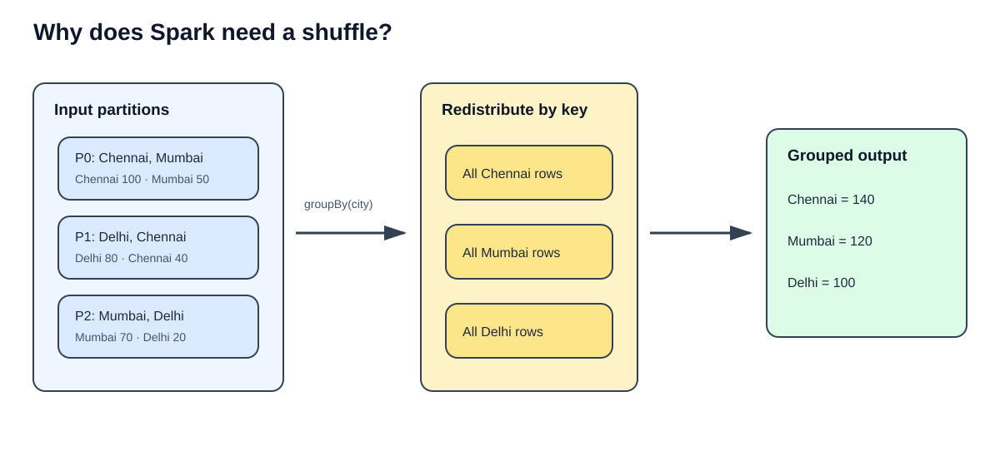
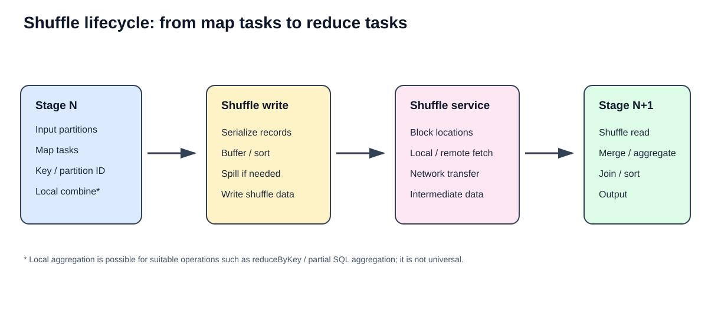
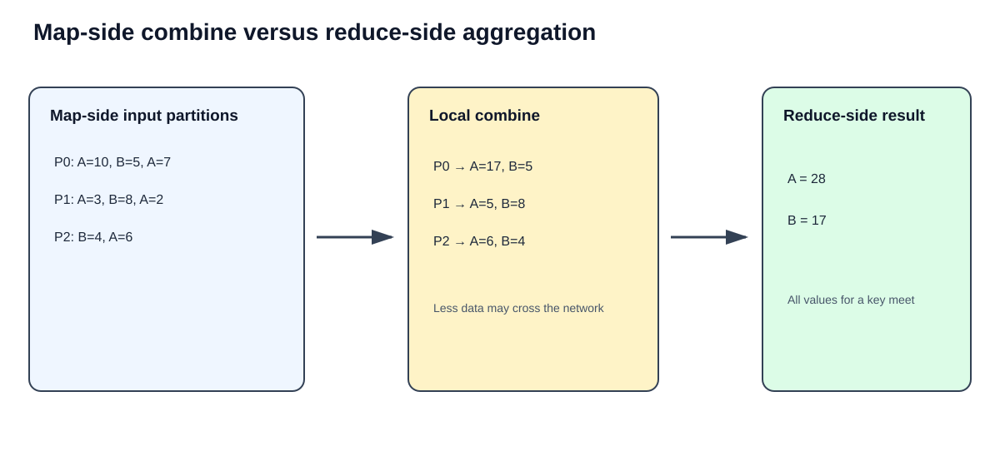
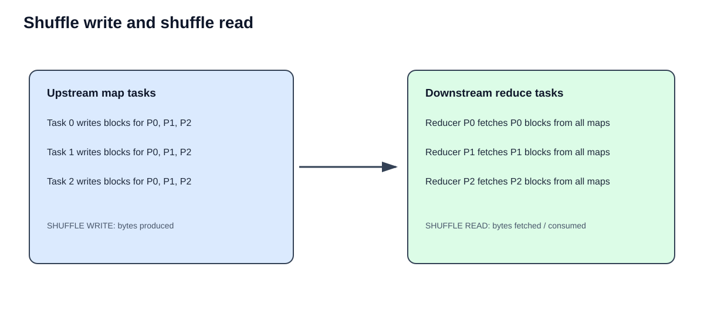
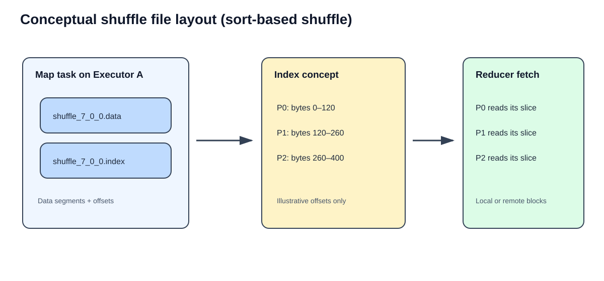
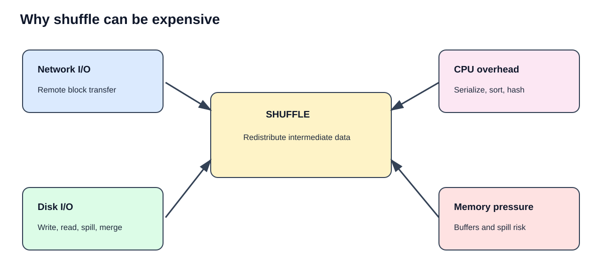
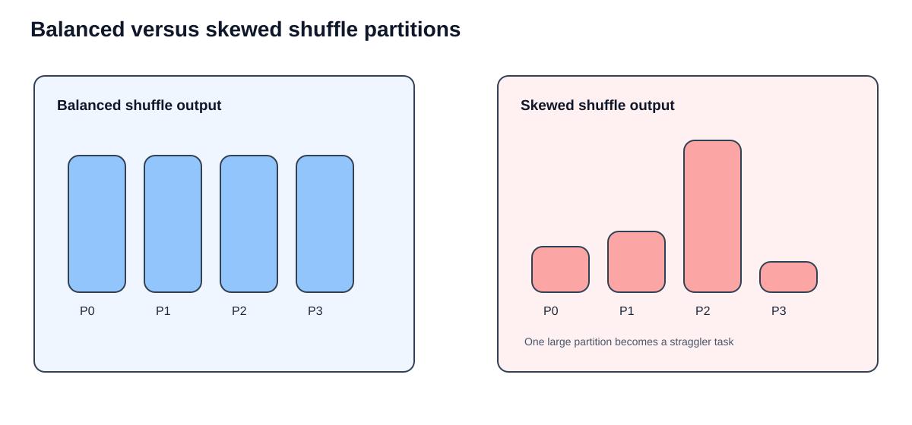
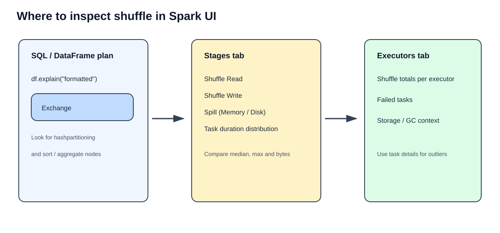

# Apache Spark Shuffling Fundamentals
## Deep-dive chapter with PySpark examples, ETL scenarios, Spark UI analysis, and SVG diagrams

> **Chapter goal:** Understand what Spark shuffle is, why it happens, what happens internally, how shuffle write/read work, why shuffle is expensive, and how to diagnose it in Spark UI.

---

## Learning outcomes

By the end of this chapter, you should be able to:

1. Explain shuffle using partitions and keys.
2. Identify operations that may require redistribution.
3. Trace map-side processing, shuffle write, block transfer, and shuffle read.
4. Explain the difference between shuffle write and shuffle read metrics.
5. Describe shuffle files and intermediate data without assuming every Spark version uses identical internals.
6. Explain the cost drivers: network, disk, CPU, memory, spill, and skew.
7. Read `Exchange` in a physical plan and inspect shuffle metrics in Spark UI.
8. Choose safer and more efficient patterns for aggregation and joins.

---

# 1. What is shuffling?

**Shuffle** is the process of redistributing records across partitions so that records which must be processed together are brought to the appropriate destination partition.

This is often necessary when the current partition layout does not satisfy the distribution required by a later operation.

Imagine a dataset split across three partitions:

| Partition | Records |
|---|---|
| P0 | Chennai: 100, Mumbai: 50 |
| P1 | Delhi: 80, Chennai: 40 |
| P2 | Mumbai: 70, Delhi: 20 |

Now run:

```python
result = sales_df.groupBy("city").sum("amount")
```

To calculate a correct total for each city, Spark must ensure that all rows for a city are brought together logically. Chennai records may be in P0 and P1; Mumbai records may be in P0 and P2; Delhi records may be in P1 and P2.

The required redistribution is the shuffle.



**Additional visual reference (click to open):** [Why shuffle is needed — image reference](https://images.openai.com/static-rsc-4/cflBszdzAJi9pUa5eoW1Lh0jWXZl7xJhq5Dqt1AGHaJ_Oap4JtPzJC4DLNYBmKz_EJLFg_p33ErwIrzL43eh12ARbcs0p-7jHe906VJuq6NJ5hTSRe7UCORINGQuHjEjEP5ng0Ibm0zbKVaT8IYoK0GRDg5yp9AOOvQJWLkNC5QxViJRXbYvQhWMY20w_nmv?purpose=fullsize)  
**Related Medium visual walkthrough:** [What is a shuffle? — visual guide](https://medium.com/@gema.correa/what-is-a-shuffle-in-apache-spark-the-visual-guide-i-wish-i-had-at-the-beginning-2294e7f3c7b0)

### Key idea

A shuffle is **not** simply sorting rows randomly. It is a controlled redistribution based on a partitioning requirement, such as a grouping key, join key, or requested partition count.

A shuffle does not necessarily mean every row travels over the network. Some shuffle blocks may be read locally when the producer and consumer happen to run on the same executor/host.

## 1.1 Why does Spark shuffle data?

Spark shuffles when the next operation requires data to be distributed differently from its current layout.

Common reasons:

| Operation / requirement | Why redistribution may be required |
|---|---|
| `groupBy()` / `groupByKey()` | Same key's values must be processed together |
| `reduceByKey()` | Values for a key must reach the same reducer partition |
| Large joins | Matching join keys must be co-located, depending on join strategy |
| `distinct()` | Duplicate keys from different partitions must be reconciled |
| `orderBy()` | Establish a global ordering across partitions |
| `repartition()` | Redistribute records to create a new partition layout |
| Window functions | Rows for a partition key may need to be co-located and ordered |

**Important qualification:** These operations do not guarantee a full shuffle in every possible plan. Spark can sometimes reuse compatible partitioning, choose a broadcast join, or apply Adaptive Query Execution (AQE). Always inspect the physical plan.

### Example: aggregation

```python
from pyspark.sql.functions import sum

city_totals = (
    sales_df
    .groupBy("city")
    .agg(sum("amount").alias("total_sales"))
)
```

### Example: join

```python
joined_df = orders_df.join(
    customers_df,
    on="customer_id",
    how="inner"
)
```

If both sides are large, Spark may repartition both inputs by `customer_id` (for example, as part of a sort-merge join). If one side is small enough and the plan selects a broadcast hash join, Spark can broadcast the small side instead of shuffling both sides by the join key.

### Example: global sort versus local sort

```python
# Global ordering: can require an exchange and range partitioning
globally_sorted = sales_df.orderBy("order_date")

# Sorts independently inside each existing partition
locally_sorted = sales_df.sortWithinPartitions("order_date")
```

`sortWithinPartitions()` does not create a global order across all partitions.

---

# 2. How shuffling works internally

At a high level, a shuffle has two main phases:

1. **Shuffle write:** upstream tasks process input partitions and produce intermediate shuffle output.
2. **Shuffle read:** downstream tasks fetch the blocks belonging to their target shuffle partition and continue processing.



**Medium diagrams for this section:** [Shuffle write/read and end-to-end lifecycle](https://medium.com/@akashchevli888/spark-shuffle-internals-how-data-moves-across-the-cluster-92f69a06b863) · [Stage 1 and Stage 2 overview](https://medium.com/@jpilli/spark-ui-essentials-3-spark-execution-concepts-4eb4d03997af)

## 2.1 Step-by-step flow

### Step 1 — Spark plans the operation

For a DataFrame query, Spark's optimizer and physical planner determine the required distribution and execution strategy.

For example:

```python
sales_df.groupBy("city").sum("amount").explain("formatted")
```

A physical plan may contain operators such as:

```text
HashAggregate
+- Exchange hashpartitioning(city, 200)
   +- HashAggregate
      +- Scan ...
```

The exact plan and operator order can vary by Spark version, query, configuration, and AQE. The `Exchange` is a strong clue that Spark needs a data redistribution boundary.

### Step 2 — Map-side tasks process their input partitions

Each upstream task processes one input partition. It evaluates expressions, filters rows if applicable, and determines where each output record belongs.

For a hash-partitioned shuffle, the key is used to derive a destination partition ID. Conceptually:

```text
destination_partition = partitioner(key)
```

Do not assume the implementation is literally `hash(key) % number_of_partitions` in every Spark path; partitioner details and hash handling are implementation-specific.

### Step 3 — Optional local aggregation / map-side combine

For mergeable aggregations such as sum and count, Spark can partially aggregate values locally before sending them across the shuffle.

This can substantially reduce the number of records and bytes exchanged.

This optimization is operation- and plan-dependent. It is not a universal step for every shuffle.

### Step 4 — Shuffle write

The upstream tasks organize their output by destination partition, serialize/buffer it, and write intermediate shuffle data. Depending on the shuffle implementation and resource pressure, data may be sorted, spilled, merged, and compressed.

### Step 5 — Shuffle metadata is made available

The downstream stage needs to know where the shuffle blocks are located. Spark's scheduler and shuffle subsystem coordinate metadata and block locations.

### Step 6 — Shuffle read

Downstream tasks fetch the blocks for their assigned reduce/shuffle partition. Fetches may be local or remote. Data is deserialized and processed by the downstream operator.

### Step 7 — Final operation

The downstream tasks finish the aggregation, join, sort, or other requested operation and produce output partitions.

## 2.2 What is a shuffle block?

A **shuffle block** is a logical piece of intermediate output associated with a map task and a target reduce partition. A downstream task reads the block(s) corresponding to its own target partition from the upstream map tasks.

For example, if there are 4 upstream map tasks and 3 downstream shuffle partitions, each map task can produce data for P0, P1, and P2. A reducer for P1 gathers the P1 block from each upstream map output.

The physical storage representation is implementation-dependent; the logical block model is the useful mental model.

---

# 3. Map-side and reduce-side operations

The terms *map side* and *reduce side* describe the two sides of a shuffle boundary.

- **Map side:** upstream tasks read their input partitions and prepare shuffle output.
- **Reduce side:** downstream tasks fetch the relevant shuffle blocks and process the collected records.



**More visual explanation:** [Map-side processing, shuffle write, and reduce-side fetch diagrams](https://medium.com/@akashchevli888/spark-shuffle-internals-how-data-moves-across-the-cluster-92f69a06b863)

## 3.1 Worked example: `reduceByKey`

Consider these RDD records:

```text
Partition 0: (A, 10), (B, 5), (A, 7)
Partition 1: (A, 3),  (B, 8), (A, 2)
Partition 2: (B, 4),  (A, 6)
```

We want the sum for each key.

### Without local combine (conceptual baseline)

All 8 records would need to be redistributed by key before the final sums can be computed.

### With map-side combine

Each map task can first combine repeated keys in its own partition:

```text
P0 -> (A, 17), (B, 5)
P1 -> (A, 5),  (B, 8)
P2 -> (A, 6),  (B, 4)
```

The downstream reducer then combines partial values:

```text
A = 17 + 5 + 6 = 28
B =  5 + 8 + 4 = 17
```

This reduces the number of values transferred when the same keys repeat within input partitions.

### PySpark RDD example

```python
rdd = sc.parallelize([
    ("A", 10), ("B", 5), ("A", 7),
    ("A", 3), ("B", 8), ("A", 2),
    ("B", 4), ("A", 6)
], 3)

result = rdd.reduceByKey(lambda x, y: x + y)

print(sorted(result.collect()))
# [('A', 28), ('B', 17)]
```

### `reduceByKey()` versus `groupByKey()`

```python
# Preferred for aggregation: combines values by key
totals = rdd.reduceByKey(lambda a, b: a + b)

# Collects all values for each key; often more data-intensive
grouped = rdd.groupByKey()
```

If the goal is a sum, count, min, max, or another mergeable aggregation, prefer an aggregation operation such as `reduceByKey()` over collecting every value with `groupByKey()`.

`groupByKey()` is not inherently wrong: it is appropriate when the actual requirement is to access the complete iterable of values for each key. It is usually a poor substitute for a simple aggregation.

## 3.2 DataFrame aggregation and partial aggregation

```python
from pyspark.sql import functions as F

summary = (
    sales_df
    .groupBy("city")
    .agg(
        F.count("*").alias("order_count"),
        F.sum("amount").alias("total_amount"),
        F.avg("amount").alias("average_amount")
    )
)
```

Spark SQL may use partial aggregation before the exchange and final aggregation after it. Check `explain("formatted")` rather than assuming a fixed physical plan.

---

# 4. Shuffle write and shuffle read



**Medium image references:** [Shuffle write/read diagrams](https://medium.com/@ajithme/spark-shuffle-25ddadcbfb10) · [Shuffle read vs. write illustrations](https://medium.com/@salimovb1999/demystifying-apache-spark-shuffle-files-895eb96f854c)

## 4.1 Shuffle write

Shuffle write is the upstream side of the exchange.

It represents intermediate data produced by map-side tasks for later consumption by downstream tasks.

Typical work includes:

- Evaluating the destination partition for records.
- Serializing records.
- Buffering and organizing intermediate data.
- Sorting or partition-wise organization as required by the shuffle implementation.
- Spilling intermediate data to disk if memory pressure requires it.
- Writing shuffle output and associated metadata.

## 4.2 Shuffle read

Shuffle read is the downstream side of the exchange.

It represents intermediate data fetched and consumed by downstream tasks.

Typical work includes:

- Locating the required blocks.
- Fetching local and remote shuffle data.
- Network transfer for remote blocks.
- Deserialization.
- Merging/sorting/aggregating as required by the downstream operator.

## 4.3 Example metrics

Imagine an upstream stage writes 200 MB of shuffle data. A downstream stage reads that shuffle output.

| Metric | Meaning |
|---|---|
| Shuffle Write | Bytes written by upstream tasks as shuffle output |
| Shuffle Read | Bytes fetched/consumed by downstream tasks |
| Records Written / Read | Number of records produced / consumed |
| Memory Spill | Intermediate data spilled from memory |
| Disk Spill | Data spilled to disk during processing |

Do not expect read and write numbers to match exactly in every UI view. Compression, aggregation, local reads, metrics scope, spills, retries, and adaptive execution can affect what is reported.

### Example: inspect a DataFrame plan

```python
from pyspark.sql import functions as F

result = (
    sales_df
    .groupBy("status")
    .agg(
        F.count("*").alias("total_orders"),
        F.sum("amount").alias("total_amount")
    )
)

result.explain("formatted")
```

Look for `Exchange`, partitioning expressions, and aggregate operators around it.

---

# 5. Shuffle files and intermediate data

Shuffle output is intermediate data, not the final business output of your ETL pipeline.

In common sort-based shuffle implementations, Spark may create data and index files on executor-local storage. The exact file layout, naming, cleanup, and storage strategy depend on the Spark version and shuffle manager.



**Related Medium file-layout illustrations:** [Shuffle data and index file diagrams](https://medium.com/@salimovb1999/demystifying-apache-spark-shuffle-files-895eb96f854c) · [Detailed `.data` and `.index` walkthrough](https://medium.com/@akashchevli888/spark-shuffle-internals-how-data-moves-across-the-cluster-92f69a06b863)

## 5.1 Conceptual data file

A data file can contain serialized shuffle output for multiple downstream partitions, organized so the required segment can be located.

Illustrative name:

```text
shuffle_7_0_0.data
```

This is only an illustrative filename pattern, not a guarantee for every Spark release or shuffle implementation.

## 5.2 Conceptual index file

An index file can store offsets that identify where each downstream partition's data segment begins and ends within the corresponding data file.

Illustrative view:

```text
P0 -> bytes 0 to 120
P1 -> bytes 120 to 260
P2 -> bytes 260 to 400
```

The numbers above are imaginary and only explain the idea of offsets.

## 5.3 Where are shuffle files stored?

Shuffle files are commonly written to executor-local directories configured through `spark.local.dir` (or environment / platform-specific local storage configuration).

For local investigation:

```python
spark.sparkContext.getConf().get("spark.local.dir", "not explicitly set")
```

The actual location may be managed by the cluster platform. In managed environments, you may not have direct filesystem access.

### Important operational notes

- Shuffle data is temporary intermediate state.
- Executors may serve shuffle blocks to downstream tasks.
- External Shuffle Service or other platform mechanisms can help preserve shuffle-file availability when executors are removed, depending on deployment configuration.
- Do not manually delete active Spark shuffle files.
- A task retry or executor loss may cause shuffle output to be regenerated or fetched from another valid source.

---

# 6. Why is shuffling expensive?



A shuffle can combine several expensive activities.

## 6.1 Network I/O

When a downstream task needs a block stored on another executor, Spark must transfer it over the network.

Large shuffle volumes can saturate network bandwidth and increase fetch wait time.

## 6.2 Disk I/O

Shuffle data is often buffered and written to local storage, then read by downstream tasks. Under memory pressure, Spark may spill data to disk and merge spill files.

Disk speed and contention can become bottlenecks.

## 6.3 Serialization and deserialization

Data must be encoded for transfer/storage and decoded for downstream processing. This consumes CPU and may add allocation overhead.

## 6.4 Sorting, hashing, and merging

Depending on the operation and shuffle path, Spark may need to hash keys, organize records, sort data, merge runs, or perform aggregation.

## 6.5 Memory pressure and spilling

Large intermediate datasets can exceed available execution memory. Spill can protect execution from running out of memory, but it adds disk I/O and merge work.

## 6.6 Data skew

A skewed key distribution can create one or a few very large shuffle partitions. The corresponding tasks run much longer than the others, producing stragglers.



**Related Medium visual reference:** [Shuffle partitioning and skew discussion](https://medium.com/@akashchevli888/spark-shuffle-internals-how-data-moves-across-the-cluster-92f69a06b863)

### Typical warning signs

- A few tasks take far longer than the median task duration.
- Shuffle read size varies dramatically between tasks.
- One reducer partition has far more records than the others.
- Large disk spill or memory spill.
- High fetch wait time.
- Executor failures or repeated task retries around a heavy shuffle stage.

### Is every shuffle bad?

No. A shuffle is often necessary to produce correct results. The goal is not to eliminate all shuffles; it is to avoid unnecessary redistribution and reduce the amount of data that must be shuffled.

---

# 7. Real-world ETL examples

## 7.1 Scenario A — Daily sales aggregation

**Business requirement:** Calculate total sales by store and date.

```python
from pyspark.sql import functions as F

daily_sales = (
    orders_df
    .filter(F.col("order_status") == "COMPLETED")
    .select("store_id", "order_date", "amount")
    .groupBy("store_id", "order_date")
    .agg(
        F.sum("amount").alias("daily_revenue"),
        F.count("*").alias("order_count")
    )
)
```

**Where can shuffle occur?** The grouping requires records for the same `(store_id, order_date)` key to be brought together unless compatible partitioning can be reused.

**Optimization reasoning:**

- Filter early when it is semantically valid.
- Project only required columns before the exchange.
- Avoid repeating the same repartition without a downstream need.
- Check whether the key distribution is skewed.

## 7.2 Scenario B — Orders joined with customers

**Business requirement:** Enrich orders with customer city and segment.

```python
enriched_orders = orders_df.join(
    customers_df,
    on="customer_id",
    how="left"
)
```

If both sides are large, Spark may choose a shuffle-based join such as sort-merge join. If one side is genuinely small enough to broadcast safely, a broadcast join may avoid shuffling the large side by the join key.

```python
from pyspark.sql.functions import broadcast

enriched_orders = orders_df.join(
    broadcast(customers_df),
    on="customer_id",
    how="left"
)
```

Only broadcast a side that is suitably small for the available executor memory. Do not force broadcast blindly.

## 7.3 Scenario C — Deduplication

**Business requirement:** Keep one latest record per customer.

```python
from pyspark.sql import Window
from pyspark.sql import functions as F

w = Window.partitionBy("customer_id").orderBy(
    F.col("updated_at").desc()
)

latest_customer = (
    customer_updates_df
    .withColumn("rn", F.row_number().over(w))
    .filter(F.col("rn") == 1)
    .drop("rn")
)
```

Spark may need to redistribute rows by `customer_id` and sort within each group to evaluate the window. Inspect the physical plan for exchanges and sorts.

## 7.4 Scenario D — Global sort for reporting

```python
top_orders = orders_df.orderBy(F.col("amount").desc())
```

A global sort has to establish ordering across partitions. If the business requirement only needs a sorted subset per partition, a local sort may be sufficient:

```python
locally_sorted = orders_df.sortWithinPartitions(
    F.col("amount").desc()
)
```

These are not interchangeable: local sorting does not guarantee a global order.

## 7.5 Scenario E — Remove duplicate product IDs

```python
unique_products = products_df.select("product_id").distinct()
```

Spark must reconcile duplicate IDs that may exist in different input partitions. This commonly requires redistribution by the distinct key.

---

# 8. How to identify shuffle operations in Spark UI



**Medium Spark UI illustrations:** [Spark UI execution concepts and shuffle metrics](https://medium.com/@jpilli/spark-ui-essentials-3-spark-execution-concepts-4eb4d03997af) · [Following shuffle stages and metrics](https://medium.com/@akashchevli888/spark-shuffle-internals-how-data-moves-across-the-cluster-92f69a06b863)

## 8.1 Start with the physical plan

```python
result.explain("formatted")
```

Look for:

- `Exchange`
- `hashpartitioning(...)`
- `rangepartitioning(...)`
- `Sort`
- `SortMergeJoin`
- `HashAggregate`

`Exchange` is a physical-plan operator that signals a distribution change. It is a strong indication of a shuffle/exchange boundary, but inspect the surrounding plan to understand why it exists.

## 8.2 Open the Spark UI

In a local Spark application, the UI is commonly available at:

```text
http://localhost:4040
```

The port may increment if another application already uses it. In managed platforms, use the platform's Spark UI link.

## 8.3 Jobs tab

Use the Jobs tab to identify the job triggered by an action and see which stages belong to it.

## 8.4 Stages tab

Select a stage and inspect:

| Metric | What it tells you |
|---|---|
| Shuffle Write | Intermediate data produced by the stage |
| Shuffle Read | Intermediate data fetched by the stage |
| Input Size / Records | Data read from the original source |
| Output Size / Records | Data written by the stage |
| Memory Spill | Data spilled from memory |
| Disk Spill | Data written to disk during spill |
| Task Duration | Whether a few tasks are much slower |
| Fetch Wait Time | Time spent waiting for remote shuffle data |

Compare task-level metrics, not only stage totals. A stage with a moderate total can still be slow if one partition is severely skewed.

## 8.5 SQL tab

For DataFrame and SQL workloads, the SQL tab can show the query's physical plan and operator-level metrics. Locate exchange operators and inspect their input/output metrics.

## 8.6 Executors tab

Use executor-level metrics to investigate uneven shuffle load, executor failures, and resource pressure.

## 8.7 A practical diagnosis checklist

1. Find the slow job.
2. Identify the slow stage.
3. Check whether the stage reads or writes shuffle data.
4. Compare task-level shuffle read sizes.
5. Compare median and maximum task duration.
6. Check memory and disk spill.
7. Inspect the SQL physical plan for `Exchange`.
8. Identify the key or operation responsible.
9. Decide whether the exchange is necessary.
10. Apply one targeted optimization and compare before/after metrics.

---

# 9. Operations that commonly cause shuffle

| Operation | Typical shuffle behavior | Important note |
|---|---|---|
| `map()` / `filter()` | Usually narrow | Each output depends on its input partition |
| `flatMap()` | Usually narrow | Can change row count, not necessarily partition distribution |
| `mapPartitions()` | Usually narrow | Processes each partition independently |
| `reduceByKey()` | Shuffle commonly required | Map-side combine can reduce exchanged data |
| `groupByKey()` | Shuffle commonly required | Moves values for keys together |
| DataFrame `groupBy()` | Exchange commonly required | May reuse existing partitioning |
| Large sort-merge join | Usually exchanges join inputs | Check the selected join strategy |
| Broadcast hash join | Avoids shuffling the large side by join key | Broadcast side must fit safely |
| `distinct()` | Commonly requires redistribution | Duplicate values may cross partitions |
| `repartition()` | Causes redistribution | Usually a shuffle |
| `coalesce()` | Can reduce partitions without full shuffle | `shuffle=True` changes behavior |
| `orderBy()` | Global ordering can require exchange | Global order differs from local sort |
| `sortWithinPartitions()` | Local sort only | No global ordering guarantee |

This table describes common behavior, not a universal physical-plan guarantee. Inspect the plan for the query you actually run.

---

# 10. Practical optimization techniques

## 10.1 Filter early

```python
filtered = orders_df.filter(F.col("order_status") == "COMPLETED")
```

Apply filters before expensive redistribution when doing so preserves the required business semantics.

## 10.2 Select only required columns

```python
narrow_orders = orders_df.select(
    "customer_id", "order_date", "amount"
)
```

Smaller rows generally mean fewer bytes to shuffle.

## 10.3 Prefer partial aggregation where appropriate

For RDD key aggregation, use `reduceByKey()` or `aggregateByKey()` when they match the requirement instead of grouping all raw values unnecessarily.

For DataFrames, use built-in aggregate expressions and let Spark optimize the physical plan.

## 10.4 Broadcast genuinely small dimensions

```python
result = fact_df.join(
    F.broadcast(small_dimension_df),
    "dimension_id",
    "inner"
)
```

Validate the size and memory impact before forcing a broadcast.

## 10.5 Avoid unnecessary repartitioning

```python
# Only do this when the downstream workload benefits from this layout
repartitioned = df.repartition(200, "customer_id")
```

Do not add repartition calls simply because a larger partition count sounds faster.

## 10.6 Address skew

Potential techniques include:

- AQE skew join handling for supported SQL joins.
- Salting for highly skewed keys where the aggregation/join logic can be safely rewritten.
- Broadcast join when one side is suitably small.
- Better partition keys when the data model permits.
- Separating unusually heavy keys for dedicated processing.

AQE is not a universal cure for every skewed RDD transformation or every workload.

## 10.7 Tune shuffle partition count with evidence

For Spark SQL, `spark.sql.shuffle.partitions` controls the default number of shuffle partitions for many SQL exchanges.

```python
spark.conf.get("spark.sql.shuffle.partitions")
```

Example configuration:

```python
spark.conf.set("spark.sql.shuffle.partitions", 200)
```

Do not copy `200` as a universal ideal. Choose a value based on data volume, cluster parallelism, task size, and observed metrics. AQE may coalesce or otherwise adapt post-shuffle partitions when enabled.

---

# 11. Hands-on lab: observe a shuffle

## 11.1 Create sample data

```python
from pyspark.sql import SparkSession
from pyspark.sql import functions as F

spark = (
    SparkSession.builder
    .appName("ShuffleLearningLab")
    .getOrCreate()
)

rows = [
    (1, "Chennai", "COMPLETED", 500.0),
    (2, "Mumbai", "COMPLETED", 300.0),
    (3, "Chennai", "CANCELLED", 200.0),
    (4, "Delhi", "COMPLETED", 400.0),
    (5, "Mumbai", "COMPLETED", 100.0),
    (6, "Chennai", "COMPLETED", 600.0),
    (7, "Delhi", "COMPLETED", 250.0),
    (8, "Mumbai", "CANCELLED", 150.0),
]

columns = ["order_id", "city", "status", "amount"]

orders = spark.createDataFrame(rows, columns).repartition(4)
orders.show()
```

## 11.2 Inspect the input partition count

```python
print("Partitions:", orders.rdd.getNumPartitions())
```

## 11.3 Run an aggregation

```python
city_summary = (
    orders
    .filter(F.col("status") == "COMPLETED")
    .groupBy("city")
    .agg(
        F.count("*").alias("order_count"),
        F.sum("amount").alias("total_sales")
    )
)

city_summary.explain("formatted")
city_summary.show()
```

Observe whether the physical plan contains an `Exchange`.

## 11.4 Compare a repartition operation

```python
by_city = orders.repartition(4, "city")
by_city.explain("formatted")
```

Compare the plan and Spark UI stages with the original DataFrame.

## 11.5 Compare a broadcast join

```python
customers = spark.createDataFrame(
    [
        (1, "Retail"),
        (2, "Enterprise"),
        (3, "Retail")
    ],
    ["customer_id", "segment"]
)

facts = spark.createDataFrame(
    [
        (101, 1, 500.0),
        (102, 2, 900.0),
        (103, 3, 250.0)
    ],
    ["order_id", "customer_id", "amount"]
)

joined = facts.join(
    F.broadcast(customers),
    "customer_id",
    "left"
)

joined.explain("formatted")
```

Look for a broadcast exchange / broadcast hash join strategy rather than assuming a shuffle-based join.

## 11.6 Inspect the UI

Run an action to execute the query:

```python
city_summary.show()
```

Then inspect the Spark UI. Compare stage-level and task-level shuffle metrics. The UI is most useful after an action has triggered execution.

---

# 12. Interview questions

## Beginner

1. What is shuffle in Apache Spark?
2. Why does Spark need to redistribute data?
3. What is the difference between a partition and a shuffle partition?
4. What is the difference between shuffle write and shuffle read?
5. What is a shuffle block?
6. Name five operations that may trigger a shuffle.
7. Why is `filter()` generally a narrow transformation?
8. What does `Exchange` indicate in a physical plan?

## Intermediate

9. Explain the map side and reduce side of a shuffle.
10. How does map-side combine reduce shuffle volume?
11. Why is `reduceByKey()` generally preferable to `groupByKey()` for summation?
12. Why can a large sort-merge join require shuffling both inputs?
13. How does a broadcast hash join reduce shuffle?
14. What is the purpose of `spark.sql.shuffle.partitions`?
15. What is the difference between `orderBy()` and `sortWithinPartitions()`?
16. What are shuffle spill and disk spill?

## Advanced

17. Explain the relationship between `Exchange` and a stage boundary.
18. Why might shuffle read and shuffle write metrics differ?
19. How would you diagnose one extremely slow task in a shuffle stage?
20. How can skew affect shuffle partition sizes?
21. What role can AQE play after shuffle statistics become available?
22. Why is increasing the shuffle partition count not always a solution?
23. Explain conceptually how data and index files can represent shuffle output in a sort-based shuffle implementation.
24. How would you decide whether to broadcast a dimension table?
25. How would you prove that a shuffle optimization improved a production ETL job?

---

# 13. Practical assignments

### Assignment 1 — Grouping and aggregation

- Create at least 100,000 order records.
- Group by `city`.
- Calculate count, sum, average, minimum, and maximum amount.
- Inspect the physical plan.
- Record shuffle read and write metrics.

### Assignment 2 — `reduceByKey()` versus `groupByKey()`

- Create an RDD with repeated keys.
- Compute sums using both approaches.
- Compare correctness.
- Explain why one approach can transfer more intermediate data.
- Do not claim runtime superiority from a tiny dataset; use a sufficiently large dataset and repeat measurements.

### Assignment 3 — Join strategies

- Create a large fact DataFrame and a small dimension DataFrame.
- Compare the default join plan with a broadcast join plan.
- Identify the join operator and exchange operators.
- Record execution time and shuffle metrics.

### Assignment 4 — Data skew

- Create a dataset where one key represents a large fraction of all records.
- Group by key.
- Inspect task duration and shuffle read distribution.
- Test a suitable mitigation and explain any correctness considerations.

### Assignment 5 — Shuffle partition tuning

- Run an aggregation with multiple values of `spark.sql.shuffle.partitions`.
- Record task count, task duration, shuffle read, spill, and total execution time.
- Explain why the fastest setting for a small dataset may not be best for a large dataset.

---

# 14. Quick revision sheet

| Term | Remember |
|---|---|
| Shuffle | Redistributes data between partitions |
| Map side | Produces intermediate shuffle output |
| Shuffle write | Writes intermediate output |
| Shuffle read | Fetches intermediate output for downstream tasks |
| Reduce side | Processes the fetched shuffle partitions |
| Exchange | Physical-plan operator indicating a distribution change |
| Shuffle block | Logical piece of map output for a target reduce partition |
| Spill | Intermediate data written to disk under memory pressure |
| Skew | Uneven data distribution causing straggler tasks |
| AQE | Runtime SQL-plan adaptation, including supported shuffle optimizations |

## The most important mental model

```text
Input partitions
      |
      v
Map-side tasks
      |
      v
Optional local combine
      |
      v
Shuffle write
      |
      v
Intermediate shuffle blocks
      |
      v
Shuffle read (local and/or remote)
      |
      v
Reduce-side processing
      |
      v
Final output partitions
```

**Remember:** Shuffle is a data redistribution mechanism. It is often necessary for correctness, but it can be expensive. Learn to identify why it happens, how much data moves, whether the partitions are balanced, and whether the chosen execution strategy is appropriate.

---

# 15. Further reading — Medium articles

The following are external Medium articles relevant to this chapter. They are supplementary reading; use the chapter explanations and your own Spark UI observations as the primary learning path.

1. [Spark Shuffle Internals: How Data Moves Across the Cluster](https://medium.com/@akashchevli888/spark-shuffle-internals-how-data-moves-across-the-cluster-92f69a06b863)
2. [What Is a Shuffle in Apache Spark? The Visual Guide I Wish I Had at the Beginning](https://medium.com/@gema.correa/what-is-a-shuffle-in-apache-spark-the-visual-guide-i-wish-i-had-at-the-beginning-2294e7f3c7b0)
3. [Demystifying Spark Shuffle Internals (Advanced)](https://medium.com/@lokeshgupta2206/demystifying-spark-shuffle-internals-advanced-1bc3a4c99151)
4. [Demystifying Apache Spark Shuffle Files](https://medium.com/@salimovb1999/demystifying-apache-spark-shuffle-files-895eb96f854c)
5. [Apache Spark Shuffle Deep Dive: How It Actually Works Under the Hood](https://medium.com/@FKosa/apache-spark-shuffle-deep-dive-how-it-actually-works-under-the-hood-62f4d61c714f)
6. [Spark UI Essentials — Spark Execution Concepts](https://medium.com/@jpilli/spark-ui-essentials-3-spark-execution-concepts-4eb4d03997af)
7. [Shuffle in Apache Spark: Why It Happens, Why It's Expensive, and How to Optimize It](https://medium.com/@geekycodes/shuffle-in-apache-spark-why-it-happens-why-its-expensive-and-how-to-optimize-it-672d63e832e4)

---

# Visual references from Medium

The links below open the original Medium articles where their authors' diagrams and illustrations appear. They are placed here as clickable references because Medium does not expose every embedded figure as a stable direct image URL in the article text.

- [Spark Shuffle Internals — full visual walkthrough, shuffle write/read, file layout, stage boundary, partitioning, and AQE](https://medium.com/@akashchevli888/spark-shuffle-internals-how-data-moves-across-the-cluster-92f69a06b863)
- [Spark UI Essentials — narrow/wide transformations, shuffle stages, shuffle write/read, and UI concepts](https://medium.com/@jpilli/spark-ui-essentials-3-spark-execution-concepts-4eb4d03997af)
- [Demystifying Apache Spark Shuffle Files — file organization, block layout, and aggregation examples](https://medium.com/@salimovb1999/demystifying-apache-spark-shuffle-files-895eb96f854c)
- [Spark: Shuffle — MapStatus, shuffle write, and shuffle read diagrams](https://medium.com/@ajithme/spark-shuffle-25ddadcbfb10)
- [What Is a Shuffle in Apache Spark? — visual guide with partition regrouping examples](https://medium.com/@gema.correa/what-is-a-shuffle-in-apache-spark-the-visual-guide-i-wish-i-had-at-the-beginning-2294e7f3c7b0)

**Direct image link supplied in the conversation:** [https://images.openai.com/static-rsc-4/cflBszdzAJi9pUa5eoW1Lh0jWXZl7xJhq5Dqt1AGHaJ_Oap4JtPzJC4DLNYBmKz_EJLFg_p33ErwIrzL43eh12ARbcs0p-7jHe906VJuq6NJ5hTSRe7UCORINGQuHjEjEP5ng0Ibm0zbKVaT8IYoK0GRDg5yp9AOOvQJWLkNC5QxViJRXbYvQhWMY20w_nmv?purpose=fullsize](https://images.openai.com/static-rsc-4/cflBszdzAJi9pUa5eoW1Lh0jWXZl7xJhq5Dqt1AGHaJ_Oap4JtPzJC4DLNYBmKz_EJLFg_p33ErwIrzL43eh12ARbcs0p-7jHe906VJuq6NJ5hTSRe7UCORINGQuHjEjEP5ng0Ibm0zbKVaT8IYoK0GRDg5yp9AOOvQJWLkNC5QxViJRXbYvQhWMY20w_nmv?purpose=fullsize)

## Chapter completion checklist

- [ ] I can explain shuffle without memorizing a definition.
- [ ] I can trace shuffle write and shuffle read.
- [ ] I understand map-side combine and reduce-side aggregation.
- [ ] I can explain shuffle blocks and the conceptual file layout.
- [ ] I can identify `Exchange` in a physical plan.
- [ ] I can read shuffle metrics in Spark UI.
- [ ] I can explain network, disk, CPU, memory, and skew costs.
- [ ] I can compare aggregation and join strategies.
- [ ] I can support an optimization claim with measurements.
