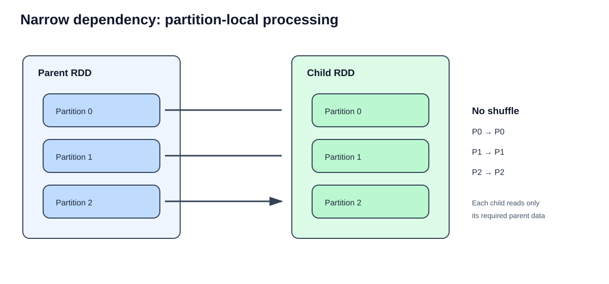
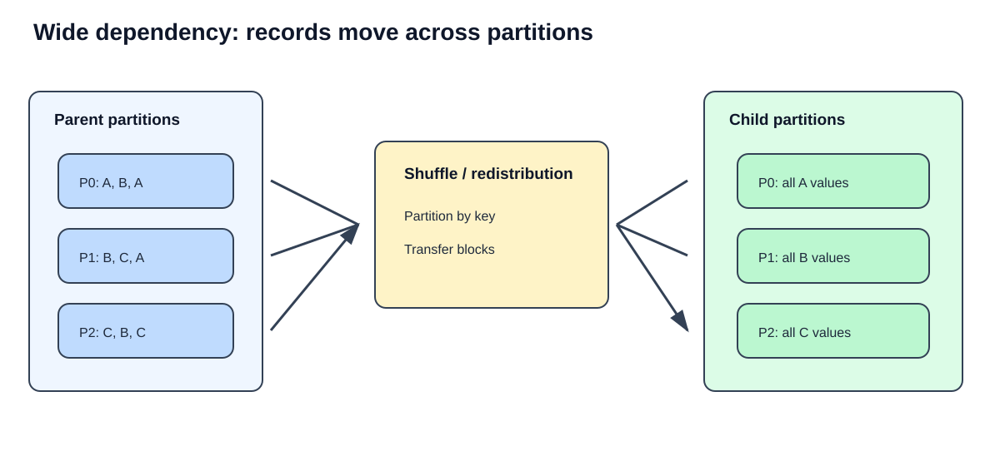
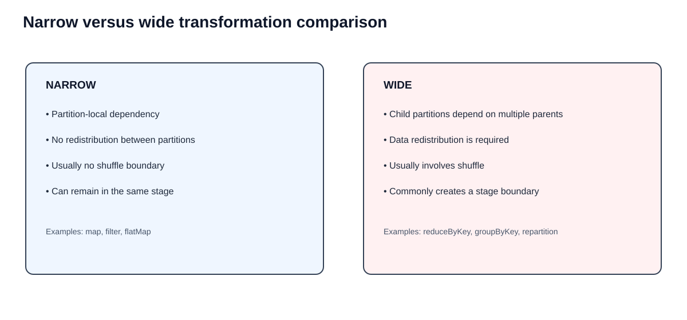
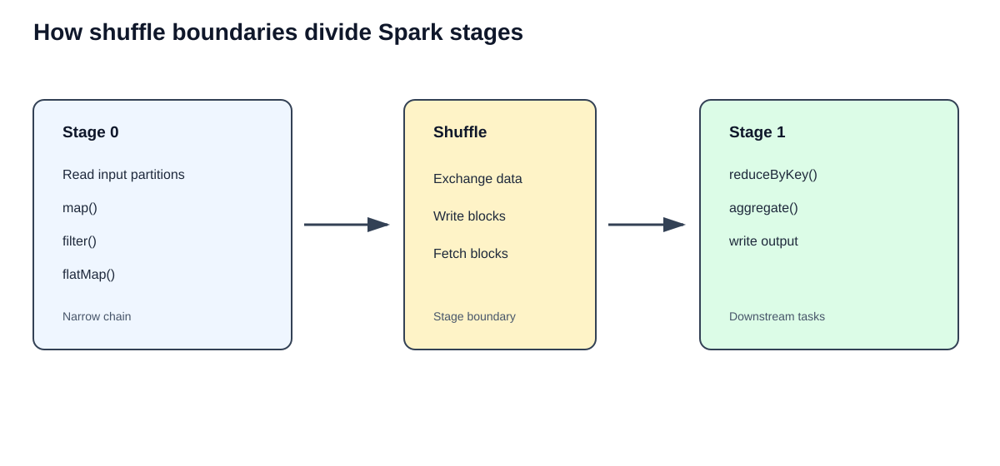
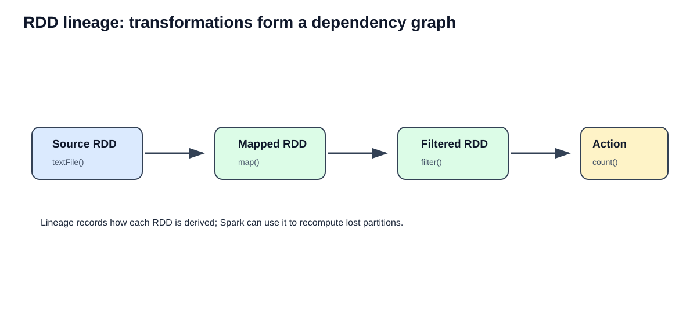
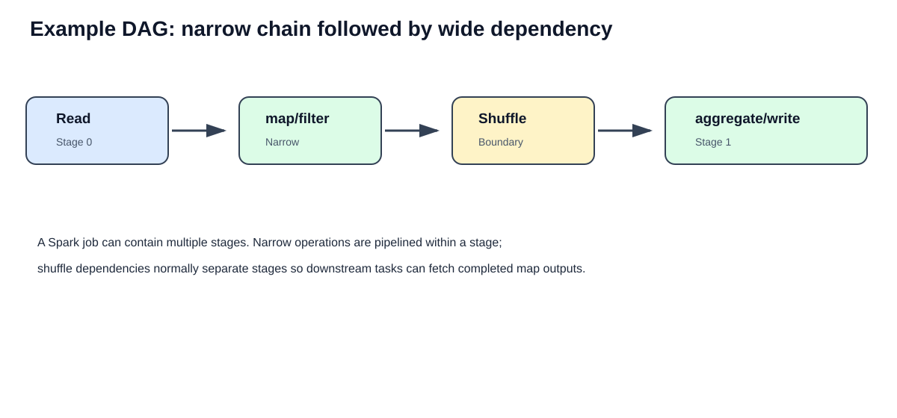
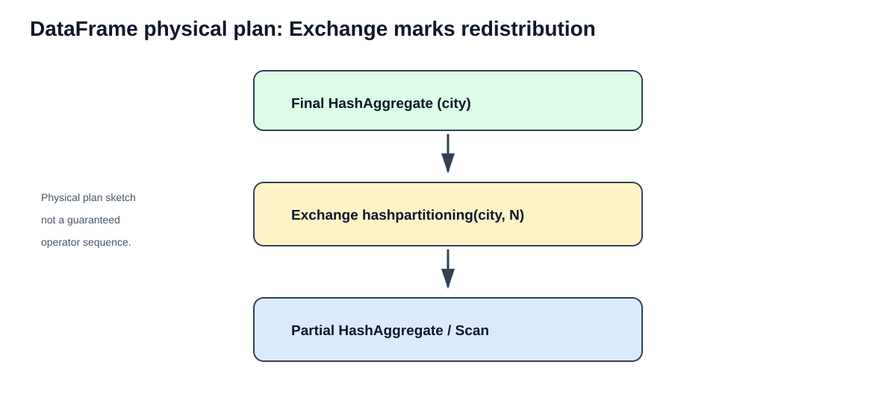
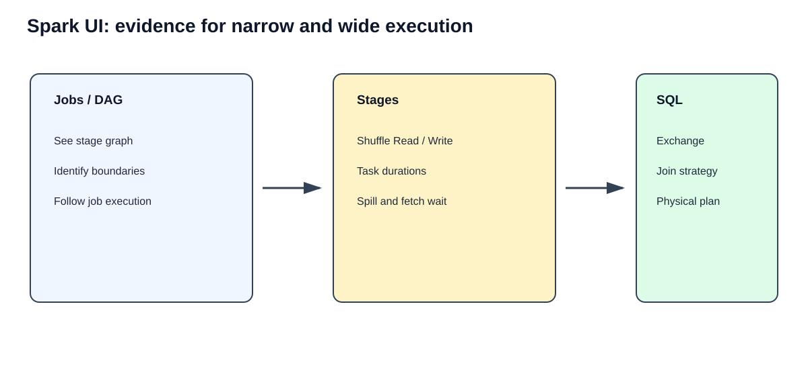

# Part 4 — Narrow and Wide Transformations in Apache Spark
## Detailed PySpark notes, internal execution, code walkthroughs, DAGs, stages, Spark UI, ETL examples, and assignments

> **Learning objective:** Understand how Spark decides whether an operation can process data within existing partitions (narrow dependency) or must redistribute data between partitions (wide dependency). This chapter connects partitions and shuffle to Spark's DAG and stage execution model.

---

# 1. Where this chapter fits

You have already studied:

1. Part 1 — Partitions Fundamentals
2. Part 2 — Partition Distribution and Data Skew
3. Part 3 — Spark Shuffling Fundamentals

Now Part 4 explains the dependency relationship behind shuffle and stage boundaries. This is essential before learning `repartition()` and `coalesce()` in depth.

# 2. Transformation fundamentals

A transformation is an operation that creates a new RDD or DataFrame from an existing one. It describes *what work should be done*; it does not normally execute the full computation immediately.

Examples:

```python
mapped_rdd = numbers_rdd.map(lambda x: x * 2)
filtered_rdd = mapped_rdd.filter(lambda x: x > 10)
```

For DataFrames:

```python
from pyspark.sql import functions as F

filtered_df = orders_df.filter(F.col("amount") > 1000)
selected_df = filtered_df.select("order_id", "customer_id", "amount")
```

Spark transformations are generally lazy. Spark records the computation plan and executes it when an action or a command requiring a result is invoked.

Common actions include:

```python
rdd.collect()
rdd.count()
df.count()
df.show()
df.write.parquet("/path/output")
```

`show()` and `count()` are actions. A DataFrame transformation such as `filter()` or `select()` generally builds a plan.

## 2.1 Why laziness matters here

Spark can inspect a chain of operations and pipeline compatible work together. It does not need to materialize every intermediate RDD/DataFrame after every transformation.

Example:

```python
result = (
    orders_df
    .filter(F.col("status") == "COMPLETED")
    .select("customer_id", "amount")
    .withColumn("tax", F.col("amount") * F.lit(0.18))
)

result.show()
```

The transformations build a plan. The action `show()` triggers execution.

---

# 3. What is a dependency?

A dependency describes how a child RDD partition obtains the data it needs from parent RDD partitions.

When Spark builds an RDD lineage graph, it tracks the transformations and their dependencies.

There are two broad categories:

- **Narrow dependency:** each child partition needs data from a limited, non-overlapping set of parent partitions; no general redistribution of records across the cluster is required.
- **Wide dependency:** a child partition may need records from multiple parent partitions, often requiring data redistribution through a shuffle.

The terms are about the dependency relationship, not simply whether an operation changes the number of records.

---

# 4. Narrow transformations

A narrow transformation allows Spark to compute a child partition using data from a limited set of parent partition(s), without redistributing records across the cluster through a shuffle.

For common partition-preserving operations such as `map()` and `filter()`, the relationship is usually one parent partition to the corresponding child partition.



## 4.1 Main characteristics

1. No shuffle is required for the narrow dependency itself.
2. Data is processed locally within the partition lineage.
3. Spark can pipeline multiple narrow transformations in one stage.
4. There is usually less network I/O than in a shuffle dependency.
5. A narrow transformation does not guarantee low CPU cost; a complex user function can still be expensive.
6. Narrow does not mean that the operation cannot change the number of records.

## 4.2 `map()` — transform each record

`map()` applies a function to every element and produces one output element for each input element.

```python
numbers = spark.sparkContext.parallelize([1, 2, 3, 4, 5], 2)

squared = numbers.map(lambda x: x * x)

print(squared.collect())
# [1, 4, 9, 16, 25]
```

### Explanation

- The input RDD has two partitions.
- Each partition's records are processed by its corresponding task.
- Each input value produces one output value.
- Spark does not need to move records to other partitions merely to perform this mapping.
- The resulting RDD retains a compatible partition structure.

## 4.3 `filter()` — retain matching records

```python
numbers = spark.sparkContext.parallelize(
    [5, 10, 15, 20, 25, 30],
    3
)

greater_than_15 = numbers.filter(lambda x: x > 15)

print(greater_than_15.collect())
# [20, 25, 30]
```

### Explanation

`filter()` evaluates the predicate for records in each input partition. It removes records that fail the condition. It does not need to collect matching records from different partitions.

The number of records can decrease, but the transformation is still narrow.

## 4.4 `flatMap()` — zero, one, or many outputs per input

```python
lines = spark.sparkContext.parallelize([
    "spark is fast",
    "pyspark supports python",
    "big data processing"
], 2)

words = lines.flatMap(lambda line: line.split())

print(words.collect())
# ['spark', 'is', 'fast', 'pyspark', 'supports',
#  'python', 'big', 'data', 'processing']
```

### Explanation

- Each line is processed inside its current partition.
- One line can produce multiple words.
- `flatMap()` flattens the produced collections.
- It changes the record count, but does not inherently redistribute words between partitions.

## 4.5 `mapPartitions()` — process a complete partition

`mapPartitions()` gives a function an iterator over all records in one partition.

```python
def add_partition_label(iterator):
    for value in iterator:
        yield (value, "processed")

numbers = spark.sparkContext.parallelize([10, 20, 30, 40], 2)

tagged = numbers.mapPartitions(add_partition_label)

print(tagged.collect())
```

Example output:

```text
[(10, 'processed'), (20, 'processed'),
 (30, 'processed'), (40, 'processed')]
```

### Why use it?

It can be useful when setup work should happen once per partition rather than once per row, for example:

- Creating a reusable connection per partition.
- Initializing a parser once per partition.
- Applying batch-oriented processing.

Use external resources carefully: retries can re-run partition code, and opening a connection per partition can still create many connections.

## 4.6 `union()` — combine RDDs

For RDDs, `union()` combines the elements of two RDDs. It generally preserves their partitions as separate partition contributions rather than redistributing all records by key.

```python
rdd_a = spark.sparkContext.parallelize([1, 2, 3], 2)
rdd_b = spark.sparkContext.parallelize([4, 5, 6], 2)

combined = rdd_a.union(rdd_b)

print(combined.collect())
print("Partitions:", combined.getNumPartitions())
```

The resulting RDD commonly has the sum of the two input partition counts. No key-based shuffle is needed just to concatenate the RDDs.

## 4.7 `coalesce()` without shuffle — a useful narrow example

A non-shuffling RDD `coalesce()` can reduce the number of partitions by combining parent partition work into fewer child partitions. This is a narrow dependency, but the resulting partitions may have uneven amounts of data.

```python
rdd = spark.sparkContext.parallelize(range(100), 8)

smaller = rdd.coalesce(2)

print("Before:", rdd.getNumPartitions())
print("After:", smaller.getNumPartitions())
```

This is a preview of the next chapter's detailed `repartition()` and `coalesce()` study.

---

# 5. Wide transformations

A wide transformation creates a dependency where child partitions need data from multiple parent partitions. Spark commonly has to redistribute data so records are assigned to the appropriate destination partitions.



## 5.1 Main characteristics

1. Data may need to move between executors.
2. Shuffle write and shuffle read may be involved.
3. The operation commonly introduces a shuffle dependency.
4. A shuffle dependency normally creates a stage boundary in the RDD execution model.
5. Network, disk, serialization, sorting, and memory costs may increase.
6. Skew can make some downstream tasks much slower than others.

## 5.2 `groupByKey()` — group all values for each key

```python
pairs = spark.sparkContext.parallelize([
    ("Chennai", 100),
    ("Mumbai", 200),
    ("Chennai", 150),
    ("Delhi", 300),
    ("Mumbai", 100)
], 3)

grouped = pairs.groupByKey()

result = grouped.mapValues(list).collect()
print(result)
```

Conceptual result:

```text
[
  ('Chennai', [100, 150]),
  ('Mumbai', [200, 100]),
  ('Delhi', [300])
]
```

### Why wide?

A key such as Chennai can occur in more than one input partition. Spark must bring values for the same key to the same logical destination partition so they can be grouped.

`groupByKey()` commonly causes a shuffle. It also transfers all values for each key, which can be expensive for large groups.

## 5.3 `reduceByKey()` — aggregate values for each key

```python
pairs = spark.sparkContext.parallelize([
    ("Chennai", 100),
    ("Mumbai", 200),
    ("Chennai", 150),
    ("Delhi", 300),
    ("Mumbai", 100)
], 3)

totals = pairs.reduceByKey(lambda a, b: a + b)

print(sorted(totals.collect()))
# [('Chennai', 250), ('Delhi', 300), ('Mumbai', 300)]
```

### Why wide?

All partial values for a key must ultimately be combined. Spark generally redistributes key-based values across partitions.

### Why can it be more efficient than `groupByKey()`?

`reduceByKey()` can perform map-side combining. Repeated keys in one map partition may be aggregated locally before the shuffle, reducing the number of records transferred.

Use `reduceByKey()` when the requirement is an associative and commutative aggregation, such as sum, count, min, or max. The aggregation function should be suitable for distributed combining.

## 5.4 `distinct()` — remove duplicates

```python
numbers = spark.sparkContext.parallelize(
    [1, 2, 2, 3, 3, 3, 4, 4],
    3
)

unique = numbers.distinct()

print(sorted(unique.collect()))
# [1, 2, 3, 4]
```

### Why wide?

The same value can occur in multiple input partitions. Spark needs to reconcile duplicates across partitions. This commonly requires redistribution by value.

## 5.5 `repartition()` — redistribute partitions

```python
rdd = spark.sparkContext.parallelize(range(100), 4)

repartitioned = rdd.repartition(8)

print(repartitioned.getNumPartitions())
```

RDD `repartition()` redistributes the data and normally involves a shuffle. It can increase or decrease the number of partitions.

DataFrame example:

```python
df = spark.range(0, 100000)

repartitioned_df = df.repartition(8)

print(repartitioned_df.rdd.getNumPartitions())
```

## 5.6 Joins — often wide, but strategy matters

RDD join example:

```python
customers = spark.sparkContext.parallelize([
    (1, "Asha"),
    (2, "Ravi"),
    (3, "Meena")
], 2)

orders = spark.sparkContext.parallelize([
    (1, "Laptop"),
    (1, "Mouse"),
    (2, "Keyboard")
], 2)

joined = customers.join(orders)

print(joined.collect())
```

A key-based RDD join commonly requires values from both sides to be partitioned compatibly by key, so shuffle is often involved.

For DataFrames, join behavior depends on the physical strategy:

- Sort-merge join commonly redistributes both inputs by join key.
- Broadcast hash join can broadcast a suitably small side and avoid shuffling the large side by the join key.
- Existing compatible partitioning may sometimes be reused.

Never label every DataFrame join as automatically wide without checking the physical plan.

## 5.7 Global sorting

```python
sorted_df = orders_df.orderBy("amount")
```

A global sort generally requires data redistribution and range partitioning so Spark can establish ordering across partitions.

Compare:

```python
# Global order across the result
global_sorted = orders_df.orderBy("amount")

# Independent sort within each existing partition
partition_sorted = orders_df.sortWithinPartitions("amount")
```

`sortWithinPartitions()` does not guarantee that partition 0's values all precede partition 1's values globally.

---

# 6. Narrow versus wide — the central comparison



| Feature | Narrow dependency | Wide dependency |
|---|---|---|
| Data movement | No general redistribution required | Redistribution commonly required |
| Shuffle | Not required for the dependency itself | Commonly required |
| Parent relationship | Limited parent partition dependency | Child may depend on many parent partitions |
| Network transfer | Usually lower | Can be substantial |
| Stage boundary | Usually no shuffle boundary | Normally a shuffle boundary |
| Execution | Often pipelined | Upstream shuffle stage then downstream stage |
| Examples | `map`, `filter`, `flatMap` | `reduceByKey`, `groupByKey`, `distinct`, `repartition` |
| Performance | Often less overhead | More overhead, but sometimes essential |

### Important nuance

Do not classify an operation based only on its name or whether it changes the number of rows. Classify the dependency and inspect the execution plan.

For example:

- `flatMap()` can produce many records but remains narrow.
- `coalesce()` without shuffle can combine partitions through a narrow dependency.
- `union()` combines RDD partition lineages without a key-based shuffle.
- A DataFrame join can use broadcast and avoid a large shuffle.
- A DataFrame aggregation can sometimes reuse existing partitioning.

---

# 7. How narrow and wide transformations affect stages

A **stage** is a group of tasks that can execute without crossing a shuffle dependency boundary in the RDD execution model.

Spark can pipeline narrow transformations together. A shuffle dependency normally divides the work into an upstream stage that writes shuffle output and a downstream stage that reads it.



Example:

```python
rdd = sc.textFile("orders.txt")

result = (
    rdd
    .map(lambda line: line.split(","))
    .filter(lambda row: row[3] == "COMPLETED")
    .map(lambda row: (row[1], float(row[4])))
    .reduceByKey(lambda a, b: a + b)
)

result.collect()
```

Conceptually:

**Stage 0**
- Read text partitions.
- `map()`.
- `filter()`.
- `map()` into key-value pairs.
- Prepare shuffle output for `reduceByKey()`.

**Stage 1**
- Fetch shuffle blocks.
- Combine values by key.
- Return results to the action.

The narrow transformations before `reduceByKey()` can be pipelined within the upstream stage. The key aggregation introduces the shuffle boundary.

### Does every wide transformation create exactly one new stage?

Not necessarily. A query can have multiple exchanges, multiple stages, reused exchanges, and adaptive changes. The simple mental model is that a shuffle dependency separates upstream and downstream work. The actual DAG and stage count depend on the full job.

---

# 8. RDD lineage and DAG

RDD lineage is the record of how an RDD was derived from earlier RDDs. It allows Spark to recompute lost partitions from the transformations that created them, where the source data and lineage remain available.



Example:

```python
source = sc.parallelize([1, 2, 3, 4, 5], 2)

mapped = source.map(lambda x: x * 10)
filtered = mapped.filter(lambda x: x > 20)

print(filtered.toDebugString())
```

`toDebugString()` can help inspect the RDD dependency lineage.

## 8.1 DAG versus stage

- **DAG (Directed Acyclic Graph):** represents the dependency flow of computation.
- **Stage:** a group of tasks that can run across partitions without crossing a shuffle dependency boundary.
- **Task:** the unit of work sent to an executor for a partition.

A DAG may contain several stages. A stage generally contains multiple tasks, often one task per partition for that stage.



---

# 9. DataFrame and Spark SQL: finding wide dependencies

For DataFrames, inspect the physical plan:

```python
from pyspark.sql import functions as F

summary = (
    orders_df
    .groupBy("city")
    .agg(F.sum("amount").alias("total_sales"))
)

summary.explain("formatted")
```

A plan may contain an exchange similar to:

```text
HashAggregate
+- Exchange hashpartitioning(city, 200)
   +- HashAggregate
      +- Scan ...
```

This is an illustrative plan shape. The exact operator order, partition count, and presence of partial aggregation vary.



## 9.1 What does `Exchange` mean?

`Exchange` is a physical operator used by Spark SQL to change the distribution of data. It often corresponds to a shuffle boundary.

Common examples include:

- `Exchange hashpartitioning(...)`
- `Exchange rangepartitioning(...)`
- `BroadcastExchange`

A `BroadcastExchange` prepares data for broadcast; it is not the same as a conventional hash shuffle of both join sides.

## 9.2 Useful plan inspection commands

```python
df.explain()
df.explain("extended")
df.explain("formatted")
df.explain("cost")
```

- `extended`: shows logical and physical planning information.
- `formatted`: presents the physical plan in a more readable structure.
- `cost`: includes available plan statistics; usefulness depends on statistics being available.

---

# 10. Spark UI: identify narrow and wide behavior

Run an action to trigger execution:

```python
summary.show()
```



In the Spark UI:

1. Open the Jobs tab and select the job.
2. Inspect the DAG visualization.
3. Identify stages separated by shuffle dependencies.
4. Open the Stages tab.
5. Check shuffle read and shuffle write metrics.
6. Compare task duration and data size.
7. For DataFrame workloads, inspect the SQL tab and physical plan.

### What you may observe

| Observation | Likely interpretation |
|---|---|
| Several `map`/`filter` operations in one stage | Narrow transformations pipelined |
| Stage with Shuffle Write | Upstream shuffle-producing stage |
| Next stage with Shuffle Read | Downstream stage consuming shuffle blocks |
| `Exchange` in SQL plan | Distribution change in physical execution |
| One task much slower than others | Possible skew or uneven work |
| Large spill | Memory pressure during execution |


---

# 11. Real-world ETL scenarios

## Scenario 1 — Clean and standardize customer records

**Requirement:** Filter invalid customers, normalize names, and select required columns.

```python
clean_customers = (
    customers_df
    .filter(F.col("customer_id").isNotNull())
    .filter(F.col("email").isNotNull())
    .withColumn("customer_name", F.initcap(F.trim("customer_name")))
    .select("customer_id", "customer_name", "email")
)
```

These operations are generally narrow in their data dependency. They can often be pipelined without a shuffle.

## Scenario 2 — Calculate customer lifetime spend

**Requirement:** Sum transaction amounts per customer.

```python
customer_spend = (
    transactions_df
    .filter(F.col("status") == "SUCCESS")
    .groupBy("customer_id")
    .agg(F.sum("amount").alias("lifetime_spend"))
)
```

The filtering/projection work can be narrow. The grouping commonly requires an exchange by `customer_id`.

## Scenario 3 — Join orders with a large customer table

```python
enriched = orders_df.join(
    customers_df,
    "customer_id",
    "left"
)
```

If both sides are large, a shuffle-based join may be selected. If the customer dimension is small enough, broadcasting it may avoid shuffling the large fact side by the join key.

## Scenario 4 — Remove duplicate events

```python
deduplicated = events_df.dropDuplicates(["event_id"])
```

Deduplication commonly requires Spark to reconcile matching keys across partitions. Inspect the physical plan for an exchange.

## Scenario 5 — Write partitioned output

```python
(
    orders_df
    .write
    .mode("overwrite")
    .partitionBy("order_date")
    .parquet("/data/output/orders")
)
```

Do not confuse storage partitioning by directory columns with Spark's in-memory execution partitioning. They are related concepts but not identical. The write may also have its own distribution and file-writing behavior.

---

# 12. Common misconceptions

1. **“Narrow means one input row creates one output row.”**  
   False. `flatMap()` can create many output rows and still be narrow.

2. **“Wide means the data is sorted.”**  
   False. Wide means the dependency requires data from multiple parent partitions; sorting may or may not be part of the operation.

3. **“Every join causes a shuffle.”**  
   False. Broadcast joins and compatible existing partitioning can avoid some shuffle work.

4. **“Every transformation creates a stage.”**  
   False. Multiple narrow transformations can be pipelined in one stage.

5. **“A stage is the same as a task.”**  
   False. A stage contains multiple tasks.

6. **“No shuffle means no performance cost.”**  
   False. CPU-heavy functions, skewed input partitions, expensive parsing, and I/O can make narrow operations slow.

7. **“`Exchange` always means both sides of a join are shuffled.”**  
   False. Read the plan and identify the exchange type and join strategy.

---

# 13. Performance guidance

## Prefer narrow operations when they satisfy the requirement

- Filter unnecessary rows early.
- Select only required columns.
- Avoid unnecessary repartitioning.
- Combine compatible transformations into a clear pipeline.
- Use built-in Spark SQL expressions where possible rather than expensive Python UDFs.

## Do not avoid necessary wide operations

Aggregations, joins, deduplication, and global ordering often require redistribution for correctness. The objective is to reduce unnecessary shuffle volume, not to eliminate all shuffle.

## Diagnose before tuning

Measure:

- Input size and number of partitions.
- Shuffle write/read bytes.
- Task duration distribution.
- Spill.
- Skew.
- Physical plan and join strategy.

---

# 14. Hands-on lab

## Lab A — Narrow transformations

```python
from pyspark.sql import SparkSession, functions as F

spark = SparkSession.builder.appName("NarrowWideLab").getOrCreate()

data = [
    (1, "Chennai", "COMPLETED", 500.0),
    (2, "Mumbai", "CANCELLED", 200.0),
    (3, "Chennai", "COMPLETED", 700.0),
    (4, "Delhi", "COMPLETED", 300.0),
    (5, "Mumbai", "COMPLETED", 900.0),
    (6, "Delhi", "CANCELLED", 100.0),
]

columns = ["order_id", "city", "status", "amount"]
orders = spark.createDataFrame(data, columns).repartition(3)

cleaned = (
    orders
    .filter(F.col("status") == "COMPLETED")
    .select("order_id", "city", "amount")
    .withColumn("tax", F.col("amount") * F.lit(0.18))
)

cleaned.explain("formatted")
cleaned.show()
```

**Tasks:**
1. Identify the filter, projection, and column expression.
2. Check whether the physical plan requires an exchange.
3. Explain why these transformations can be pipelined.

## Lab B — Wide aggregation

```python
city_summary = (
    cleaned
    .groupBy("city")
    .agg(
        F.count("*").alias("order_count"),
        F.sum("amount").alias("total_amount")
    )
)

city_summary.explain("formatted")
city_summary.show()
```

**Tasks:**
1. Find `Exchange` if it appears.
2. Explain why grouping by city needs compatible partitioning.
3. Compare the physical plan with Lab A.
4. Inspect shuffle metrics in the Spark UI.

## Lab C — RDD narrow versus wide

```python
sc = spark.sparkContext

pairs = sc.parallelize([
    ("A", 10), ("B", 5), ("A", 7),
    ("B", 8), ("A", 3), ("C", 4)
], 3)

narrow = pairs.mapValues(lambda value: value * 2)
wide = narrow.reduceByKey(lambda a, b: a + b)

print("Narrow lineage:")
print(narrow.toDebugString())

print("Wide lineage:")
print(wide.toDebugString())

print(sorted(wide.collect()))
```

**Tasks:**
1. Compare the lineage before and after `reduceByKey()`.
2. Explain why the key aggregation introduces a wide dependency.
3. Identify the action that triggers execution.

---

# 15. Interview questions

## Beginner

1. What is a transformation in Spark?
2. What is a dependency in Spark?
3. Define narrow transformation.
4. Define wide transformation.
5. Give five examples of narrow transformations.
6. Give five examples of wide transformations.
7. Why is `filter()` narrow?
8. Why can `flatMap()` be narrow even when it increases row count?
9. What is lazy evaluation?
10. What is RDD lineage?

## Intermediate

11. Why does `reduceByKey()` normally require a shuffle?
12. How does map-side combine help `reduceByKey()`?
13. Why can `groupByKey()` be expensive?
14. What is the relationship between shuffle and stage boundaries?
15. Can multiple narrow transformations run in one stage?
16. Why can a DataFrame join avoid a shuffle?
17. What does `Exchange` mean in a Spark SQL physical plan?
18. What is the difference between a DAG and a stage?
19. Is `union()` necessarily a wide transformation?
20. Why can a narrow transformation still be slow?

## Advanced

21. Explain narrow and wide dependencies using parent and child partition relationships.
22. Explain how the DAGScheduler uses shuffle dependencies to divide work into stages.
23. Why does a shuffle stage need completed map outputs before downstream tasks can fetch them?
24. Explain how AQE can alter a SQL execution plan around shuffle stages.
25. How would you diagnose a skewed wide transformation?
26. Why is it inaccurate to classify every join as a shuffle join?
27. What is the difference between a normal shuffle exchange and a broadcast exchange?
28. How would you reduce shuffle volume without changing business results?
29. Explain the difference between in-memory partitioning and output directory partitioning.
30. How would you demonstrate narrow versus wide execution using Spark UI evidence?

---

# 16. Practical assignments

### Assignment 1 — Transformation classification

Classify the following and justify each answer:

- `map()`
- `filter()`
- `flatMap()`
- `mapPartitions()`
- `union()`
- `coalesce()` without shuffle
- `reduceByKey()`
- `groupByKey()`
- `distinct()`
- `repartition()`
- DataFrame `groupBy()`
- DataFrame `orderBy()`
- DataFrame `sortWithinPartitions()`
- Broadcast hash join
- Sort-merge join

### Assignment 2 — Build a mini ETL pipeline

Use an orders dataset with at least 100,000 records.

1. Read the source.
2. Filter invalid records.
3. Select required columns.
4. Normalize text columns.
5. Calculate derived columns.
6. Group by customer.
7. Join with a customer dimension.
8. Write Parquet output.

Mark each step as narrow or wide based on its actual plan. Capture the physical plan and Spark UI metrics.

### Assignment 3 — Prove the stage boundary

1. Build a chain of `map()` and `filter()` operations.
2. Trigger an action.
3. Record the stage count.
4. Add `reduceByKey()`.
5. Trigger another action.
6. Compare the DAG and stage structure.
7. Explain the observed difference.

### Assignment 4 — Compare join strategies

1. Create a large fact dataset and a small dimension dataset.
2. Run a normal join.
3. Run a broadcast join.
4. Compare the physical plans.
5. Identify exchanges and join operators.
6. Compare shuffle metrics and execution time.

---

# 17. Quick revision

| Concept | Key takeaway |
|---|---|
| Transformation | Creates a new RDD/DataFrame plan |
| Lazy evaluation | Work is generally deferred until an action |
| Dependency | Defines how child partitions obtain parent data |
| Narrow | No general cross-partition redistribution required |
| Wide | Child partitions depend on data from multiple parent partitions |
| Shuffle | Redistributes intermediate data |
| Stage | Group of tasks separated from other stages by shuffle dependencies |
| DAG | Directed graph of computation dependencies |
| Lineage | Records how an RDD was derived |
| Exchange | SQL physical operator for changing data distribution |

## Final mental model

```text
Source partitions
      |
      v
Narrow transformations
(map -> filter -> flatMap)
      |
      v
One pipelined stage
      |
      v
Wide transformation
(reduceByKey / groupBy / shuffle join)
      |
      v
Shuffle boundary
      |
      v
Next stage
      |
      v
Final result
```

**Remember:** Narrow and wide describe how partitions depend on one another. The most important consequence is that wide dependencies commonly require shuffle and divide execution into stages, while narrow transformations can often be pipelined.

---

# 18. Recommended next chapter

**Part 5 — Repartition and Coalesce**

After this chapter, study:

- `repartition()`
- `coalesce()`
- `coalesce(shuffle=True)`
- Increasing and decreasing partitions
- Hash partitioning and partition distribution
- Shuffle and stage implications
- Performance comparison
- Output file sizing
- Real-world ETL scenarios
