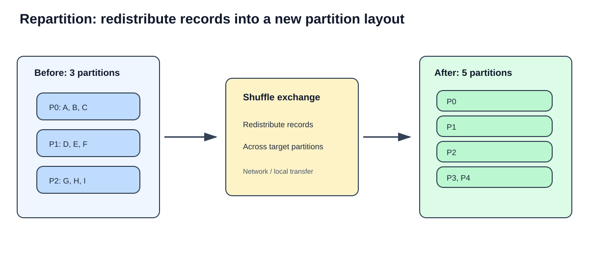
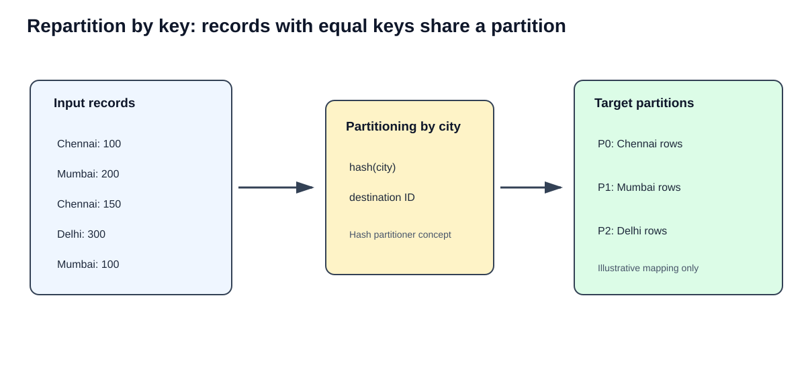
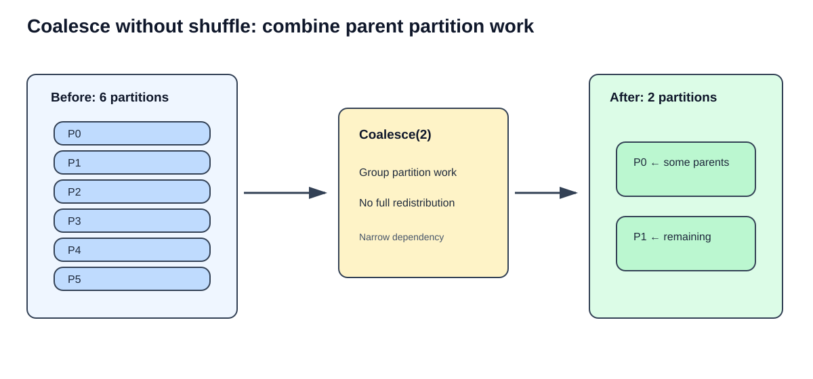
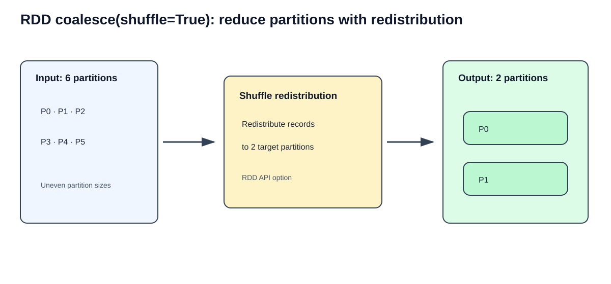
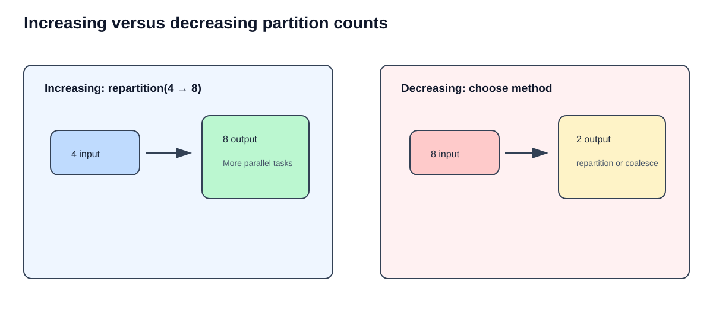
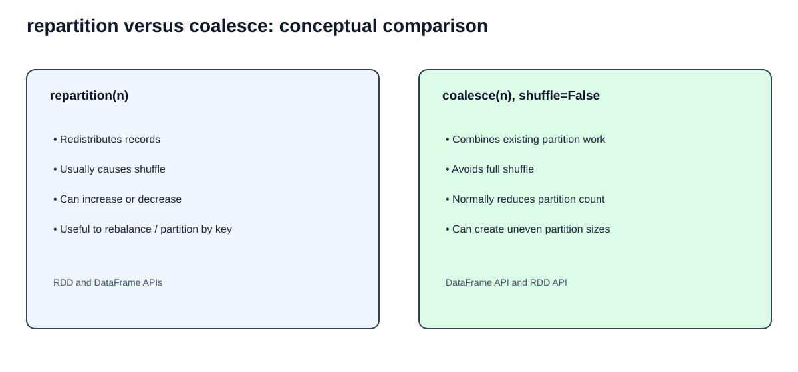
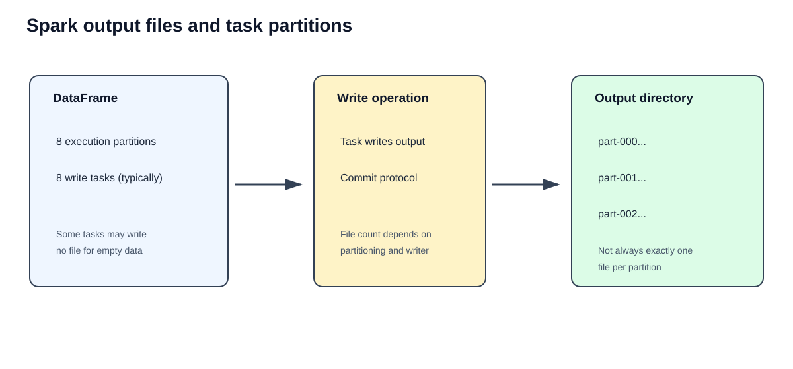
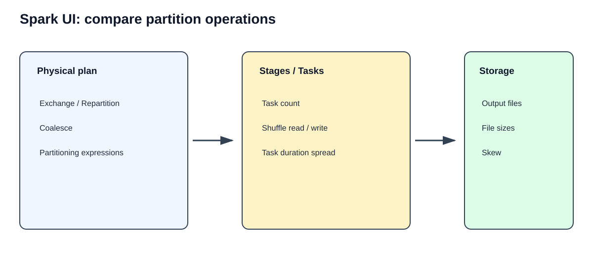

# Part 5 — Repartition and Coalesce in Apache Spark
## Deep-dive PySpark notes with code walkthroughs, expected outputs, SVG diagrams, ETL scenarios, Spark UI analysis, and assignments

> **Important API clarification:** In PySpark, `DataFrame.coalesce(numPartitions)` does **not** accept a `shuffle` argument. The `coalesce(numPartitions, shuffle=False)` option belongs to the **RDD API**. This chapter explains both APIs and their differences.

---

# 1. Learning objectives

By the end of this chapter, you should be able to:

1. Explain why partition count matters in Spark.
2. Use DataFrame and RDD `repartition()` correctly.
3. Understand `repartition()` with and without partitioning columns.
4. Use DataFrame and RDD `coalesce()` correctly.
5. Explain RDD `coalesce(shuffle=True)`.
6. Choose a method for increasing or decreasing partitions.
7. Inspect partition counts and partition sizes.
8. Understand shuffle, task count, stages, and output file implications.
9. Benchmark alternatives using Spark UI and repeatable measurements.
10. Design partition strategies for real ETL pipelines.

# 2. Why partition management matters

Spark distributes work across partitions. A task normally processes one partition for a stage. Partition count therefore influences:

- How many tasks can run in parallel.
- How much data each task processes.
- Scheduling overhead.
- Memory pressure within individual tasks.
- Shuffle volume and task balance.
- Number and size of files produced by write operations.

Too few partitions can limit parallelism and create large tasks. Too many partitions can create many small tasks, scheduling overhead, and potentially many small output files.

There is no universally correct partition count. It depends on data size, available executor cores, operation complexity, skew, storage format, and downstream workload.

## 2.1 A simple example

Suppose a dataset contains 10 million rows.

- With 2 partitions, each partition has an average of 5 million rows.
- With 20 partitions, each has an average of 500,000 rows.
- With 100 partitions, each has an average of 100,000 rows.

These are averages only. Actual partition sizes may be uneven.

**Important:** More partitions do not automatically mean faster execution. Each task has overhead, and a shuffle to create more partitions also has a cost.

---

# 3. Inspecting partitions before changing them

Start by understanding the existing DataFrame.

```python
from pyspark.sql import SparkSession, functions as F

spark = (
    SparkSession.builder
    .appName("RepartitionCoalesceLearning")
    .getOrCreate()
)

df = spark.range(0, 100)

print("Partitions:", df.rdd.getNumPartitions())
print("Rows:", df.count())
```

### Code breakdown

- `spark.range(0, 100)` creates rows with IDs from 0 through 99.
- `df.rdd` exposes the DataFrame's underlying RDD interface for inspection.
- `getNumPartitions()` returns the current RDD partition count.
- `count()` is an action that executes a count query.

### Expected output

The row count is:

```text
Rows: 100
```

The initial partition count depends on the Spark session and environment. Do not assume it is always 2 or 4.

## 3.1 Inspect records in each partition

```python
partition_sizes = (
    df.rdd
      .mapPartitions(lambda rows: [sum(1 for _ in rows)])
      .collect()
)

print(partition_sizes)
```

Example output (illustrative):

```text
[25, 25, 25, 25]
```

The actual output depends on the initial partition layout.

### What does `mapPartitions()` do here?

- Spark invokes the function once for each partition.
- The iterator contains records in that partition.
- The generator expression counts the records.
- One count is returned per partition.
- `collect()` brings the small list of counts to the driver.

Use this technique only for diagnostic summaries. Do not collect a large dataset to the driver.

---

# 4. `repartition()` — detailed explanation

`repartition()` creates a new partition layout by redistributing records. In common Spark execution paths, it uses a shuffle.

It can be used to:

- Increase partition count.
- Decrease partition count.
- Redistribute records more evenly.
- Partition data by one or more columns.



## 4.1 DataFrame `repartition(numPartitions)`

### Syntax

```python
df.repartition(numPartitions)
```

### Example

```python
df = spark.range(0, 100).repartition(8)

print("Partitions:", df.rdd.getNumPartitions())
print("Rows:", df.count())
```

### Expected output

```text
Partitions: 8
Rows: 100
```

### Code breakdown

1. `spark.range(0, 100)` creates 100 rows.
2. `.repartition(8)` asks Spark for a new layout with 8 partitions.
3. Spark redistributes records across the target partitions.
4. `getNumPartitions()` reports the resulting partition count.
5. `count()` triggers execution.

### Why can this be expensive?

Redistribution can require:

- Shuffle write.
- Intermediate storage.
- Local or remote shuffle reads.
- Network transfer.
- Serialization and deserialization.
- Additional task scheduling.

Do not call `repartition()` repeatedly without a downstream reason.

## 4.2 Increase partitions

```python
source_df = spark.range(0, 100000).repartition(4)

more_partitions = source_df.repartition(12)

print("Before:", source_df.rdd.getNumPartitions())
print("After:", more_partitions.rdd.getNumPartitions())
```

### Expected output

```text
Before: 4
After: 12
```

### When is this useful?

- A previous operation produced too few partitions.
- You need more downstream task parallelism.
- Each existing partition contains too much work.
- A large downstream transformation can benefit from more parallel tasks.

### Important limitation

Increasing partition count can create more parallel tasks, but it cannot create useful parallelism if the input source or downstream work has other constraints. It may also add a shuffle cost.

## 4.3 Decrease partitions with `repartition()`

```python
source_df = spark.range(0, 100000).repartition(12)

fewer_partitions = source_df.repartition(3)

print("Before:", source_df.rdd.getNumPartitions())
print("After:", fewer_partitions.rdd.getNumPartitions())
```

### Expected output

```text
Before: 12
After: 3
```

### Why use repartition to decrease?

Unlike a narrow coalesce, repartition redistributes records across the new target partitions. This may provide a more balanced layout, at the cost of a shuffle.

Use it when balance or a new distribution is more important than avoiding shuffle.

## 4.4 `repartition()` using a column

### Syntax

```python
df.repartition(numPartitions, "column_name")
```

This requests hash partitioning by the specified expression(s).



### Example

```python
sales = spark.createDataFrame(
    [
        (1, "Chennai", 100),
        (2, "Mumbai", 200),
        (3, "Chennai", 150),
        (4, "Delhi", 300),
        (5, "Mumbai", 100),
        (6, "Delhi", 250)
    ],
    ["order_id", "city", "amount"]
)

by_city = sales.repartition(3, "city")

print("Partitions:", by_city.rdd.getNumPartitions())
```

### Expected output

```text
Partitions: 3
```

### What happens internally?

- Spark evaluates the `city` expression for each row.
- A partitioning function assigns each row to a target partition.
- Rows with equal partitioning keys are assigned to the same target partition under that hash partitioning.
- Spark performs an exchange to establish the requested distribution.

The exact numeric partition ID for a city is not something you should hard-code. It depends on Spark's partitioning implementation and the requested partition count.

### Verify the distribution

```python
def inspect_partition(index, iterator):
    rows = list(iterator)
    yield (index, len(rows), [row.city for row in rows])

distribution = (
    by_city.rdd
    .mapPartitionsWithIndex(inspect_partition)
    .collect()
)

for item in distribution:
    print(item)
```

Example output shape:

```text
(0, 2, ['Mumbai', 'Mumbai'])
(1, 2, ['Chennai', 'Chennai'])
(2, 2, ['Delhi', 'Delhi'])
```

This is only illustrative. Actual city-to-partition mapping and partition ordering can differ. Empty partitions are possible.

### Does repartition by key guarantee balanced partitions?

No. If one key is extremely common, all records for that key are assigned to the same hash partition. This can create skew. Repartitioning by a skewed key may therefore produce uneven partitions.

## 4.5 Repartition by multiple columns

```python
by_city_status = sales.repartition(6, "city", "status")
```

For multiple columns, the combined expressions determine the hash partition assignment.

This is useful when downstream operations frequently use the same combination of keys, but do not repartition by multiple columns without a clear downstream benefit.

---

# 5. `coalesce()` — detailed explanation

`coalesce()` reduces the number of partitions by combining existing partition work. In its normal no-shuffle form, it avoids a full redistribution.



## 5.1 DataFrame `coalesce(numPartitions)`

### Syntax

```python
df.coalesce(numPartitions)
```

### Example

```python
source_df = spark.range(0, 100).repartition(8)

smaller_df = source_df.coalesce(2)

print("Before:", source_df.rdd.getNumPartitions())
print("After:", smaller_df.rdd.getNumPartitions())
```

### Expected output

```text
Before: 8
After: 2
```

### Code breakdown

1. The source DataFrame has 8 partitions.
2. `coalesce(2)` requests a reduction to 2 partitions.
3. Spark combines existing partition work into fewer output partitions.
4. In the normal DataFrame API, this is designed to avoid a full shuffle.
5. The resulting partitions can be uneven.

### Why can it be faster than repartition?

It avoids the full data redistribution required by a shuffle-based repartition. This can reduce network and disk I/O.

### Why can it produce uneven partitions?

Coalesce combines existing partitions rather than globally redistributing individual records to balance the output. If some source partitions are much larger than others, the output may remain uneven.

## 5.2 Can DataFrame `coalesce()` increase partitions?

No. DataFrame `coalesce()` is intended to reduce the partition count. If you request a count greater than or equal to the current number, it does not provide a way to increase the partition count.

Use `repartition()` when you need to increase partitions.

## 5.3 Coalesce in a real ETL write

```python
cleaned_df = (
    orders_df
    .filter(F.col("status") == "COMPLETED")
    .select("order_id", "customer_id", "amount")
)

output_df = cleaned_df.coalesce(4)

(
    output_df.write
    .mode("overwrite")
    .parquet("/data/output/cleaned_orders")
)
```

### Explanation

- Filtering and selecting reduce the output rows and columns.
- Coalesce reduces the number of output partitions.
- The write operation runs tasks on the output partitions.
- This can reduce the number of output files compared with writing many non-empty partitions.

Do not use `coalesce(1)` automatically for large datasets. It can funnel all output through one task and create a severe bottleneck.

---

# 6. RDD `coalesce(shuffle=True)`

This topic needs an important API distinction.

For RDDs, the signature is:

```python
rdd.coalesce(numPartitions, shuffle=False)
```

With `shuffle=True`, Spark redistributes records while reducing the partition count.



## 6.1 Example

```python
sc = spark.sparkContext

rdd = sc.parallelize(range(100), 8)

without_shuffle = rdd.coalesce(2)
with_shuffle = rdd.coalesce(2, shuffle=True)

print("Original:", rdd.getNumPartitions())
print("Without shuffle:", without_shuffle.getNumPartitions())
print("With shuffle:", with_shuffle.getNumPartitions())
```

### Expected output

```text
Original: 8
Without shuffle: 2
With shuffle: 2
```

### What is different?

| Behavior | `coalesce(2)` | `coalesce(2, shuffle=True)` |
|---|---|---|
| Partition count | Reduced | Reduced |
| Full redistribution | No | Yes |
| Shuffle | Normally no | Yes |
| Balance | May remain uneven | Can redistribute more evenly |
| Cost | Usually lower | Higher due to shuffle |
| Dependency | Narrow-style coalescing | Shuffle dependency |

The shuffle version can improve distribution, but it does not guarantee perfectly equal record counts, especially when records have different processing costs or the partitioning key is skewed.

## 6.2 Important: DataFrame API versus RDD API

Do not write:

```python
df.coalesce(2, shuffle=True)  # Not a valid PySpark DataFrame signature
```

Use:

```python
df.coalesce(2)                # DataFrame API
```

For RDD:

```python
rdd.coalesce(2, shuffle=True) # RDD API
```

If you need a shuffled DataFrame partition reduction, use:

```python
df.repartition(2)
```

---

# 7. Increasing versus decreasing partitions



| Requirement | Typical choice | Reason |
|---|---|---|
| Increase from 4 to 12 | `repartition(12)` | Creates more target partitions |
| Decrease from 12 to 3 with redistribution | `repartition(3)` | Shuffles to new distribution |
| Decrease from 12 to 3 without full shuffle | `coalesce(3)` | Combines existing partition work |
| RDD decrease with shuffle | `rdd.coalesce(3, shuffle=True)` | Redistributes into fewer partitions |
| DataFrame partition by city | `df.repartition(8, "city")` | Hash partitioning by city |

### Rule of thumb

- Need more partitions? Use `repartition()`.
- Need fewer partitions and want to avoid a full shuffle? Use `coalesce()`.
- Need fewer partitions but also want redistribution? Use `repartition()` for DataFrames or RDD `coalesce(..., shuffle=True)`.

---

# 8. Performance comparison



Consider a DataFrame with 100 million records and 100 input partitions. You want 10 output partitions.

### Option A — repartition

```python
repartitioned = large_df.repartition(10)
```

Expected behavior:

- Shuffle exchange.
- Data redistribution.
- Shuffle write/read metrics may be non-zero.
- More balanced output is often possible, but not guaranteed.

### Option B — coalesce

```python
coalesced = large_df.coalesce(10)
```

Expected behavior:

- Narrow coalescing.
- No full shuffle solely for this operation.
- Less redistribution overhead.
- Output partitions may be uneven.

### Which is faster?

There is no universal answer. Coalesce is often cheaper when simply reducing partition count is sufficient. Repartition may be worth its shuffle cost if a better distribution materially improves downstream processing.

Measure both on representative data.

---

# 9. Inspecting partition sizes

Partition count alone does not tell you whether the data is balanced.

Use an RDD-based diagnostic:

```python
def count_partition(iterator):
    count = sum(1 for _ in iterator)
    yield count

sizes = (
    df.rdd
    .mapPartitions(count_partition)
    .collect()
)

for partition_id, size in enumerate(sizes):
    print(f"Partition {partition_id}: {size} rows")
```

Example output:

```text
Partition 0: 25000 rows
Partition 1: 25000 rows
Partition 2: 25000 rows
Partition 3: 25000 rows
```

This example is balanced. Real data may look different.

For production-scale datasets, use partition-level summaries and Spark UI metrics rather than collecting individual records.

---

# 10. Output files and partition count

Spark writes output using tasks and the file writer. The number of files is influenced by:

- Number of non-empty write partitions.
- Storage partition columns.
- File format and writer behavior.
- Dynamic partition writing.
- Commit protocol.
- Whether multiple records are written to multiple directory partitions.



## 10.1 Example

```python
(
    large_df
    .coalesce(5)
    .write
    .mode("overwrite")
    .parquet("/data/output/orders")
)
```

This may reduce the number of output files compared with writing the original large number of partitions, but it is not a universal guarantee of exactly five files.

## 10.2 `partitionBy()` is different from `repartition()`

```python
# Execution partitioning
df.repartition(8, "city")

# Directory partitioning in storage
df.write.partitionBy("city").parquet("/data/output")
```

- `repartition()` changes the in-memory execution distribution.
- `partitionBy()` organizes output into directory paths based on column values.

These concepts can work together, but they are not the same operation.

---

# 11. Spark UI and physical plan analysis



## 11.1 Inspect DataFrame physical plans

```python
repart_df = df.repartition(8)
coal_df = df.coalesce(2)

repart_df.explain("formatted")
coal_df.explain("formatted")
```

Look for:

- `Exchange`
- `RoundRobinPartitioning`
- `hashpartitioning`
- `Coalesce`
- Number of partitions in the plan.

The exact plan display varies by Spark version and context.

## 11.2 What to compare in Spark UI

| Metric | What to inspect |
|---|---|
| Number of tasks | Does the output stage have the expected parallelism? |
| Shuffle Write | Did the operation produce shuffle output? |
| Shuffle Read | Did downstream tasks fetch shuffle data? |
| Task duration | Are tasks evenly distributed in duration? |
| Spill | Did tasks spill intermediate data to disk? |
| Output files | Did the write create the desired file layout? |

### Experiment

```python
# Experiment A
a = large_df.repartition(10)
a.count()

# Experiment B
b = large_df.coalesce(10)
b.count()
```

Run the experiments separately, use the same input, and compare the relevant stages. Avoid comparing one cold run against one warm cached run.

---

# 12. Real-world ETL scenarios

## Scenario A — Increase partitions before a large join

A source was read into only 4 partitions, but the cluster can process more tasks concurrently.

```python
orders_ready = orders_df.repartition(32)

result = orders_ready.join(
    customers_df,
    "customer_id",
    "inner"
)
```

Use this only if the current distribution limits the workload. The join may itself introduce an exchange, so inspect whether the earlier repartition is reused or becomes redundant.

## Scenario B — Reduce partitions before a Parquet write

A filtered dataset has hundreds of small partitions.

```python
filtered = orders_df.filter(F.col("status") == "COMPLETED")

output = filtered.coalesce(20)

output.write.mode("overwrite").parquet("/data/curated/orders")
```

This can reduce small output files, but inspect file sizes and avoid creating a few oversized files.

## Scenario C — Rebalance a skewed dataset

```python
balanced = orders_df.repartition(40)
```

A round-robin-style redistribution can spread rows across target partitions more evenly than the previous layout, but it does not guarantee equal processing cost.

If partitioning by a key:

```python
by_customer = orders_df.repartition(40, "customer_id")
```

be aware that skewed customer IDs can still create skewed partitions.

## Scenario D — Reduce RDD partitions with shuffle

```python
smaller_rdd = large_rdd.coalesce(10, shuffle=True)
```

Use this RDD API when reducing partitions while redistributing data is useful.

---

# 13. Common mistakes

1. Using `coalesce()` to increase partition count.
2. Assuming `coalesce()` guarantees balanced output partitions.
3. Using `repartition()` repeatedly and introducing unnecessary shuffles.
4. Using `coalesce(1)` for very large production datasets without considering the single-task bottleneck.
5. Assuming repartition by a skewed key will balance the data.
6. Confusing DataFrame `coalesce()` with RDD `coalesce(shuffle=True)`.
7. Confusing execution partitioning with output directory partitioning.
8. Choosing partition counts without inspecting task duration and data size.
9. Assuming one partition always creates exactly one output file.
10. Benchmarking with different data, cache states, or cluster conditions.

---

# 14. Hands-on lab

## 14.1 Create a dataset

```python
from pyspark.sql import functions as F

orders = (
    spark.range(0, 1_000_000)
    .withColumn(
        "city",
        F.when((F.col("id") % 3) == 0, "Chennai")
         .when((F.col("id") % 3) == 1, "Mumbai")
         .otherwise("Delhi")
    )
    .withColumn("amount", (F.col("id") % 1000).cast("double"))
)

print("Initial partitions:", orders.rdd.getNumPartitions())
print("Total records:", orders.count())
```

Expected total records:

```text
1000000
```

The initial partition count depends on the Spark environment.

## 14.2 Experiment 1 — repartition increase

```python
repart_increase = orders.repartition(20)

print(repart_increase.rdd.getNumPartitions())
```

Expected:

```text
20
```

## 14.3 Experiment 2 — repartition decrease

```python
repart_decrease = orders.repartition(4)

print(repart_decrease.rdd.getNumPartitions())
```

Expected:

```text
4
```

## 14.4 Experiment 3 — coalesce decrease

```python
coalesce_decrease = orders.coalesce(4)

print(coalesce_decrease.rdd.getNumPartitions())
```

Expected:

```text
4
```

## 14.5 Experiment 4 — repartition by city

```python
city_partitioned = orders.repartition(6, "city")

print(city_partitioned.rdd.getNumPartitions())
```

Expected:

```text
6
```

## 14.6 Experiment 5 — compare partition sizes

```python
def partition_summary(index, iterator):
    count = 0
    amount_sum = 0.0

    for row in iterator:
        count += 1
        amount_sum += row.amount

    yield (index, count, amount_sum)

for name, frame in [
    ("repartition", repart_decrease),
    ("coalesce", coalesce_decrease),
    ("by_city", city_partitioned)
]:
    print(name)
    summaries = (
        frame.rdd
        .mapPartitionsWithIndex(partition_summary)
        .collect()
    )
    for summary in summaries:
        print(summary)
```

The results show each partition's row count and amount sum. They are data-dependent; do not expect every partition to contain the same number of rows.

---

# 15. Interview questions

## Beginner

1. What is repartitioning in Spark?
2. What is coalescing?
3. What is the main difference between `repartition()` and `coalesce()`?
4. Can `repartition()` increase partition count?
5. Can DataFrame `coalesce()` increase partition count?
6. Why does repartition usually cause a shuffle?
7. Why is normal coalesce usually cheaper?
8. What happens when you reduce 100 partitions to 10 using coalesce?

## Intermediate

9. Explain `repartition(numPartitions, column)`.
10. What is hash partitioning?
11. Why can repartition by a skewed key still produce skew?
12. Explain RDD `coalesce(shuffle=True)`.
13. Why is `coalesce(shuffle=True)` not the same signature as DataFrame `coalesce()`?
14. How can partition count affect output file count?
15. What is the difference between `repartition()` and writer `partitionBy()`?
16. How would you inspect partition sizes?
17. What is the impact of too many small partitions?
18. What is the impact of too few large partitions?

## Advanced

19. Explain the dependency difference between RDD coalesce with and without shuffle.
20. Why might repartition improve a downstream operation even though it adds a shuffle?
21. How can you benchmark repartition and coalesce fairly?
22. How does AQE interact with SQL shuffle partitions?
23. Why can one hot key defeat hash repartitioning?
24. How would you choose partitions for a large Parquet write?
25. How can you determine whether a repartition is redundant?
26. Why might task count differ from output file count?
27. Explain the trade-off between task scheduling overhead and parallelism.
28. Design a partition strategy for a 500 GB daily ETL workload.

---

# 16. Practical assignments

### Assignment 1 — Partition count experiments

Create a DataFrame with at least 1 million records.

- Start with 4 partitions.
- Increase to 16.
- Decrease to 2 using repartition.
- Decrease to 2 using coalesce.
- Record the resulting partition counts.
- Compare task count and execution metrics.

### Assignment 2 — Partition by key

Create sales data containing city, category, and amount.

- Repartition by city.
- Inspect partition distribution.
- Repartition by city and category.
- Compare the number of records in each partition.
- Explain why equal key frequency is not guaranteed.

### Assignment 3 — Output file optimization

- Write the source DataFrame directly to Parquet.
- Write another copy after `coalesce(10)`.
- Compare number of files and file sizes.
- Explain whether the result improved the downstream workload.

### Assignment 4 — RDD coalesce shuffle

- Create an RDD with 20 partitions.
- Reduce to 5 with `coalesce(5)`.
- Reduce to 5 with `coalesce(5, shuffle=True)`.
- Compare lineage and execution stages.
- Explain the cost and balance differences.

### Assignment 5 — Production-style benchmark

Run at least three repeated trials for each method. Keep data and cluster conditions consistent. Record:

- Wall-clock time.
- Number of tasks.
- Shuffle read/write.
- Spill.
- Maximum and median task duration.
- Output file count and size distribution.

Explain which approach you would choose and why.

---

# 17. Quick revision

| Method | Can increase partitions? | Shuffle? | Typical purpose |
|---|---:|---|---|
| DataFrame `repartition(n)` | Yes | Yes, generally | Redistribute to n partitions |
| DataFrame `repartition(n, col)` | Yes | Yes, generally | Hash partition by expressions |
| DataFrame `coalesce(n)` | No | No full shuffle | Reduce partitions cheaply |
| RDD `coalesce(n)` | No | No | Reduce partitions cheaply |
| RDD `coalesce(n, shuffle=True)` | Can be used to repartition | Yes | Redistribute while changing count |
| RDD `repartition(n)` | Yes | Yes | Shuffle-based repartition |

## Final mental model

```text
Need more partitions?
        |
        v
   repartition(n)
        |
        v
  Shuffle redistribution

Need fewer partitions?
        |
        +-------------------------+
        |                         |
        v                         v
 Avoid full shuffle          Need redistribution
        |                         |
        v                         v
 coalesce(n)             repartition(n)
                         or RDD coalesce(n, shuffle=True)
```

---

# 18. Next chapter

**Part 6 — Caching and Persistence in Apache Spark**

Recommended topics:

- Lazy evaluation and recomputation
- `cache()`
- `persist()`
- Storage levels
- Memory and disk persistence
- `unpersist()`
- Cache eviction
- RDD vs DataFrame caching
- Spark UI Storage tab
- Performance benchmarking
- Real-world ETL scenarios
