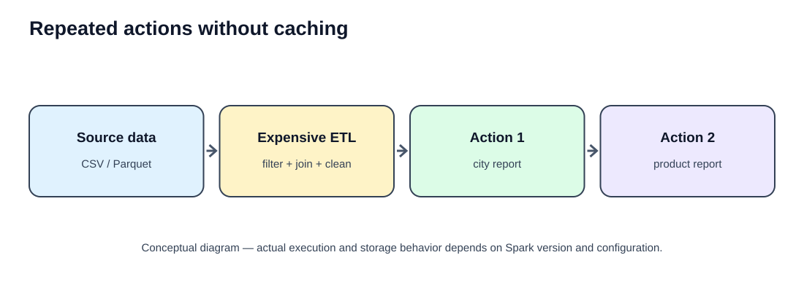
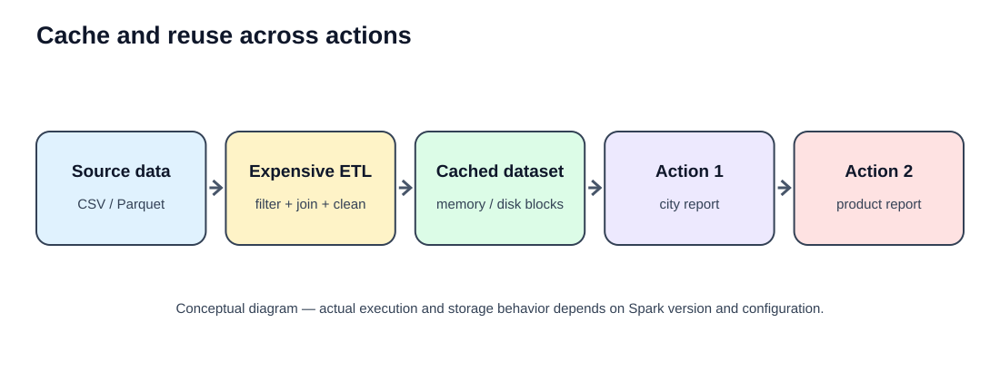
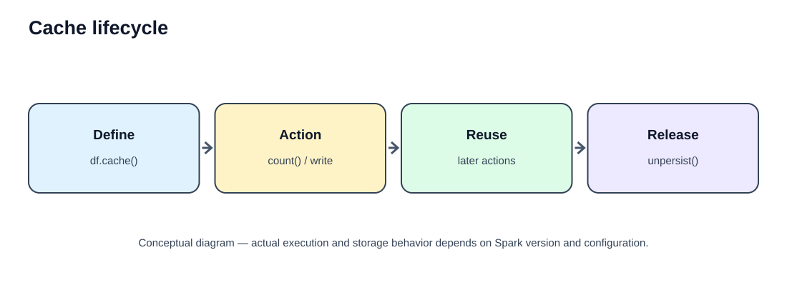
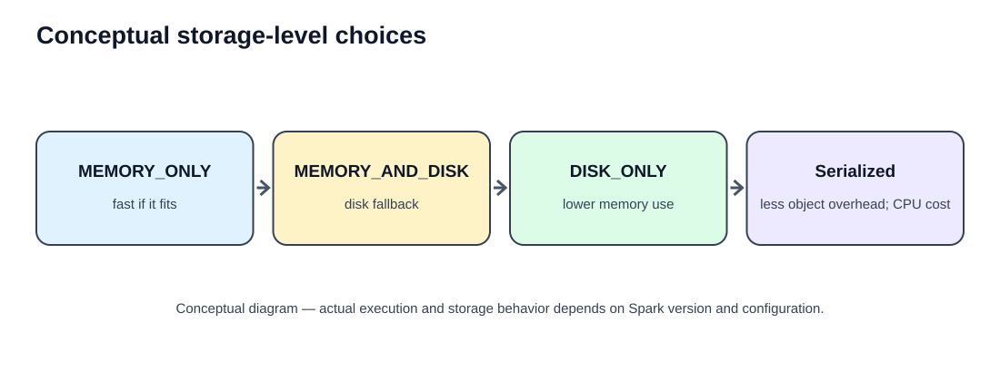
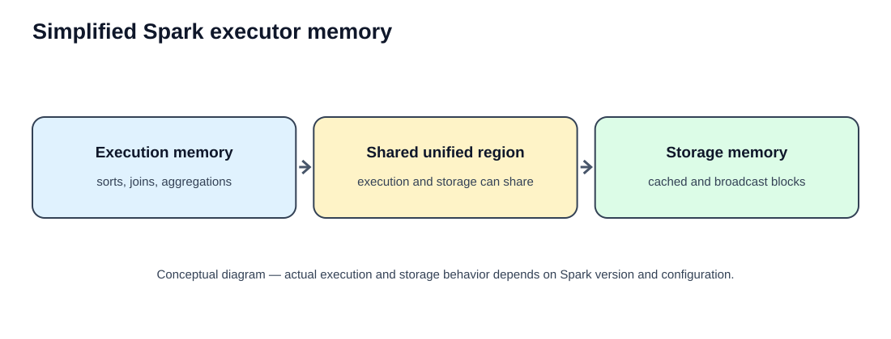
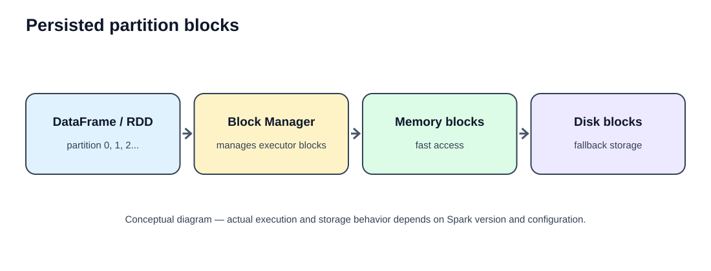

# Part 6 — Cache and Persist in PySpark
## Detailed learning notes: `cache()`, `persist()`, storage levels, `unpersist()` and performance

**Learning goal:** Understand why Spark recomputes data, when caching is useful, how to select a storage level, how to verify persistence in Spark UI, and how to release cached data safely.

## The mental model

Spark transformations are lazy. They build a plan; an action starts execution. If you run multiple actions on the same transformed DataFrame without persistence, Spark may repeat upstream work. Caching asks Spark to retain computed partitions for reuse.





### Common dataset for examples

```python
from pyspark.sql import SparkSession
from pyspark.sql.functions import col, sum as spark_sum, avg, count
from pyspark import StorageLevel

spark = (
    SparkSession.builder
    .appName("CachePersistLearning")
    .master("local[*]")
    .getOrCreate()
)

sales_data = [
    (1, "Chennai", "Laptop", 65000, 2, "COMPLETED"),
    (2, "Bangalore", "Phone", 25000, 3, "COMPLETED"),
    (3, "Chennai", "Tablet", 18000, 1, "PENDING"),
    (4, "Hyderabad", "Laptop", 65000, 1, "COMPLETED"),
    (5, "Bangalore", "Monitor", 12000, 2, "CANCELLED"),
    (6, "Chennai", "Phone", 25000, 4, "COMPLETED"),
    (7, "Hyderabad", "Tablet", 18000, 2, "COMPLETED"),
    (8, "Bangalore", "Laptop", 65000, 1, "PENDING"),
]
columns = ["order_id", "city", "product", "price", "quantity", "status"]
sales_df = spark.createDataFrame(sales_data, columns)
sales_df.show()
```

**Expected output**

```text
+--------+---------+-------+-----+--------+---------+
|order_id|city     |product|price|quantity|status   |
+--------+---------+-------+-----+--------+---------+
|1       |Chennai  |Laptop |65000|2       |COMPLETED|
|2       |Bangalore|Phone  |25000|3       |COMPLETED|
|3       |Chennai  |Tablet |18000|1       |PENDING  |
|4       |Hyderabad|Laptop |65000|1       |COMPLETED|
|5       |Bangalore|Monitor |12000|2       |CANCELLED|
|6       |Chennai  |Phone  |25000|4       |COMPLETED|
|7       |Hyderabad|Tablet |18000|2       |COMPLETED|
|8       |Bangalore|Laptop |65000|1       |PENDING  |
+--------+---------+-------+-----+--------+---------+
```

---

# Section 1 — Fundamentals

## 1. Why caching is needed

Imagine reading a large orders table, cleaning it, joining customers, and then creating city, product, and status reports. If each report reuses the same expensive intermediate dataset, recomputing the read/filter/join repeatedly can waste time. Caching can retain that intermediate result.

**Cache when:** the same expensive result is reused by multiple actions or branches, or an iterative process repeatedly reads the same data.

**Do not automatically cache when:** data is used once, transformations are cheap, the cached data is too large, or memory pressure harms other operations.

**Real ETL scenario:** Clean transactions once, then use the cleaned result for revenue-by-city, revenue-by-product, and order-status reports.

## 2. Lazy evaluation recap

```python
completed_df = sales_df.filter(col("status") == "COMPLETED")
```

This defines a filter transformation. It does not normally compute all matching rows immediately.

```python
completed_df.count()
```

`count()` is an action and triggers execution.

**Output**

```text
5
```

There are five completed orders. Other common actions include `show()`, `collect()`, and writing a DataFrame.

## 3. Recalculation without cache

```python
cleaned_df = (
    sales_df
    .filter(col("status") == "COMPLETED")
    .withColumn("revenue", col("price") * col("quantity"))
)

cleaned_df.count()

cleaned_df.groupBy("city").agg(
    spark_sum("revenue").alias("city_revenue")
).show()

cleaned_df.groupBy("product").agg(
    avg("revenue").alias("average_revenue")
).show()
```

**Line-by-line explanation**
1. `filter()` keeps completed orders.
2. `withColumn()` creates revenue by multiplying unit price and quantity.
3. `count()` triggers the first job.
4. The city aggregation is a separate action.
5. The product aggregation is another action.
6. Since the DataFrame was not persisted, Spark may recompute the upstream plan for later actions.

**Expected count:** `5`

**Expected city revenue**

```text
+---------+------------+
|city     |city_revenue|
+---------+------------+
|Chennai  |230000      |
|Bangalore|75000       |
|Hyderabad|101000      |
+---------+------------+
```

**Expected average revenue by product**

```text
+-------+----------------+
|product|average_revenue |
+-------+----------------+
|Laptop |97500.0         |
|Phone  |62500.0         |
|Tablet |36000.0         |
+-------+----------------+
```

Group results may appear in a different row order because `groupBy()` does not guarantee ordering.

## 4. What caching means

Caching means retaining computed intermediate partitions so that later operations can reuse them. It is a runtime performance feature, not a permanent table.

Caching does **not** guarantee:
- all partitions remain in memory forever;
- lineage is removed;
- every query becomes faster;
- data survives application termination.

If a cached block is missing or evicted, Spark can recompute it from lineage when possible.

---

# Section 2 — `cache()`

## 5. `cache()` purpose and syntax

```python
cleaned_df = (
    sales_df
    .filter(col("status") == "COMPLETED")
    .withColumn("revenue", col("price") * col("quantity"))
)

cleaned_df.cache()
```

**Explanation**
- First, define the cleaned DataFrame.
- `cache()` requests persistence using the default level for that API.
- It is lazy: the call does not itself force every partition to be calculated.
- An action is needed to populate the cache.

You may also write `cleaned_df = cleaned_df.cache()`. For DataFrames, assigning it back is optional because `cache()` returns the DataFrame.

## 6. Caching a DataFrame

```python
completed_sales = (
    sales_df
    .filter(col("status") == "COMPLETED")
    .withColumn("revenue", col("price") * col("quantity"))
    .cache()
)

completed_sales.count()
```

**Output**

```text
5
```

The count action triggers the computation and populates cached partitions as they are produced. A later compatible query can reuse the cached DataFrame.

Inspect the plan:

```python
completed_sales.explain("formatted")
```

After materialization, later plans may show cache-related operators such as `InMemoryTableScan`. Exact plan output depends on Spark version and query optimization.

## 7. Caching an RDD

```python
numbers_rdd = spark.sparkContext.parallelize([10, 20, 30, 40, 50], 2)
squared_rdd = numbers_rdd.map(lambda x: x * x)

squared_rdd.cache()

print(squared_rdd.collect())
print(squared_rdd.sum())
```

**Output**

```text
[100, 400, 900, 1600, 2500]
5500
```

**Explanation**
- `parallelize()` creates a distributed collection with two partitions.
- `map()` defines a transformation that squares each number.
- `cache()` requests persistence for the resulting RDD.
- `collect()` is the first action and computes the values.
- `sum()` is a second action and can reuse cached partitions.

RDD persistence and DataFrame caching are related but use different internal paths. RDDs persist partition data; Spark SQL DataFrame caching commonly stores optimized columnar batches.

## 8. Cache materialization

```python
df = sales_df.filter(col("status") == "COMPLETED")
df.cache()
print("Cache requested")
```

**Output**

```text
Cache requested
```

No action was called, so the code has requested persistence but has not deliberately computed the full dataset.

Now execute:

```python
df.count()
```

**Output:** `5`

This action causes Spark to compute the required result and populate cached partitions as they are computed. A useful mental formula is:

- `cache()` = request persistence.
- Action = trigger computation.
- Cached blocks = computed partitions retained under the storage policy.



## 9. Reusing cache across actions

```python
completed_sales = (
    sales_df
    .filter(col("status") == "COMPLETED")
    .withColumn("revenue", col("price") * col("quantity"))
    .cache()
)

completed_sales.count()  # first action: populate cache

completed_sales.groupBy("city").agg(
    spark_sum("revenue").alias("total_revenue")
).show()

completed_sales.groupBy("product").agg(
    count("*").alias("order_count")
).show()
```

**Expected outputs**

Count: `5`

City revenue:

```text
+---------+-------------+
|city     |total_revenue|
+---------+-------------+
|Chennai  |230000       |
|Bangalore|75000        |
|Hyderabad|101000       |
+---------+-------------+
```

Product count:

```text
+-------+-----------+
|product|order_count|
+-------+-----------+
|Laptop |2          |
|Phone  |2          |
|Tablet |1          |
+-------+-----------+
```

The cached input can be reused, but each group-by aggregation still has to execute. Caching the input does not cache every downstream result automatically.

## 10. Limitations of `cache()`

Caching can make a workload slower if:
- the data is never reused;
- cache population costs more than recomputation;
- cached data crowds out memory needed by joins, sorts, or aggregations;
- partitions are evicted repeatedly;
- the later query does not reuse the cached plan.

**Practical rule:** cache because you have identified reuse, then measure the result.

---

# Section 3 — `persist()` and storage levels

## 11. `persist()` introduction

`persist()` is similar to `cache()`, but it allows you to choose a storage level.

```python
completed_sales = (
    sales_df
    .filter(col("status") == "COMPLETED")
    .withColumn("revenue", col("price") * col("quantity"))
)

completed_sales.persist(StorageLevel.MEMORY_AND_DISK)
completed_sales.count()
```

**Explanation**
- `StorageLevel` contains storage policies exposed by PySpark.
- `MEMORY_AND_DISK` asks Spark to use memory and disk fallback.
- `count()` triggers the computation.
- The output is `5`.

Persistence is not durable storage across application termination.

## 12. Storage levels explained

A storage level describes where and how Spark stores persisted partitions: memory, disk, serialized representation (for applicable APIs), and optionally replicas.



## 13. `MEMORY_ONLY`

```python
memory_df = completed_sales.persist(StorageLevel.MEMORY_ONLY)
memory_df.count()
```

**Output:** `5`

Conceptually, Spark keeps persisted partitions in memory. If a partition cannot remain cached, it may need to be recomputed from lineage when requested.

Use it when the dataset fits comfortably in executor storage memory and fast repeated access is valuable. Check the Storage tab; do not assume all partitions fit.

## 14. `MEMORY_AND_DISK`

```python
memory_disk_df = completed_sales.persist(StorageLevel.MEMORY_AND_DISK)
memory_disk_df.count()
```

**Output:** `5`

Spark keeps partitions in memory where possible and uses disk for partitions that do not fit in memory. Disk access is slower than memory, but may avoid recomputing expensive transformations.

This is worth testing for large reusable datasets when memory alone may not be sufficient.

## 15. `DISK_ONLY`

```python
disk_df = completed_sales.persist(StorageLevel.DISK_ONLY)
disk_df.count()
```

**Output:** `5`

Persisted partitions are stored on disk rather than using executor memory for those persisted blocks. Consider it when memory is constrained, recomputation is expensive, and disk reads are acceptable.

It is not automatically faster than recomputing. Benchmark your workload.

## 16. Serialized storage

Serialized persistence stores data in a serialized representation for applicable RDD storage levels. It can reduce the overhead of many individual objects, but encoding and decoding consume CPU.

**Trade-off**
- Possible reduction in memory footprint.
- Additional serialization/deserialization work.
- Actual performance depends on data shape, serializer, Spark version, and workload.

DataFrame caching uses Spark SQL's optimized cache representation (commonly columnar batches), not simply Python objects stored row by row. Available storage-level constants differ by API and Spark version.

## 17. Storage-level comparison

| Storage level | Memory | Disk | Concept |
|---|---:|---:|---|
| `MEMORY_ONLY` | Yes | No | Fast if partitions fit; missing blocks may be recomputed |
| `MEMORY_AND_DISK` | Yes | Yes | Disk fallback when memory is insufficient |
| `DISK_ONLY` | No | Yes | Lower persisted-memory pressure |
| Serialized variants | Depends | Depends | Lower object overhead may cost CPU |
| Replicated variants | Depends | Depends | Additional copies where supported |

**Version/API note:** DataFrame `cache()` typically uses `MEMORY_AND_DISK_DESER` in modern Spark. RDD `cache()` traditionally uses `MEMORY_ONLY`. Confirm the exact defaults and available Python constants for your Spark version; do not copy JVM-only constants blindly.

---

# Section 4 — Cache vs Persist

## 18. `cache()` vs `persist()`

| Feature | `cache()` | `persist()` |
|---|---|---|
| Purpose | Request default persistence | Request persistence with chosen level |
| Choose storage level | No explicit choice | Yes |
| Lazy | Yes | Yes |
| Needs an action to populate | Yes | Yes |
| Release | `unpersist()` | `unpersist()` |

```python
df_a = sales_df.filter(col("status") == "COMPLETED").cache()

df_b = sales_df.filter(col("status") == "COMPLETED").persist(
    StorageLevel.MEMORY_AND_DISK
)
```

Both request persistence. The main difference is control over the storage policy.

## 19. Default storage levels: RDD vs DataFrame

Do not apply one default to every API:
- RDD `cache()` traditionally defaults to `MEMORY_ONLY`.
- DataFrame/Dataset `cache()` typically defaults to `MEMORY_AND_DISK_DESER` in modern Spark.
- Defaults and Python-exposed constants can vary by Spark version.

Inspect the configured level:

```python
print(completed_sales.storageLevel)
```

For an RDD:

```python
print(squared_rdd.getStorageLevel())
```

The exact printed representation depends on Spark version.

## 20. Choosing a storage level

Ask:
1. How large is the filtered and projected dataset?
2. How expensive is it to recompute?
3. How many downstream operations reuse it?
4. How much executor storage memory is available?
5. Is disk fallback acceptable?
6. Is latency important?
7. What does Spark UI report after materialization?

A starting strategy:
- Small, reusable dataset: test the DataFrame default.
- Large reusable dataset: test memory-and-disk behavior.
- Memory pressure: consider disk-only or avoid caching.
- One-pass use: normally do not cache.

There is no universally best storage level.

## 21. RDD vs DataFrame caching

| Area | RDD | DataFrame |
|---|---|---|
| Abstraction | Distributed collection of objects | Structured rows and columns |
| Optimizer | No Catalyst optimization of arbitrary RDD functions | Spark SQL optimizer |
| Cache representation | RDD partition blocks | Commonly cached columnar batches |
| Traditional default | `MEMORY_ONLY` | `MEMORY_AND_DISK_DESER` |
| Typical use | Low-level custom processing | Structured ETL and analytics |

For most structured data engineering work, prefer DataFrames unless there is a specific reason to use RDDs.

---

# Section 5 — Cache management and internals

## 22. `unpersist()`

When no downstream operation needs the cached dataset, release it.

```python
completed_sales.unpersist()
```

The call requests removal of persisted blocks. It is generally non-blocking by default, so it may return before all blocks have been removed.

To wait:

```python
completed_sales.unpersist(blocking=True)
```

Do not unpersist before the final operation that depends on the cache.

## 23. Cache eviction and insufficient memory

Suppose an executor has limited storage capacity and an application caches several large DataFrames. Spark may evict persisted blocks to make room for other storage needs. If a required block is missing later, Spark can recompute it from lineage.

Example:
1. Cache customer data.
2. Cache transactions.
3. Cache product data.
4. A large aggregation needs resources.
5. Some cached blocks may be evicted.
6. A later query may reload or recompute missing partitions.

Persistence is a performance optimization, not a promise that every cached partition remains resident forever.

## 24. Execution memory vs storage memory

- **Execution memory:** working memory for sorting, joins, and aggregations.
- **Storage memory:** cached/persisted blocks and broadcast data.



Spark's unified memory manager allows execution and storage to share a region. They can borrow capacity subject to Spark's memory-management rules and configuration. The diagram is conceptual; do not assume a fixed percentage allocation for every cluster.

A large cache can compete with memory required for shuffle, sort, and aggregation work. Over-caching can therefore slow down the workload.

## 25. Block Manager

The Block Manager manages storage blocks on executors.



Conceptual sequence:
1. A task computes a partition.
2. Spark attempts to store it according to the storage level.
3. The executor's Block Manager manages the block.
4. Later tasks can retrieve it if available.
5. If it is missing, Spark may recompute it from lineage.

Block Manager is not a permanent data lake or warehouse. These are runtime storage blocks.

## 26. Partition-level caching

Spark persists data at partition/block granularity, not as one indivisible object. A DataFrame with 100 partitions may have some partitions cached and others not, depending on execution and available storage.

Why it matters:
- Cache can be partially populated.
- Spark UI may show fewer cached partitions than total partitions.
- Missing partitions may need recomputation.
- Skewed partition sizes can lead to uneven cache sizes.

## 27. What if a cached partition is lost?

Caching does not normally break lineage. If a cached partition is lost because an executor disappears or a block is evicted, Spark can recompute that partition from the original transformations, provided the lineage and source data remain available.

**Cache vs checkpoint**
- Cache: retain computed data for reuse; lineage remains.
- Checkpoint: write data to reliable storage and truncate lineage after a successful checkpoint.

Checkpointing is the next chapter.

---

# Section 6 — Performance optimization

## 28. Benchmark cache vs no cache

Use a sufficiently large dataset; this example is for a benchmark exercise, not a guaranteed speed demonstration.

```python
from time import perf_counter

large_df = spark.range(0, 20_000_000).withColumn(
    "group_id", col("id") % 100
)

# Baseline: two actions without explicit cache
start = perf_counter()
large_df.groupBy("group_id").count().collect()
large_df.groupBy("group_id").sum("id").collect()
without_cache_seconds = perf_counter() - start

# Persisted version
cached_large_df = large_df.cache()
start = perf_counter()
cached_large_df.count()  # warm-up / materialize
cached_large_df.groupBy("group_id").count().collect()
cached_large_df.groupBy("group_id").sum("id").collect()
with_cache_seconds = perf_counter() - start

print("Without cache:", round(without_cache_seconds, 2))
print("With cache:", round(with_cache_seconds, 2))

cached_large_df.unpersist()
```

**Code explanation**
- `spark.range()` generates 20 million rows.
- `group_id` assigns each row to one of 100 groups.
- The first section runs two aggregations without explicit persistence.
- The second section requests cache and uses `count()` to warm it.
- Both elapsed times are printed.
- `unpersist()` releases the cache.

**Interpretation:** The cached timing includes the warm-up count, so it includes the cost of materialization plus reuse. For deeper analysis, measure warm-up separately from subsequent actions. Run multiple trials and compare medians. Startup, code generation, adaptive execution, and cluster load affect results. The cached version is not guaranteed to be faster.

## 29. Repeated actions and reuse patterns

```python
base = (
    sales_df
    .filter(col("status") == "COMPLETED")
    .withColumn("revenue", col("price") * col("quantity"))
    .cache()
)

base.count()  # populate cache

base.groupBy("city").agg(
    spark_sum("revenue").alias("revenue")
).show()

base.groupBy("product").agg(
    spark_sum("revenue").alias("revenue")
).show()

base.groupBy("status").count().show()

base.unpersist()
```

The base DataFrame is reused by three reports. Each aggregation still executes its own grouping work.

## 30. Correct cache placement

A useful cache point is often after expensive transformations, filtering, and column selection, but before multiple downstream branches.

```python
reusable_df = (
    sales_df
    .filter(col("status") == "COMPLETED")
    .select("order_id", "city", "product", "price", "quantity")
    .withColumn("revenue", col("price") * col("quantity"))
    .cache()
)

reusable_df.count()
```

**Why this placement?**
- Invalid/unneeded rows have been removed.
- Unneeded columns are excluded.
- The calculated reusable dataset is retained.
- Multiple reports can consume the same result.

Do not cache the raw source by default if only a small filtered subset is reused.

## 31. Avoid unnecessary caching

Potentially wasteful pattern:

```python
raw_df.cache()
step1_df.cache()
step2_df.cache()
step3_df.cache()
final_df.cache()
```

This can retain many large datasets and compete for executor resources.

Better: identify the smallest expensive reusable boundary.

```python
reusable_df = (
    raw_df
    .filter(col("status") == "COMPLETED")
    .select("order_id", "city", "amount")
    .cache()
)
```

Cache because you have a reuse problem, not simply because the API exists.

## 32. Cache with joins

If an expensive joined result is reused by multiple branches, it may be a candidate for caching.

```python
customers = spark.createDataFrame(
    [(101, "Arun", "Chennai"),
     (102, "Bala", "Bangalore"),
     (103, "Charan", "Hyderabad")],
    ["customer_id", "customer_name", "customer_city"]
)

orders = spark.createDataFrame(
    [(1, 101, 5000), (2, 102, 7000),
     (3, 101, 3000), (4, 103, 9000)],
    ["order_id", "customer_id", "amount"]
)

joined_df = orders.join(customers, "customer_id", "inner").cache()
joined_df.count()

joined_df.groupBy("customer_city").agg(
    spark_sum("amount").alias("total_amount")
).show()

joined_df.groupBy("customer_name").count().show()

joined_df.unpersist()
```

**Expected joined rows**

```text
+-----------+--------+------+-------------+-------------+
|customer_id|order_id|amount|customer_name|customer_city|
+-----------+--------+------+-------------+-------------+
|101        |1       |5000  |Arun         |Chennai      |
|102        |2       |7000  |Bala         |Bangalore    |
|101        |3       |3000  |Arun         |Chennai      |
|103        |4       |9000  |Charan       |Hyderabad    |
+-----------+--------+------+-------------+-------------+
```

The exact column order can vary with the join expression. The joined dataset is cached because two downstream reports reuse it. If only one report used it, caching might not be worthwhile. Spark may choose a broadcast join or another strategy; not every join requires a shuffle.

## 33. Cache with aggregations

Cache the expensive reusable base, not every output automatically.

```python
base = (
    sales_df
    .filter(col("status") == "COMPLETED")
    .withColumn("revenue", col("price") * col("quantity"))
    .cache()
)
base.count()

city_metrics = base.groupBy("city").agg(
    count("*").alias("orders"),
    spark_sum("revenue").alias("revenue"),
    avg("revenue").alias("average_revenue")
)

product_metrics = base.groupBy("product").agg(
    count("*").alias("orders"),
    spark_sum("revenue").alias("revenue")
)

city_metrics.show()
product_metrics.show()
base.unpersist()
```

The cached base is reused. Each aggregation still performs its own group-by work. If an aggregated output itself is reused repeatedly, it may also be a candidate for persistence—measure first.

## 34. Cache with iterative processing

Iterative algorithms may reuse the same input repeatedly.

```python
points = spark.range(1, 6).select(
    col("id").alias("point")
).cache()

points.count()

for iteration in range(3):
    result = points.select(
        (col("point") * (iteration + 1)).alias("value")
    )
    print(f"Iteration {iteration + 1}")
    result.show()

points.unpersist()
```

**Expected output**

```text
Iteration 1
+-----+
|value|
+-----+
|1    |
|2    |
|3    |
|4    |
|5    |
+-----+

Iteration 2
+-----+
|value|
+-----+
|2    |
|4    |
|6    |
|8    |
|10   |
+-----+

Iteration 3
+-----+
|value|
+-----+
|3    |
|6    |
|9    |
|12   |
|15   |
+-----+
```

The loop reuses `points`. The derived `result` is not cached. In a real algorithm, verify whether each iteration depends on the previous iteration's result; place persistence at the actual reusable boundary.

---

# Section 7 — Spark UI and plan inspection

## 35. Inspect the Storage tab

In local mode, Spark UI is commonly available at `http://localhost:4040` while the application is running. The port may change if 4040 is occupied or if the platform manages the UI.

Check:
- persisted DataFrame/RDD entry;
- storage level;
- cached partitions vs total partitions;
- memory size;
- disk size.

Do not assume cache succeeded merely because `.cache()` was called. Verify that an action ran and inspect the resulting storage entry.

## 36. Inspect the physical plan

```python
cached_df = sales_df.filter(
    col("status") == "COMPLETED"
).cache()

cached_df.count()

cached_df.groupBy("city").count().explain("formatted")
```

Look for in-memory relation/scan operators in the plan. Exact operator names and plan details depend on Spark version and optimization.

**Spark UI investigation checklist**
1. Did the cache entry appear?
2. How many partitions were cached?
3. What memory and disk sizes were reported?
4. Did downstream jobs reuse the cache?
5. Did elapsed time improve?
6. Did eviction or recomputation occur?

---

# Section 8 — Real-world ETL case studies

## Case study A: Reusable cleaned customer data

**Requirement:** Clean customer records once and produce city and age-band reports.

```python
from pyspark.sql.functions import trim, upper, when

customers_raw = spark.createDataFrame(
    [(1, " Arun ", "Chennai", 28),
     (2, "BALA", "Bangalore", 35),
     (3, "Charan ", "Chennai", 42),
     (4, "Divya", "Hyderabad", 24)],
    ["customer_id", "name", "city", "age"]
)

customers_clean = (
    customers_raw
    .withColumn("name", trim(col("name")))
    .withColumn("city", upper(trim(col("city"))))
    .filter(col("age") >= 18)
    .cache()
)

customers_clean.count()

customers_clean.groupBy("city").count().show()

age_band = when(col("age") < 30, "Under 30") \
    .when(col("age") < 40, "30 to 39") \
    .otherwise("40 and above")

customers_clean.groupBy(age_band.alias("age_band")).count().show()

customers_clean.unpersist()
```

**Explanation**
- `trim()` removes leading/trailing spaces.
- `upper()` standardizes city text.
- `filter()` removes underage records for this example.
- `cache()` requests persistence of the cleaned dataset.
- `count()` materializes it.
- The reports reuse the cleaned data.
- `unpersist()` releases it after use.

## Case study B: Multi-output sales reporting

A production pipeline might read a source table, validate rows, select required columns, calculate revenue, and generate several reports. Cache the cleaned reusable intermediate only if multiple reports genuinely reuse it. Materialize it intentionally, verify the Storage tab, benchmark the complete workflow, then unpersist it.

---

# Section 9 — Hands-on lab

## Lab 1: Observe recomputation without cache
1. Generate a large DataFrame with `spark.range()`.
2. Apply filters and calculated columns.
3. Run three different actions.
4. Inspect Jobs and Stages in Spark UI.
5. Record repeated upstream work.

## Lab 2: Repeat with cache
1. Add `.cache()` after the reusable transformations.
2. Run an action to materialize it.
3. Run the same downstream actions.
4. Inspect the Storage tab.
5. Compare with Lab 1.

## Lab 3: Compare storage levels
Test `MEMORY_ONLY`, `MEMORY_AND_DISK`, and `DISK_ONLY`. For each: persist, run an action, inspect storage, run a second action, record timings, and unpersist before the next test.

## Lab 4: Verify lazy materialization
```python
test_df = spark.range(0, 1_000_000).cache()
print("Persistence requested")
test_df.count()
```
Inspect the Storage tab before and after `count()`.

## Lab 5: Test unpersist
```python
test_df.unpersist(blocking=True)
```
Refresh Storage tab and observe the persisted entry.

## Lab 6: Compare RDD and DataFrame
Create equivalent RDD and DataFrame datasets, persist both, trigger actions, and compare their storage-level information and UI entries.

## Lab 7: Multi-branch ETL
Create one expensive cleaned DataFrame and at least three reports. Benchmark with and without caching.

---

# Section 10 — Common mistakes and best practices

## Common mistakes
1. Assuming `cache()` immediately computes data.
2. Caching a dataset used only once.
3. Caching all raw columns when only a few are needed.
4. Forgetting `unpersist()`.
5. Assuming all partitions remain in memory.
6. Assuming cache removes lineage.
7. Assuming cache always improves speed.
8. Comparing one cold run with one warm run.
9. Persisting many large intermediates without checking memory.
10. Confusing cache with checkpoint or durable storage.

## Best-practice checklist
- [ ] Identify multiple downstream uses.
- [ ] Cache after expensive transformations where practical.
- [ ] Filter rows and select columns before persistence.
- [ ] Trigger an action when intentionally warming the cache.
- [ ] Verify partitions in Spark UI.
- [ ] Benchmark the full workload, including warm-up cost.
- [ ] Monitor executor memory and disk.
- [ ] Call `unpersist()` after the final dependent operation.
- [ ] Remember that missing partitions may be recomputed.
- [ ] Use checkpointing when lineage truncation is required.

---

# Section 11 — Interview questions

## Easy
1. What is caching in Spark?
2. Why does Spark use lazy evaluation?
3. What is a transformation?
4. What is an action?
5. Does `cache()` execute a DataFrame immediately?
6. What is cache materialization?
7. What is `persist()`?
8. What does `unpersist()` do?
9. What is a storage level?
10. Can cached blocks be evicted?

## Medium
11. Explain `cache()` vs `persist()`.
12. Explain `MEMORY_ONLY` and `MEMORY_AND_DISK`.
13. Why can Spark recompute a cached partition?
14. What happens when data does not fit in memory?
15. How do you verify caching in Spark UI?
16. Why can caching make a job slower?
17. Why cache after filtering and projection?
18. What is the Block Manager?
19. Compare RDD and DataFrame caching.
20. Why should persisted datasets be unpersisted?

## Hard
21. Explain cache and lazy evaluation together.
22. How can a DataFrame be only partially cached?
23. Explain execution memory vs storage memory.
24. How would you decide whether to cache a large join result?
25. How would you benchmark caching fairly?
26. What happens to cached blocks when an executor is lost?
27. How can eviction affect later stages?
28. How does Spark SQL caching differ from RDD persistence?
29. Why can caching a narrow projection be better?
30. Compare cache and checkpoint.
31. What would you investigate if only 60% of partitions are cached?
32. Why does warm-up time matter in benchmarks?
33. How would you cache an iterative workload?
34. What are symptoms of over-caching?
35. How would you optimize a multi-output ETL pipeline?

---

# Section 12 — Assignments

## Assignment 1: Clean and cache orders
1. Remove invalid orders.
2. Normalize status values.
3. Calculate `order_value`.
4. Cache and materialize the cleaned DataFrame.
5. Generate city-wise and status-wise reports.
6. Unpersist it.
**Deliverable:** Code, output, and explanation of cache placement.

## Assignment 2: Compare storage levels
Compare `MEMORY_ONLY`, `MEMORY_AND_DISK`, and `DISK_ONLY`.
**Deliverable:** Table with storage level, cached partitions, memory size, disk size, warm-up time, reuse time, and observations.

## Assignment 3: Find the right cache boundary
Build a pipeline with five transformations and three downstream branches. Compare no cache, cache after read, cache after filter/projection, and cache after join.
**Deliverable:** Explain which placement worked best and why.

## Assignment 4: Spark UI investigation
Persist a DataFrame and inspect Storage tab, cached partition count, memory/disk usage, jobs/stages, and physical plan.
**Deliverable:** Screenshots and written interpretation.

## Assignment 5: Production case study
A company processes 100 million sales records and needs region revenue, product revenue, monthly revenue, and high-value customer reports.
Design the pipeline and decide:
1. Which intermediate should be cached?
2. Which columns should be retained?
3. Which storage level would you test first?
4. When should it be unpersisted?
5. Which metrics prove caching helped?
**Deliverable:** PySpark code, architecture diagram, benchmark table, and Spark UI analysis.

---

## Final revision — five ideas to remember

1. **Cache is lazy:** `cache()` registers persistence; an action computes and populates partitions.
2. **Persist gives control:** choose storage level based on reuse, data size, memory, and recomputation cost.
3. **Cache is not permanent:** blocks can be evicted or lost; Spark can recompute them from lineage.
4. **Measure first:** cache can help repeated workloads but hurt memory-constrained or one-pass workloads.
5. **Release deliberately:** call `unpersist()` after the final dependent operation.

## Next chapter — Part 7: Checkpointing in Spark
Checkpoint vs cache, reliable and local checkpointing, lineage truncation, checkpoint directory, `checkpoint()`, `localCheckpoint()`, and practical fault-recovery experiments.
