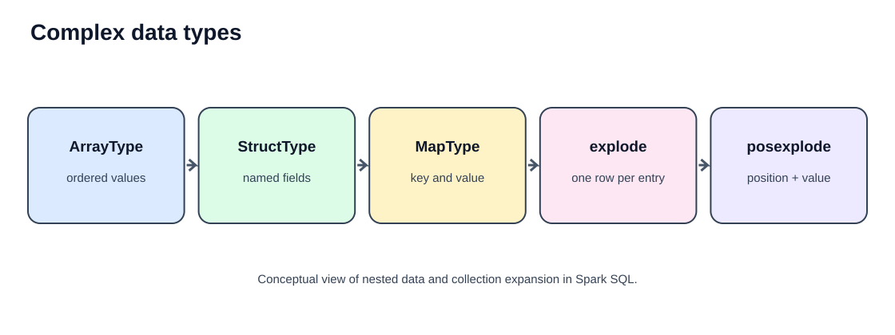
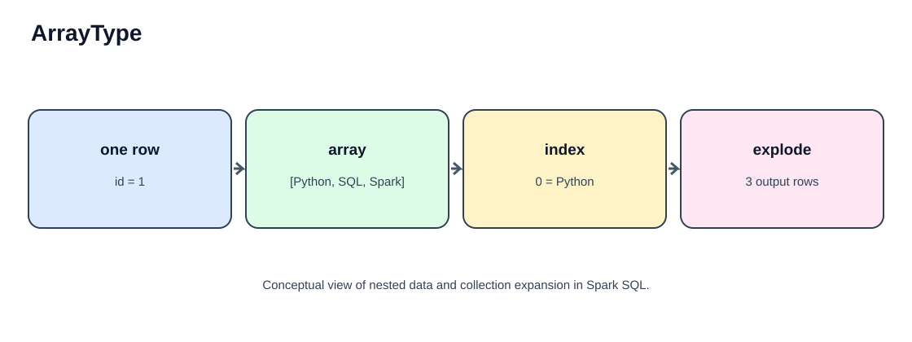
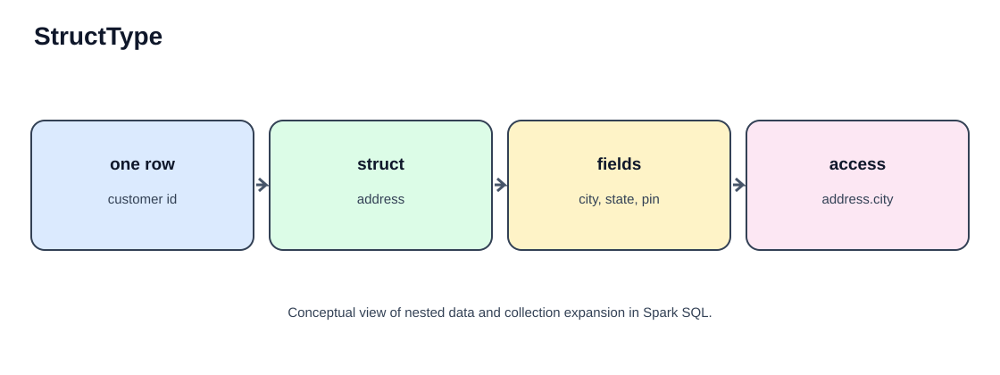
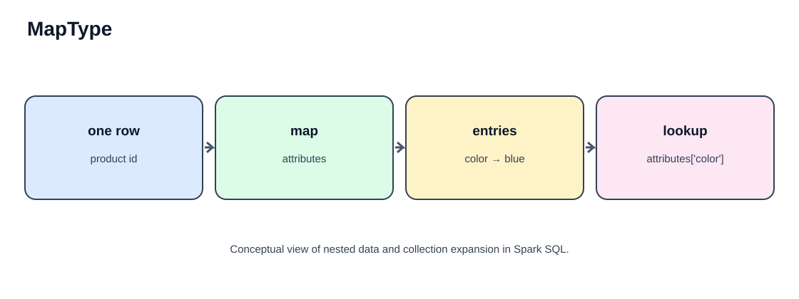
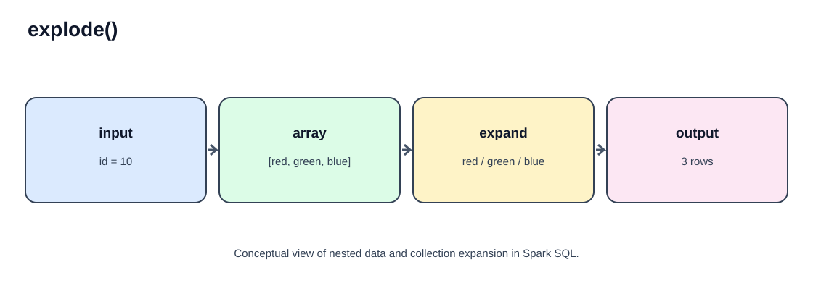
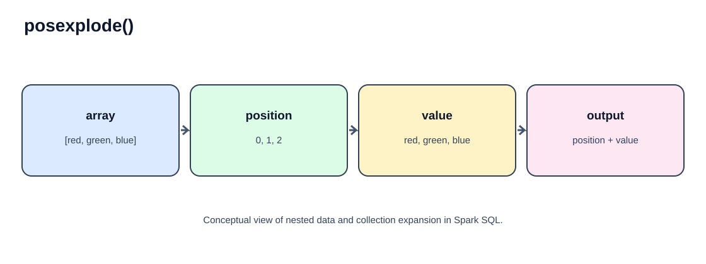
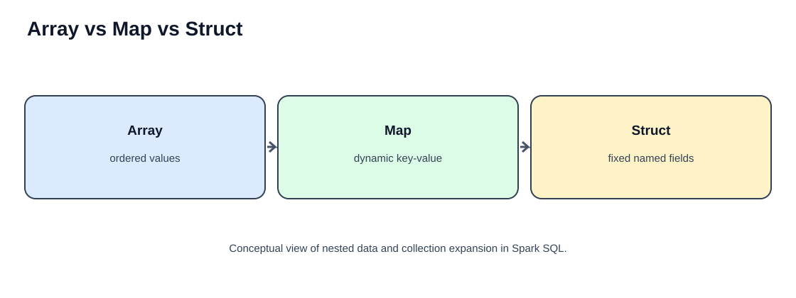
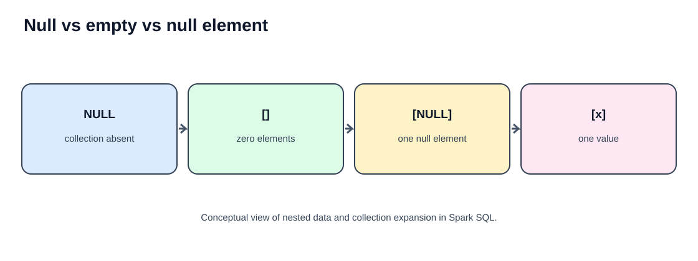

# Part 7 — Complex Data Types in PySpark
## ArrayType, StructType, MapType, explode() and posexplode()

**Complete chapter:** definitions, SVG diagrams, 50 worked examples (10 for each topic), code explanations, expected outputs, ETL patterns, interview questions and assignments.

## Learning objectives

Real-world data often arrives as nested JSON, API responses, event payloads, clickstream records and product metadata. A single row may contain a list of products, a nested customer address, or dynamic key-value attributes.

| Topic | Meaning | Typical use |
|---|---|---|
| `ArrayType` | Ordered collection of same-type elements | Tags, skills, order items |
| `StructType` | Fixed group of named fields | Address, customer profile |
| `MapType` | Key-value collection | Dynamic product attributes |
| `explode()` | One output row per collection element | Flatten arrays/maps |
| `posexplode()` | Position plus element per output row | Preserve array order |



## 0. Setup

```python
from pyspark.sql import SparkSession
from pyspark.sql.functions import (
    col, lit, explode, explode_outer, posexplode, posexplode_outer,
    element_at, size, array, struct, map_keys, map_values, map_entries,
    transform, filter as array_filter, arrays_zip, flatten, sort_array,
    array_contains, create_map, from_json, to_json, when
)
from pyspark.sql.types import (
    StructType, StructField, StringType, IntegerType, DoubleType,
    ArrayType, MapType, BooleanType
)

spark = (
    SparkSession.builder
    .appName("ComplexDataTypes")
    .master("local[*]")
    .getOrCreate()
)
```

**Explanation**
- `SparkSession` is the entry point for DataFrame operations.
- `pyspark.sql.functions` contains built-in expressions for nested columns.
- `pyspark.sql.types` contains schema types.
- `ArrayType`, `StructType`, and `MapType` describe nested column shapes.
- `explode` and `posexplode` are generator functions that expand collection values into rows.

> Output row order is not guaranteed unless you explicitly use `orderBy()`. Map entry order is especially not a reliable business ordering. Minor display differences can occur between Spark versions.

---

# 1. ArrayType

## Definition

`ArrayType` represents an ordered collection of elements stored in one DataFrame column. All elements follow the same declared element type. For example, `ArrayType(StringType())` can store `["Python", "SQL", "Spark"]`.

Important properties:
- Element order is meaningful and retained.
- Array indexing in DataFrame expressions is zero-based (`arr[0]` is the first element).
- An array can be empty (`[]`) or null (`NULL`).
- Individual elements may be null when `containsNull=True`.
- Arrays can be nested, including arrays of structs.



### Create a DataFrame with ArrayType

```python
array_schema = StructType([
    StructField("student_id", IntegerType(), False),
    StructField("student_name", StringType(), True),
    StructField("skills", ArrayType(StringType(), containsNull=True), True)
])

students = [
    (1, "Arun", ["Python", "SQL", "PySpark"]),
    (2, "Bala", ["Java", "SQL"]),
    (3, "Charan", []),
    (4, "Divya", ["Python", None, "Databricks"])
]

students_df = spark.createDataFrame(students, array_schema)
students_df.show(truncate=False)
students_df.printSchema()
```

**Expected data**

```text
+----------+------------+-------------------------------+
|student_id|student_name|skills                         |
+----------+------------+-------------------------------+
|1         |Arun        |[Python, SQL, PySpark]         |
|2         |Bala        |[Java, SQL]                    |
|3         |Charan      |[]                             |
|4         |Divya       |[Python, NULL, Databricks]     |
+----------+------------+-------------------------------+
```

**Schema meaning:** `skills` is an array column; each element is a string and may be null because `containsNull=True`.

## ArrayType — 10 examples

### Example 1 — Define ArrayType explicitly

```python
schema = StructType([
    StructField("id", IntegerType(), False),
    StructField("languages", ArrayType(StringType()), True)
])
data = [(1, ["Python", "SQL"]), (2, ["Java", "Scala"])]
df = spark.createDataFrame(data, schema)
df.show(truncate=False)
df.printSchema()
```

**Code explanation:** The outer `StructType` defines the row. `id` is a non-null integer. `ArrayType(StringType())` defines a list of strings. Each tuple supplies one row, with a Python list in the `languages` field. `printSchema()` confirms Spark's inferred structure.

**Output**
```text
+---+--------------+
|id |languages     |
+---+--------------+
|1  |[Python, SQL] |
|2  |[Java, Scala] |
+---+--------------+
```

### Example 2 — Access array elements by index

```python
df.select(
    "id",
    col("languages")[0].alias("first_language"),
    col("languages")[1].alias("second_language")
).show()
```

**Code explanation:** `col("languages")[0]` accesses the first element and index `1` accesses the second. Spark array indexing here is zero-based. `alias()` gives the selected expressions readable names. An out-of-range index returns null under normal Spark SQL behavior.

**Output**
```text
+---+--------------+---------------+
|id |first_language|second_language|
+---+--------------+---------------+
|1  |Python        |SQL            |
|2  |Java          |Scala          |
+---+--------------+---------------+
```

### Example 3 — Count array elements with size()

```python
df.select("id", size("languages").alias("language_count")).show()
```

**Code explanation:** `size()` returns the number of elements in the array. An empty array has size zero. A null collection is not the same as an empty collection; null handling depends on the input and Spark SQL semantics.

**Output**
```text
+---+--------------+
|id |language_count|
+---+--------------+
|1  |2             |
|2  |2             |
+---+--------------+
```

### Example 4 — Test whether an array contains a value

```python
df.select(
    "id",
    array_contains("languages", "Python").alias("has_python")
).show()
```

**Code explanation:** `array_contains(array, value)` checks whether a matching element exists. It returns true for a match and false when there is no match. If the array itself is null, the result can be null rather than false.

**Output**
```text
+---+----------+
|id |has_python|
+---+----------+
|1  |true      |
|2  |false     |
+---+----------+
```

### Example 5 — Build an array column using array()

```python
df2 = df.withColumn(
    "learning_stack",
    array(lit("Spark"), lit("Python"), lit("SQL"))
)
df2.show(truncate=False)
```

**Code explanation:** `array()` builds an array expression from its arguments. `lit()` converts constant Python values into Spark literal expressions. `withColumn()` adds the resulting array as a new column. Each row receives the same three values in this example.

**Output**
```text
+---+--------------+----------------------+
|id |languages     |learning_stack        |
+---+--------------+----------------------+
|1  |[Python, SQL] |[Spark, Python, SQL]  |
|2  |[Java, Scala] |[Spark, Python, SQL]  |
+---+--------------+----------------------+
```

### Example 6 — Sort an array

```python
df.select(
    "id",
    sort_array("languages").alias("sorted_languages")
).show(truncate=False)
```

**Code explanation:** `sort_array()` returns a new array sorted in ascending order by default. String values are sorted lexicographically. It does not modify the original DataFrame column.

**Output**
```text
+---+----------------+
|id |sorted_languages|
+---+----------------+
|1  |[Python, SQL]   |
|2  |[Java, Scala]   |
+---+----------------+
```

### Example 7 — Transform every array element

```python
df.select(
    "id",
    transform("languages", lambda x: x.upper()).alias("upper_languages")
).show(truncate=False)
```

**Code explanation:** `transform()` applies a Spark SQL lambda expression to each element. `x` is the current string element and `x.upper()` converts it to uppercase. The result is a new array with the same order and number of elements. This is a Spark expression, not a Python loop over collected data.

**Output**
```text
+---+----------------+
|id |upper_languages|
+---+----------------+
|1  |[PYTHON, SQL]  |
|2  |[JAVA, SCALA]  |
+---+----------------+
```

### Example 8 — Filter values inside an array

```python
df.select(
    "id",
    array_filter("languages", lambda x: x != "SQL").alias("without_sql")
).show(truncate=False)
```

**Code explanation:** We imported Spark's `filter` function under the Python name `array_filter` to avoid shadowing Python's built-in `filter`. The lambda is checked for every element; elements satisfying the condition remain. Their original relative order is preserved.

**Output**
```text
+---+-------------+
|id |without_sql  |
+---+-------------+
|1  |[Python]     |
|2  |[Java, Scala]|
+---+-------------+
```

### Example 9 — Zip two arrays position by position

```python
marks_df = spark.createDataFrame(
    [(1, ["Math", "Science"], [90, 85]),
     (2, ["English", "History"], [88, 92])],
    ["student_id", "subjects", "marks"]
)
marks_df.select(
    "student_id",
    arrays_zip("subjects", "marks").alias("subject_marks")
).show(truncate=False)
```

**Code explanation:** `arrays_zip()` pairs elements at matching positions. It returns an array of structs; each struct contains a subject and its corresponding mark. If arrays have different lengths, shorter arrays are padded with nulls in the zipped output.

**Output**
```text
+----------+--------------------------------------+
|student_id|subject_marks                         |
+----------+--------------------------------------+
|1         |[{Math, 90}, {Science, 85}]            |
|2         |[{English, 88}, {History, 92}]         |
+----------+--------------------------------------+
```

### Example 10 — Flatten one level of nested arrays

```python
nested_df = spark.createDataFrame(
    [(1, [["Python", "SQL"], ["Spark", "Databricks"]])],
    ["id", "skill_groups"]
)
nested_df.select(
    "id", flatten("skill_groups").alias("all_skills")
).show(truncate=False)
```

**Code explanation:** The input is an array of arrays. `flatten()` removes one level of nesting and concatenates the inner array elements into one array. It does not recursively flatten arbitrary levels.

**Output**
```text
+---+--------------------------------+
|id |all_skills                      |
+---+--------------------------------+
|1  |[Python, SQL, Spark, Databricks]|
+---+--------------------------------+
```

---

# 2. StructType

## Definition

`StructType` represents a nested record containing multiple named fields. Each field can have a different type. It is similar to a JSON object with a known schema. For example, an `address` struct may contain `door_no`, `street`, `city` and `pincode`.

- Fields have names and declared data types.
- A struct can contain another struct, array or map.
- Access nested fields with dot notation (`address.city`) or `getField()`.
- A struct represents a fixed schema, unlike a map whose keys can vary.



### Create a StructType DataFrame

```python
address_schema = StructType([
    StructField("door_no", StringType(), True),
    StructField("street", StringType(), True),
    StructField("city", StringType(), True),
    StructField("pincode", IntegerType(), True)
])
customer_schema = StructType([
    StructField("customer_id", IntegerType(), False),
    StructField("customer_name", StringType(), True),
    StructField("address", address_schema, True)
])
customer_data = [
    (1, "Arun", ("12A", "Anna Salai", "Chennai", 600002)),
    (2, "Bala", ("44B", "MG Road", "Bangalore", 560001))
]
customers_df = spark.createDataFrame(customer_data, customer_schema)
customers_df.show(truncate=False)
customers_df.printSchema()
```

**Output (conceptual)**

```text
+-----------+-------------+--------------------------------------+
|customer_id|customer_name|address                               |
+-----------+-------------+--------------------------------------+
|1          |Arun         |{12A, Anna Salai, Chennai, 600002}    |
|2          |Bala         |{44B, MG Road, Bangalore, 560001}     |
+-----------+-------------+--------------------------------------+
```

## StructType — 10 examples

### Example 1 — Define a nested struct schema

```python
schema = StructType([
    StructField("id", IntegerType(), False),
    StructField("profile", StructType([
        StructField("name", StringType(), True),
        StructField("age", IntegerType(), True)
    ]), True)
])
data = [(1, ("Arun", 25)), (2, ("Bala", 30))]
df = spark.createDataFrame(data, schema)
df.show(truncate=False)
df.printSchema()
```

**Explanation:** The outer `StructType` defines each DataFrame row. The `profile` field is another `StructType`, containing `name` and `age`. Each row supplies the nested struct as a tuple. `printSchema()` displays the hierarchy.

**Output**
```text
+---+----------+
|id |profile   |
+---+----------+
|1  |{Arun, 25}|
|2  |{Bala, 30}|
+---+----------+
```

### Example 2 — Access nested fields with dot notation

```python
df.select(
    "id",
    col("profile.name").alias("person_name"),
    col("profile.age").alias("person_age")
).show()
```

**Explanation:** `profile.name` addresses the `name` field inside the `profile` struct; `profile.age` addresses the age field. Aliases give the flattened output columns clear names.

**Output**
```text
+---+-----------+----------+
|id |person_name|person_age|
+---+-----------+----------+
|1  |Arun       |25        |
|2  |Bala       |30        |
+---+-----------+----------+
```

### Example 3 — Access a field with getField()

```python
df.select(
    col("profile").getField("name").alias("name")
).show()
```

**Explanation:** `getField("name")` selects a named field from a struct column. It is an explicit alternative to dot notation and is useful when building expressions programmatically.

**Output**
```text
+----+
|name|
+----+
|Arun|
|Bala|
+----+
```

### Example 4 — Select the complete struct

```python
df.select("id", "profile").show(truncate=False)
```

**Explanation:** Selecting the struct column returns the entire nested record as one column. The fields remain grouped together rather than being flattened.

**Output**
```text
+---+----------+
|id |profile   |
+---+----------+
|1  |{Arun, 25}|
|2  |{Bala, 30}|
+---+----------+
```

### Example 5 — Create a struct using struct()

```python
simple_df = spark.createDataFrame(
    [(1, "Arun", "Chennai"), (2, "Bala", "Bangalore")],
    ["id", "name", "city"]
)
structured_df = simple_df.select(
    "id",
    struct(
        col("name").alias("customer_name"),
        col("city").alias("customer_city")
    ).alias("customer")
)
structured_df.show(truncate=False)
```

**Explanation:** `struct()` groups the `name` and `city` expressions into one nested column. The aliases become the nested field names. This is useful when creating nested output for JSON or downstream systems.

**Output**
```text
+---+----------------------+
|id |customer              |
+---+----------------------+
|1  |{Arun, Chennai}       |
|2  |{Bala, Bangalore}     |
+---+----------------------+
```

### Example 6 — Add a field by rebuilding the struct

```python
updated_df = structured_df.withColumn(
    "customer",
    struct(
        col("customer.customer_name").alias("customer_name"),
        col("customer.customer_city").alias("customer_city"),
        lit("ACTIVE").alias("customer_status")
    )
)
updated_df.show(truncate=False)
```

**Explanation:** The expression rebuilds the `customer` struct. It copies the two existing nested fields and adds a constant status using `lit()`. `withColumn()` replaces the old struct column with the new struct.

**Output**
```text
+---+--------------------------------+
|id |customer                        |
+---+--------------------------------+
|1  |{Arun, Chennai, ACTIVE}         |
|2  |{Bala, Bangalore, ACTIVE}       |
+---+--------------------------------+
```

### Example 7 — Filter using a nested field

```python
df.filter(
    col("profile.age") >= 28
).select(
    "id",
    col("profile.name").alias("name"),
    col("profile.age").alias("age")
).show()
```

**Explanation:** The filter evaluates the nested `age` field. Only rows with age 28 or above remain. The following select flattens the name and age into ordinary output columns.

**Output**
```text
+---+----+---+
|id |name|age|
+---+----+---+
|2  |Bala|30 |
+---+----+---+
```

### Example 8 — Update a nested value

```python
renamed_df = df.withColumn(
    "profile",
    struct(
        col("profile.name").alias("name"),
        (col("profile.age") + 1).alias("age")
    )
)
renamed_df.show(truncate=False)
```

**Explanation:** This portable pattern rebuilds the struct rather than trying to mutate a nested field in place. The name is preserved and one is added to age. The new struct replaces the old `profile` column.

**Output**
```text
+---+----------+
|id |profile   |
+---+----------+
|1  |{Arun, 26}|
|2  |{Bala, 31}|
+---+----------+
```

### Example 9 — Access an array nested inside a struct

```python
nested_schema = StructType([
    StructField("id", IntegerType(), False),
    StructField("profile", StructType([
        StructField("name", StringType(), True),
        StructField("skills", ArrayType(StringType()), True)
    ]), True)
])
nested_data = [
    (1, ("Arun", ["Python", "SQL"])),
    (2, ("Bala", ["Java", "Spark"]))
]
nested_df = spark.createDataFrame(nested_data, nested_schema)
nested_df.select(
    "id",
    col("profile.name").alias("name"),
    col("profile.skills")[0].alias("first_skill")
).show()
```

**Explanation:** A struct field can itself be an array. `profile.skills` accesses the nested array and `[0]` retrieves its first element. Nested structures can therefore combine multiple complex types.

**Output**
```text
+---+----+-----------+
|id |name|first_skill|
+---+----+-----------+
|1  |Arun|Python     |
|2  |Bala|Java       |
+---+----+-----------+
```

### Example 10 — Convert a struct to JSON

```python
structured_df.select(
    "id",
    to_json("customer").alias("customer_json")
).show(truncate=False)
```

**Explanation:** `to_json()` serializes a struct expression as JSON text. The output column is a string, not a StructType column. This is useful when a downstream API or file expects JSON payloads.

**Output**
```text
+---+--------------------------------------------------------------+
|id |customer_json                                                 |
+---+--------------------------------------------------------------+
|1  |{"customer_name":"Arun","customer_city":"Chennai"}             |
|2  |{"customer_name":"Bala","customer_city":"Bangalore"}           |
+---+--------------------------------------------------------------+
```

---

# 3. MapType

## Definition

`MapType` represents a collection of key-value pairs in one column. It is useful when each row has dynamic attributes whose names may vary, such as product metadata or event properties.

A MapType declares:
- key data type;
- value data type;
- whether values may be null (`valueContainsNull`).

Keys are unique within a map. A map is not an ordered list; do not rely on key iteration order for business logic.



### Create a MapType DataFrame

```python
map_schema = StructType([
    StructField("product_id", IntegerType(), False),
    StructField(
        "attributes",
        MapType(StringType(), StringType(), valueContainsNull=True),
        True
    )
])
products = [
    (101, {"color": "Blue", "size": "M", "brand": "Acme"}),
    (102, {"color": "Black", "size": "L", "brand": "Nova"}),
    (103, {"color": "Red", "material": "Cotton"})
]
products_df = spark.createDataFrame(products, map_schema)
products_df.show(truncate=False)
products_df.printSchema()
```

**Output**
```text
+----------+----------------------------------------------+
|product_id|attributes                                   |
+----------+----------------------------------------------+
|101       |{color -> Blue, size -> M, brand -> Acme}     |
|102       |{color -> Black, size -> L, brand -> Nova}    |
|103       |{color -> Red, material -> Cotton}            |
+----------+----------------------------------------------+
```

## MapType — 10 examples

### Example 1 — Define MapType explicitly

```python
schema = StructType([
    StructField("id", IntegerType(), False),
    StructField("metadata", MapType(StringType(), StringType()), True)
])
data = [
    (1, {"department": "IT", "level": "Senior"}),
    (2, {"department": "HR", "level": "Junior"})
]
df = spark.createDataFrame(data, schema)
df.show(truncate=False)
df.printSchema()
```

**Explanation:** `MapType(StringType(), StringType())` means every map key and value is a string. Each row supplies a Python dictionary. Spark converts it into a typed map column.

**Output**
```text
+---+-----------------------------------+
|id |metadata                           |
+---+-----------------------------------+
|1  |{department -> IT, level -> Senior}|
|2  |{department -> HR, level -> Junior}|
+---+-----------------------------------+
```

### Example 2 — Look up a map value by key

```python
df.select(
    "id",
    col("metadata")["department"].alias("department")
).show()
```

**Explanation:** The bracket expression looks up the value for the `department` key. If a row does not contain that key, the lookup returns null.

**Output**
```text
+---+----------+
|id |department|
+---+----------+
|1  |IT        |
|2  |HR        |
+---+----------+
```

### Example 3 — Use element_at() for map lookup

```python
df.select(
    "id",
    element_at("metadata", lit("level")).alias("level")
).show()
```

**Explanation:** `element_at()` retrieves a map value using the key expression. `lit("level")` supplies the key as a Spark literal. Missing keys return null. Note that array indexing semantics for `element_at()` differ from map lookup semantics.

**Output**
```text
+---+------+
|id |level |
+---+------+
|1  |Senior|
|2  |Junior|
+---+------+
```

### Example 4 — Extract map keys

```python
df.select("id", map_keys("metadata").alias("keys")).show(truncate=False)
```

**Explanation:** `map_keys()` returns an array containing the keys. The result type is an array of the map's key type. The order of keys is not a stable business guarantee.

**Output (order may vary)**
```text
+---+----------------------+
|id |keys                  |
+---+----------------------+
|1  |[department, level]   |
|2  |[department, level]   |
+---+----------------------+
```

### Example 5 — Extract map values

```python
df.select("id", map_values("metadata").alias("values")).show(truncate=False)
```

**Explanation:** `map_values()` returns an array of the map's values. Do not assume a particular order; if a specific value is required, retrieve it using its key.

**Output (order may vary)**
```text
+---+----------------+
|id |values          |
+---+----------------+
|1  |[IT, Senior]    |
|2  |[HR, Junior]    |
+---+----------------+
```

### Example 6 — Count map entries

```python
df.select("id", size("metadata").alias("attribute_count")).show()
```

**Explanation:** `size()` counts key-value pairs when the input is a map. It does not count characters or nested values.

**Output**
```text
+---+---------------+
|id |attribute_count|
+---+---------------+
|1  |2              |
|2  |2              |
+---+---------------+
```

### Example 7 — Construct a map using create_map()

```python
map_df = spark.createDataFrame(
    [(1, "Blue", "M"), (2, "Black", "L")],
    ["id", "color", "size"]
)
map_df = map_df.withColumn(
    "attributes",
    create_map(
        lit("color"), col("color"),
        lit("size"), col("size")
    )
)
map_df.select("id", "attributes").show(truncate=False)
```

**Explanation:** `create_map()` accepts alternating key and value expressions. The first pair creates the `color` entry and the second pair creates the `size` entry. Each row gets a map built from its own column values.

**Output**
```text
+---+------------------------------+
|id |attributes                    |
+---+------------------------------+
|1  |{color -> Blue, size -> M}    |
|2  |{color -> Black, size -> L}   |
+---+------------------------------+
```

### Example 8 — Convert a map to an array of key-value structs

```python
df.select(
    "id",
    map_entries("metadata").alias("entries")
).show(truncate=False)
```

**Explanation:** `map_entries()` returns an array of structs. Each struct contains `key` and `value` fields. This is useful when you want to apply array operations or explode key-value pairs.

**Output (entry order may vary)**
```text
+---+---------------------------------------------+
|id |entries                                      |
+---+---------------------------------------------+
|1  |[{department, IT}, {level, Senior}]          |
|2  |[{department, HR}, {level, Junior}]          |
+---+---------------------------------------------+
```

### Example 9 — Filter rows using a map value

```python
df.filter(
    col("metadata")["department"] == "IT"
).show(truncate=False)
```

**Explanation:** The expression looks up the department value for each row. The filter keeps only rows where it equals `IT`. A missing key produces null and does not satisfy the equality condition.

**Output**
```text
+---+-----------------------------------+
|id |metadata                           |
+---+-----------------------------------+
|1  |{department -> IT, level -> Senior}|
+---+-----------------------------------+
```

### Example 10 — Convert a map to JSON

```python
df.select(
    "id",
    to_json("metadata").alias("metadata_json")
).show(truncate=False)
```

**Explanation:** `to_json()` serializes the map to a JSON string. The result is a string column. JSON object property order should not be used as a business ordering.

**Output (property order may vary)**
```text
+---+---------------------------------------------+
|id |metadata_json                                |
+---+---------------------------------------------+
|1  |{"department":"IT","level":"Senior"}         |
|2  |{"department":"HR","level":"Junior"}          |
+---+---------------------------------------------+
```

---

# 4. explode()

## Definition

`explode()` is a Spark SQL generator function. It takes an array or map column and produces a separate output row for each element or map entry.

For an array:
- An input row with three elements produces three output rows.
- Other selected columns are repeated for each generated element.
- An empty or null array produces no rows with ordinary `explode()`.

For a map, it generates one row per key-value entry, with two output columns.



### Basic example

```python
orders_df = spark.createDataFrame(
    [(1001, ["PEN", "BOOK", "BAG"]),
     (1002, ["MOUSE", "KEYBOARD"])],
    ["order_id", "items"]
)
orders_df.select(
    "order_id",
    explode("items").alias("item")
).show()
```

**Output**
```text
+--------+--------+
|order_id|item    |
+--------+--------+
|1001    |PEN     |
|1001    |BOOK    |
|1001    |BAG     |
|1002    |MOUSE   |
|1002    |KEYBOARD|
+--------+--------+
```

## explode() — 10 examples

### Example 1 — Explode a simple array

```python
df = spark.createDataFrame(
    [(1, ["Python", "SQL"]), (2, ["Java", "Spark"])],
    ["id", "skills"]
)
df.select("id", explode("skills").alias("skill")).show()
```

**Explanation:** Each input row has an array. `explode()` emits one row for each element. The `id` value is repeated for every generated skill, and `alias()` names the generated column.

**Output**
```text
+---+------+
|id |skill |
+---+------+
|1  |Python|
|1  |SQL   |
|2  |Java  |
|2  |Spark |
+---+------+
```

### Example 2 — Explode an array of structs

```python
item_type = ArrayType(StructType([
    StructField("sku", StringType(), True),
    StructField("qty", IntegerType(), True)
]))
schema = StructType([
    StructField("order_id", IntegerType(), False),
    StructField("items", item_type, True)
])
df = spark.createDataFrame(
    [(1, [("P101", 2), ("P102", 1)]), (2, [("P103", 5)])],
    schema
)
expanded = df.select("order_id", explode("items").alias("item"))
expanded.select(
    "order_id",
    col("item.sku").alias("sku"),
    col("item.qty").alias("quantity")
).show()
```

**Explanation:** `items` is an array of structs. `explode()` emits one struct per row. Dot notation accesses `sku` and `qty` from the generated `item` struct. This is a standard pattern for nested order JSON.

**Output**
```text
+--------+----+--------+
|order_id|sku |quantity|
+--------+----+--------+
|1       |P101|2       |
|1       |P102|1       |
|2       |P103|5       |
+--------+----+--------+
```

### Example 3 — Explode a map

```python
df = spark.createDataFrame(
    [(1, {"color": "Blue", "size": "M"}),
     (2, {"color": "Black", "size": "L"})],
    ["product_id", "attributes"]
)
df.select(
    "product_id",
    explode("attributes").alias("attribute_name", "attribute_value")
).show()
```

**Explanation:** When the input is a map, `explode()` produces both the key and value. The two aliases name the generated columns. One product with two map entries becomes two rows.

**Output (map entry order may vary)**
```text
+----------+--------------+---------------+
|product_id|attribute_name|attribute_value|
+----------+--------------+---------------+
|1         |color         |Blue           |
|1         |size          |M              |
|2         |color         |Black          |
|2         |size          |L              |
+----------+--------------+---------------+
```

### Example 4 — Filter parent rows before exploding

```python
df = spark.createDataFrame(
    [(1, "ACTIVE", ["A", "B"]),
     (2, "INACTIVE", ["C"]),
     (3, "ACTIVE", ["D", "E"])],
    ["id", "status", "codes"]
)
df.filter(col("status") == "ACTIVE").select(
    "id", explode("codes").alias("code")
).show()
```

**Explanation:** First the filter keeps active parent records. Then `explode()` expands their arrays. Filtering early can reduce the number of generated rows and the amount of downstream processing.

**Output**
```text
+---+----+
|id |code|
+---+----+
|1  |A   |
|1  |B   |
|3  |D   |
|3  |E   |
+---+----+
```

### Example 5 — Sequentially explode two arrays

```python
df = spark.createDataFrame(
    [(1, ["red", "blue"], ["S", "M"])],
    ["id", "colors", "sizes"]
)
colors_expanded = df.select(
    "id", explode("colors").alias("color")
)
result = colors_expanded.select(
    "id", "color",
    explode(array(lit("S"), lit("M"))).alias("size")
)
result.show()
```

**Explanation:** The first explosion creates one row per color. The second explosion creates two size rows for each color. This produces a Cartesian combination: two colors multiplied by two sizes equals four rows. This multiplication is a common source of unexpected row growth.

**Output**
```text
+---+-----+----+
|id |color|size|
+---+-----+----+
|1  |red  |S   |
|1  |red  |M   |
|1  |blue |S   |
|1  |blue |M   |
+---+-----+----+
```

### Example 6 — Preserve empty/null arrays with explode_outer()

```python
df = spark.createDataFrame(
    [(1, ["A", "B"]), (2, []), (3, None)],
    ["id", "values"]
)
df.select("id", explode_outer("values").alias("value")).show()
```

**Explanation:** Ordinary `explode()` drops rows where the collection is empty or null. `explode_outer()` preserves the parent row and produces a null generated value for those cases. Use it when parent records must not disappear during flattening.

**Output**
```text
+---+-----+
|id |value|
+---+-----+
|1  |A    |
|1  |B    |
|2  |NULL |
|3  |NULL |
+---+-----+
```

### Example 7 — Explode an array nested inside a struct

```python
schema = StructType([
    StructField("order_id", IntegerType(), False),
    StructField("details", StructType([
        StructField("customer", StringType(), True),
        StructField("items", ArrayType(StringType()), True)
    ]), True)
])
df = spark.createDataFrame(
    [(10, ("Arun", ["Pen", "Book"])), (11, ("Bala", ["Bag"]))],
    schema
)
df.select(
    "order_id",
    col("details.customer").alias("customer"),
    explode("details.items").alias("item")
).show()
```

**Explanation:** `details` is a struct. The customer field is selected with dot notation and `details.items` accesses the nested array. `explode()` creates one row per nested item while preserving the order ID and customer name.

**Output**
```text
+--------+--------+----+
|order_id|customer|item|
+--------+--------+----+
|10      |Arun    |Pen |
|10      |Arun    |Book|
|11      |Bala    |Bag |
+--------+--------+----+
```

### Example 8 — Explode and count item frequency

```python
df = spark.createDataFrame(
    [(1, ["Pen", "Book", "Pen"]), (2, ["Book", "Bag"])],
    ["order_id", "items"]
)
item_counts = (
    df.select(explode("items").alias("item"))
      .groupBy("item")
      .count()
      .orderBy("item")
)
item_counts.show()
```

**Explanation:** `explode()` turns all item arrays into one stream of item rows. `groupBy()` groups equal item names, `count()` counts occurrences, and `orderBy()` makes the output order deterministic.

**Output**
```text
+----+-----+
|item|count|
+----+-----+
|Bag |1    |
|Book|2    |
|Pen |2    |
+----+-----+
```

### Example 9 — Explode and calculate line-level revenue

```python
schema = StructType([
    StructField("order_id", IntegerType(), False),
    StructField("items", ArrayType(StructType([
        StructField("sku", StringType(), True),
        StructField("qty", IntegerType(), True),
        StructField("price", DoubleType(), True)
    ])), True)
])
df = spark.createDataFrame(
    [(1, [("A1", 2, 100.0), ("B2", 1, 250.0)]),
     (2, [("A1", 3, 100.0)])],
    schema
)
lines = df.select("order_id", explode("items").alias("item"))
lines.select(
    "order_id",
    col("item.sku").alias("sku"),
    col("item.qty").alias("qty"),
    (col("item.qty") * col("item.price")).alias("line_revenue")
).show()
```

**Explanation:** Each array element is a line-item struct. Exploding creates one row per item. The code extracts SKU and quantity, then multiplies quantity by unit price to calculate line revenue.

**Output**
```text
+--------+---+---+------------+
|order_id|sku|qty|line_revenue|
+--------+---+---+------------+
|1       |A1 |2  |200.0       |
|1       |B2 |1  |250.0       |
|2       |A1 |3  |300.0       |
+--------+---+---+------------+
```

### Example 10 — Parse JSON and explode an array

```python
json_df = spark.createDataFrame(
    [(1, '{"customer":"Arun","tags":["new","premium"]}'),
     (2, '{"customer":"Bala","tags":["returning"]}')],
    ["id", "payload"]
)
payload_schema = StructType([
    StructField("customer", StringType(), True),
    StructField("tags", ArrayType(StringType()), True)
])
parsed = json_df.withColumn("data", from_json("payload", payload_schema))
parsed.select(
    "id",
    col("data.customer").alias("customer"),
    explode("data.tags").alias("tag")
).show()
```

**Explanation:** `from_json()` parses JSON text according to the declared schema. The parsed result is a struct named `data`. Dot notation selects the customer and tags fields. `explode()` turns each tag into its own row. In production, validate malformed JSON because parsing failures can result in null values.

**Output**
```text
+---+--------+---------+
|id |customer|tag      |
+---+--------+---------+
|1  |Arun    |new      |
|1  |Arun    |premium  |
|2  |Bala    |returning|
+---+--------+---------+
```

---

# 5. posexplode()

## Definition

`posexplode()` behaves like `explode()` but also returns the position of each array element. The position starts at zero.

For `["Pen", "Book", "Bag"]`, the result is:

```text
position | value
0        | Pen
1        | Book
2        | Bag
```

Use it when order matters: event sequences, recommendation rankings, survey answer positions, ordered steps and order line numbers.



For a map input, `posexplode()` returns a position plus key and value, but map iteration order is not guaranteed. The position is most useful with arrays.

## posexplode() — 10 examples

### Example 1 — Basic posexplode

```python
df = spark.createDataFrame(
    [(1, ["Pen", "Book", "Bag"])],
    ["id", "items"]
)
df.select(
    "id",
    posexplode("items").alias("position", "item")
).show()
```

**Explanation:** `posexplode()` emits one row per element and adds two generated columns: zero-based position and value. The original ID repeats for every generated row.

**Output**
```text
+---+--------+----+
|id |position|item|
+---+--------+----+
|1  |0       |Pen |
|1  |1       |Book|
|1  |2       |Bag |
+---+--------+----+
```

### Example 2 — Preserve item order across multiple orders

```python
df = spark.createDataFrame(
    [(100, ["A", "B", "C"]), (200, ["X", "Y"])],
    ["order_id", "items"]
)
df.select(
    "order_id",
    posexplode("items").alias("item_position", "item")
).orderBy("order_id", "item_position").show()
```

**Explanation:** Position is local to each input array. Sorting by order ID and then position presents each order's items in their original sequence. Without `orderBy()`, Spark does not guarantee the display order of rows.

**Output**
```text
+--------+-------------+----+
|order_id|item_position|item|
+--------+-------------+----+
|100     |0            |A   |
|100     |1            |B   |
|100     |2            |C   |
|200     |0            |X   |
|200     |1            |Y   |
+--------+-------------+----+
```

### Example 3 — Select the first element using its position

```python
df.select(
    "order_id",
    posexplode("items").alias("pos", "item")
).filter(col("pos") == 0).show()
```

**Explanation:** The generator emits all positions. The filter keeps only position zero, which is the first element of each non-empty array. Direct indexing is simpler if only the first value is needed; this pattern is useful when you are already expanding the array.

**Output**
```text
+--------+---+----+
|order_id|pos|item|
+--------+---+----+
|100     |0  |A   |
|200     |0  |X   |
+--------+---+----+
```

### Example 4 — Generate one-based order line numbers

```python
df = spark.createDataFrame(
    [(501, ["SKU-A", "SKU-B"]), (502, ["SKU-C"])],
    ["order_id", "skus"]
)
expanded = df.select(
    "order_id",
    posexplode("skus").alias("pos", "sku")
)
expanded.select(
    "order_id",
    (col("pos") + 1).alias("line_number"),
    "sku"
).orderBy("order_id", "line_number").show()
```

**Explanation:** The first step creates one row per SKU and retains the zero-based position. The second step adds one to convert the position into a human-friendly one-based line number. Notice that the generator is called only once.

**Output**
```text
+--------+-----------+-----+
|order_id|line_number|sku  |
+--------+-----------+-----+
|501     |1          |SKU-A|
|501     |2          |SKU-B|
|502     |1          |SKU-C|
+--------+-----------+-----+
```

### Example 5 — Find the position of a particular value

```python
df = spark.createDataFrame(
    [(1, ["SQL", "Python", "Spark"]), (2, ["Java", "Scala"])],
    ["id", "skills"]
)
df.select(
    "id",
    posexplode("skills").alias("position", "skill")
).filter(col("skill") == "Spark").show()
```

**Explanation:** `posexplode()` creates position and skill columns. Filtering for `Spark` leaves its position in the original array. Here the zero-based position is two.

**Output**
```text
+---+--------+-----+
|id |position|skill|
+---+--------+-----+
|1  |2       |Spark|
+---+--------+-----+
```

### Example 6 — Preserve empty arrays with posexplode_outer()

```python
df = spark.createDataFrame(
    [(1, ["A", "B"]), (2, []), (3, None)],
    ["id", "values"]
)
df.select(
    "id",
    posexplode_outer("values").alias("position", "value")
).show()
```

**Explanation:** `posexplode_outer()` retains parent rows even when the collection is empty or null. For real elements it returns their position and value. For empty/null collections, both generated columns are null.

**Output**
```text
+---+--------+-----+
|id |position|value|
+---+--------+-----+
|1  |0       |A    |
|1  |1       |B    |
|2  |NULL    |NULL |
|3  |NULL    |NULL |
+---+--------+-----+
```

### Example 7 — posexplode an array of structs

```python
item_type = ArrayType(StructType([
    StructField("sku", StringType(), True),
    StructField("qty", IntegerType(), True)
]))
schema = StructType([
    StructField("order_id", IntegerType(), False),
    StructField("items", item_type, True)
])
df = spark.createDataFrame(
    [(1, [("A1", 2), ("B2", 5)])],
    schema
)
expanded = df.select(
    "order_id",
    posexplode("items").alias("position", "item")
)
expanded.select(
    "order_id", "position",
    col("item.sku").alias("sku"),
    col("item.qty").alias("qty")
).show()
```

**Explanation:** Each element is a struct. `posexplode()` returns its position and the entire struct. Nested field access then extracts SKU and quantity while preserving the item's original order.

**Output**
```text
+--------+--------+---+---+
|order_id|position|sku|qty|
+--------+--------+---+---+
|1       |0       |A1 |2  |
|1       |1       |B2 |5  |
+--------+--------+---+---+
```

### Example 8 — Compare each event with the previous event

```python
df = spark.createDataFrame(
    [(1, ["START", "PAYMENT", "PACKED", "SHIPPED"])],
    ["order_id", "events"]
)
expanded = df.select(
    "order_id", "events",
    posexplode("events").alias("pos", "event")
)
expanded.select(
    "order_id", "pos", "event",
    when(col("pos") == 0, lit(None))
      .otherwise(col("events")[col("pos") - 1])
      .alias("previous_event")
).orderBy("pos").show()
```

**Explanation:** The original array is deliberately retained alongside the generated rows. `pos` tells us which element is current. For the first element there is no previous event; otherwise the expression reads the element at `pos - 1`. Sorting by position displays the sequence correctly.

**Output**
```text
+--------+---+-------+-------------+
|order_id|pos|event  |previous_event|
+--------+---+-------+-------------+
|1       |0  |START  |NULL         |
|1       |1  |PAYMENT|START        |
|1       |2  |PACKED |PAYMENT      |
|1       |3  |SHIPPED|PACKED       |
+--------+---+-------+-------------+
```

### Example 9 — Apply a position-based discount

```python
df = spark.createDataFrame(
    [(1, [100.0, 200.0, 300.0])],
    ["order_id", "prices"]
)
expanded = df.select(
    "order_id",
    posexplode("prices").alias("pos", "price")
)
expanded.select(
    "order_id",
    (col("pos") + 1).alias("item_number"),
    "price",
    when(col("pos") == 0, col("price") * 0.10)
      .otherwise(col("price") * 0.05)
      .alias("discount")
).orderBy("item_number").show()
```

**Explanation:** The generator retains the original position. `pos + 1` produces a one-based item number. `when()` applies a 10% discount to the first item and 5% to subsequent items. This is an illustrative business rule.

**Output**
```text
+--------+-----------+-----+--------+
|order_id|item_number|price|discount|
+--------+-----------+-----+--------+
|1       |1          |100.0|10.0    |
|1       |2          |200.0|10.0    |
|1       |3          |300.0|15.0    |
+--------+-----------+-----+--------+
```

### Example 10 — posexplode map entries

```python
df = spark.createDataFrame(
    [(1, {"color": "Blue", "size": "M"})],
    ["id", "attributes"]
)
entries = df.select(
    "id",
    posexplode(map_entries("attributes")).alias("position", "entry")
)
entries.select(
    "id", "position",
    col("entry.key").alias("attribute"),
    col("entry.value").alias("value")
).show()
```

**Explanation:** `map_entries()` converts a map into an array of key-value structs. `posexplode()` expands that array and adds a position. `entry.key` and `entry.value` access each pair. Map iteration order is not guaranteed, so do not use this position as a stable business sequence.

**Output (entry order and positions may vary)**
```text
+---+--------+---------+-----+
|id |position|attribute|value|
+---+--------+---------+-----+
|1  |0       |color    |Blue |
|1  |1       |size     |M    |
+---+--------+---------+-----+
```

---

# 6. Compare the types and generator functions



| Type/function | What it represents or returns | Use it when |
|---|---|---|
| `ArrayType(T)` | Ordered list of elements of type T | Position/order matters |
| `StructType([...])` | Fixed named fields, possibly different types | Record has a known shape |
| `MapType(K, V)` | Key-value pairs | Attribute keys may vary |
| `explode(array)` | One output row per element | Need one row per item |
| `explode(map)` | One output row per key-value pair | Need key and value columns |
| `posexplode(array)` | Position and element per row | Need to preserve array index |
| `explode_outer()` | Like explode, retains empty/null parent rows | Parent record must not disappear |
| `posexplode_outer()` | Position/value plus outer behavior | Need position and parent retention |

## Null, empty and null-element differences



These four states are different:

| Value | Meaning | `size()` idea | `explode()` behavior |
|---|---|---:|---|
| `NULL` | Collection itself is absent | Null/setting-dependent | No output rows |
| `[]` | Collection exists with zero elements | 0 | No output rows |
| `[NULL]` | One element exists, and it is null | 1 | One row containing null |
| `["A"]` | One real element | 1 | One row containing A |

`explode_outer()` preserves a parent row for a null or empty collection by producing a null generated value. An array containing a null element already produces one row with a null element using ordinary `explode()`.

## Important distinction: Array of structs vs struct containing an array

**Array of structs**

```python
ArrayType(StructType([
    StructField("sku", StringType()),
    StructField("qty", IntegerType())
]))
```

Meaning: one array contains multiple item records. Typical use: an order has many line items.

**Struct containing an array**

```python
StructType([
    StructField("customer_name", StringType()),
    StructField("skills", ArrayType(StringType()))
])
```

Meaning: one nested record has a name and a list of skills. Typical use: a customer profile has multiple skills.

These structures are not interchangeable. Their paths and explosion points differ.

---

# 7. Real-world ETL case study — JSON order payload

A retail platform sends one JSON record per order. Each order contains customer details and an array of item records. Analytics needs one row per item.

```python
raw_orders = [
    (1001, '{"customer":{"id":7,"name":"Arun"},"items":[{"sku":"PEN","qty":2,"price":10.0},{"sku":"BOOK","qty":1,"price":80.0}]}'),
    (1002, '{"customer":{"id":8,"name":"Bala"},"items":[{"sku":"BAG","qty":1,"price":500.0}]}')
]
raw_df = spark.createDataFrame(raw_orders, ["order_id", "payload"])

order_schema = StructType([
    StructField("customer", StructType([
        StructField("id", IntegerType(), True),
        StructField("name", StringType(), True)
    ]), True),
    StructField("items", ArrayType(StructType([
        StructField("sku", StringType(), True),
        StructField("qty", IntegerType(), True),
        StructField("price", DoubleType(), True)
    ])), True)
])

parsed_df = raw_df.withColumn(
    "data",
    from_json("payload", order_schema)
)

order_lines = parsed_df.select(
    "order_id",
    col("data.customer.id").alias("customer_id"),
    col("data.customer.name").alias("customer_name"),
    posexplode("data.items").alias("item_position", "item")
)

final_df = order_lines.select(
    "order_id",
    "customer_id",
    "customer_name",
    (col("item_position") + 1).alias("line_number"),
    col("item.sku").alias("sku"),
    col("item.qty").alias("quantity"),
    col("item.price").alias("unit_price"),
    (col("item.qty") * col("item.price")).alias("line_total")
)

final_df.orderBy("order_id", "line_number").show()
```

## Detailed code walkthrough

1. `raw_df` contains the original JSON string and its order ID.
2. `order_schema` describes the expected JSON structure before parsing.
3. `customer` is a struct with `id` and `name`.
4. `items` is an array of structs; each item has SKU, quantity and price.
5. `from_json()` parses the JSON string into a typed struct column named `data`.
6. Dot notation selects customer fields inside the nested struct.
7. `posexplode()` turns each item struct into its own row and retains the original array position.
8. Adding one to `item_position` creates a human-friendly one-based line number.
9. Nested field access extracts SKU, quantity and unit price.
10. Multiplying quantity by unit price calculates line-level revenue.
11. `orderBy()` sorts the final output for presentation; it is not required for the underlying calculation.

**Expected output**

```text
+--------+-----------+-------------+-----------+----+--------+----------+----------+
|order_id|customer_id|customer_name|line_number|sku |quantity|unit_price|line_total|
+--------+-----------+-------------+-----------+----+--------+----------+----------+
|1001    |7          |Arun         |1          |PEN |2       |10.0      |20.0      |
|1001    |7          |Arun         |2          |BOOK|1       |80.0      |80.0      |
|1002    |8          |Bala         |1          |BAG |1       |500.0     |500.0     |
+--------+-----------+-------------+-----------+----+--------+----------+----------+
```

This pattern is widely used in e-commerce order processing, event ingestion, API integration and semi-structured data lakes.

## Production considerations for nested JSON

- Define explicit schemas for stable production payloads.
- Validate malformed JSON and unexpected null fields.
- Retain parent keys such as `order_id` and `customer_id` after explosion.
- Filter parent rows before exploding where possible.
- Select only required nested fields to reduce downstream data volume.
- Estimate row multiplication before exploding large arrays.
- Use `posexplode()` when array order is meaningful.
- Do not infer a business sequence from MapType iteration order.
- Consider schema evolution: upstream APIs may add, remove or change fields.
- Keep raw source payloads when auditability or replay is important.

---

# 8. Performance and common mistakes

## Common mistakes

1. Treating array index as one-based. `col("arr")[0]` selects the first element.
2. Treating MapType as an ordered collection.
3. Confusing a struct (fixed named fields) with a map (dynamic keys).
4. Using ordinary `explode()` when empty parent records must be preserved.
5. Exploding two arrays sequentially and unintentionally multiplying rows.
6. Forgetting to retain parent IDs before flattening.
7. Forgetting to access fields inside an exploded array of structs.
8. Assuming `posexplode()` is needed when only one known array element is required.
9. Parsing JSON without a schema or validation strategy in a production pipeline.
10. Flattening every nested field even when downstream analytics needs only a few.

## Performance best practices

- Filter parent records before exploding when business logic permits.
- Project only required columns before a large explosion.
- Estimate output rows: 10 million input records with 20 array elements on average can produce about 200 million rows.
- Preserve identifiers so flattened rows remain traceable.
- Use `explode_outer()` only when retaining empty/null parent records is required.
- Use `posexplode()` only when position is meaningful or needed.
- Avoid repeated explosions that form unintended Cartesian products.
- Inspect the physical plan and Spark UI for large nested-data transformations.
- Validate array lengths and unexpected nulls before downstream joins and aggregations.

---

# 9. Interview questions

## Easy
1. What is `ArrayType`?
2. What is `StructType`?
3. What is `MapType`?
4. What is the difference between array and map?
5. How do you access an array element?
6. How do you access a nested struct field?
7. How do you retrieve a map value using its key?
8. What does `explode()` do?
9. What does `posexplode()` return?
10. What is the difference between a null array and an empty array?

## Medium
11. How do you define an array of structs?
12. How do you create a struct column using `struct()`?
13. How do you convert a map to an array of entries?
14. What is the difference between `explode()` and `explode_outer()`?
15. What is the difference between `posexplode()` and `posexplode_outer()`?
16. How do you parse JSON text into a nested DataFrame?
17. How do you filter using a nested struct field?
18. How can you rebuild a struct after changing one field?
19. What happens when you explode an array of structs?
20. Why should parent identifiers be retained after explosion?

## Hard
21. Explain `ArrayType(StructType(...))` versus `StructType(...ArrayType(...))`.
22. How can sequential explosions multiply row counts?
23. How do you avoid accidental Cartesian expansion of multiple arrays?
24. Why is MapType iteration order not a reliable business sequence?
25. How would you flatten deeply nested JSON efficiently?
26. How would you handle malformed JSON records?
27. How would you preserve parent rows with empty collections?
28. How can `posexplode()` help reconstruct event sequences?
29. What is the performance impact of exploding very large arrays?
30. Design a nested JSON-to-analytical-table ETL process using these types.

---

# 10. Practical assignments

## Assignment 1 — Student skills (ArrayType)

Create a student DataFrame with `student_id`, `name`, and an array of skills. Perform:
- array length;
- first and last element selection;
- `array_contains`;
- uppercase transformation;
- filtering selected skills;
- flattening nested skill groups.

**Deliverable:** PySpark code, output and explanation for each operation.

## Assignment 2 — Customer address (StructType)

Create a customer DataFrame with name, email and an address struct containing door number, street, city and pincode. Perform:
- nested field selection;
- filter by city;
- rebuild a struct after changing one field;
- create a new nested struct;
- convert the struct to JSON.

**Deliverable:** Schema, code, output and explanation.

## Assignment 3 — Product attributes (MapType)

Create a product DataFrame with a MapType column. Perform:
- lookup a map value by key;
- extract keys and values;
- count attributes;
- convert map to entries;
- explode key-value pairs;
- serialize the map to JSON.

**Deliverable:** Code and outputs, noting that map entry order is not guaranteed.

## Assignment 4 — Order line explosion (explode / posexplode)

Create orders containing an array of item structs. Produce one row per item with order ID, item position, SKU, quantity, unit price and line total. Compare `explode()` and `posexplode()`.

**Deliverable:** Two output DataFrames and an explanation of why position is or is not required.

## Assignment 5 — Nested JSON ETL (all five topics)

Read JSON records containing a customer struct, item array and dynamic attributes map. Parse using an explicit schema, validate nulls, explode items, preserve item position, flatten required fields and create an analytical output.

**Deliverable:** Sample source JSON, schema, transformation code, output and data-quality checks.

---

# 11. Final revision

- **ArrayType:** ordered list of elements sharing one element type.
- **StructType:** nested record with named fields.
- **MapType:** key-value collection with declared key and value types.
- **explode():** converts each array element or map entry into a row.
- **posexplode():** also returns the zero-based array position.
- **Outer variants:** preserve parent rows for null or empty collections.
- **Production principle:** retain keys, filter early, select needed fields and estimate row multiplication.

## Next suggested chapter

**Nested JSON Processing and Flattening in PySpark** — `from_json()`, `to_json()`, `schema_of_json()`, `get_json_object()`, deeply nested arrays/structs/maps, schema evolution, malformed records and production JSON ETL patterns.
