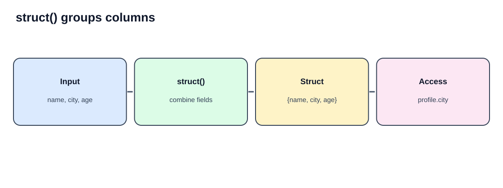
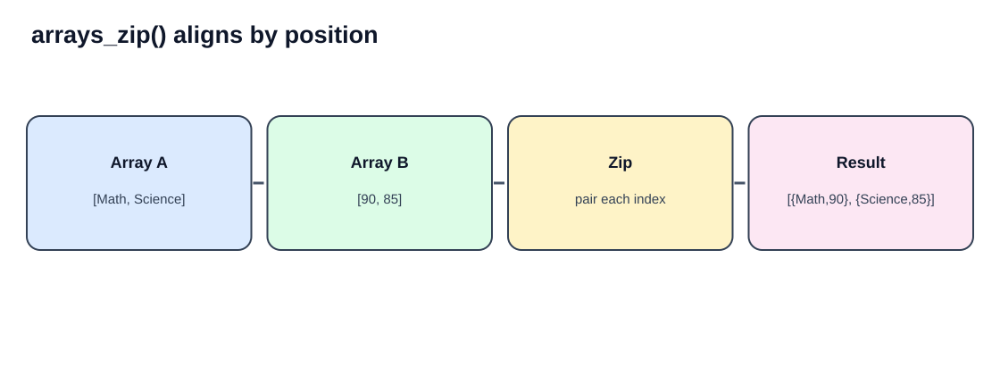
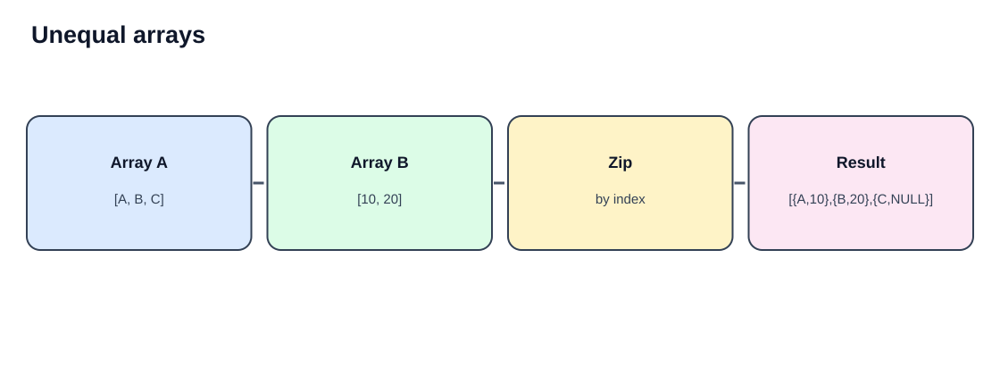
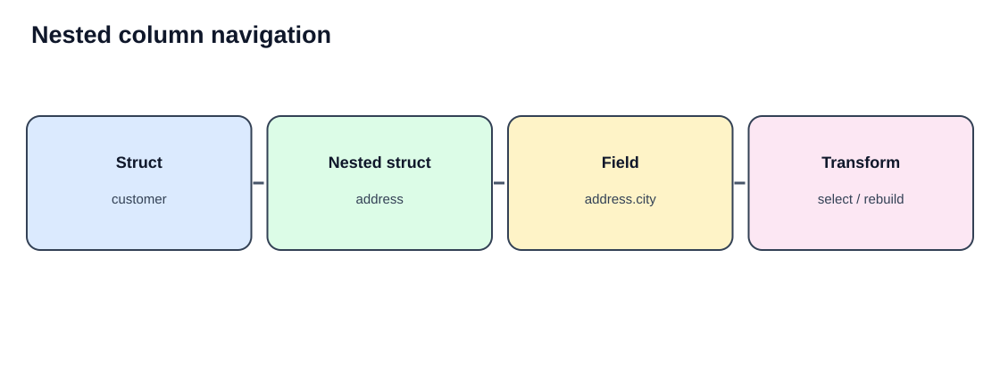
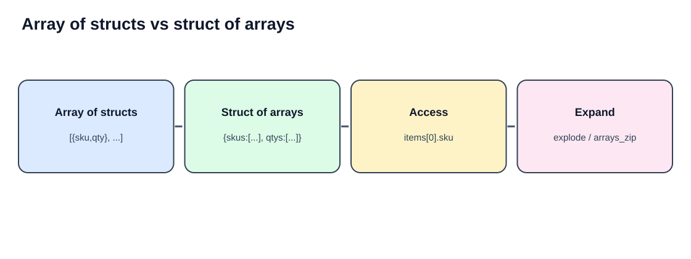

# Part 8 — Struct Functions in PySpark
## `struct()`, `arrays_zip()` and Nested Columns

**Complete learning chapter:** definitions, SVG diagrams, 30 worked examples (10 for each topic), detailed code explanations, expected outputs, ETL case study, interview questions and assignments.

## Learning objectives

In the previous chapter, we learned `ArrayType`, `StructType`, `MapType`, `explode()` and `posexplode()`. This chapter focuses on building, combining, accessing and reshaping nested columns.

| Topic | Purpose |
|---|---|
| `struct()` | Groups multiple columns into one struct column |
| `arrays_zip()` | Combines arrays position by position into an array of structs |
| Nested columns | Access, select, transform, rename and rebuild nested fields |



## Setup

```python
from pyspark.sql import SparkSession
from pyspark.sql.functions import (
    col, lit, struct, arrays_zip, explode, posexplode,
    transform, when, to_json, from_json, array, size
)
from pyspark.sql.types import (
    StructType, StructField, StringType, IntegerType,
    DoubleType, ArrayType
)

spark = (
    SparkSession.builder
    .appName("StructFunctions")
    .master("local[*]")
    .getOrCreate()
)
```

**Explanation**
- `SparkSession` is the entry point for DataFrame operations.
- `col()` references a DataFrame column as a Spark expression.
- `lit()` creates a literal expression.
- `struct()` creates one nested record from expressions.
- `arrays_zip()` aligns multiple arrays by their indexes.
- `explode()` and `posexplode()` expand array values into rows.
- `transform()` applies an expression to every array element.
- `to_json()` and `from_json()` serialize and parse nested data.

> Run the setup first. Each example is independent unless it explicitly reuses a DataFrame from an earlier example. Row ordering is not guaranteed unless `orderBy()` is used.

---

# 1. `struct()`

## Definition

`struct()` combines two or more column expressions into one **StructType column**. Think of it as grouping separate columns into one named object.

Before:

| id | name | city | age |
|---:|---|---|---:|
| 1 | Arun | Chennai | 25 |
| 2 | Bala | Bengaluru | 28 |

After creating a `profile` struct:

| id | profile |
|---:|---|
| 1 | `{Arun, Chennai, 25}` |
| 2 | `{Bala, Bengaluru, 28}` |

The nested fields can be accessed using dot notation such as `profile.name`.


### Syntax

```python
struct(
    col("column_1").alias("field_1"),
    col("column_2").alias("field_2")
).alias("struct_column")
```

The inner aliases set the struct field names. The final alias sets the outer DataFrame column name.

## `struct()` — 10 examples

### Example 1 — Create a struct from multiple columns

```python
df = spark.createDataFrame(
    [(1, "Arun", "Chennai", 25),
     (2, "Bala", "Bengaluru", 28)],
    ["id", "name", "city", "age"]
)

result = df.select(
    "id",
    struct("name", "city", "age").alias("profile")
)
result.show(truncate=False)
result.printSchema()
```

**Detailed explanation**
1. `createDataFrame()` creates a flat DataFrame.
2. `struct("name", "city", "age")` groups three columns into one nested record.
3. `alias("profile")` names the struct column.
4. `select()` returns `id` and the new struct.
5. `printSchema()` confirms `profile` is a struct containing `name`, `city` and `age`.

**Expected output**
```text
+---+----------------------+
|id |profile               |
+---+----------------------+
|1  |{Arun, Chennai, 25}   |
|2  |{Bala, Bengaluru, 28} |
+---+----------------------+
```

### Example 2 — Rename nested fields with alias()

```python
result = df.select(
    "id",
    struct(
        col("name").alias("customer_name"),
        col("city").alias("customer_city"),
        col("age").alias("customer_age")
    ).alias("customer")
)
result.show(truncate=False)
```

**Detailed explanation**
- `col("name")` references the original name column.
- `.alias("customer_name")` sets the name of that field inside the struct.
- The city and age expressions are renamed in the same way.
- `struct()` groups the three expressions.
- The outer alias names the struct `customer`.

**Expected output**
```text
+---+-----------------------------+
|id |customer                     |
+---+-----------------------------+
|1  |{Arun, Chennai, 25}          |
|2  |{Bala, Bengaluru, 28}        |
+---+-----------------------------+
```

### Example 3 — Create a struct using literal values

```python
result = df.select(
    "id",
    struct(
        col("name").alias("name"),
        lit("ACTIVE").alias("status"),
        lit("Retail").alias("segment")
    ).alias("customer_info")
)
result.show(truncate=False)
```

**Detailed explanation**
- `col("name")` changes from row to row.
- `lit("ACTIVE")` creates a constant Spark expression.
- `lit("Retail")` creates another constant expression.
- `struct()` combines dynamic and constant values in one record.
- Both rows have the same status and segment but retain their own name.

**Expected output**
```text
+---+--------------------------+
|id |customer_info             |
+---+--------------------------+
|1  |{Arun, ACTIVE, Retail}     |
|2  |{Bala, ACTIVE, Retail}     |
+---+--------------------------+
```

### Example 4 — Create a struct inside another struct

```python
df_address = spark.createDataFrame(
    [(1, "Arun", "12A", "Anna Salai", "Chennai"),
     (2, "Bala", "44B", "MG Road", "Bengaluru")],
    ["id", "name", "door_no", "street", "city"]
)

result = df_address.select(
    "id",
    struct(
        col("name").alias("name"),
        struct(
            col("door_no").alias("door_no"),
            col("street").alias("street"),
            col("city").alias("city")
        ).alias("address")
    ).alias("customer")
)
result.show(truncate=False)
result.printSchema()
```

**Detailed explanation**
1. The inner `struct()` groups door number, street and city into an `address` object.
2. The outer `struct()` groups customer name and address.
3. `customer` therefore contains `name` and `address`.
4. `address` contains its own three fields.
5. This nested shape is common in customer, employee and delivery JSON records.

**Expected output**
```text
+---+----------------------------------------------+
|id |customer                                      |
+---+----------------------------------------------+
|1  |{Arun, {12A, Anna Salai, Chennai}}             |
|2  |{Bala, {44B, MG Road, Bengaluru}}              |
+---+----------------------------------------------+
```

### Example 5 — Add a struct column using withColumn()

```python
result = df.withColumn(
    "profile",
    struct(
        col("name").alias("name"),
        col("city").alias("city"),
        col("age").alias("age")
    )
)
result.show(truncate=False)
```

**Detailed explanation**
- `withColumn()` adds a column when the name does not already exist.
- The `struct()` expression is evaluated for every row.
- Original flat columns remain in the DataFrame.
- This is useful when both the original source columns and a nested representation are needed.

**Expected output**
```text
+---+----+---------+---+----------------------+
|id |name|city     |age|profile               |
+---+----+---------+---+----------------------+
|1  |Arun|Chennai  |25 |{Arun, Chennai, 25}   |
|2  |Bala|Bengaluru|28 |{Bala, Bengaluru, 28} |
+---+----+---------+---+----------------------+
```

### Example 6 — Include a derived field inside a struct

```python
result = df.select(
    "id",
    struct(
        col("name").alias("name"),
        col("age").alias("age"),
        when(col("age") >= 27, lit("Senior"))
          .otherwise(lit("Junior"))
          .alias("age_group")
    ).alias("profile")
)
result.show(truncate=False)
```

**Detailed explanation**
- `when()` evaluates a condition for each row.
- Age 27 or above is labelled `Senior`.
- Other ages are labelled `Junior`.
- The derived expression is named `age_group`.
- `struct()` stores original and derived values together.

**Expected output**
```text
+---+-------------------------+
|id |profile                  |
+---+-------------------------+
|1  |{Arun, 25, Junior}       |
|2  |{Bala, 28, Senior}       |
+---+-------------------------+
```

### Example 7 — Access fields from a struct

```python
profile_df = df.select(
    "id",
    struct(
        col("name").alias("name"),
        col("city").alias("city"),
        col("age").alias("age")
    ).alias("profile")
)

profile_df.select(
    "id",
    col("profile.name").alias("name"),
    col("profile.city").alias("city")
).show()
```

**Detailed explanation**
- The first transformation creates a nested `profile` column.
- `col("profile.name")` accesses the name field within it.
- `col("profile.city")` accesses the city field.
- The second select exposes those fields as ordinary top-level columns.

**Expected output**
```text
+---+----+---------+
|id |name|city     |
+---+----+---------+
|1  |Arun|Chennai  |
|2  |Bala|Bengaluru|
+---+----+---------+
```

### Example 8 — Rebuild a struct after changing a field

```python
profile_df = df.select(
    "id",
    struct(
        col("name").alias("name"),
        col("city").alias("city"),
        col("age").alias("age")
    ).alias("profile")
)

updated = profile_df.withColumn(
    "profile",
    struct(
        col("profile.name").alias("name"),
        col("profile.city").alias("city"),
        (col("profile.age") + 1).alias("age")
    )
)
updated.show(truncate=False)
```

**Detailed explanation**
- DataFrames are immutable; transformations return a new DataFrame.
- The expression rebuilds the `profile` struct.
- Name and city are copied from the old struct.
- Age is incremented by one.
- `withColumn("profile", ...)` replaces the column expression in the returned DataFrame.

**Expected output**
```text
+---+----------------------+
|id |profile               |
+---+----------------------+
|1  |{Arun, Chennai, 26}   |
|2  |{Bala, Bengaluru, 29} |
+---+----------------------+
```

### Example 9 — Convert a struct to JSON text

```python
profile_df = df.select(
    "id",
    struct(
        col("name").alias("name"),
        col("city").alias("city"),
        col("age").alias("age")
    ).alias("profile")
)

profile_df.select(
    "id",
    to_json("profile").alias("profile_json")
).show(truncate=False)
```

**Detailed explanation**
- `profile` is a StructType column.
- `to_json()` serializes its nested fields into JSON text.
- The output is a string column, not a StructType column.
- This is useful at an API or file serialization boundary.

**Expected output**
```text
+---+------------------------------------------------+
|id |profile_json                                    |
+---+------------------------------------------------+
|1  |{"name":"Arun","city":"Chennai","age":25}        |
|2  |{"name":"Bala","city":"Bengaluru","age":28}      |
+---+------------------------------------------------+
```

### Example 10 — Create an array of structs

```python
result = df.select(
    "id",
    array(
        struct(lit("Python").alias("skill"), lit(4).alias("level")),
        struct(lit("SQL").alias("skill"), lit(5).alias("level"))
    ).alias("skill_details")
)
result.show(truncate=False)
result.printSchema()
```

**Detailed explanation**
- Each `struct()` creates one skill record with `skill` and `level`.
- `array()` groups the two struct values into one array.
- The result is `ArrayType(StructType(...))`.
- This structure is useful for certifications, skills, product variants and order items.

**Expected output**
```text
+---+----------------------------------+
|id |skill_details                     |
+---+----------------------------------+
|1  |[{Python, 4}, {SQL, 5}]           |
|2  |[{Python, 4}, {SQL, 5}]           |
+---+----------------------------------+
```

---

# 2. `arrays_zip()`

## Definition

`arrays_zip()` combines two or more arrays **position by position**. It returns an array whose elements are structs containing the values from the corresponding positions of the input arrays.

Example:

```text
subjects = ["Math", "Science"]
marks    = [90, 85]

arrays_zip(subjects, marks)
    = [{subjects: "Math", marks: 90},
       {subjects: "Science", marks: 85}]
```



### Syntax and behavior

```python
arrays_zip("array_column_1", "array_column_2")
```

- Arrays are aligned by index, not by matching values.
- The result is an array of structs.
- The output length is the longest input array length.
- Shorter arrays are padded with nulls at missing positions.
- Use `explode()` or `posexplode()` if each zipped pair must become a separate row.

## `arrays_zip()` — 10 examples

### Example 1 — Zip two simple arrays

```python
df = spark.createDataFrame(
    [(1, ["Math", "Science"], [90, 85])],
    ["student_id", "subjects", "marks"]
)
result = df.select(
    "student_id",
    arrays_zip("subjects", "marks").alias("subject_marks")
)
result.show(truncate=False)
```

**Detailed explanation**
1. `subjects` is an array of strings.
2. `marks` is an array of integers.
3. `arrays_zip()` pairs index zero, then index one.
4. The result is an array of structs.
5. Struct field names are derived from the input array column names.

**Expected output**
```text
+----------+--------------------------------------+
|student_id|subject_marks                         |
+----------+--------------------------------------+
|1         |[{Math, 90}, {Science, 85}]            |
+----------+--------------------------------------+
```

### Example 2 — Zip arrays of different lengths

```python
df = spark.createDataFrame(
    [(1, ["A", "B", "C"], [10, 20])],
    ["id", "codes", "quantities"]
)
df.select(
    arrays_zip("codes", "quantities").alias("zipped")
).show(truncate=False)
```

**Detailed explanation**
- The first array has three elements; the second has two.
- Spark uses the longest input length.
- The third zipped struct has code `C` and a null quantity.
- This is important when source systems send incomplete parallel arrays.

**Expected output**
```text
+--------------------------------------+
|zipped                                |
+--------------------------------------+
|[{A, 10}, {B, 20}, {C, NULL}]          |
+--------------------------------------+
```



### Example 3 — Zip three arrays

```python
df = spark.createDataFrame(
    [(101, ["PEN", "BOOK"], [2, 1], [10.0, 80.0])],
    ["order_id", "skus", "quantities", "prices"]
)
df.select(
    "order_id",
    arrays_zip("skus", "quantities", "prices").alias("items")
).show(truncate=False)
```

**Detailed explanation**
- `arrays_zip()` accepts more than two arrays.
- Position zero combines PEN, quantity 2 and price 10.0.
- Position one combines BOOK, quantity 1 and price 80.0.
- Each result element is a struct with three fields.

**Expected output**
```text
+--------+----------------------------------------------+
|order_id|items                                         |
+--------+----------------------------------------------+
|101     |[{PEN, 2, 10.0}, {BOOK, 1, 80.0}]              |
+--------+----------------------------------------------+
```

### Example 4 — Zip arrays and explode the result

```python
df = spark.createDataFrame(
    [(101, ["PEN", "BOOK"], [2, 1])],
    ["order_id", "skus", "quantities"]
)
zipped = df.select(
    "order_id",
    arrays_zip("skus", "quantities").alias("items")
)
zipped.select(
    "order_id",
    explode("items").alias("item")
).select(
    "order_id",
    col("item.skus").alias("sku"),
    col("item.quantities").alias("quantity")
).show()
```

**Detailed explanation**
1. `arrays_zip()` builds an array of paired structs.
2. `explode()` emits one struct per row.
3. `item.skus` reads the SKU field.
4. `item.quantities` reads the quantity field.
5. The result is a flat order-line table.

**Expected output**
```text
+--------+----+--------+
|order_id|sku |quantity|
+--------+----+--------+
|101     |PEN |2       |
|101     |BOOK|1       |
+--------+----+--------+
```

### Example 5 — Calculate line totals after zipping

```python
df = spark.createDataFrame(
    [(101, ["PEN", "BOOK"], [2, 1], [10.0, 80.0])],
    ["order_id", "skus", "qtys", "prices"]
)
zipped = df.select(
    "order_id",
    arrays_zip("skus", "qtys", "prices").alias("items")
)
lines = zipped.select(
    "order_id", explode("items").alias("item")
)
lines.select(
    "order_id",
    col("item.skus").alias("sku"),
    col("item.qtys").alias("quantity"),
    col("item.prices").alias("unit_price"),
    (col("item.qtys") * col("item.prices")).alias("line_total")
).show()
```

**Detailed explanation**
- The three arrays are paired by index.
- Exploding produces one row per item.
- Nested fields supply SKU, quantity and unit price.
- Multiplying quantity by unit price calculates the line total.
- Validate that the arrays represent the same source ordering before using this business calculation.

**Expected output**
```text
+--------+----+--------+----------+----------+
|order_id|sku |quantity|unit_price|line_total|
+--------+----+--------+----------+----------+
|101     |PEN |2       |10.0      |20.0      |
|101     |BOOK|1       |80.0      |80.0      |
+--------+----+--------+----------+----------+
```

### Example 6 — Zip student subjects and marks

```python
df = spark.createDataFrame(
    [(1, "Arun", ["Math", "Science", "English"], [90, 85, 88]),
     (2, "Bala", ["Math", "Science", "English"], [75, 80, 92])],
    ["student_id", "name", "subjects", "marks"]
)
zipped = df.select(
    "student_id", "name",
    arrays_zip("subjects", "marks").alias("results")
)
zipped.select(
    "student_id", "name",
    explode("results").alias("result")
).select(
    "student_id", "name",
    col("result.subjects").alias("subject"),
    col("result.marks").alias("mark")
).orderBy("student_id", "subject").show()
```

**Detailed explanation**
- Every student has a subjects array and a parallel marks array.
- `arrays_zip()` associates each subject with the mark at the same index.
- `explode()` produces one row per student-subject result.
- `orderBy()` sorts the result for a stable display.

**Expected output**
```text
+----------+----+-------+----+
|student_id|name|subject|mark|
+----------+----+-------+----+
|1         |Arun|English|88  |
|1         |Arun|Math   |90  |
|1         |Arun|Science|85  |
|2         |Bala|English|92  |
|2         |Bala|Math   |75  |
|2         |Bala|Science|80  |
+----------+----+-------+----+
```

### Example 7 — Use posexplode() to retain zipped position

```python
df = spark.createDataFrame(
    [(1, ["A", "B", "C"], [100, 200, 300])],
    ["id", "codes", "amounts"]
)
zipped = df.select(
    "id", arrays_zip("codes", "amounts").alias("pairs")
)
zipped.select(
    "id", posexplode("pairs").alias("position", "pair")
).select(
    "id",
    (col("position") + 1).alias("line_number"),
    col("pair.codes").alias("code"),
    col("pair.amounts").alias("amount")
).orderBy("line_number").show()
```

**Detailed explanation**
- `arrays_zip()` returns an array of structs.
- `posexplode()` returns each struct and its zero-based position.
- Adding one converts the index into a one-based line number.
- The fields are extracted from the generated `pair` struct.

**Expected output**
```text
+---+-----------+----+------+
|id |line_number|code|amount|
+---+-----------+----+------+
|1  |1          |A   |100   |
|1  |2          |B   |200   |
|1  |3          |C   |300   |
+---+-----------+----+------+
```

### Example 8 — Transform the zipped struct array

```python
df = spark.createDataFrame(
    [(1, ["pen", "book"], [2, 1])],
    ["id", "products", "qtys"]
)
zipped = arrays_zip("products", "qtys")
result = df.select(
    "id",
    transform(
        zipped,
        lambda x: struct(
            x["products"].alias("product"),
            x["qtys"].alias("quantity"),
            (x["qtys"] * 10).alias("points")
        )
    ).alias("product_details")
)
result.show(truncate=False)
```

**Detailed explanation**
- `arrays_zip()` first creates paired product/quantity structs.
- `transform()` applies a Spark expression to every zipped struct without exploding the array.
- `x` represents the current zipped struct.
- `x["products"]` and `x["qtys"]` read its fields.
- A new struct is created with product, quantity and calculated points.
- The result remains an array of structs.

**Expected output**
```text
+---+----------------------------------------------+
|id |product_details                               |
+---+----------------------------------------------+
|1  |[{pen, 2, 20}, {book, 1, 10}]                  |
+---+----------------------------------------------+
```

### Example 9 — Preserve null elements when zipping

```python
df = spark.createDataFrame(
    [(1, ["A", None, "C"], [10, 20, None])],
    ["id", "codes", "amounts"]
)
df.select(
    arrays_zip("codes", "amounts").alias("pairs")
).show(truncate=False)
```

**Detailed explanation**
- Both arrays have three positions.
- The null code remains null at position one.
- The null amount remains null at position two.
- `arrays_zip()` preserves positions; it does not automatically remove or replace null values.

**Expected output**
```text
+--------------------------------------+
|pairs                                 |
+--------------------------------------+
|[{A, 10}, {NULL, 20}, {C, NULL}]        |
+--------------------------------------+
```

### Example 10 — Zip arrays nested inside a struct

```python
schema = StructType([
    StructField("student_id", IntegerType(), False),
    StructField("academic", StructType([
        StructField("subjects", ArrayType(StringType()), True),
        StructField("marks", ArrayType(IntegerType()), True)
    ]), True)
])
df = spark.createDataFrame(
    [(1, (["Math", "Science"], [90, 85])),
     (2, (["Math", "Science"], [75, 80]))],
    schema
)
result = df.select(
    "student_id",
    arrays_zip(
        col("academic.subjects"),
        col("academic.marks")
    ).alias("subject_marks")
)
result.show(truncate=False)
```

**Detailed explanation**
- Both arrays are nested inside the `academic` struct.
- Dot notation selects the two nested arrays.
- `arrays_zip()` pairs their values by index.
- The result is a top-level array of structs.
- This pattern appears in nested API response objects.

**Expected output**
```text
+----------+--------------------------------------+
|student_id|subject_marks                         |
+----------+--------------------------------------+
|1         |[{Math, 90}, {Science, 85}]            |
|2         |[{Math, 75}, {Science, 80}]            |
+----------+--------------------------------------+
```

---

# 3. Nested Columns

## Definition

Nested columns contain other fields or collections. Spark commonly represents nested data using:
- `StructType` — named fields inside a record;
- `ArrayType` — a collection of values or structs;
- `MapType` — key-value attributes.

Example hierarchy:

```text
order
 ├── order_id
 ├── customer
 │    ├── name
 │    └── address
 │         ├── city
 │         └── pincode
 └── items
      └── array of item structs
```



Nested data is common in JSON, REST APIs, event streams and data lake ingestion.

## Nested columns — 10 examples

### Example 1 — Create multiple nested levels

```python
schema = StructType([
    StructField("order_id", IntegerType(), False),
    StructField("customer", StructType([
        StructField("name", StringType(), True),
        StructField("address", StructType([
            StructField("city", StringType(), True),
            StructField("pincode", IntegerType(), True)
        ]), True)
    ]), True)
])
data = [
    (1001, ("Arun", ("Chennai", 600002))),
    (1002, ("Bala", ("Bengaluru", 560001)))
]
df = spark.createDataFrame(data, schema)
df.show(truncate=False)
df.printSchema()
```

**Detailed explanation**
1. The outer schema defines the order row.
2. `customer` is a struct inside the order.
3. `address` is another struct nested inside customer.
4. City and pincode belong to the address struct.
5. The nested tuples follow the same order as the schema fields.

**Expected output**
```text
+--------+-------------------------------+
|order_id|customer                       |
+--------+-------------------------------+
|1001    |{Arun, {Chennai, 600002}}       |
|1002    |{Bala, {Bengaluru, 560001}}     |
+--------+-------------------------------+
```

### Example 2 — Access fields at multiple levels

```python
df.select(
    "order_id",
    col("customer.name").alias("customer_name"),
    col("customer.address.city").alias("city"),
    col("customer.address.pincode").alias("pincode")
).show()
```

**Detailed explanation**
- `customer.name` selects a field one level down.
- `customer.address.city` navigates through two nested structs.
- Aliases expose the values as top-level columns.
- This is often the first step in flattening a nested source.

**Expected output**
```text
+--------+-------------+---------+-------+
|order_id|customer_name|city     |pincode|
+--------+-------------+---------+-------+
|1001    |Arun         |Chennai  |600002 |
|1002    |Bala         |Bengaluru|560001 |
+--------+-------------+---------+-------+
```

### Example 3 — Filter using a nested field

```python
df.filter(
    col("customer.address.city") == "Chennai"
).select(
    "order_id",
    col("customer.name").alias("customer_name"),
    col("customer.address.city").alias("city")
).show()
```

**Detailed explanation**
- The filter navigates directly to the nested city field.
- Only records where city equals Chennai remain.
- You do not have to flatten the complete DataFrame before filtering.

**Expected output**
```text
+--------+-------------+-------+
|order_id|customer_name|city   |
+--------+-------------+-------+
|1001    |Arun         |Chennai|
+--------+-------------+-------+
```

### Example 4 — Rebuild a nested struct with a transformed value

```python
updated = df.withColumn(
    "customer",
    struct(
        col("customer.name").alias("name"),
        struct(
            col("customer.address.city").alias("city"),
            (col("customer.address.pincode") + 1).alias("pincode")
        ).alias("address")
    )
)
updated.show(truncate=False)
```

**Detailed explanation**
- The existing customer struct is replaced by a rebuilt struct expression.
- The name is copied unchanged.
- The inner address struct is also rebuilt.
- Pincode is incremented by one only to demonstrate a nested transformation.
- In real ETL, use a valid business rule instead of this illustrative arithmetic.

**Expected output**
```text
+--------+-------------------------------+
|order_id|customer                       |
+--------+-------------------------------+
|1001    |{Arun, {Chennai, 600003}}       |
|1002    |{Bala, {Bengaluru, 560002}}     |
+--------+-------------------------------+
```

### Example 5 — Rename nested fields in the target structure

```python
renamed = df.select(
    col("order_id").alias("order_number"),
    struct(
        col("customer.name").alias("full_name"),
        struct(
            col("customer.address.city").alias("city_name"),
            col("customer.address.pincode").alias("postal_code")
        ).alias("location")
    ).alias("buyer")
)
renamed.show(truncate=False)
```

**Detailed explanation**
- The top-level `order_id` is renamed to `order_number`.
- The customer struct is rebuilt under the name `buyer`.
- `name` becomes `full_name`.
- `address` becomes `location`.
- The nested city and pincode fields are renamed too.
- This shapes a target data contract without mutating the source DataFrame.

**Expected output**
```text
+------------+--------------------------------------+
|order_number|buyer                                 |
+------------+--------------------------------------+
|1001        |{Arun, {Chennai, 600002}}             |
|1002        |{Bala, {Bengaluru, 560001}}           |
+------------+--------------------------------------+
```

### Example 6 — Access an array of nested structs

```python
item_type = ArrayType(StructType([
    StructField("sku", StringType(), True),
    StructField("quantity", IntegerType(), True),
    StructField("price", DoubleType(), True)
]))
schema = StructType([
    StructField("order_id", IntegerType(), False),
    StructField("items", item_type, True)
])
df_items = spark.createDataFrame(
    [(1, [("PEN", 2, 10.0), ("BOOK", 1, 80.0)]),
     (2, [("BAG", 1, 500.0)])],
    schema
)
df_items.select(
    "order_id",
    col("items")[0].sku.alias("first_item_sku"),
    col("items")[0].quantity.alias("first_item_quantity")
).show()
```

**Detailed explanation**
- `items` is an array and each element is a struct.
- `items[0]` selects the first struct in the array.
- `.sku` and `.quantity` access fields within that struct.
- Use direct indexing when only one known position is needed. Use `explode()` when every item must become a row.

**Expected output**
```text
+--------+--------------+-------------------+
|order_id|first_item_sku|first_item_quantity|
+--------+--------------+-------------------+
|1       |PEN           |2                  |
|2       |BAG           |1                  |
+--------+--------------+-------------------+
```

### Example 7 — Explode nested array values and retain parent fields

```python
expanded = df_items.select(
    "order_id",
    posexplode("items").alias("position", "item")
)
expanded.select(
    "order_id",
    (col("position") + 1).alias("line_number"),
    col("item.sku").alias("sku"),
    col("item.quantity").alias("quantity"),
    col("item.price").alias("price")
).orderBy("order_id", "line_number").show()
```

**Detailed explanation**
- `posexplode()` creates one row per item and returns its original position.
- The parent `order_id` is retained.
- Adding one converts the zero-based position to a one-based line number.
- Dot notation extracts SKU, quantity and price from the item struct.
- `orderBy()` makes the output easy to read.

**Expected output**
```text
+--------+-----------+----+--------+-----+
|order_id|line_number|sku |quantity|price|
+--------+-----------+----+--------+-----+
|1       |1          |PEN |2       |10.0 |
|1       |2          |BOOK|1       |80.0 |
|2       |1          |BAG |1       |500.0|
+--------+-----------+----+--------+-----+
```

### Example 8 — Build a compact nested summary from an array

```python
target = df_items.select(
    "order_id",
    struct(
        col("items")[0].sku.alias("primary_sku"),
        col("items")[0].quantity.alias("primary_quantity"),
        col("items")[0].price.alias("primary_price")
    ).alias("primary_item")
)
target.show(truncate=False)
```

**Detailed explanation**
- The first item struct is selected from each array.
- Its SKU, quantity and price fields are extracted.
- `struct()` groups these fields into one `primary_item` object.
- This is useful when a target model needs a compact summary of the first item.
- If the array is empty or null, the nested expressions evaluate to null.

**Expected output**
```text
+--------+----------------------+
|order_id|primary_item          |
+--------+----------------------+
|1       |{PEN, 2, 10.0}         |
|2       |{BAG, 1, 500.0}       |
+--------+----------------------+
```

### Example 9 — Serialize nested data to JSON

```python
json_output = df_items.select(
    "order_id",
    to_json(struct(col("items").alias("items"))).alias("payload")
)
json_output.show(truncate=False)
```

**Detailed explanation**
- The outer `struct()` creates an object with an `items` field.
- `to_json()` serializes the struct and nested array of structs into JSON text.
- The result column is a string.
- This is useful when sending a nested payload to an API or message queue.

**Expected output (JSON formatting may vary)**
```text
+--------+----------------------------------------------------------------------------------+
|order_id|payload                                                                           |
+--------+----------------------------------------------------------------------------------+
|1       |{"items":[{"sku":"PEN","quantity":2,"price":10.0},{"sku":"BOOK","quantity":1,"price":80.0}]}|
|2       |{"items":[{"sku":"BAG","quantity":1,"price":500.0}]}                               |
+--------+----------------------------------------------------------------------------------+
```

### Example 10 — Parse JSON and flatten selected nested fields

```python
raw = spark.createDataFrame(
    [(1, '{"customer":{"name":"Arun","city":"Chennai"},"preferences":{"channels":["email","sms"]}}'),
     (2, '{"customer":{"name":"Bala","city":"Bengaluru"},"preferences":{"channels":["app"]}}')],
    ["id", "payload"]
)

schema = StructType([
    StructField("customer", StructType([
        StructField("name", StringType(), True),
        StructField("city", StringType(), True)
    ]), True),
    StructField("preferences", StructType([
        StructField("channels", ArrayType(StringType()), True)
    ]), True)
])

parsed = raw.withColumn("data", from_json("payload", schema))
result = parsed.select(
    "id",
    col("data.customer.name").alias("customer_name"),
    col("data.customer.city").alias("city"),
    col("data.preferences.channels").alias("channels")
)
result.show(truncate=False)
```

**Detailed explanation**
1. `raw` contains one JSON string per source record.
2. The schema describes the nested customer and preferences objects.
3. `from_json()` parses the string into a typed struct column.
4. Dot notation selects customer name, city and the nested channels array.
5. The result is partially flattened: scalar fields are top-level, while channels remains an array.

**Expected output**
```text
+---+-------------+---------+--------------+
|id |customer_name|city     |channels      |
+---+-------------+---------+--------------+
|1  |Arun         |Chennai  |[email, sms]  |
|2  |Bala         |Bengaluru|[app]         |
+---+-------------+---------+--------------+
```

---

# 4. Important comparisons

## `struct()` vs `arrays_zip()`

| Feature | `struct()` | `arrays_zip()` |
|---|---|---|
| Input | Multiple column expressions | Two or more arrays |
| Behavior | Groups values from one row | Pairs values at matching indexes |
| Output | One struct value per row | Array of structs per row |
| Position-sensitive | No | Yes |
| Typical use | Customer/address object | SKU and quantity pairing |

```text
struct(name, city)
    -> {name: "Arun", city: "Chennai"}

arrays_zip(skus, quantities)
    -> [{sku: "PEN", qty: 2}, {sku: "BOOK", qty: 1}]
```

## Array of structs vs struct containing arrays



**Array of structs:** each element is one complete record.

```text
items = [
  {sku: "PEN", qty: 2},
  {sku: "BOOK", qty: 1}
]
```

**Struct containing arrays:** fields hold separate collections.

```text
items = {
  skus: ["PEN", "BOOK"],
  quantities: [2, 1]
}
```

The second structure is a typical use case for `arrays_zip()`: align parallel arrays and turn them into an array of item structs.

## Unequal arrays


If arrays have different lengths, `arrays_zip()` pads missing positions in shorter arrays with null. It does not truncate to the shortest array. Validate lengths if mismatches indicate a source data-quality issue.

---

# 5. Real-world ETL case study — Build order-line objects

A source system stores product codes, quantities and prices in parallel arrays. The target system expects one nested array of line-item structs.

```python
source = spark.createDataFrame(
    [
        (1001, ["PEN", "BOOK"], [2, 1], [10.0, 80.0]),
        (1002, ["BAG"], [1], [500.0])
    ],
    ["order_id", "skus", "quantities", "prices"]
)

prepared = source.withColumn(
    "items",
    arrays_zip("skus", "quantities", "prices")
)

target = prepared.select(
    "order_id",
    struct(
        col("order_id").alias("id"),
        col("items").alias("line_items")
    ).alias("order")
)
target.show(truncate=False)
target.printSchema()
```

**Expected output**
```text
+--------+---------------------------------------------------------------+
|order_id|order                                                          |
+--------+---------------------------------------------------------------+
|1001    |{1001, [{PEN, 2, 10.0}, {BOOK, 1, 80.0}]}                       |
|1002    |{1002, [{BAG, 1, 500.0}]}                                      |
+--------+---------------------------------------------------------------+
```

### Walkthrough

1. The source has one row per order.
2. SKU, quantity and price are stored in parallel arrays.
3. `arrays_zip()` aligns values by index and creates an array of structs.
4. `struct()` groups the order ID and item array into one nested order object.
5. The result is a typed target structure that can be serialized to JSON or written to a nested data format.

### Validate parallel array lengths

```python
checked = source.select(
    "order_id",
    size("skus").alias("sku_count"),
    size("quantities").alias("quantity_count"),
    size("prices").alias("price_count")
)

checked.withColumn(
    "arrays_match",
    (col("sku_count") == col("quantity_count")) &
    (col("sku_count") == col("price_count"))
).show()
```

**Expected output**
```text
+--------+---------+--------------+-----------+------------+
|order_id|sku_count|quantity_count|price_count|arrays_match|
+--------+---------+--------------+-----------+------------+
|1001    |2        |2             |2          |true        |
|1002    |1        |1             |1          |true        |
+--------+---------+--------------+-----------+------------+
```

`arrays_zip()` pads shorter arrays with nulls. A production pipeline should decide whether mismatched lengths are rejected, quarantined or accepted with nulls.

---

# 6. Performance, best practices and common mistakes

## Best practices

- Use explicit schemas for production nested data.
- Give nested fields meaningful aliases.
- Use `struct()` to create a clear target schema.
- Use `arrays_zip()` only when arrays are positionally related.
- Validate parallel array lengths when they represent corresponding business records.
- Keep parent identifiers when exploding nested arrays.
- Select only required nested fields.
- Use `printSchema()` to inspect unfamiliar structures.
- Keep data as typed nested columns during Spark transformations; serialize with `to_json()` at system boundaries.
- Preserve all required fields when rebuilding structs.

## Common mistakes

1. Assuming `struct()` creates an array. It creates one struct value per input row.
2. Assuming `arrays_zip()` matches values by content. It matches by position.
3. Forgetting that `arrays_zip()` returns an array of structs.
4. Assuming unequal arrays are truncated to the shortest length. Shorter arrays are padded with nulls.
5. Rebuilding a struct and accidentally dropping fields that were not included in the new struct.
6. Using an incorrect nested field path.
7. Confusing an array of structs with a struct containing arrays.
8. Converting nested data to JSON too early and losing convenient typed access.
9. Exploding before filtering and generating unnecessary rows.
10. Failing to validate that parallel arrays represent the same logical records.

---

# 7. Interview questions

## Easy
1. What does `struct()` do in PySpark?
2. What is the return type of `struct()`?
3. How do you rename a field inside a struct?
4. How do you access a nested struct field?
5. What does `arrays_zip()` do?
6. What is the return type of `arrays_zip()`?
7. Does `arrays_zip()` pair values by content or by position?
8. What is a nested column?
9. How do you inspect a nested schema?
10. What is the difference between a struct and an array?

## Medium
11. How do you create a nested struct using `struct()`?
12. How do you rebuild a struct after changing one nested value?
13. How do you create an array of structs?
14. How do you zip three arrays?
15. What happens when arrays passed to `arrays_zip()` have unequal lengths?
16. How do you explode an array returned by `arrays_zip()`?
17. How do you use `posexplode()` with zipped arrays?
18. How do you convert a nested struct to JSON?
19. How do you parse JSON into nested columns?
20. How do you preserve parent identifiers while flattening nested data?

## Hard
21. Compare `struct()` and `arrays_zip()` with practical examples.
22. Explain array-of-structs versus struct-of-arrays.
23. How would you validate parallel arrays before zipping?
24. What happens to null elements during `arrays_zip()`?
25. How would you transform a deeply nested struct while retaining unrelated fields?
26. Design a nested target schema for an e-commerce order.
27. How can nested field projection reduce unnecessary data processing?
28. How would you handle schema changes in a nested JSON source?
29. What are the risks of exploding zipped arrays with mismatched lengths?
30. Design an ETL pipeline that converts parallel source arrays into a nested order object.

---

# 8. Practical assignments

## Assignment 1 — Employee profile struct
Create a DataFrame with employee ID, name, department, city and salary. Use `struct()` to create an employee profile, nested contact struct, derived salary band and a flattened output.

## Assignment 2 — Student marks with arrays_zip()
Create parallel arrays for subjects, marks and maximum marks. Zip them, explode the result, calculate percentage per subject, identify subjects below 50%, and preserve original subject position.

## Assignment 3 — E-commerce order transformation
Create source orders with arrays of SKUs, quantities and prices. Use `arrays_zip()` to create item structs, then use `struct()` to create an order object. Validate array lengths and calculate line totals.

## Assignment 4 — Nested JSON transformation
Parse JSON containing customer, address, preferences and item arrays. Rename selected nested fields, derive a new field, preserve required nested data and serialize the final result as JSON.

## Assignment 5 — Production-style data quality
Build a dataset with equal-length arrays, unequal-length arrays, null arrays, arrays containing null elements and empty arrays. Use `size()`, null checks and `arrays_zip()` to classify valid and invalid records. Explain the handling strategy for each case.

---

# 9. Final revision

- **`struct()`** groups multiple expressions into one nested struct value.
- **`arrays_zip()`** aligns arrays by index and returns an array of structs.
- **Nested columns** are accessed through paths such as `customer.address.city`.
- **Array of structs** stores a collection of complete records.
- **Struct of arrays** stores parallel collections inside one record.
- **Data-quality rule:** validate parallel array lengths when they represent corresponding business records.
- **ETL rule:** build typed nested columns during transformations and serialize to JSON only when needed.

## Next suggested chapter

**Nested JSON Processing and Flattening in PySpark** — `from_json()`, `to_json()`, `schema_of_json()`, `get_json_object()`, nested schema design, schema evolution, malformed records and production JSON ETL.
